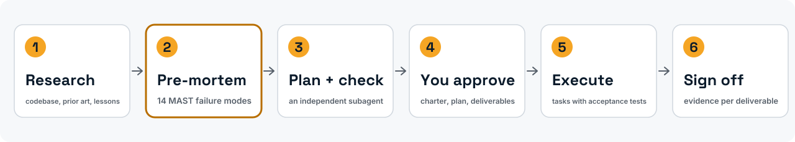
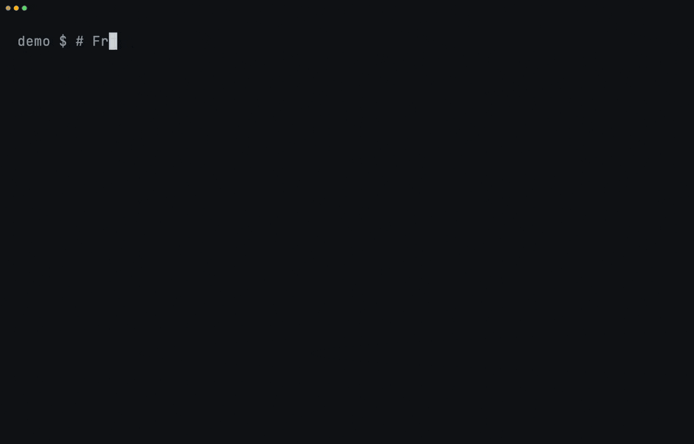
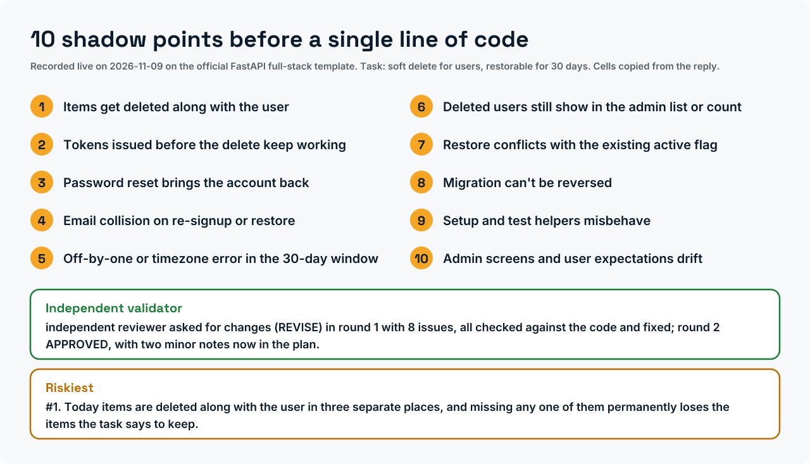
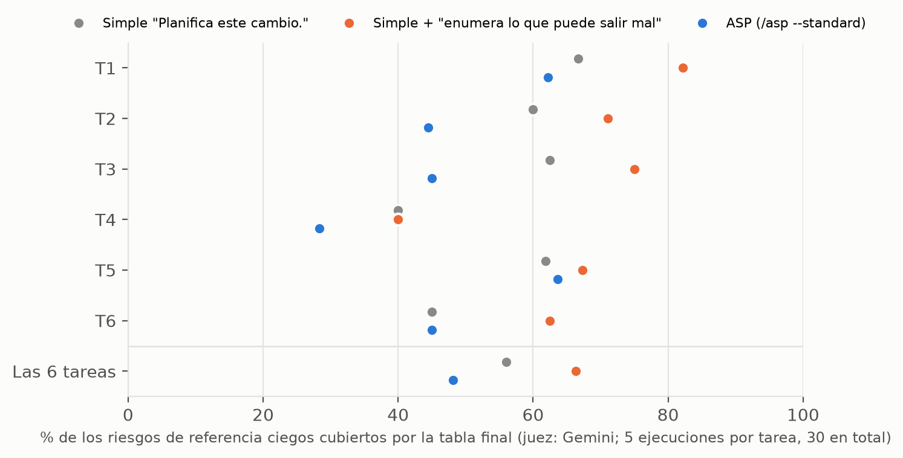

<div align="center">

<picture>
  <source media="(prefers-color-scheme: dark)" srcset="assets/brand/banner-dark.svg">
  
</picture>

<h3>Un pre-mortem para tu agente de código, y una prueba medida de si ayuda.</h3>

[](https://doi.org/10.5281/zenodo.20276631)
[](LICENSE)
[](LICENSES/CC-BY-4.0.txt)
[](pyproject.toml)
[](tests/)
[](output/hash-chain.md)
[](https://colab.research.google.com/github/ulissesflores/anticipating-shadow-points/blob/main/colab/replication.ipynb)
[](plugins/anticipating-shadow-points/)

[English](README.md) · [Português (Brasil)](README.pt-BR.md) · **Español** · [Italiano](README.it.md) · [עברית](README.he.md)

*Traducido del README en inglés de la v2.0.0; el archivo en inglés es el canónico.*

*Traducción asistida por máquina; se agradece la revisión de hablantes nativos.*

</div>

<picture>
  <source media="(prefers-color-scheme: dark)" srcset="assets/brand/phases-dark.svg">
  
</picture>

<p align="center">Instálalo en Claude Code:</p>

```text
/plugin marketplace add ulissesflores/anticipating-shadow-points
/plugin install anticipating-shadow-points@anticipating-shadow-points
```

<p align="center"></p>

<picture>
  <source media="(prefers-color-scheme: dark)" srcset="assets/brand/plan-card-dark.svg">
  
</picture>
<p align="center"><sub>Grabado en vivo: ASP instalado desde su marketplace en una configuración limpia de Claude Code y ejecutado sobre la plantilla oficial full-stack de FastAPI (248 archivos). La espera de tres minutos se reproduce 13× más rápido, como indica la etiqueta, y las pausas sin actividad de la instalación se acortaron; nada es una repetición. <a href="assets/demo/live/">Cómo se grabó</a>.</sub></p>

> [!IMPORTANT]
> **Hallazgo: exit 0 no es éxito.** `claude -p` devuelve exit code 0 cuando el agente rechaza amablemente la tarea, sin ninguna marca de rechazo legible por máquina en el sobre JSON. En una suite fija de 50 prompts diseñados para provocar rechazos (Claude Code 2.1.200, julio de 2026), **24 de 50 terminaron con exit code 0, todos ellos con `stop_reason: end_turn`**, y **entre 12 y 20 de esos fueron rechazos**: del 24% al 40% de la suite, según cómo se cuente un rechazo. Un wrapper de shell que confíe en `$?` los lee todos como éxito.
>
> **Medido: el protocolo completo de ASP no superó una petición de una frase.** En un estudio prerregistrado (90 ejecuciones en seis repositorios públicos, Claude Opus 5.5, dos jueces ciegos de otros proveedores), `/asp --standard` cubrió el **48%** de los riesgos que nombraron revisores independientes, frente al **66%** de Claude Code simple con la petición *"Before planning, list the ways this change could go wrong."* (antes de planificar, enumera lo que puede salir mal), por detrás en las seis tareas: sin beneficio medible. Esa frase, por sí sola, subió la cobertura del **56% al 66%** frente a un simple "Plan this change." (p ≤ 0,0014 con ambos jueces). Era una comparación secundaria fijada antes de los datos, en un modelo y seis tareas; está previsto un estudio confirmatorio con ella como pregunta principal. [Protocolo, datos y registro](benchmark/study-2026-11/).

## Los artículos

| Artículo | DOI | PDF (DOCX al lado) |
|---|---|---|
| *ASP: an operational pre-mortem skill for LLM coding agents*, whitepaper, versión 2.3 | [10.5281/zenodo.24065969](https://doi.org/10.5281/zenodo.24065969) | [en](docs/paper/asp-preprint.en.pdf) · [pt-BR](docs/paper/asp-preprint.pt-BR.pdf) · [es](docs/paper/asp-preprint.es.pdf) · [it](docs/paper/asp-preprint.it.pdf) |
| *Graceful refusals as unsignalled failures*, nota técnica, versión 2.3 | [10.5281/zenodo.24065935](https://doi.org/10.5281/zenodo.24065935) | [en](docs/paper/graceful-refusals.en.pdf) · [pt-BR](docs/paper/graceful-refusals.pt-BR.pdf) · [es](docs/paper/graceful-refusals.es.pdf) · [it](docs/paper/graceful-refusals.it.pdf) |

Ambos son informes técnicos, sin revisión por pares, cada uno con su propio registro en Zenodo. Las fuentes en Markdown están en [`paper/`](paper/) y el SHA-256 de cada edición en [`paper/PAPER-SHA256.txt`](paper/PAPER-SHA256.txt). Los lectores de hebreo cuentan con la edición en inglés.

## Qué aporta

1. **Un protocolo de planificación que puedes instalar.** Trece fases: investigación, un pre-mortem de Klein forzado a través de los 14 modos de fallo multiagente de MAST, un subagente validador independiente, un contrato de tareas con pruebas de aceptación y una firma de entregables. Doce "Iron Laws" impiden que el agente se salte pasos.
2. **Un fallo medido en un patrón común de harness.** `claude -p` sale con código 0 ante un rechazo amable. La medición, sus cuatro lecturas y una receta de parseo defensivo están en [`paper/graceful-refusals.md`](paper/graceful-refusals.md); la receta está integrada en la fase de ejecución de la skill.
3. **Una prueba prerregistrada del propio protocolo, publicada tal como salió.** Tres condiciones, seis repositorios fijados, listas de referencia y jueces ciegos de otros proveedores, cada ejecución y cada veredicto encadenados en un registro de hashes con prueba en OpenTimestamps. El protocolo perdió frente a una petición de una frase; la frase es el hallazgo. Ver [Resultados](#resultados).
4. **Cada número publicado como un test.** `python run_all.py` vuelve a derivar los números a partir de datos confirmados en el repositorio, verifica cada uno con una aserción y sella código, tests, datos y resultados bajo un único chain hash SHA-256.

## De un vistazo

| | |
|---|---|
| Qué es | Plugin de Claude Code (skill + comando `/asp`), más una capa de replicación en Python |
| Instalación | `claude plugin marketplace add ulissesflores/anticipating-shadow-points` |
| Requisitos de ejecución | Claude Code, `bash`, `jq` |
| Requisitos de replicación | Python 3.11+, `matplotlib`, `pytest`; sin llamadas a modelos, unos 10 segundos |
| Evidencia | 2 × 50 transcripciones de `claude -p` (mayo y julio de 2026); 90 ejecuciones conservadas del estudio de 2026-11 sobre ASP, con los veredictos de ambos jueces |
| Permisos | La skill nunca fija un modo de permisos; la sesión hija opcional de `--goal` se ejecuta con tu propia configuración |

## Velo en acción

| Replica cada número sin conexión | El fallo, a partir de evidencia registrada |
|---|---|
|  |  |

Ambos son reproducciones de archivos confirmados en el repositorio, guionizadas con [vhs](https://github.com/charmbracelet/vhs) en [`assets/demo/`](assets/demo/). Ninguno llama a un modelo.

## Inicio rápido

### Usar el plugin

```bash
claude plugin marketplace add ulissesflores/anticipating-shadow-points
claude plugin install anticipating-shadow-points@anticipating-shadow-points
```

Luego, en cualquier sesión de Claude Code: `/anticipating-shadow-points:asp <your task>`. Flags de profundidad: `--quick` (sin validador, sin ejecución autónoma), `--standard` (predeterminado), `--paranoid`.

Lo que el plugin hace en tu máquina está en [su README](plugins/anticipating-shadow-points/README.md).

Tres formas de instalar:

| Vía | Comando | Invocación |
|---|---|---|
| Marketplace de plugins (recomendada) | los dos comandos de arriba | `/anticipating-shadow-points:asp` |
| Solo la sesión, desde un clon | `claude --plugin-dir /path/to/anticipating-shadow-points/plugins/anticipating-shadow-points` | `/anticipating-shadow-points:asp` |
| Script independiente | `./scripts/verify.sh --pre-install && ./scripts/install.sh` | `/asp` |

<details>
<summary><b>Solución de problemas</b></summary>

- **`claude plugin install` falla con SSH permission denied.** Tu git reescribe las URL de GitHub a SSH y no tienes ninguna clave registrada. Solución única: `git config --global url."https://github.com/".insteadOf "git@github.com:"`.
- **`/asp` funciona pero `/anticipating-shadow-points:asp` no, o al revés.** Provienen de vías de instalación distintas (independiente vs plugin) y pueden coexistir.
- **El nombre del plugin aparece dos veces (`name@marketplace`).** El repositorio es su propio marketplace, así que ambas mitades son la misma cadena.
- **La fase autónoma se detiene por una denegación de permiso.** Es intencional. ASP no pasa ningún flag de permisos al hijo `claude -p`; todo lo que tu configuración no permita ya se deniega en modo no interactivo, y la skill lo reporta en lugar de reintentar con más permisos.

</details>

#### Cuándo recurrir a ASP

Úsalo para migraciones, despliegues con dependencias externas, refactors que abarcan muchos archivos, cambios en políticas de acceso, decisiones de arquitectura e investigaciones de causa raíz. Sáltalo para correcciones de erratas, ediciones de una línea y preguntas de solo lectura.

### Replicar los papers

```bash
git clone https://github.com/ulissesflores/anticipating-shadow-points
cd anticipating-shadow-points
python3 -m venv .venv && .venv/bin/pip install -r requirements.txt
.venv/bin/python run_all.py
```

Salida esperada:

```text
== results: analysis/results.py
results -> output/results.json | July author 20/50, codebook 19/50, detector 9/50
== study results: benchmark/study-2026-11/analyze.py results 5
study -> benchmark/study-2026-11/results.json | coverage ASP 48.1%, list-what-could-go-wrong 66.3%, plain 56.0% | primary: no measurable benefit
== figures: analysis/make_figures.py
figures -> output/figures (3 x PNG+SVG, plus pt-BR, es, it editions)
== tests: -m pytest -q tests
.................................................                        [100%]
== benchmark tests: -m pytest -q -o addopts= -c benchmark/pyproject.toml benchmark/tests
...............................                                          [100%]
31 passed in <seconds>s
== provenance: make_provenance.py
provenance written: chain_hash <64 hex characters>
== verify: make_provenance.py --verify
provenance verified: chain_hash <the same 64 hex characters>
run_all OK: results reproduced, tests passed, provenance verified
```

## Resultados

### Exit code de `claude -p` ante un rechazo amable

| Instantánea | CLI | Modelo que respondió | Exit 0 | Rechazos con exit 0 | Lectura |
|---|---|---|---|---|---|
| 2026-05-18 | 2.1.143 | Opus 4.7 | 36/50 | **30/50 (60%)** | detector de frases bloqueado |
| 2026-07-08 | 2.1.200 | Fable 5 (34), Opus 4.8 (16, incl. los 12 prompts de seguridad) | 24/50 | **9/50 (18%)** | el mismo detector de frases bloqueado |
| | | | | **12/50 (24%)** | solo rechazos inequívocos |
| | | | | **19/50 (38%)** | mayoría de 5 evaluadores ciegos, libro de códigos |
| | | | | **20/50 (40%)** | etiqueta del autor |


Las ejecuciones de mayo y julio difieren en modelo y CLI, de modo que la caída del 60% al 18% con el mismo detector es un cambio de objetivo, no una tendencia. En julio, cada uno de los 24 ensayos con exit 0 llevaba `stop_reason: end_turn`; el único `stop_reason: refusal` fue un bloqueo del lado del servidor, y salió con código 1.

### Efecto de ASP sobre los planes: el estudio de 2026-11

Prerregistrado en [`benchmark/study-2026-11/PROTOCOL.md`](benchmark/study-2026-11/PROTOCOL.md) y sellado en el tiempo antes de la ejecución 1. Cómo se hizo:
- **Tareas:** seis peticiones de cambio en seis repositorios públicos, cada uno fijado en un commit.
- **Condiciones:** tres, todas en modo plan, todas con la misma tabla final de como máximo diez riesgos.
- **Ejecuciones:** 5 por tarea y condición, 90 en total, con Claude Opus 5.5.
- **Listas de referencia:** escritas a ciegas por Grok, GPT-OSS 120B y Gemini 3.8 Flash. Un riesgo cuenta cuando al menos dos lo nombran.
- **Puntuación:** un juez ciego de otro proveedor (Gemini el principal, Grok el segundo) lee solo las filas de la tabla, con las palabras que revelarían la condición borradas.

| Condición | Riesgos cubiertos (Gemini) | (Grok) | Tiempo por ejecución |
|---|---|---|---|
| Simple: "Plan this change." | 56% | 57% | 58 s |
| Simple + "Before planning, list the ways this change could go wrong." | **66%** | **70%** | 50 s |
| ASP: `/asp --standard`, detenido tras el plan validado | 48% | 54% | 175 s |



- **Primario, prerregistrado:** ASP menos la petición de una frase = −18 puntos (Gemini) y −16 (Grok), negativo en 6 de 6 tareas, permutación p = 1,0. La regla de decisión fijada de antemano dice *sin beneficio medible*.
- **Secundario, prerregistrado:** la frase menos la petición simple = +10 puntos (p = 0,0014) y +13 (p = 0,0001).
- **Exploratorio:**
  - Las respuestas de ASP tratan algunos riesgos dentro del plan y no en la tabla final. Juzgar la respuesta completa reduce la diferencia a −8 puntos (66% frente a 74%), con ASP aún por detrás en 5 de 6 tareas.
  - Los dos jueces coinciden en el 91,9% de 855 decisiones por ítem.
  - Las 90 ejecuciones terminaron con éxito y ninguna cambió un archivo del proyecto.
- **Cambiado antes de la recogida, y por qué:** el matcher léxico fijado primero no veía que dos revisores nombraban el mismo problema (0% a 46% de acuerdo), así que un juez ciego lo sustituyó. Se informan ambos; el matcher da casi cero en todo.

Evidencia anterior, conservada para el registro y ya no usada:

| Evidencia | Qué es | Qué respalda |
|---|---|---|
| Lectura del autor de 8 planes de subagentes (5 GREEN, 3 RED), 2026-05-17 ([resumen](tests/evals-summary.md)) | Juicio no ciego contra listas escritas por el autor; RED cerca del 47%, GREEN cerca del 100%; transcripciones no conservadas | Una observación, no una medición |
| Ejecución de benchmark simulado (mock), 2026-05-18 | El matcher determinista puntuando fixtures que el autor escribió para ejercitarlo: RED 4%, GREEN 80% | Nada sobre ASP. Muestra que el matcher discrimina entre tareas: 80% sobre la lista propia de un fixture, 0,5% sobre las listas de otras tareas |


## Qué se afirma y qué no

| | |
|---|---|
| **Afirmado** | `claude -p` salió con 0 y `stop_reason: end_turn` en rechazos corteses en dos instantáneas fechadas; en el estudio de 2026-11, el protocolo de ASP cubrió menos riesgos de los revisores que una petición simple que los pide, y esa petición de una frase cubrió más que un simple "planifica este cambio" (secundario, prerregistrado); cada recuento anterior se sigue de forma determinista de archivos versionados |
| **No afirmado** | Una tasa base de fallo silencioso en tráfico real de agentes (la suite se construyó para provocar rechazos); que la caída del 60% al 18% sea una tendencia; que ASP mejore los planes o los resultados en el mundo real (el estudio de 2026-11 no encontró beneficio en la cobertura de riesgos); que el efecto de la frase valga más allá de un modelo, seis tareas y listas escritas por modelos, o que más riesgos enumerados signifiquen mejor código (no medido); que las puntuaciones de fixtures del 80%/4% digan algo sobre ASP |
| **Congelado** | Las transcripciones y los veredictos de los jueces. Los modelos que los produjeron no pueden fijarse para siempre; volver a ejecutar da una nueva instantánea, no una replicación |

Las versiones 1.0.0 a 1.0.3 (mayo de 2026) hicieron afirmaciones que la versión 2.0.0 retira; cada una figura en el [CHANGELOG](CHANGELOG.md). Método completo y límites: [`REPRODUCIBILITY.md`](REPRODUCIBILITY.md). El protocolo, las tareas, las listas de referencia, las 90 ejecuciones, los veredictos y el registro de hashes del estudio están en [`benchmark/study-2026-11/`](benchmark/study-2026-11/). Un estudio confirmatorio con la petición de una frase como pregunta principal es lo siguiente en la [hoja de ruta](ROADMAP.md).

## Integridad

`output/hash-chain.md` contiene un único `chain_hash` SHA-256 sobre cinco hojas: código, tests, entradas congeladas, datos y resultados derivados. Para comprobar que nada ha cambiado desde que se selló:

```bash
python3 make_provenance.py --verify
```

Solo necesita la biblioteca estándar. La CI lo ejecuta antes de instalar nada y luego ejecuta `run_all.py` en Python 3.11 y 3.12.

<a id="install"></a>

## Estructura

```text
.claude-plugin/        marketplace manifest (points at the plugin folder)
plugins/anticipating-shadow-points/
                       the plugin itself, and all that an install copies: skill (protocol, Iron Laws,
                       templates, 5 evals), /asp command, icon, README, LICENSE. Markdown only
colab/                 replication.ipynb: verifica el sello y replica en el navegador (Google Colab)
paper/                 the two papers (Markdown source), PAPER-SHA256.txt and paper/tools/ (house-format build)
analysis/              derivation of every published number, figures, redacted extractor
data/                  July 2026 redacted extract, labels, codebook
tests/                 paper-number and determinism tests; iron-law-11/ holds the May 2026 run
benchmark/             RED/GREEN benchmark package and its committed May 2026 run
output/                results.json, hash-chain.md, provenance.json, figures/
assets/                icon, demo GIFs and their vhs scripts
docs/                  architecture notes and docs/findings.md
README.*.md            this README in Portuguese (Brazil), Spanish, Italian and Hebrew
.github/               CI, contributing guide, code of conduct, security policy
docs/paper/            PDF and DOCX editions of both papers (en, pt-BR, es, it)
run_all.py             single entry point: results -> figures -> tests -> seal -> verify
make_provenance.py     build or --verify the SHA-256 chain
```

Lecturas adicionales: [resultados](docs/findings.md) · [arquitectura e historia del diseño](docs/ARCHITECTURE.md) · [la skill y sus 12 Iron Laws](plugins/anticipating-shadow-points/skills/anticipating-shadow-points/SKILL.md) · [las 5 evaluaciones](plugins/anticipating-shadow-points/skills/anticipating-shadow-points/evals/) · [cómo contribuir](.github/CONTRIBUTING.md) · [política de seguridad](.github/SECURITY.md) · [registro de cambios](CHANGELOG.md) · [hoja de ruta](ROADMAP.md).

## Autor

**Carlos Ulisses Flores** — CTO e Investigador Principal, Codex Hash Research Laboratory, São Paulo, Brasil.

[](https://orcid.org/0000-0002-6034-7765)
[](https://ulissesflores.com)
[](http://lattes.cnpq.br/6905246706890561)

La síntesis de investigación, la redacción y los scripts de verificación se produjeron con Claude (Anthropic) bajo la dirección del autor; cada número de los papers se deriva mediante código de este repositorio.

## Cita

Cita el **DOI de concepto** para referirte a ASP en general; siempre apunta a la última versión. Cita un **DOI de versión** para fijar los archivos exactos que usaste. El DOI de versión de v2.0.0 es [10.5281/zenodo.24090006](https://doi.org/10.5281/zenodo.24090006).

```bibtex
@software{flores_asp_2026,
  author    = {Flores, Carlos Ulisses},
  title     = {{ASP — Anticipating Shadow Points}},
  year      = {2026},
  version   = {2.0.0},
  publisher = {Zenodo},
  doi       = {10.5281/zenodo.20276631},
  url       = {https://doi.org/10.5281/zenodo.20276631}
}
```

Para citar un artículo, usa su propio DOI:

```bibtex
@techreport{flores_asp_report_2026,
  author      = {Flores, Carlos Ulisses},
  title       = {ASP: An Operational Pre-Mortem Skill for LLM Coding Agents — An Experience Report},
  year        = {2026},
  institution = {Codex Hash Research Laboratory},
  type        = {Whitepaper, version 2.3},
  doi         = {10.5281/zenodo.24065969}
}

@techreport{flores_graceful_refusals_2026,
  author      = {Flores, Carlos Ulisses},
  title       = {Graceful Refusals as Unsignalled Failures: Characterising claude -p Exit-Code Semantics on Agent Declines},
  year        = {2026},
  institution = {Codex Hash Research Laboratory},
  type        = {Technical note, version 2.3},
  doi         = {10.5281/zenodo.24065935}
}
```

El botón "Cite this repository" de GitHub lee [`CITATION.cff`](CITATION.cff), que también lista las referencias metodológicas que conviene citar junto con ASP.

## Licencia

Código bajo [MIT](LICENSE). Papers, figuras, datos y prosa bajo [CC BY 4.0](LICENSES/CC-BY-4.0.txt). El mapa archivo por archivo está en [`NOTICE`](NOTICE).

## Referencias ancla

- Klein, G. (2007). Performing a project premortem. *Harvard Business Review*, 85(9), 18–19.
- Mitchell, D. J., Russo, J. E., & Pennington, N. (1989). Back to the future: Temporal perspective in the explanation of events. *Journal of Behavioral Decision Making*, 2(1), 25–38. https://doi.org/10.1002/bdm.3960020103
- Cemri, M., et al. (2025). *Why do multi-agent LLM systems fail?* arXiv:2503.13657. https://arxiv.org/abs/2503.13657
- Avizienis, A., Laprie, J.-C., Randell, B., & Landwehr, C. (2004). Basic concepts and taxonomy of dependable and secure computing. *IEEE TDSC*, 1(1), 11–33. https://doi.org/10.1109/TDSC.2004.2
- Huang, J., et al. (2024). Large language models cannot self-correct reasoning yet. *ICLR 2024*. https://arxiv.org/abs/2310.01798
