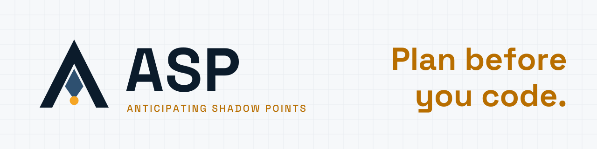
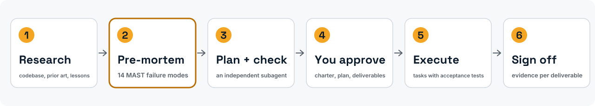
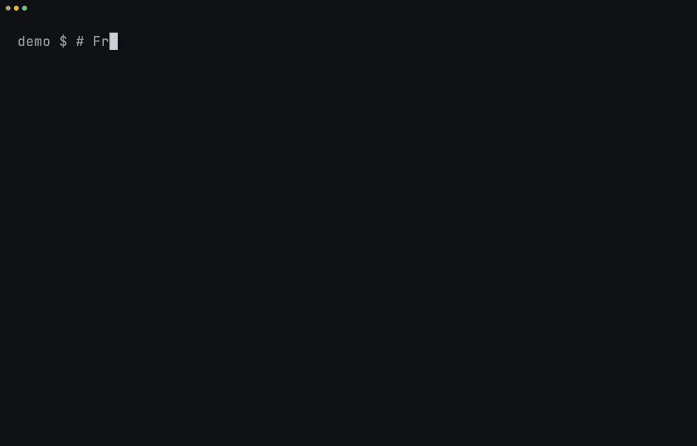
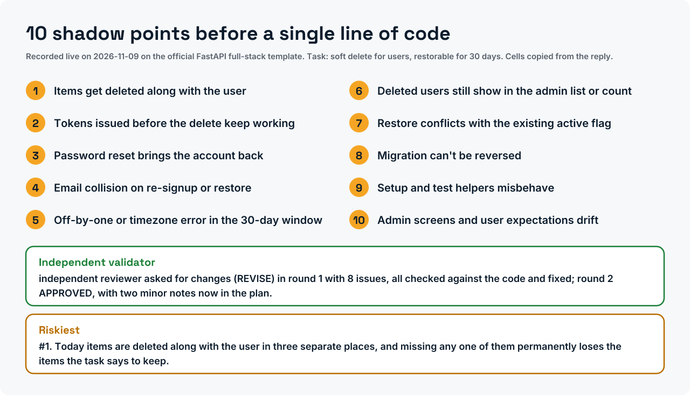
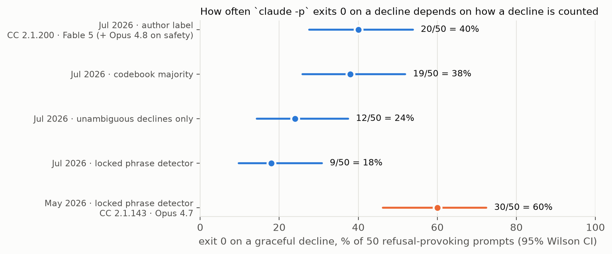
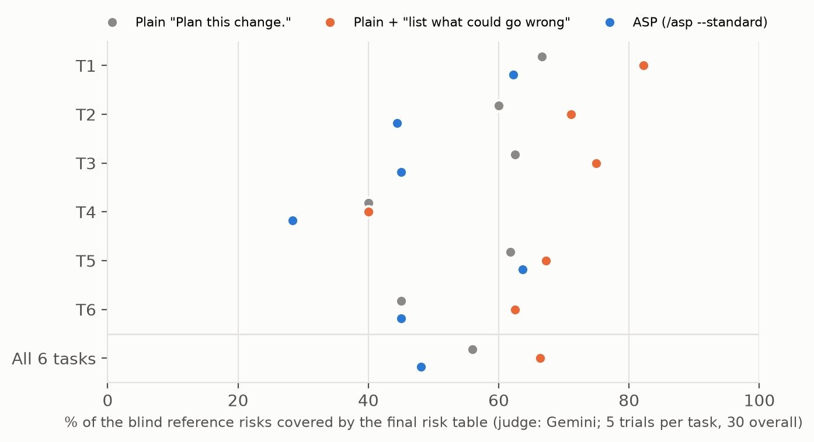
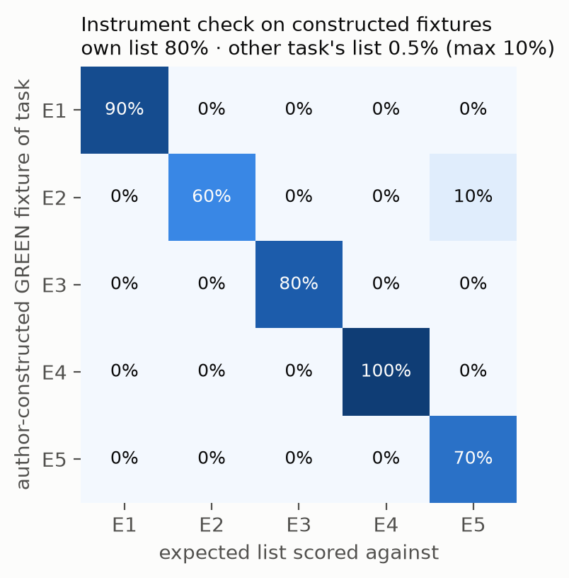

<div dir="rtl" markdown="1">

<div align="center" markdown="1">

<picture>
  <source media="(prefers-color-scheme: dark)" srcset="assets/brand/banner-dark.svg">
  
</picture>

<h3>‏pre-mortem לסוכן הקוד שלך, ומבחן מדוד של האם הוא עוזר.</h3>

[](https://doi.org/10.5281/zenodo.20276631)
[](LICENSE)
[](LICENSES/CC-BY-4.0.txt)
[](pyproject.toml)
[](tests/)
[](output/hash-chain.md)
[](https://colab.research.google.com/github/ulissesflores/anticipating-shadow-points/blob/main/colab/replication.ipynb)
[](plugins/anticipating-shadow-points/)

[English](README.md) · [Português (Brasil)](README.pt-BR.md) · [Español](README.es.md) · [Italiano](README.it.md) · **עברית**

*תורגם מה-README האנגלי של גרסה v2.0.0; הקובץ האנגלי הוא הקנוני. תרגום בסיוע מכונה; סקירה של דוברי עברית שפת אם תתקבל בברכה.*

</div>

<picture>
  <source media="(prefers-color-scheme: dark)" srcset="assets/brand/phases-dark.svg">
  
</picture>

<p align="center">התקנה ב-Claude Code:</p>

```text
/plugin marketplace add ulissesflores/anticipating-shadow-points
/plugin install anticipating-shadow-points@anticipating-shadow-points
```

<p align="center"></p>

<picture>
  <source media="(prefers-color-scheme: dark)" srcset="assets/brand/plan-card-dark.svg">
  
</picture>
<p align="center"><sub>הוקלט בשידור חי: ASP הותקן מה-marketplace שלו בתצורה נקייה של Claude Code והורץ על תבנית ה-full-stack הרשמית של FastAPI (248 קבצים). ההמתנה בת שלוש הדקות מוצגת מהר פי 13, כפי שהתג מראה, וההשהיות הריקות בהתקנה קוצרו; שום דבר אינו הקרנה חוזרת. <a href="assets/demo/live/">איך זה הוקלט</a>.</sub></p>

> [!IMPORTANT]
> **ממצא: exit 0 אינו הצלחה.** הפקודה `claude -p` מחזירה exit code 0 כאשר הסוכן מסרב בנימוס לבצע את המשימה, בלי שום דגל סירוב קריא-מכונה במעטפת ה-JSON. על סט קבוע של 50 הנחיות שנועדו לעורר סירוב (Claude Code 2.1.200, יולי 2026), **24 מתוך 50 הסתיימו ב-0, כולם עם `stop_reason: end_turn`**, ו-**12 עד 20 מהם היו סירובים**: 24% עד 40% מהסט, בהתאם לאופן שבו סופרים סירוב. עטיפת shell שסומכת על `$?` קוראת את כולם כהצלחה.
>
> **נמדד: הפרוטוקול המלא של ASP לא גבר על בקשה של משפט אחד.** במחקר שנרשם מראש (90 הרצות על שישה מאגרים ציבוריים, Claude Opus 5.5, שני שופטים עיוורים מספקים אחרים), `/asp --standard` כיסה **48%** מהסיכונים שמנו סוקרים בלתי תלויים, לעומת **66%** של Claude Code רגיל עם הבקשה *"Before planning, list the ways this change could go wrong."* (לפני התכנון, מנה את מה שעלול להשתבש), ונשאר מאחור בכל שש המשימות: אין תועלת מדידה. המשפט הזה לבדו העלה את הכיסוי **מ־56% ל־66%** לעומת "Plan this change." פשוט (p ≤ 0.0014 אצל שני השופטים). זו הייתה השוואה משנית שנקבעה לפני הנתונים, במודל אחד ובשש משימות. מחקר שני שנרשם מראש הפך אותה לשאלה הראשית **ואישש אותה**: 240 הרצות על שנים־עשר מאגרים חדשים, עם Claude Opus 5.5 ו־Sonnet 5.5, והכיסוי עלה **מ־46% ל־58%** (p = 0.0001 בסך הכול ובתוך כל מודל). מול רשימות ייחוס שהתבקשו שוב במילים אחרות הרווח קטן יותר: מ־55.8% ל־62.5% (p = 0.0002). [מחקר 1](benchmark/study-2026-11/) · [מחקר 2](benchmark/study-2026-11b/).

## המאמרים

| מאמר | DOI | PDF (DOCX לצדו) |
|---|---|---|
| *ASP: an operational pre-mortem skill for LLM coding agents*, whitepaper, גרסה 2.4 | [10.5281/zenodo.24410420](https://doi.org/10.5281/zenodo.24410420) | [en](docs/paper/asp-preprint.en.pdf) · [pt-BR](docs/paper/asp-preprint.pt-BR.pdf) · [es](docs/paper/asp-preprint.es.pdf) · [it](docs/paper/asp-preprint.it.pdf) |
| *Graceful refusals as unsignalled failures*, הערה טכנית, גרסה 2.4 | [10.5281/zenodo.24410426](https://doi.org/10.5281/zenodo.24410426) | [en](docs/paper/graceful-refusals.en.pdf) · [pt-BR](docs/paper/graceful-refusals.pt-BR.pdf) · [es](docs/paper/graceful-refusals.es.pdf) · [it](docs/paper/graceful-refusals.it.pdf) |
| *One sentence before the plan: a pre-registered confirmatory study of pre-mortem prompting in LLM coding agents*, דוח טכני, גרסה 1.0 | [10.5281/zenodo.24410437](https://doi.org/10.5281/zenodo.24410437) | [en](docs/paper/one-sentence-premortem.en.pdf) · [pt-BR](docs/paper/one-sentence-premortem.pt-BR.pdf) · [es](docs/paper/one-sentence-premortem.es.pdf) · [it](docs/paper/one-sentence-premortem.it.pdf) |

שלושת המאמרים הם דוחות טכניים שלא עברו ביקורת עמיתים, ולכל אחד רשומה משלו ב-Zenodo. מקורות ה-Markdown נמצאים ב-[`paper/`](paper/), וה-SHA-256 של כל מהדורה ב-[`paper/PAPER-SHA256.txt`](paper/PAPER-SHA256.txt). קוראי עברית מוזמנים להשתמש במהדורה האנגלית.

## מה הפרויקט תורם

1. **פרוטוקול תכנון שאפשר להתקין.** שלושה עשר שלבים: מחקר, pre-mortem של Klein שנאלץ לעבור דרך 14 מצבי הכשל של MAST למערכות מרובות סוכנים, תת-סוכן מאמת עצמאי, חוזה של משימות עם בדיקות קבלה, ואישור סופי של התוצרים. שנים עשר "Iron Laws" מונעים מהסוכן לדלג על שלבים.
2. **כשל שנמדד בדפוס נפוץ של harness.** `claude -p` יוצא עם 0 בסירוב מנומס. המדידה, ארבע הקריאות שלה ומתכון לפענוח הגנתי נמצאים ב-[`paper/graceful-refusals.md`](paper/graceful-refusals.md); המתכון מובנה בשלב הביצוע של ה-skill.
3. **מבחן רשום מראש של הפרוטוקול עצמו, מדווח כפי שיצא.** שלושה תנאים, שישה מאגרים מקובעים, רשימות ייחוס ושופטים עיוורים מספקים אחרים, וכל הרצה וכל פסיקה משורשרות ביומן גיבובים עם הוכחת OpenTimestamps. הפרוטוקול הפסיד לבקשה של משפט אחד; המשפט הוא הממצא, ומחקר שני שנרשם מראש אישש אותו בשני מודלים ובשנים־עשר מאגרים חדשים.
4. **כל מספר שפורסם כבדיקה.** `python run_all.py` גוזר מחדש את המספרים מנתונים שב-commit, מאמת (assert) כל אחד מהם, ואוטם קוד, בדיקות, נתונים ותוצאות תחת chain hash אחד של SHA-256.

## במבט מהיר

| | |
|---|---|
| מה זה | תוסף ל-Claude Code (skill + פקודת `/asp`), בתוספת שכבת שכפול ב-Python |
| התקנה | `claude plugin marketplace add ulissesflores/anticipating-shadow-points` |
| דרישות זמן ריצה | Claude Code, `bash`, `jq` |
| דרישות שכפול | Python 3.11+, `matplotlib`, `pytest`; ללא קריאות למודל, כ-10 שניות |
| ראיות | 2 × 50 תמלילי `claude -p` (מאי ויולי 2026); 90 הרצות שנשמרו מהמחקר של 2026-11 על ASP ו־240 מהמחקר של 2026-11b, עם הפסיקות של שני השופטים |
| הרשאות | ה-skill לעולם אינו קובע מצב הרשאות; סשן-הבן האופציונלי של `--goal` רץ תחת ההגדרות שלך |

## ראו זאת

| שכפול כל מספר במצב לא מקוון | הכשל, מתוך ראיות מוקלטות |
|---|---|
|  |  |

שתי ההקלטות הן השמעות חוזרות של קבצים שב-commit, מתוסרטות באמצעות [vhs](https://github.com/charmbracelet/vhs) ב-[`assets/demo/`](assets/demo/). אף אחת מהן אינה קוראת למודל.

## התחלה מהירה

### שימוש בתוסף

<div dir="ltr" markdown="1">

```bash
claude plugin marketplace add ulissesflores/anticipating-shadow-points
claude plugin install anticipating-shadow-points@anticipating-shadow-points
```

</div>

לאחר מכן, בכל סשן של Claude Code: `/anticipating-shadow-points:asp <your task>`. דגלי עומק: `--quick` (ללא validator, ללא ביצוע אוטונומי), `--standard` (ברירת מחדל), `--paranoid`.

מה התוסף עושה במחשב שלך מתואר [ב-README שלו](plugins/anticipating-shadow-points/README.md).

שלוש דרכים להתקנה:

| נתיב | פקודה | הפעלה |
|---|---|---|
| Plugin marketplace (מומלץ) | שתי הפקודות שלמעלה | `/anticipating-shadow-points:asp` |
| לסשן הנוכחי בלבד, מתוך clone | `claude --plugin-dir /path/to/anticipating-shadow-points/plugins/anticipating-shadow-points` | `/anticipating-shadow-points:asp` |
| סקריפט עצמאי | `./scripts/verify.sh --pre-install && ./scripts/install.sh` | `/asp` |

<details markdown="1">
<summary><b>פתרון תקלות</b></summary>

- **`claude plugin install` נכשל עם SSH permission denied.** ה-git שלך משכתב כתובות GitHub ל-SSH ואין לך מפתח רשום. תיקון חד-פעמי: `git config --global url."https://github.com/".insteadOf "git@github.com:"`.
- **`/asp` עובד אבל `/anticipating-shadow-points:asp` לא, או להפך.** הם מגיעים מנתיבי התקנה שונים (עצמאי מול תוסף) ויכולים להתקיים יחד.
- **שם התוסף מופיע פעמיים (`name@marketplace`).** המאגר הוא ה-marketplace של עצמו, ולכן שני החלקים הם אותה מחרוזת.
- **השלב האוטונומי נעצר בגלל דחיית הרשאה.** כמתוכנן. ASP אינו מעביר שום דגל הרשאה לתהליך-הבן `claude -p`; כל מה שההגדרות שלך אינן מתירות כבר נדחה במצב לא-אינטראקטיבי, וה-skill מדווח על כך במקום לנסות שוב עם יותר הרשאה.

</details>

#### מתי להשתמש ב-ASP

השתמשו בו עבור מיגרציות, deploys עם תלויות חיצוניות, refactors על פני קבצים רבים, שינויים במדיניות גישה, החלטות ארכיטקטורה וחקירות root-cause. דלגו עליו בתיקוני typo, עריכות של שורה אחת ושאלות לקריאה בלבד.

### שכפול המאמרים

<div dir="ltr" markdown="1">

```bash
git clone https://github.com/ulissesflores/anticipating-shadow-points
cd anticipating-shadow-points
python3 -m venv .venv && .venv/bin/pip install -r requirements.txt
.venv/bin/python run_all.py
```

</div>

פלט צפוי:

<div dir="ltr" markdown="1">

```text
== results: analysis/results.py
results -> output/results.json | July author 20/50, codebook 19/50, detector 9/50
== study results: benchmark/study-2026-11/analyze.py results 5
study -> benchmark/study-2026-11/results.json | coverage ASP 48.1%, list-what-could-go-wrong 66.3%, plain 56.0% | primary: no measurable benefit
== study 2 results: benchmark/study-2026-11b/analyze.py results 5
study2 -> results.json | plain 46.1%, list-what-could-go-wrong 57.5% | delta +0.114, p = 0.0001 | confirmed
== study 2 sensitivity: benchmark/study-2026-11b/sensitivity.py --quiet
study2 sensitivity -> sensitivity.json | without the 3 network-error strata: delta +0.101, p = 0.0001
== figures: analysis/make_figures.py
figures -> output/figures (3 x PNG+SVG, plus pt-BR, es, it editions)
== tests: -m pytest -q tests
.................................................                        [100%]
== benchmark tests: -m pytest -q -o addopts= -c benchmark/pyproject.toml benchmark/tests
...............................                                          [100%]
31 passed in <seconds>s
== provenance: make_provenance.py
provenance written: chain_hash <64 hex characters>
== verify: make_provenance.py --verify
provenance verified: chain_hash <the same 64 hex characters>
run_all OK: results reproduced, tests passed, provenance verified
```

</div>

## תוצאות

### ה-exit code של `claude -p` בסירוב מנומס

| צילום מצב | CLI | המודל שענה | Exit 0 | סירובים עם exit 0 | קריאה |
|---|---|---|---|---|---|
| 2026-05-18 | 2.1.143 | Opus 4.7 | 36/50 | **30/50 (60%)** | גלאי ביטויים נעול |
| 2026-07-08 | 2.1.200 | Fable 5 (34), Opus 4.8 (16, כולל את כל 12 הנחיות הבטיחות) | 24/50 | **9/50 (18%)** | אותו גלאי ביטויים נעול |
| | | | | **12/50 (24%)** | סירובים חד-משמעיים בלבד |
| | | | | **19/50 (38%)** | רוב של 5 מדרגים עיוורים, codebook |
| | | | | **20/50 (40%)** | התיוג של המחבר |



הרצות מאי ויולי נבדלות במודל וב-CLI, ולכן הירידה מ-60% ל-18% תחת אותו גלאי היא שינוי של מושא המדידה, לא מגמה. ביולי, כל אחד מ-24 ניסויי ה-exit 0 נשא `stop_reason: end_turn`; ה-`stop_reason: refusal` היחיד היה חסימה בצד השרת, והוא יצא עם 1.

### השפעת ASP על תוכניות: המחקר של 2026-11

נרשם מראש ב־[`benchmark/study-2026-11/PROTOCOL.md`](benchmark/study-2026-11/PROTOCOL.md) וקיבל חותמת זמן לפני ההרצה הראשונה. איך זה נעשה:
- **משימות:** שש בקשות שינוי בשישה מאגרים ציבוריים, כל אחד מקובע לקומיט אחד.
- **תנאים:** שלושה, כולם במצב תוכנית, וכולם מתבקשים לאותה טבלה סופית של עד עשרה סיכונים.
- **הרצות:** 5 לכל משימה ותנאי, 90 בסך הכול, עם Claude Opus 5.5.
- **רשימות ייחוס:** נכתבו באופן עיוור על ידי Grok, ‏GPT-OSS 120B ו־Gemini 3.8 Flash. סיכון נספר כששניים מהם לפחות מזכירים אותו.
- **ניקוד:** שופט עיוור מספק אחר (Gemini הראשי, Grok השני) קורא רק את שורות הטבלה, כשמילים שהיו חושפות את התנאי מושחרות.

| תנאי | סיכונים מכוסים (Gemini) | (Grok) | זמן להרצה |
|---|---|---|---|
| רגיל: "Plan this change." | 56% | 57% | 58 ש' |
| רגיל + "Before planning, list the ways this change could go wrong." | **66%** | **70%** | 50 ש' |
| ASP: ‏`/asp --standard`, נעצר אחרי התוכנית המאומתת | 48% | 54% | 175 ש' |



- **ראשי, רשום מראש:** ASP פחות הבקשה של משפט אחד = ‎−18 נקודות (Gemini) ו־‎−16 (Grok), שלילי ב־6 מתוך 6 משימות, מבחן תמורות p = 1.0. כלל ההחלטה שנקבע מראש קובע *אין תועלת מדידה*.
- **משני, רשום מראש:** המשפט פחות הבקשה הרגילה = ‎+10 נקודות (p = 0.0014) ו־‎+13 (p = 0.0001).
- **גישושי:**
  - התשובות של ASP מטפלות בחלק מהסיכונים בתוך התוכנית ולא בטבלה הסופית. שיפוט התשובה המלאה מצמצם את הפער ל־‎−8 נקודות (66% לעומת 74%), ו־ASP עדיין מאחור ב־5 מתוך 6 משימות.
  - שני השופטים מסכימים ב־91.9% מ־855 החלטות לפי פריט.
  - כל 90 ההרצות הצליחו ואף אחת לא שינתה קובץ בפרויקט.
- **שונה לפני האיסוף, ולמה:** המתאם הלקסיקלי שנקבע תחילה לא זיהה ששני סוקרים מזכירים את אותה בעיה (הסכמה של 0% עד 46%), ולכן שופט עיוור החליף אותו. שניהם מדווחים; המתאם נותן כמעט אפס בכל מקום.

### המשפט, מאושש: המחקר של 2026-11b

מחקר 1 מצא את האפקט של המשפט כהשוואה משנית. מחקר 2 בוחן אותו כשאלה הראשית. הוא נרשם מראש ב־[`benchmark/study-2026-11b/PROTOCOL.md`](benchmark/study-2026-11b/PROTOCOL.md) וקיבל חותמת זמן לפני ההרצה הראשונה. למיטב ידיעתנו, אף מחקר קודם לא מודד את המשפט היחיד הזה בסוכן קוד. איך זה נעשה:
- **משימות:** שתים־עשרה בקשות שינוי חדשות בשנים־עשר מאגרים ציבוריים, כל אחד מקובע ל-commit אחד. אף אחת מהן לא שימשה במחקר 1.
- **תנאים:** שניים, כאשר ASP והתוספים של החשבון כבויים בשניהם (ארבעת התוספים המובנים ב-Claude Code נשארו פעילים). הם נבדלים במשפט אחד: "Plan this change." לעומת "Before planning, list the ways this change could go wrong."
- **הרצות:** 5 לכל משימה, מודל ותנאי, 240 בסך הכול, עם Claude Opus 5.5 ו־Claude Sonnet 5.5.
- **רשימות ייחוס וניקוד:** כמו במחקר 1, עם מדד שני, רלוונטיות: החלק משורות הטבלה של תשובה שהשופט רואה בו סיכון מוחשי וסביר של אותו שינוי.

| מודל | רגיל (Gemini) | + המשפט (Gemini) | רגיל (Grok) | + המשפט (Grok) |
|---|---|---|---|---|
| Claude Opus 5.5 | 43% | **54%** | 48% | **57%** |
| Claude Sonnet 5.5 | 49% | **61%** | 52% | **64%** |
| שניהם | 46% | **58%** | 50% | **61%** |

- **ראשי, רשום מראש:** המשפט פחות הבקשה הרגילה = ‎+11 נקודות (Gemini), מבחן תמורות p = 0.0001 בסך הכול ו־p = 0.0001 בתוך כל מודל, חיובי ב־22 מתוך 24 תאים של משימה ומודל. כלל ההחלטה שנקבע מראש קובע *מאושש*, בתחום של שני המודלים האלה, המשימות האלה ורשימות ייחוס שכתבו מודלים.
- **שופט שני:** Grok נותן ‎+11 נקודות ואותה החלטה. שני השופטים מסכימים ב־93.2% מתוך 2,000 החלטות על פריטים.
- **סרגל מדידה שני, לא מתוכנן:** סוקרי המאמר טענו שרשימות הייחוס התבקשו במילים קרובות למילות המשפט. רשימות חדשות, שהתבקשו כ־"the main risks of this change" (הסיכונים העיקריים של השינוי הזה), נותנות 55.8% מול 62.5%: ‎+6.7 נקודות (Gemini, ‏p = 0.0002), חיובי בשני המודלים וב־16 מתוך 24 תאים. שלוש ההרצות שהסתיימו בשגיאת רשת נספרות שם כאפס; אם סופרים אותן ככיסוי מלא, ההפרש הוא ‎+4.2 נקודות (‏p = 0.0051), וב־Opus 5.5 לבדו ‎+3.2, לא מובהק (‏p = 0.099). שתי תוספות מאוחרות יותר, גם הן לא מתוכננות: כששלוש ההרצות הורצו פעם נוספת ההפרש הוא ‎+5.6 נקודות (‏p = 0.0003) ו-‎+4.9 ב-Opus 5.5 (‏p = 0.0094), ושופט של ספק שלישי, GPT-6 Astra, נותן ‎+9.0 נקודות (‏p = 0.0001). ראו [`benchmark/study-2026-11b/addendum2/ADDENDUM-2.md`](benchmark/study-2026-11b/addendum2/ADDENDUM-2.md), [`benchmark/study-2026-11b/addendum3/ADDENDUM-3.md`](benchmark/study-2026-11b/addendum3/ADDENDUM-3.md). האפקט נשמר והוא קטן יותר בסרגל הזה. פסקי הדין של Grok עבורו עדיין ממתינים. ראו [`benchmark/study-2026-11b/yardstick2/ADDENDUM.md`](benchmark/study-2026-11b/yardstick2/ADDENDUM.md).
- **רלוונטיות:** המשפט לא הפך את הסיכונים שנמנו לפחות רלוונטיים. הוא קיבל 74% לעומת 69%; בלי שגיאות הרשת שלהלן, ההפרש הוא ‎+3 נקודות ואינו מובהק (p = 0.09).
- **עלות:** התשובות עם המשפט ארכו 40 שניות בממוצע לעומת 50 שניות, ובטבלאות שלהן כמעט אותו מספר שורות (9.6 לעומת 9.2).
- **שלוש שגיאות רשת ובדיקה שלא תוכננה:**
  - שלוש הרצות הסתיימו בשגיאת רשת בזמן נפילת אינטרנט. הכלל שנקבע סופר כל אחת כ־0 ואינו מריץ אותה שוב.
  - שלושתן היו בקשות רגילות, ולכן הכלל הזה מיטיב עם התוצאה. בלי שלושת התאים של משימה ומודל שמכילים אותן, ההפרש הוא ‎+10 נקודות (Gemini) ו־‎+9 (Grok), p ≤ 0.0005 בסך הכול ובתוך כל מודל.
- **סטיות אחרות, כולן רשומות בפרוטוקול:** האיסוף נעצר לארבעה ימים והתחדש באותה גרסה של Claude Code (2.1.319), והשופט Gemini השלים את 15 הפסיקות האחרונות אחרי שהמכסה התחדשה.

ראיות קודמות, נשמרות לתיעוד ואינן בשימוש עוד:

| ראיה | מהי | מה היא תומכת בו |
|---|---|---|
| קריאת המחבר ב-8 תוכניות של תת-סוכנים (5 GREEN, 3 RED), 2026-05-17 ([סיכום](tests/evals-summary.md)) | שיפוט ללא עיוורון מול רשימות שהמחבר כתב; RED קרוב ל-47%, GREEN קרוב ל-100%; התמלילים לא נשמרו | תצפית, לא מדידה |
| הרצת בנצ'מארק מדומה (mock), 2026-05-18 | ה-matcher הדטרמיניסטי מנקד fixtures שהמחבר כתב כדי להפעיל אותו: RED 4%, GREEN 80% | שום דבר לגבי ASP. היא מראה שה-matcher מבחין בין משימות: 80% על הרשימה של ה-fixture עצמו, 0.5% על הרשימות של משימות אחרות |



## מה נטען ומה לא

| | |
|---|---|
| **נטען** | `claude -p` יצא עם 0 ועם `stop_reason: end_turn` בסירובים מנומסים בשני צילומי מצב מתוארכים; במחקר של 2026-11, הפרוטוקול של ASP כיסה פחות מסיכוני הסוקרים מאשר בקשה רגילה שמבקשת אותם, והבקשה של משפט אחד כיסתה יותר מ"תכנן את השינוי" פשוט (משני במחקר 1, ואחר כך מאושש כשאלה הראשית של המחקר של 2026-11b עם Opus 5.5 ו־Sonnet 5.5); כל ספירה לעיל נובעת באופן דטרמיניסטי מקבצים שב-commit |
| **לא נטען** | שיעור בסיס של כשל שקט בתעבורת סוכנים אמיתית (הסט נבנה כדי לעורר סירובים); שהירידה מ-60% ל-18% היא מגמה; ש-ASP משפר תוכניות או תוצאות בעולם האמיתי (המחקר של 2026-11 לא מצא תועלת בכיסוי סיכונים); שהאפקט של המשפט תקף מעבר לשני מודלים של Claude, שמונה־עשרה משימות ורשימות שכתבו מודלים, או שיותר סיכונים ברשימה פירושם קוד טוב יותר (לא נמדד); שציוני ה-fixtures 80%/4% אומרים משהו על ASP |
| **קפוא** | התמלילים והפסיקות של השופטים. אי אפשר לקבע לתמיד את המודלים שהפיקו אותם; הרצה מחדש נותנת צילום מצב חדש, לא שכפול |

גרסאות 1.0.0 עד 1.0.3 (מאי 2026) כללו טענות שגרסה 2.0.0 חוזרת בה מהן; כל אחת מהן מפורטת ב-[CHANGELOG](CHANGELOG.md). שיטה מלאה ומגבלות: [`REPRODUCIBILITY.md`](REPRODUCIBILITY.md). הפרוטוקול, המשימות, רשימות הייחוס, 90 ההרצות, הפסיקות ויומן הגיבובים של המחקר נמצאים ב־[`benchmark/study-2026-11/`](benchmark/study-2026-11/), ו־240 ההרצות של המחקר המאשש נמצאות ב־[`benchmark/study-2026-11b/`](benchmark/study-2026-11b/). מה שבא אחר כך נמצא ב[מפת הדרכים](ROADMAP.md).

## שלמות

`output/hash-chain.md` מחזיק `chain_hash` אחד של SHA-256 על פני חמישה עלים: קוד, בדיקות, קלטים קפואים, נתונים ותוצאות נגזרות. כדי לוודא שדבר לא השתנה מאז שנאטם:

<div dir="ltr" markdown="1">

```bash
python3 make_provenance.py --verify
```

</div>

הוא דורש רק את הספרייה הסטנדרטית. ה-CI מריץ אותו לפני התקנת כל דבר, ואז מריץ את `run_all.py` על Python 3.11 ו-3.12.

<a id="install"></a>

## מבנה המאגר

<div dir="ltr" markdown="1">

```text
.claude-plugin/        marketplace manifest (points at the plugin folder)
plugins/anticipating-shadow-points/
                       the plugin itself, and all that an install copies: skill (protocol, Iron Laws,
                       templates, 5 evals), /asp command, icon, README, LICENSE. Markdown only
colab/                 replication.ipynb: אימות החותם ושחזור בדפדפן (Google Colab)
paper/                 the two papers (Markdown source), PAPER-SHA256.txt and paper/tools/ (house-format build)
analysis/              derivation of every published number, figures, redacted extractor
data/                  July 2026 redacted extract, labels, codebook
tests/                 paper-number and determinism tests; iron-law-11/ holds the May 2026 run
benchmark/             RED/GREEN benchmark package and its committed May 2026 run
output/                results.json, hash-chain.md, provenance.json, figures/
assets/                icon, demo GIFs and their vhs scripts
docs/                  architecture notes and docs/findings.md
README.*.md            this README in Portuguese (Brazil), Spanish, Italian and Hebrew
.github/               CI, contributing guide, code of conduct, security policy
docs/paper/            PDF and DOCX editions of both papers (en, pt-BR, es, it)
run_all.py             single entry point: results -> figures -> tests -> seal -> verify
make_provenance.py     build or --verify the SHA-256 chain
```

</div>

לקריאה נוספת: [ממצאים](docs/findings.md) · [ארכיטקטורה והיסטוריית העיצוב](docs/ARCHITECTURE.md) · [ה-skill ו-12 ה-Iron Laws שלו](plugins/anticipating-shadow-points/skills/anticipating-shadow-points/SKILL.md) · [5 ההערכות](plugins/anticipating-shadow-points/skills/anticipating-shadow-points/evals/) · [תרומה לפרויקט](.github/CONTRIBUTING.md) · [מדיניות אבטחה](.github/SECURITY.md) · [יומן שינויים](CHANGELOG.md) · [מפת דרכים](ROADMAP.md).

## מחבר

**Carlos Ulisses Flores** — CTO וחוקר ראשי, Codex Hash Research Laboratory, סאו פאולו, ברזיל.

[](https://orcid.org/0000-0002-6034-7765)
[](https://ulissesflores.com)
[](http://lattes.cnpq.br/6905246706890561)

סינתזת המחקר, הניסוח וסקריפטי האימות הופקו עם Claude (Anthropic) בהנחיית המחבר; כל מספר במאמרים נגזר על ידי קוד במאגר זה.

## ציטוט

ציטטו את ה-**concept DOI** כדי להפנות ל-ASP באופן כללי; הוא תמיד מפנה לגרסה האחרונה. ציטטו **version DOI** כדי לקבע את הקבצים המדויקים שבהם השתמשתם. ה-version DOI של v2.0.0 הוא [10.5281/zenodo.24090006](https://doi.org/10.5281/zenodo.24090006).

<div dir="ltr" markdown="1">

```bibtex
@software{flores_asp_2026,
  author    = {Flores, Carlos Ulisses},
  title     = {{ASP — Anticipating Shadow Points}},
  year      = {2026},
  version   = {2.0.0},
  publisher = {Zenodo},
  doi       = {10.5281/zenodo.20276631},
  url       = {https://doi.org/10.5281/zenodo.20276631}
}
```

כדי לצטט מאמר, השתמשו ב-DOI שלו:

```bibtex
@techreport{flores_asp_report_2026,
  author      = {Flores, Carlos Ulisses},
  title       = {ASP: An Operational Pre-Mortem Skill for LLM Coding Agents — An Experience Report},
  year        = {2026},
  institution = {Codex Hash Research Laboratory},
  type        = {Whitepaper, version 2.4},
  doi         = {10.5281/zenodo.24410420}
}

@techreport{flores_graceful_refusals_2026,
  author      = {Flores, Carlos Ulisses},
  title       = {Graceful Refusals as Unsignalled Failures: Characterising claude -p Exit-Code Semantics on Agent Declines},
  year        = {2026},
  institution = {Codex Hash Research Laboratory},
  type        = {Technical note, version 2.4},
  doi         = {10.5281/zenodo.24410426}
}

@techreport{flores_one_sentence_2026,
  author      = {Flores, Carlos Ulisses},
  title       = {One Sentence Before the Plan: A Pre-Registered Confirmatory Study of Pre-Mortem Prompting in LLM Coding Agents},
  year        = {2026},
  institution = {Codex Hash Research Laboratory},
  type        = {Technical report, version 1.0},
  doi         = {10.5281/zenodo.24410437}
}
```

</div>

כפתור "Cite this repository" של GitHub קורא את [`CITATION.cff`](CITATION.cff), שמפרט גם את ההפניות המתודולוגיות שיש לצטט לצד ASP.

## רישיון

הקוד תחת [MIT](LICENSE). המאמרים, האיורים, הנתונים והטקסט תחת [CC BY 4.0](LICENSES/CC-BY-4.0.txt). המיפוי קובץ-אחר-קובץ נמצא ב-[`NOTICE`](NOTICE).

## הפניות עוגן

- Klein, G. (2007). Performing a project premortem. *Harvard Business Review*, 85(9), 18–19.
- Mitchell, D. J., Russo, J. E., & Pennington, N. (1989). Back to the future: Temporal perspective in the explanation of events. *Journal of Behavioral Decision Making*, 2(1), 25–38. https://doi.org/10.1002/bdm.3960020103
- Cemri, M., et al. (2025). *Why do multi-agent LLM systems fail?* arXiv:2503.13657. https://arxiv.org/abs/2503.13657
- Avizienis, A., Laprie, J.-C., Randell, B., & Landwehr, C. (2004). Basic concepts and taxonomy of dependable and secure computing. *IEEE TDSC*, 1(1), 11–33. https://doi.org/10.1109/TDSC.2004.2
- Huang, J., et al. (2024). Large language models cannot self-correct reasoning yet. *ICLR 2024*. https://arxiv.org/abs/2310.01798

</div>
