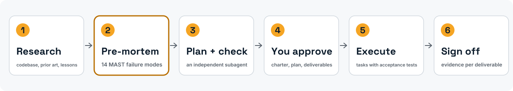
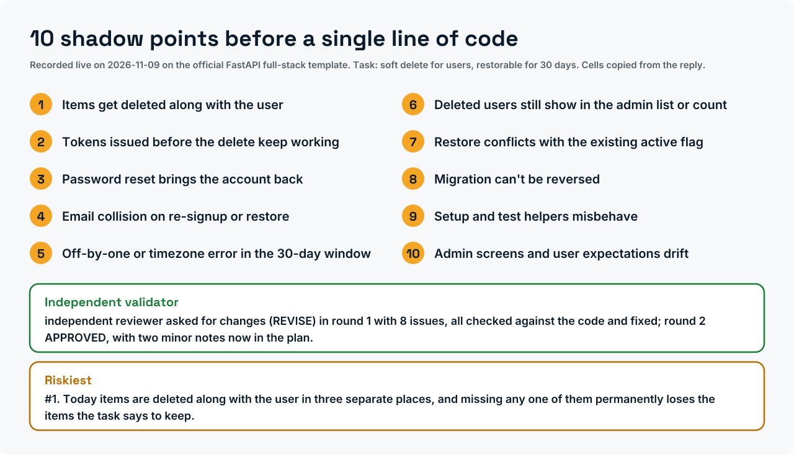

<div dir="rtl" markdown="1">

<div align="center" markdown="1">

<picture>
  <source media="(prefers-color-scheme: dark)" srcset="assets/brand/banner-dark.svg">
  
</picture>

<h3>סוכן הקוד שלך כותב את ה-post-mortem לפני שהוא כותב את הקוד.</h3>

[](https://doi.org/10.5281/zenodo.20276631)
[](LICENSE)
[](LICENSES/CC-BY-4.0.txt)
[](pyproject.toml)
[](tests/)
[](output/hash-chain.md)
[](https://colab.research.google.com/github/ulissesflores/anticipating-shadow-points/blob/main/colab/replication.ipynb)
[](plugins/anticipating-shadow-points/)

[English](README.md) · [Português (Brasil)](README.pt-BR.md) · [Español](README.es.md) · [Italiano](README.it.md) · **עברית**

*תורגם מה-README האנגלי של גרסה v2.0.0; הקובץ האנגלי הוא הקנוני. תרגום בסיוע מכונה; סקירה של דוברי עברית שפת אם תתקבל בברכה.*

</div>

<picture>
  <source media="(prefers-color-scheme: dark)" srcset="assets/brand/phases-dark.svg">
  
</picture>

<p align="center"><b>מצאו את הכשל לפני שהוא ימצא אתכם.</b> התקנה ב-Claude Code:</p>

```text
/plugin marketplace add ulissesflores/anticipating-shadow-points
/plugin install anticipating-shadow-points@anticipating-shadow-points
```

<p align="center"></p>

<picture>
  <source media="(prefers-color-scheme: dark)" srcset="assets/brand/plan-card-dark.svg">
  
</picture>
<p align="center"><sub>הוקלט בשידור חי: ASP הותקן מה-marketplace שלו בתצורה נקייה של Claude Code והורץ על תבנית ה-full-stack הרשמית של FastAPI (248 קבצים). ההמתנה בת שלוש הדקות מוצגת מהר פי 13, כפי שהתג מראה, וההשהיות הריקות בהתקנה קוצרו; שום דבר אינו הקרנה חוזרת. <a href="assets/demo/live/">איך זה הוקלט</a>.</sub></p>

> [!IMPORTANT]
> **ממצא: exit 0 אינו הצלחה.** הפקודה `claude -p` מחזירה exit code 0 כאשר הסוכן מסרב בנימוס לבצע את המשימה, בלי שום דגל סירוב קריא-מכונה במעטפת ה-JSON. על סט קבוע של 50 הנחיות שנועדו לעורר סירוב (Claude Code 2.1.200, יולי 2026), **24 מתוך 50 הסתיימו ב-0, כולם עם `stop_reason: end_turn`**, ו-**12 עד 20 מהם היו סירובים**: 24% עד 40% מהסט, בהתאם לאופן שבו סופרים סירוב. עטיפת shell שסומכת על `$?` קוראת את כולם כהצלחה.
>
> **טרם נמדד: האם ASP משפר תוכניות.** המחבר צפה בכך ללא עיוורון בחמש משימות במאי 2026, והתמלילים ההם לא נשמרו. הנתון "80% מול 4%" בגרסאות קודמות נבע מניקוד של fixtures שהמחבר כתב כדי לבדוק את ה-matcher, ולא מפלטים של מודלים; הוא נמשך כראיה. בנצ'מארק אמיתי [מתוכנן](PREREGISTRATION.md), מוגדר מראש ב-[`PREREGISTRATION.md`](PREREGISTRATION.md), טרם הופקד.

## המאמרים

| מאמר | DOI | PDF (DOCX לצדו) |
|---|---|---|
| *ASP: an operational pre-mortem skill for LLM coding agents*, whitepaper, גרסה 2.2 | [10.5281/zenodo.24065969](https://doi.org/10.5281/zenodo.24065969) | [en](docs/paper/asp-preprint.en.pdf) · [pt-BR](docs/paper/asp-preprint.pt-BR.pdf) · [es](docs/paper/asp-preprint.es.pdf) · [it](docs/paper/asp-preprint.it.pdf) |
| *Graceful refusals as unsignalled failures*, הערה טכנית, גרסה 2.3 | [10.5281/zenodo.24065935](https://doi.org/10.5281/zenodo.24065935) | [en](docs/paper/graceful-refusals.en.pdf) · [pt-BR](docs/paper/graceful-refusals.pt-BR.pdf) · [es](docs/paper/graceful-refusals.es.pdf) · [it](docs/paper/graceful-refusals.it.pdf) |

שני המאמרים הם דוחות טכניים שלא עברו ביקורת עמיתים, ולכל אחד רשומה משלו ב-Zenodo. מקורות ה-Markdown נמצאים ב-[`paper/`](paper/), וה-SHA-256 של כל מהדורה ב-[`paper/PAPER-SHA256.txt`](paper/PAPER-SHA256.txt). קוראי עברית מוזמנים להשתמש במהדורה האנגלית.

## מה הפרויקט תורם

1. **פרוטוקול תכנון שאפשר להתקין.** שלושה עשר שלבים: מחקר, pre-mortem של Klein שנאלץ לעבור דרך 14 מצבי הכשל של MAST למערכות מרובות סוכנים, תת-סוכן מאמת עצמאי, חוזה של משימות עם בדיקות קבלה, ואישור סופי של התוצרים. שנים עשר "Iron Laws" מונעים מהסוכן לדלג על שלבים.
2. **כשל שנמדד בדפוס נפוץ של harness.** `claude -p` יוצא עם 0 בסירוב מנומס. המדידה, ארבע הקריאות שלה ומתכון לפענוח הגנתי נמצאים ב-[`paper/graceful-refusals.md`](paper/graceful-refusals.md); המתכון מובנה בשלב הביצוע של ה-skill.
3. **כל מספר שפורסם כבדיקה.** `python run_all.py` גוזר מחדש את המספרים מנתונים שב-commit, מאמת (assert) כל אחד מהם, ואוטם קוד, בדיקות, נתונים ותוצאות תחת chain hash אחד של SHA-256.

## במבט מהיר

| | |
|---|---|
| מה זה | תוסף ל-Claude Code (skill + פקודת `/asp`), בתוספת שכבת שכפול ב-Python |
| התקנה | `claude plugin marketplace add ulissesflores/anticipating-shadow-points` |
| דרישות זמן ריצה | Claude Code, `bash`, `jq` |
| דרישות שכפול | Python 3.11+, `matplotlib`, `pytest`; ללא קריאות למודל, כ-10 שניות |
| ראיות | 2 × 50 תמלילי `claude -p` (מאי ויולי 2026); עדיין אין תמלילים שנשמרו עבור אפקט ה-ASP |
| הרשאות | ה-skill לעולם אינו קובע מצב הרשאות; סשן-הבן שהוא מפעיל רץ תחת ההגדרות שלך |

## ראו זאת

| שכפול כל מספר במצב לא מקוון | הכשל, מתוך ראיות מוקלטות |
|---|---|
|  |  |

שתי ההקלטות הן השמעות חוזרות של קבצים שב-commit, מתוסרטות באמצעות [vhs](https://github.com/charmbracelet/vhs) ב-[`assets/demo/`](assets/demo/). אף אחת מהן אינה קוראת למודל.

## התחלה מהירה

### שימוש בתוסף

<div dir="ltr" markdown="1">

```bash
claude plugin marketplace add ulissesflores/anticipating-shadow-points
claude plugin install anticipating-shadow-points@anticipating-shadow-points
```

</div>

לאחר מכן, בכל סשן של Claude Code: `/anticipating-shadow-points:asp <your task>`. דגלי עומק: `--quick` (ללא validator, ללא ביצוע אוטונומי), `--standard` (ברירת מחדל), `--paranoid`.

מה התוסף עושה במחשב שלך מתואר [ב-README שלו](plugins/anticipating-shadow-points/README.md).

שלוש דרכים להתקנה:

| נתיב | פקודה | הפעלה |
|---|---|---|
| Plugin marketplace (מומלץ) | שתי הפקודות שלמעלה | `/anticipating-shadow-points:asp` |
| לסשן הנוכחי בלבד, מתוך clone | `claude --plugin-dir /path/to/anticipating-shadow-points/plugins/anticipating-shadow-points` | `/anticipating-shadow-points:asp` |
| סקריפט עצמאי | `./scripts/verify.sh --pre-install && ./scripts/install.sh` | `/asp` |

<details markdown="1">
<summary><b>פתרון תקלות</b></summary>

- **`claude plugin install` נכשל עם SSH permission denied.** ה-git שלך משכתב כתובות GitHub ל-SSH ואין לך מפתח רשום. תיקון חד-פעמי: `git config --global url."https://github.com/".insteadOf "git@github.com:"`.
- **`/asp` עובד אבל `/anticipating-shadow-points:asp` לא, או להפך.** הם מגיעים מנתיבי התקנה שונים (עצמאי מול תוסף) ויכולים להתקיים יחד.
- **שם התוסף מופיע פעמיים (`name@marketplace`).** המאגר הוא ה-marketplace של עצמו, ולכן שני החלקים הם אותה מחרוזת.
- **השלב האוטונומי נעצר בגלל דחיית הרשאה.** כמתוכנן. ASP אינו מעביר שום דגל הרשאה לתהליך-הבן `claude -p`; כל מה שההגדרות שלך אינן מתירות כבר נדחה במצב לא-אינטראקטיבי, וה-skill מדווח על כך במקום לנסות שוב עם יותר הרשאה.

</details>

#### מתי להשתמש ב-ASP

השתמשו בו עבור מיגרציות, deploys עם תלויות חיצוניות, refactors על פני קבצים רבים, שינויים במדיניות גישה, החלטות ארכיטקטורה וחקירות root-cause. דלגו עליו בתיקוני typo, עריכות של שורה אחת ושאלות לקריאה בלבד.

### שכפול המאמרים

<div dir="ltr" markdown="1">

```bash
git clone https://github.com/ulissesflores/anticipating-shadow-points
cd anticipating-shadow-points
python3 -m venv .venv && .venv/bin/pip install -r requirements.txt
.venv/bin/python run_all.py
```

</div>

פלט צפוי:

<div dir="ltr" markdown="1">

```text
== results: analysis/results.py
results -> output/results.json | July author 20/50, codebook 19/50, detector 9/50
== figures: analysis/make_figures.py
figures -> output/figures (2 x PNG+SVG, plus pt-BR, es, it editions)
== tests: -m pytest -q tests
.................................................                        [100%]
== benchmark tests: -m pytest -q -o addopts= -c benchmark/pyproject.toml benchmark/tests
...............................                                          [100%]
31 passed in <seconds>s
== provenance: make_provenance.py
provenance written: chain_hash <64 hex characters>
== verify: make_provenance.py --verify
provenance verified: chain_hash <the same 64 hex characters>
run_all OK: results reproduced, tests passed, provenance verified
```

</div>

## תוצאות

### ה-exit code של `claude -p` בסירוב מנומס

| צילום מצב | CLI | המודל שענה | Exit 0 | סירובים עם exit 0 | קריאה |
|---|---|---|---|---|---|
| 2026-05-18 | 2.1.143 | Opus 4.7 | 36/50 | **30/50 (60%)** | גלאי ביטויים נעול |
| 2026-07-08 | 2.1.200 | Fable 5 (34), Opus 4.8 (16, כולל את כל 12 הנחיות הבטיחות) | 24/50 | **9/50 (18%)** | אותו גלאי ביטויים נעול |
| | | | | **12/50 (24%)** | סירובים חד-משמעיים בלבד |
| | | | | **19/50 (38%)** | רוב של 5 מדרגים עיוורים, codebook |
| | | | | **20/50 (40%)** | התיוג של המחבר |


הרצות מאי ויולי נבדלות במודל וב-CLI, ולכן הירידה מ-60% ל-18% תחת אותו גלאי היא שינוי של מושא המדידה, לא מגמה. ביולי, כל אחד מ-24 ניסויי ה-exit 0 נשא `stop_reason: end_turn`; ה-`stop_reason: refusal` היחיד היה חסימה בצד השרת, והוא יצא עם 1.

### השפעת ASP על תוכניות: טרם נמדדה

| ראיה | מהי | מה היא תומכת בו |
|---|---|---|
| קריאת המחבר ב-8 תוכניות של תת-סוכנים (5 GREEN, 3 RED), 2026-05-17 ([סיכום](tests/evals-summary.md)) | שיפוט ללא עיוורון מול רשימות שהמחבר כתב; RED קרוב ל-47%, GREEN קרוב ל-100%; התמלילים לא נשמרו | תצפית, לא מדידה |
| הרצת בנצ'מארק מדומה (mock), 2026-05-18 | ה-matcher הדטרמיניסטי מנקד fixtures שהמחבר כתב כדי להפעיל אותו: RED 4%, GREEN 80% | שום דבר לגבי ASP. היא מראה שה-matcher מבחין בין משימות: 80% על הרשימה של ה-fixture עצמו, 0.5% על הרשימות של משימות אחרות |


## מה נטען ומה לא

| | |
|---|---|
| **נטען** | `claude -p` יצא עם 0 ועם `stop_reason: end_turn` בסירובים מנומסים בשני צילומי מצב מתוארכים; הספירות לעיל נובעות באופן דטרמיניסטי מהתמלילים שב-commit; ה-matcher שנשלח מבחין בין משימות על fixtures שנבנו |
| **לא נטען** | שיעור בסיס של כשל שקט בתעבורת סוכנים אמיתית (הסט נבנה כדי לעורר סירובים); שהירידה מ-60% ל-18% היא מגמה; ש-ASP משפר תוכניות או תוצאות בעולם האמיתי (לא נמדד על פלט מודל שנשמר); שציוני ה-fixtures 80%/4% אומרים משהו על ASP |
| **קפוא** | התמלילים. המודלים שהפיקו אותם אינם מקובעים (pinned) ולא ניתן לשאול אותם שוב; הרצה מחדש של ההנחיות נותנת צילום מצב חדש, לא שכפול |

גרסאות 1.0.0 עד 1.0.3 (מאי 2026) כללו טענות שגרסה 2.0.0 חוזרת בה מהן; כל אחת מהן מפורטת ב-[CHANGELOG](CHANGELOG.md). שיטה מלאה ומגבלות: [`REPRODUCIBILITY.md`](REPRODUCIBILITY.md). המדידה הבאה מתוכננת ב-[`PREREGISTRATION.md`](PREREGISTRATION.md) (טיוטה, טרם הופקדה).

## שלמות

`output/hash-chain.md` מחזיק `chain_hash` אחד של SHA-256 על פני חמישה עלים: קוד, בדיקות, קלטים קפואים, נתונים ותוצאות נגזרות. כדי לוודא שדבר לא השתנה מאז שנאטם:

<div dir="ltr" markdown="1">

```bash
python3 make_provenance.py --verify
```

</div>

הוא דורש רק את הספרייה הסטנדרטית. ה-CI מריץ אותו לפני התקנת כל דבר, ואז מריץ את `run_all.py` על Python 3.11 ו-3.12.

<a id="install"></a>

## מבנה המאגר

<div dir="ltr" markdown="1">

```text
.claude-plugin/        marketplace manifest (points at the plugin folder)
plugins/anticipating-shadow-points/
                       the plugin itself, and all that an install copies: skill (protocol, Iron Laws,
                       templates, 5 evals), /asp command, icon, README, LICENSE. Markdown only
colab/                 replication.ipynb: אימות החותם ושחזור בדפדפן (Google Colab)
paper/                 the two papers (Markdown source), PAPER-SHA256.txt and paper/tools/ (house-format build)
analysis/              derivation of every published number, figures, redacted extractor
data/                  July 2026 redacted extract, labels, codebook
tests/                 paper-number and determinism tests; iron-law-11/ holds the May 2026 run
benchmark/             RED/GREEN benchmark package and its committed May 2026 run
output/                results.json, hash-chain.md, provenance.json, figures/
assets/                icon, demo GIFs and their vhs scripts
docs/                  architecture notes and docs/findings.md
README.*.md            this README in Portuguese (Brazil), Spanish, Italian and Hebrew
.github/               CI, contributing guide, code of conduct, security policy
docs/paper/            PDF and DOCX editions of both papers (en, pt-BR, es, it)
run_all.py             single entry point: results -> figures -> tests -> seal -> verify
make_provenance.py     build or --verify the SHA-256 chain
```

</div>

לקריאה נוספת: [ממצאים](docs/findings.md) · [ארכיטקטורה והיסטוריית העיצוב](docs/ARCHITECTURE.md) · [ה-skill ו-12 ה-Iron Laws שלו](plugins/anticipating-shadow-points/skills/anticipating-shadow-points/SKILL.md) · [5 ההערכות](plugins/anticipating-shadow-points/skills/anticipating-shadow-points/evals/) · [תרומה לפרויקט](.github/CONTRIBUTING.md) · [מדיניות אבטחה](.github/SECURITY.md) · [יומן שינויים](CHANGELOG.md) · [מפת דרכים](ROADMAP.md).

## מחבר

**Carlos Ulisses Flores** — CTO וחוקר ראשי, Codex Hash Research Laboratory, סאו פאולו, ברזיל.

[](https://orcid.org/0000-0002-6034-7765)
[](https://ulissesflores.com)
[](http://lattes.cnpq.br/6905246706890561)

סינתזת המחקר, הניסוח וסקריפטי האימות הופקו עם Claude (Anthropic) בהנחיית המחבר; כל מספר במאמרים נגזר על ידי קוד במאגר זה.

## ציטוט

ציטטו את ה-**concept DOI** כדי להפנות ל-ASP באופן כללי; הוא תמיד מפנה לגרסה האחרונה. ציטטו **version DOI** כדי לקבע את הקבצים המדויקים שבהם השתמשתם. ה-version DOI של v2.0.0 נוצר בעת ההוצאה (release) ויופיע כאן וב-[`CITATION.cff`](CITATION.cff).

<div dir="ltr" markdown="1">

```bibtex
@software{flores_asp_2026,
  author    = {Flores, Carlos Ulisses},
  title     = {{ASP — Anticipating Shadow Points}},
  year      = {2026},
  version   = {2.0.0},
  publisher = {Zenodo},
  doi       = {10.5281/zenodo.20276631},
  url       = {https://doi.org/10.5281/zenodo.20276631}
}
```

כדי לצטט מאמר, השתמשו ב-DOI שלו:

```bibtex
@techreport{flores_asp_report_2026,
  author      = {Flores, Carlos Ulisses},
  title       = {ASP: An Operational Pre-Mortem Skill for LLM Coding Agents — An Experience Report},
  year        = {2026},
  institution = {Codex Hash Research Laboratory},
  type        = {Whitepaper, version 2.2},
  doi         = {10.5281/zenodo.24065969}
}

@techreport{flores_graceful_refusals_2026,
  author      = {Flores, Carlos Ulisses},
  title       = {Graceful Refusals as Unsignalled Failures: Characterising claude -p Exit-Code Semantics on Agent Declines},
  year        = {2026},
  institution = {Codex Hash Research Laboratory},
  type        = {Technical note, version 2.3},
  doi         = {10.5281/zenodo.24065935}
}
```

</div>

כפתור "Cite this repository" של GitHub קורא את [`CITATION.cff`](CITATION.cff), שמפרט גם את ההפניות המתודולוגיות שיש לצטט לצד ASP.

## רישיון

הקוד תחת [MIT](LICENSE). המאמרים, האיורים, הנתונים והטקסט תחת [CC BY 4.0](LICENSES/CC-BY-4.0.txt). המיפוי קובץ-אחר-קובץ נמצא ב-[`NOTICE`](NOTICE).

## הפניות עוגן

- Klein, G. (2007). Performing a project premortem. *Harvard Business Review*, 85(9), 18–19.
- Mitchell, D. J., Russo, J. E., & Pennington, N. (1989). Back to the future: Temporal perspective in the explanation of events. *Journal of Behavioral Decision Making*, 2(1), 25–38. https://doi.org/10.1002/bdm.3960020103
- Cemri, M., et al. (2025). *Why do multi-agent LLM systems fail?* arXiv:2503.13657. https://arxiv.org/abs/2503.13657
- Avizienis, A., Laprie, J.-C., Randell, B., & Landwehr, C. (2004). Basic concepts and taxonomy of dependable and secure computing. *IEEE TDSC*, 1(1), 11–33. https://doi.org/10.1109/TDSC.2004.2
- Huang, J., et al. (2024). Large language models cannot self-correct reasoning yet. *ICLR 2024*. https://arxiv.org/abs/2310.01798

</div>
