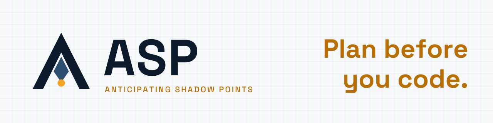
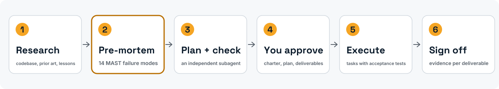
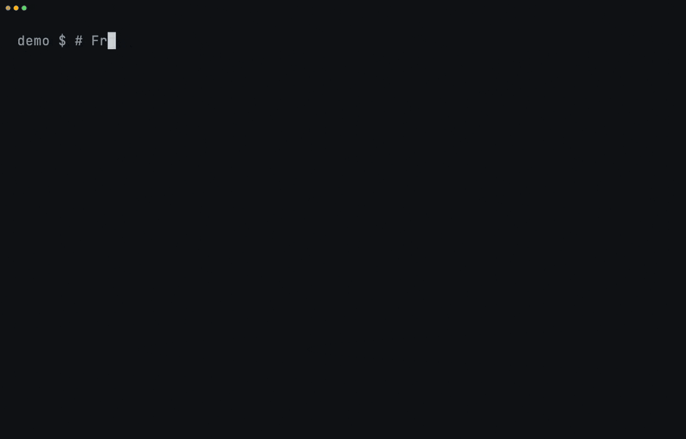
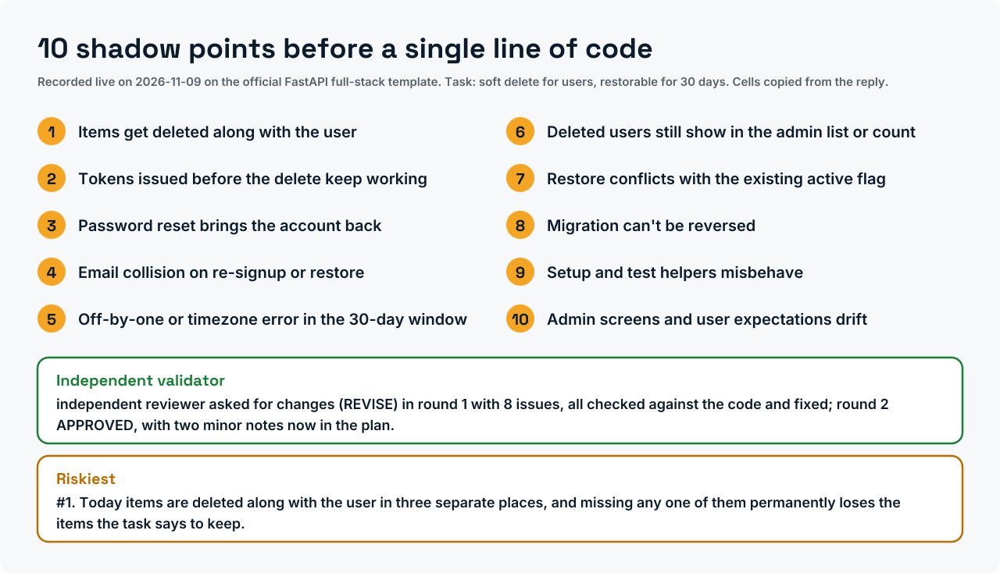
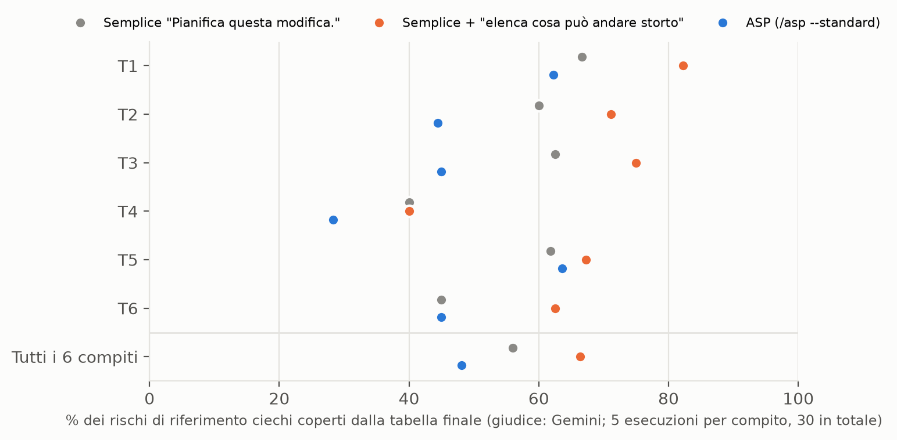

<div align="center">

<picture>
  <source media="(prefers-color-scheme: dark)" srcset="assets/brand/banner-dark.svg">
  
</picture>

<h3>Un pre-mortem per il tuo agente di programmazione, e un test misurato di quanto aiuti.</h3>

[](https://doi.org/10.5281/zenodo.20276631)
[](LICENSE)
[](LICENSES/CC-BY-4.0.txt)
[](pyproject.toml)
[](tests/)
[](output/hash-chain.md)
[](https://colab.research.google.com/github/ulissesflores/anticipating-shadow-points/blob/main/colab/replication.ipynb)
[](#installazione)

[English](README.md) · [Português (Brasil)](README.pt-BR.md) · [Español](README.es.md) · **Italiano** · [עברית](README.he.md)

*Traduzione dal README inglese della v2.0.0; il file inglese è canonico.*

*Traduzione assistita da macchina; la revisione di madrelingua è benvenuta.*

</div>

<picture>
  <source media="(prefers-color-scheme: dark)" srcset="assets/brand/phases-dark.svg">
  
</picture>

<p align="center">Installalo in Claude Code:</p>

```text
/plugin marketplace add ulissesflores/anticipating-shadow-points
/plugin install anticipating-shadow-points@anticipating-shadow-points
```

<p align="center"></p>

<picture>
  <source media="(prefers-color-scheme: dark)" srcset="assets/brand/plan-card-dark.svg">
  
</picture>
<p align="center"><sub>Registrato dal vivo: ASP installato dal suo marketplace in una configurazione pulita di Claude Code ed eseguito sul template ufficiale full-stack di FastAPI (248 file). L'attesa di tre minuti scorre 13× più veloce, come indica il badge, e le pause inattive dell'installazione sono accorciate; niente è una riproduzione. <a href="assets/demo/live/">Come è stato registrato</a>.</sub></p>

> [!IMPORTANT]
> **Risultato: exit 0 non è successo.** `claude -p` restituisce exit code 0 quando l'agente rifiuta con garbo il compito, senza alcun flag di rifiuto leggibile da macchina nell'envelope JSON. Su una suite fissa di 50 prompt pensati per provocare rifiuti (Claude Code 2.1.200, luglio 2026), **24 su 50 sono terminati con exit 0, tutti con `stop_reason: end_turn`**, e **da 12 a 20 di questi erano rifiuti**: dal 24% al 40% della suite, a seconda di come si conta un rifiuto. Un wrapper di shell che si fida di `$?` li legge tutti come successi.
>
> **Misurato: il protocollo completo di ASP non ha superato una richiesta di una frase.** In uno studio preregistrato (90 esecuzioni su sei repository pubblici, Claude Opus 5.5, due giudici ciechi di altri fornitori), `/asp --standard` ha coperto il **48%** dei rischi indicati da revisori indipendenti, contro il **66%** di Claude Code semplice con la richiesta *"Before planning, list the ways this change could go wrong."* (prima di pianificare, elenca cosa può andare storto), indietro su tutti e sei i compiti: nessun beneficio misurabile. Quella frase, da sola, ha portato la copertura dal **56% al 66%** rispetto a un semplice "Plan this change." (p ≤ 0,0014 con entrambi i giudici). Era un confronto secondario fissato prima dei dati, su un modello e sei compiti; è previsto uno studio confermativo con essa come domanda principale. [Protocollo, dati e registro](benchmark/study-2026-11/).

## Gli articoli

| Articolo | DOI | PDF (DOCX accanto) |
|---|---|---|
| *ASP: an operational pre-mortem skill for LLM coding agents*, whitepaper, versione 2.3 | [10.5281/zenodo.24065969](https://doi.org/10.5281/zenodo.24065969) | [en](docs/paper/asp-preprint.en.pdf) · [pt-BR](docs/paper/asp-preprint.pt-BR.pdf) · [es](docs/paper/asp-preprint.es.pdf) · [it](docs/paper/asp-preprint.it.pdf) |
| *Graceful refusals as unsignalled failures*, nota tecnica, versione 2.3 | [10.5281/zenodo.24065935](https://doi.org/10.5281/zenodo.24065935) | [en](docs/paper/graceful-refusals.en.pdf) · [pt-BR](docs/paper/graceful-refusals.pt-BR.pdf) · [es](docs/paper/graceful-refusals.es.pdf) · [it](docs/paper/graceful-refusals.it.pdf) |

Entrambi sono rapporti tecnici, non sottoposti a revisione paritaria, ciascuno con un proprio record su Zenodo. I sorgenti Markdown sono in [`paper/`](paper/) e lo SHA-256 di ogni edizione in [`paper/PAPER-SHA256.txt`](paper/PAPER-SHA256.txt). I lettori di ebraico possono usare l'edizione inglese.

## Cosa apporta questo lavoro

1. **Un protocollo di pianificazione installabile.** Tredici fasi: ricerca, un pre-mortem di Klein forzato attraverso le 14 modalità di fallimento multi-agente MAST, un subagente validatore indipendente, un contratto di task con test di accettazione e una chiusura con sign-off dei deliverable. Dodici «Iron Laws» impediscono all'agente di saltare passaggi.
2. **Un fallimento misurato in un pattern comune degli harness.** `claude -p` termina con exit 0 su un rifiuto garbato. La misura, le sue quattro letture e una ricetta di parsing difensivo sono in [`paper/graceful-refusals.md`](paper/graceful-refusals.md); la ricetta è integrata nella fase di esecuzione della skill.
3. **Un test preregistrato del protocollo stesso, riportato così com'è uscito.** Tre condizioni, sei repository fissati, liste di riferimento e giudici ciechi di altri fornitori, ogni esecuzione e ogni verdetto concatenati in un registro di hash con prova OpenTimestamps. Il protocollo ha perso contro una richiesta di una frase; la frase è il risultato. Vedi [Risultati](#risultati).
4. **Ogni numero pubblicato come test.** `python run_all.py` ri-deriva i numeri dai dati committati, verifica ciascuno con un'asserzione e sigilla codice, test, dati e risultati sotto un unico chain hash SHA-256.

## In sintesi

| | |
|---|---|
| Cos'è | Plugin per Claude Code (skill + comando `/asp`), più un livello di replicazione in Python |
| Installazione | `claude plugin marketplace add ulissesflores/anticipating-shadow-points` |
| Requisiti di runtime | Claude Code, `bash`, `jq` |
| Requisiti per la replicazione | Python 3.11+, `matplotlib`, `pytest`; nessuna chiamata a modelli, circa 10 secondi |
| Evidenza | 2 × 50 trascrizioni di `claude -p` (maggio e luglio 2026); 90 esecuzioni conservate dello studio 2026-11 su ASP, con i verdetti di entrambi i giudici |
| Permessi | La skill non imposta mai una modalità di permessi; la sessione figlia opzionale di `--goal` gira con le tue impostazioni |

## Vederlo in azione

| Replicare ogni numero offline | Il fallimento, da evidenza registrata |
|---|---|
|  |  |

Entrambi sono riproduzioni di file committati, scriptate con [vhs](https://github.com/charmbracelet/vhs) in [`assets/demo/`](assets/demo/). Nessuno chiama un modello.

## Avvio rapido

### Usare il plugin

```bash
claude plugin marketplace add ulissesflores/anticipating-shadow-points
claude plugin install anticipating-shadow-points@anticipating-shadow-points
```

Poi, in qualsiasi sessione di Claude Code: `/anticipating-shadow-points:asp <your task>`. Flag di profondità: `--quick` (nessun validatore, nessuna esecuzione autonoma), `--standard` (predefinito), `--paranoid`.

Che cosa fa il plugin sulla tua macchina è descritto nel [suo README](plugins/anticipating-shadow-points/README.md).

Tre modi per installarlo:

| Percorso | Comando | Invocazione |
|---|---|---|
| Marketplace dei plugin (consigliato) | i due comandi sopra | `/anticipating-shadow-points:asp` |
| Solo per la sessione, da un clone | `claude --plugin-dir /path/to/anticipating-shadow-points/plugins/anticipating-shadow-points` | `/anticipating-shadow-points:asp` |
| Script standalone | `./scripts/verify.sh --pre-install && ./scripts/install.sh` | `/asp` |

<details>
<summary><b>Risoluzione dei problemi</b></summary>

- **`claude plugin install` fallisce con SSH permission denied.** Il tuo git riscrive gli URL di GitHub in SSH e non hai alcuna chiave registrata. Correzione una tantum: `git config --global url."https://github.com/".insteadOf "git@github.com:"`.
- **`/asp` funziona ma `/anticipating-shadow-points:asp` no, o viceversa.** Provengono da percorsi di installazione diversi (standalone contro plugin) e possono coesistere.
- **Il nome del plugin compare due volte (`name@marketplace`).** Il repository è esso stesso il marketplace, quindi le due metà sono la stessa stringa.
- **La fase autonoma si ferma per un permesso negato.** È voluto. ASP non passa alcun flag di permessi al figlio `claude -p`; tutto ciò che le tue impostazioni non consentono già viene negato in modalità non interattiva, e la skill lo segnala invece di riprovare con più permessi.

</details>

#### Quando ricorrere ad ASP

Usalo per migrazioni, deploy con dipendenze esterne, refactoring su molti file, modifiche alla politica di accesso, decisioni architetturali e indagini sulla causa radice. Evitalo per correzioni di refusi, modifiche di una riga e domande di sola lettura.

### Replicare i paper

```bash
git clone https://github.com/ulissesflores/anticipating-shadow-points
cd anticipating-shadow-points
python3 -m venv .venv && .venv/bin/pip install -r requirements.txt
.venv/bin/python run_all.py
```

Output atteso:

```text
== results: analysis/results.py
results -> output/results.json | July author 20/50, codebook 19/50, detector 9/50
== study results: benchmark/study-2026-11/analyze.py results 5
study -> benchmark/study-2026-11/results.json | coverage ASP 48.1%, list-what-could-go-wrong 66.3%, plain 56.0% | primary: no measurable benefit
== figures: analysis/make_figures.py
figures -> output/figures (3 x PNG+SVG, plus pt-BR, es, it editions)
== tests: -m pytest -q tests
.................................................                        [100%]
== benchmark tests: -m pytest -q -o addopts= -c benchmark/pyproject.toml benchmark/tests
...............................                                          [100%]
31 passed in <seconds>s
== provenance: make_provenance.py
provenance written: chain_hash <64 hex characters>
== verify: make_provenance.py --verify
provenance verified: chain_hash <the same 64 hex characters>
run_all OK: results reproduced, tests passed, provenance verified
```

## Risultati

### Exit code di `claude -p` su un rifiuto garbato

| Snapshot | CLI | Modello che ha risposto | Exit 0 | Rifiuti con exit 0 | Lettura |
|---|---|---|---|---|---|
| 2026-05-18 | 2.1.143 | Opus 4.7 | 36/50 | **30/50 (60%)** | rilevatore a frasi bloccate |
| 2026-07-08 | 2.1.200 | Fable 5 (34), Opus 4.8 (16, inclusi tutti i 12 prompt di sicurezza) | 24/50 | **9/50 (18%)** | stesso rilevatore a frasi bloccate |
| | | | | **12/50 (24%)** | solo rifiuti inequivocabili |
| | | | | **19/50 (38%)** | maggioranza di 5 valutatori in cieco, codebook |
| | | | | **20/50 (40%)** | etichetta dell'autore |


Le esecuzioni di maggio e luglio differiscono per modello e CLI, quindi il calo dal 60% al 18% con lo stesso rilevatore è un cambiamento dell'oggetto misurato, non un andamento. A luglio, tutte le 24 prove con exit 0 riportavano `stop_reason: end_turn`; l'unico `stop_reason: refusal` era un blocco lato server, ed è terminato con exit 1.

### Effetto di ASP sui piani: lo studio 2026-11

Preregistrato in [`benchmark/study-2026-11/PROTOCOL.md`](benchmark/study-2026-11/PROTOCOL.md) e marcato temporalmente prima dell'esecuzione 1. Come è stato fatto:
- **Compiti:** sei richieste di modifica su sei repository pubblici, ciascuno fissato a un commit.
- **Condizioni:** tre, tutte in modalità piano, tutte con la stessa tabella finale di al massimo dieci rischi.
- **Esecuzioni:** 5 per compito e condizione, 90 in totale, con Claude Opus 5.5.
- **Liste di riferimento:** scritte alla cieca da Grok, GPT-OSS 120B e Gemini 3.8 Flash. Un rischio conta quando almeno due lo nominano.
- **Punteggio:** un giudice cieco di un altro fornitore (Gemini il principale, Grok il secondo) legge solo le righe della tabella, con le parole che rivelerebbero la condizione oscurate.

| Condizione | Rischi coperti (Gemini) | (Grok) | Tempo per esecuzione |
|---|---|---|---|
| Semplice: "Plan this change." | 56% | 57% | 58 s |
| Semplice + "Before planning, list the ways this change could go wrong." | **66%** | **70%** | 50 s |
| ASP: `/asp --standard`, fermato dopo il piano validato | 48% | 54% | 175 s |



- **Primario, preregistrato:** ASP meno la richiesta di una frase = −18 punti (Gemini) e −16 (Grok), negativo su 6 compiti su 6, permutazione p = 1,0. La regola di decisione fissata in anticipo dice *nessun beneficio misurabile*.
- **Secondario, preregistrato:** la frase meno la richiesta semplice = +10 punti (p = 0,0014) e +13 (p = 0,0001).
- **Esplorativo:**
  - Le risposte di ASP trattano alcuni rischi dentro il piano e non nella tabella finale. Giudicare la risposta intera riduce il divario a −8 punti (66% contro 74%), con ASP ancora indietro su 5 compiti su 6.
  - I due giudici concordano sul 91,9% di 855 decisioni per voce.
  - Tutte le 90 esecuzioni sono riuscite e nessuna ha modificato un file del progetto.
- **Cambiato prima della raccolta, e perché:** il matcher lessicale fissato per primo non vedeva che due revisori nominavano lo stesso problema (accordo dallo 0% al 46%), quindi un giudice cieco lo ha sostituito. Sono riportati entrambi; il matcher dà quasi zero ovunque.

Evidenza precedente, conservata agli atti e non più usata:

| Evidenza | Che cos'è | Cosa supporta |
|---|---|---|
| Lettura dell'autore di 8 piani di subagenti (5 GREEN, 3 RED), 2026-05-17 ([sintesi](tests/evals-summary.md)) | Giudizio non in cieco rispetto a liste scritte dall'autore; RED intorno al 47%, GREEN intorno al 100%; trascrizioni non conservate | Un'osservazione, non una misura |
| Esecuzione mock del benchmark, 2026-05-18 | Il matcher deterministico che assegna punteggi a fixture scritte dall'autore per esercitarlo: RED 4%, GREEN 80% | Nulla su ASP. Mostra che il matcher discrimina tra i compiti: 80% sulla lista della propria fixture, 0.5% sulle liste di altri compiti |


## Cosa si afferma e cosa no

| | |
|---|---|
| **Affermato** | `claude -p` è uscito con 0 e `stop_reason: end_turn` su rifiuti cortesi in due istantanee datate; nello studio 2026-11 il protocollo di ASP ha coperto meno rischi dei revisori di una richiesta semplice che li chiede, e quella richiesta di una frase ha coperto più di un semplice "pianifica questa modifica" (secondario, preregistrato); ogni conteggio sopra discende in modo deterministico da file versionati |
| **Non affermato** | Un tasso di base di fallimento silenzioso nel traffico reale degli agenti (la suite è stata costruita per provocare rifiuti); che il calo dal 60% al 18% sia un andamento; che ASP migliori i piani o i risultati nel mondo reale (lo studio 2026-11 non ha trovato benefici sulla copertura dei rischi); che l'effetto della frase valga oltre un modello, sei compiti e liste scritte da modelli, o che più rischi elencati significhino codice migliore (non misurato); che i punteggi 80%/4% delle fixture dicano qualcosa su ASP |
| **Congelato** | Le trascrizioni e i verdetti dei giudici. I modelli che li hanno prodotti non possono essere fissati per sempre; rieseguire dà una nuova istantanea, non una replica |

Le versioni da 1.0.0 a 1.0.3 (maggio 2026) contenevano affermazioni che la versione 2.0.0 ritira; ognuna è elencata nel [CHANGELOG](CHANGELOG.md). Metodo completo e limiti: [`REPRODUCIBILITY.md`](REPRODUCIBILITY.md). Il protocollo, i compiti, le liste di riferimento, le 90 esecuzioni, i verdetti e il registro di hash dello studio sono in [`benchmark/study-2026-11/`](benchmark/study-2026-11/). Uno studio confermativo con la richiesta di una frase come domanda principale è il prossimo passo della [roadmap](ROADMAP.md).

## Integrità

`output/hash-chain.md` contiene un unico `chain_hash` SHA-256 su cinque foglie: codice, test, input congelati, dati e risultati derivati. Per verificare che nulla sia cambiato da quando è stato sigillato:

```bash
python3 make_provenance.py --verify
```

Richiede solo la libreria standard. La CI lo esegue prima di installare qualsiasi cosa, poi esegue `run_all.py` su Python 3.11 e 3.12.

<a id="install"></a>

## Struttura

```text
.claude-plugin/        marketplace manifest (points at the plugin folder)
plugins/anticipating-shadow-points/
                       the plugin itself, and all that an install copies: skill (protocol, Iron Laws,
                       templates, 5 evals), /asp command, icon, README, LICENSE. Markdown only
colab/                 replication.ipynb: verifica il sigillo e replica nel browser (Google Colab)
paper/                 the two papers (Markdown source), PAPER-SHA256.txt and paper/tools/ (house-format build)
analysis/              derivation of every published number, figures, redacted extractor
data/                  July 2026 redacted extract, labels, codebook
tests/                 paper-number and determinism tests; iron-law-11/ holds the May 2026 run
benchmark/             RED/GREEN benchmark package and its committed May 2026 run
output/                results.json, hash-chain.md, provenance.json, figures/
assets/                icon, demo GIFs and their vhs scripts
docs/                  architecture notes and docs/findings.md
README.*.md            this README in Portuguese (Brazil), Spanish, Italian and Hebrew
.github/               CI, contributing guide, code of conduct, security policy
docs/paper/            PDF and DOCX editions of both papers (en, pt-BR, es, it)
run_all.py             single entry point: results -> figures -> tests -> seal -> verify
make_provenance.py     build or --verify the SHA-256 chain
```

Ulteriori letture: [risultati](docs/findings.md) · [architettura e storia del design](docs/ARCHITECTURE.md) · [la skill e le sue 12 Iron Laws](plugins/anticipating-shadow-points/skills/anticipating-shadow-points/SKILL.md) · [le 5 valutazioni](plugins/anticipating-shadow-points/skills/anticipating-shadow-points/evals/) · [come contribuire](.github/CONTRIBUTING.md) · [policy di sicurezza](.github/SECURITY.md) · [changelog](CHANGELOG.md) · [roadmap](ROADMAP.md).

## Autore

**Carlos Ulisses Flores** — CTO & Chief Researcher, Codex Hash Research Laboratory, São Paulo, Brasile.

[](https://orcid.org/0000-0002-6034-7765)
[](https://ulissesflores.com)
[](http://lattes.cnpq.br/6905246706890561)

La sintesi della ricerca, la stesura e gli script di verifica sono stati prodotti con Claude (Anthropic) sotto la direzione dell'autore; ogni numero nei paper è derivato da codice in questo repository.

## Citazione

Cita il **concept DOI** per riferirti ad ASP in generale; si risolve sempre sull'ultima versione. Cita un **version DOI** per fissare i file esatti che hai usato. Il version DOI della v2.0.0 viene emesso al momento del rilascio e sarà elencato qui e in [`CITATION.cff`](CITATION.cff).

```bibtex
@software{flores_asp_2026,
  author    = {Flores, Carlos Ulisses},
  title     = {{ASP — Anticipating Shadow Points}},
  year      = {2026},
  version   = {2.0.0},
  publisher = {Zenodo},
  doi       = {10.5281/zenodo.20276631},
  url       = {https://doi.org/10.5281/zenodo.20276631}
}
```

Per citare un articolo, usa il suo DOI:

```bibtex
@techreport{flores_asp_report_2026,
  author      = {Flores, Carlos Ulisses},
  title       = {ASP: An Operational Pre-Mortem Skill for LLM Coding Agents — An Experience Report},
  year        = {2026},
  institution = {Codex Hash Research Laboratory},
  type        = {Whitepaper, version 2.3},
  doi         = {10.5281/zenodo.24065969}
}

@techreport{flores_graceful_refusals_2026,
  author      = {Flores, Carlos Ulisses},
  title       = {Graceful Refusals as Unsignalled Failures: Characterising claude -p Exit-Code Semantics on Agent Declines},
  year        = {2026},
  institution = {Codex Hash Research Laboratory},
  type        = {Technical note, version 2.3},
  doi         = {10.5281/zenodo.24065935}
}
```

Il pulsante «Cite this repository» di GitHub legge [`CITATION.cff`](CITATION.cff), che elenca anche i riferimenti metodologici da citare insieme ad ASP.

## Licenza

Codice sotto [MIT](LICENSE). Paper, figure, dati e testo sotto [CC BY 4.0](LICENSES/CC-BY-4.0.txt). La mappa file per file è in [`NOTICE`](NOTICE).

## Riferimenti di ancoraggio

- Klein, G. (2007). Performing a project premortem. *Harvard Business Review*, 85(9), 18–19.
- Mitchell, D. J., Russo, J. E., & Pennington, N. (1989). Back to the future: Temporal perspective in the explanation of events. *Journal of Behavioral Decision Making*, 2(1), 25–38. https://doi.org/10.1002/bdm.3960020103
- Cemri, M., et al. (2025). *Why do multi-agent LLM systems fail?* arXiv:2503.13657. https://arxiv.org/abs/2503.13657
- Avizienis, A., Laprie, J.-C., Randell, B., & Landwehr, C. (2004). Basic concepts and taxonomy of dependable and secure computing. *IEEE TDSC*, 1(1), 11–33. https://doi.org/10.1109/TDSC.2004.2
- Huang, J., et al. (2024). Large language models cannot self-correct reasoning yet. *ICLR 2024*. https://arxiv.org/abs/2310.01798
