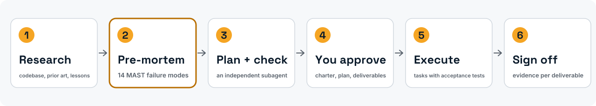
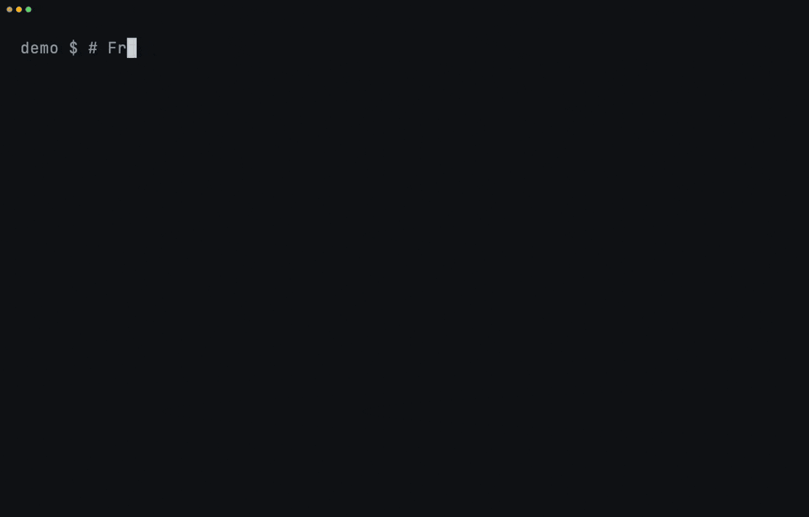
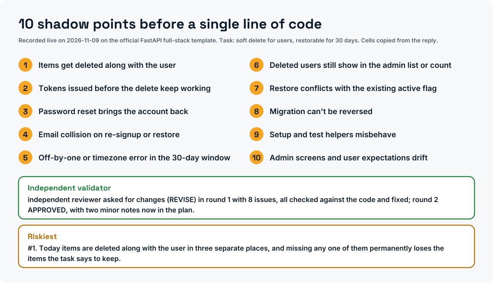
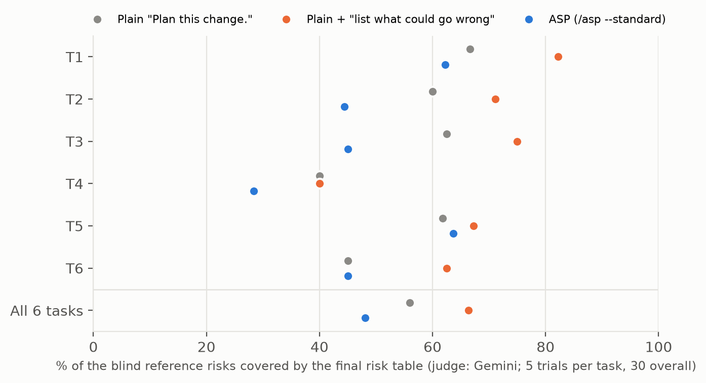

<div align="center">

<picture>
  <source media="(prefers-color-scheme: dark)" srcset="assets/brand/banner-dark.svg">
  
</picture>

<h3>A pre-mortem for your coding agent, and a measured test of whether it helps.</h3>

[](https://doi.org/10.5281/zenodo.20276631)
[](LICENSE)
[](LICENSES/CC-BY-4.0.txt)
[](pyproject.toml)
[](tests/)
[](output/hash-chain.md)
[](https://colab.research.google.com/github/ulissesflores/anticipating-shadow-points/blob/main/colab/replication.ipynb)
[](plugins/anticipating-shadow-points/)

**English** · [Português (Brasil)](README.pt-BR.md) · [Español](README.es.md) · [Italiano](README.it.md) · [עברית](README.he.md)

</div>

<picture>
  <source media="(prefers-color-scheme: dark)" srcset="assets/brand/phases-dark.svg">
  
</picture>

<p align="center">Install in Claude Code:</p>

```text
/plugin marketplace add ulissesflores/anticipating-shadow-points
/plugin install anticipating-shadow-points@anticipating-shadow-points
```

<p align="center"></p>

<picture>
  <source media="(prefers-color-scheme: dark)" srcset="assets/brand/plan-card-dark.svg">
  
</picture>
<p align="center"><sub>Recorded live: ASP installed from its marketplace into a fresh Claude Code config, then run on the official FastAPI full-stack template (248 files). The three-minute wait plays 13× faster, as the badge shows, and idle pauses in the install are shortened; nothing is replayed. <a href="assets/demo/live/">How it was recorded</a>.</sub></p>

> [!IMPORTANT]
> **Finding: exit 0 is not success.** `claude -p` returns exit code 0 when the agent gracefully declines the task, with no machine-readable refusal flag in the JSON envelope. On a fixed suite of 50 refusal-provoking prompts (Claude Code 2.1.200, July 2026), **24 of 50 exited 0, every one with `stop_reason: end_turn`**, and **12 to 20 of those were declines**: 24% to 40% of the suite, depending on how a decline is counted. A shell wrapper that trusts `$?` reads all of them as success.
>
> **Measured: ASP's full protocol did not beat a one-sentence request.** In a pre-registered study (90 trials on six public repositories, Claude Opus 5.5, two blind judges from other vendors), `/asp --standard` covered **48%** of the risks that independent reviewers named, against **66%** for plain Claude Code asked *"Before planning, list the ways this change could go wrong."*, behind on all six tasks: no measurable benefit. That one sentence, by itself, raised coverage from **56% to 66%** over a plain "Plan this change." (p ≤ 0.0014 with both judges). That was a secondary comparison fixed before the data, in one model and six tasks; a confirmatory study with it as the primary question is planned. [Protocol, data and ledger](benchmark/study-2026-11/).

## The papers

| Paper | DOI | PDF (DOCX alongside) |
|---|---|---|
| *ASP: an operational pre-mortem skill for LLM coding agents*, whitepaper, version 2.3 | [10.5281/zenodo.24065969](https://doi.org/10.5281/zenodo.24065969) | [en](docs/paper/asp-preprint.en.pdf) · [pt-BR](docs/paper/asp-preprint.pt-BR.pdf) · [es](docs/paper/asp-preprint.es.pdf) · [it](docs/paper/asp-preprint.it.pdf) |
| *Graceful refusals as unsignalled failures*, technical note, version 2.3 | [10.5281/zenodo.24065935](https://doi.org/10.5281/zenodo.24065935) | [en](docs/paper/graceful-refusals.en.pdf) · [pt-BR](docs/paper/graceful-refusals.pt-BR.pdf) · [es](docs/paper/graceful-refusals.es.pdf) · [it](docs/paper/graceful-refusals.it.pdf) |

Both are technical reports, not peer-reviewed, each with its own Zenodo record. The Markdown sources are in [`paper/`](paper/) and the SHA-256 of every edition in [`paper/PAPER-SHA256.txt`](paper/PAPER-SHA256.txt). Hebrew readers are served by the English edition.

## What this contributes

1. **A planning protocol you can install.** Thirteen phases: research, a Klein pre-mortem forced through the 14 MAST multi-agent failure modes, an independent validator subagent, a contract of tasks with acceptance tests, and a sign-off of deliverables. Twelve "Iron Laws" keep the agent from skipping steps.
2. **A measured failure in a common harness pattern.** `claude -p` exits 0 on a graceful decline. The measurement, its four readings and a defensive parsing recipe are in [`paper/graceful-refusals.md`](paper/graceful-refusals.md); the recipe is built into the skill's execution phase.
3. **A pre-registered test of the protocol itself, reported as it came out.** Three conditions, six pinned repositories, blind reference lists and blind judges from other vendors, every trial and verdict chained in a hash ledger with an OpenTimestamps proof. The protocol lost to a one-sentence request; the sentence is the finding. See [Results](#results).
4. **Every computed number as a test.** `python run_all.py` re-derives every number computed from the committed data, asserts each one, and seals code, tests, data and results under one SHA-256 chain hash.

## At a glance

| | |
|---|---|
| What it is | Claude Code plugin (skill + `/asp` command), plus a Python replication layer |
| Install | `claude plugin marketplace add ulissesflores/anticipating-shadow-points` |
| Runtime needs | Claude Code, `bash`, `jq` |
| Replication needs | Python 3.11+, `matplotlib`, `pytest`; no model calls, about 10 seconds |
| Evidence | 2 × 50 `claude -p` transcripts (May and July 2026); 90 preserved trials of the 2026-11 ASP study, with both judges' verdicts |
| Permissions | The skill never sets a permission mode; the optional `--goal` child session runs under your own settings |
| What an install copies | Only [`plugins/anticipating-shadow-points/`](plugins/anticipating-shadow-points/): Markdown, an SVG icon and the licence. No hooks, scripts, MCP servers or telemetry |

## See it

| Replicate every number offline | The failure, from recorded evidence |
|---|---|
|  |  |

Both are replays of committed files, scripted with [vhs](https://github.com/charmbracelet/vhs) in [`assets/demo/`](assets/demo/). None calls a model.

## Quick start

### Use the plugin

```bash
claude plugin marketplace add ulissesflores/anticipating-shadow-points
claude plugin install anticipating-shadow-points@anticipating-shadow-points
```

Then, in any Claude Code session: `/anticipating-shadow-points:asp <your task>`. Depth flags: `--quick` (no validator, no autonomous execution), `--standard` (default), `--paranoid`. What the plugin does on your machine is in [its README](plugins/anticipating-shadow-points/README.md).

Three ways to install:

| Path | Command | Invoke |
|---|---|---|
| Plugin marketplace (recommended) | the two commands above | `/anticipating-shadow-points:asp` |
| Session only, from a clone | `claude --plugin-dir /path/to/anticipating-shadow-points/plugins/anticipating-shadow-points` | `/anticipating-shadow-points:asp` |
| Standalone script | `./scripts/verify.sh --pre-install && ./scripts/install.sh` | `/asp` |

<details>
<summary><b>Troubleshooting</b></summary>

- **`claude plugin install` fails with SSH permission denied.** Your git rewrites GitHub URLs to SSH and you have no key registered. One-time fix: `git config --global url."https://github.com/".insteadOf "git@github.com:"`.
- **`/asp` works but `/anticipating-shadow-points:asp` does not, or the reverse.** They come from different install paths (standalone vs plugin) and can coexist.
- **The plugin name appears twice (`name@marketplace`).** The repository is its own marketplace, so both halves are the same string.
- **The autonomous phase stops on a permission denial.** By design. ASP passes no permission flag to the `claude -p` child; anything your settings do not already allow is denied in non-interactive mode, and the skill reports it instead of retrying with more permission.

</details>

#### When to reach for ASP

Use it for migrations, deploys with external dependencies, refactors across many files, changes to access policy, architecture decisions and root-cause investigations. Skip it for typo fixes, one-line edits and read-only questions.

### Replicate the papers

```bash
git clone https://github.com/ulissesflores/anticipating-shadow-points
cd anticipating-shadow-points
python3 -m venv .venv && .venv/bin/pip install -r requirements.txt
.venv/bin/python run_all.py
```

Expected output:

```text
== results: analysis/results.py
results -> output/results.json | July author 20/50, codebook 19/50, detector 9/50
== study results: benchmark/study-2026-11/analyze.py results 5
study -> benchmark/study-2026-11/results.json | coverage ASP 48.1%, list-what-could-go-wrong 66.3%, plain 56.0% | primary: no measurable benefit
== figures: analysis/make_figures.py
figures -> output/figures (3 x PNG+SVG, plus pt-BR, es, it editions)
== tests: -m pytest -q tests
.................................................                        [100%]
== benchmark tests: -m pytest -q -o addopts= -c benchmark/pyproject.toml benchmark/tests
...............................                                          [100%]
31 passed in <seconds>s
== provenance: make_provenance.py
provenance written: chain_hash <64 hex characters>
== verify: make_provenance.py --verify
provenance verified: chain_hash <the same 64 hex characters>
run_all OK: results reproduced, tests passed, provenance verified
```

## Results

### `claude -p` exit code on a graceful decline

| Snapshot | CLI | Model that answered | Exit 0 | Declines with exit 0 | Reading |
|---|---|---|---|---|---|
| 2026-05-18 | 2.1.143 | Opus 4.7 | 36/50 | **30/50 (60%)** | locked phrase detector |
| 2026-07-08 | 2.1.200 | Fable 5 (34), Opus 4.8 (16, incl. all 12 safety prompts) | 24/50 | **9/50 (18%)** | same locked phrase detector |
| | | | | **12/50 (24%)** | unambiguous declines only |
| | | | | **19/50 (38%)** | majority of 5 blind LLM raters, codebook |
| | | | | **20/50 (40%)** | author's label |


The May and July runs differ in model, CLI and reply language (11 of July's 20 declines are in Portuguese, which the English-only detector cannot see), so the drop from 60% to 18% under the same detector is not a trend. In July, every one of the 24 exit-0 trials carried `stop_reason: end_turn`; the only `stop_reason: refusal` was a server-side block, and it exited 1.

### ASP effect on plans: the 2026-11 study

Pre-registered in [`benchmark/study-2026-11/PROTOCOL.md`](benchmark/study-2026-11/PROTOCOL.md) and timestamped before trial 1. The setup:
- **Tasks:** six change requests on six public repositories, each pinned to one commit.
- **Conditions:** three, all in plan mode, all asked for the same final table of at most ten risks.
- **Runs:** 5 per task and condition, 90 in total, on Claude Opus 5.5.
- **Reference lists:** written blind by Grok, GPT-OSS 120B and Gemini 3.8 Flash. A risk counts when at least two of them name it.
- **Scoring:** a blind judge from another vendor (Gemini primary, Grok second) reads only the table rows, with words that would reveal the condition redacted.

| Condition | Risks covered (Gemini) | (Grok) | Time per run |
|---|---|---|---|
| Plain: "Plan this change." | 56% | 57% | 58 s |
| Plain + "Before planning, list the ways this change could go wrong." | **66%** | **70%** | 50 s |
| ASP: `/asp --standard`, stopped after the validated plan | 48% | 54% | 175 s |



- **Primary, pre-registered:** ASP minus the one-sentence request = −18 points (Gemini) and −16 (Grok), negative on 6 of 6 tasks, permutation p = 1.0. The decision rule fixed in advance says *no measurable benefit*.
- **Secondary, pre-registered:** the one sentence minus the plain request = +10 points (p = 0.0014) and +13 (p = 0.0001).
- **Exploratory:**
  - ASP's answers deal with some risks in their plan rather than in the final table. Judging the whole answer narrows the gap to −8 points (66% vs 74%), with ASP still behind on 5 of 6 tasks.
  - The two judges agree on 91.9% of 855 item decisions.
  - All 90 trials succeeded and none changed a project file.
- **Changed before collection, and why:** the lexical matcher fixed first could not see that two reviewers named the same problem (0% to 46% agreement), so a blind judge replaced it. Both are reported; the matcher scores near zero everywhere.

Earlier evidence, kept for the record and no longer used:

| Evidence | What it is | What it supports |
|---|---|---|
| Author's reading of 8 subagent plans (5 GREEN, 3 RED), 2026-05-17 ([summary](tests/evals-summary.md)) | Non-blind judgement against lists the author wrote; RED near 47%, GREEN near 100%; transcripts not preserved | An observation, not a measurement; the 2026-11 study did not reproduce it |
| Mock benchmark run, 2026-05-18 | The deterministic matcher scoring fixtures the author wrote to exercise it: RED 4%, GREEN 80% | Nothing about ASP. It shows the matcher discriminates tasks: 80% on a fixture's own list, 0.5% on other tasks' lists |


## What is and isn't claimed

| | |
|---|---|
| **Claimed** | `claude -p` exited 0 with `stop_reason: end_turn` on graceful declines in two dated snapshots; in the 2026-11 study, ASP's protocol covered fewer of the reviewers' risks than a plain request asking for them, and that one-sentence request covered more than a plain "plan this change" (secondary, pre-registered); every count above follows deterministically from committed files |
| **Not claimed** | A base rate of silent failure in real agent traffic (the suite was built to provoke declines); that the 60% to 18% drop is a trend; that ASP improves plans or real-world outcomes (the 2026-11 study found no benefit on risk coverage); that the one-sentence effect holds beyond one model, six tasks and model-written reference lists, or that more risks listed means better code (not measured); that the 80%/4% fixture scores say anything about ASP |
| **Frozen** | The transcripts and the judges' verdicts. The models that produced them cannot be pinned forever; re-running gives a new snapshot, not a replication |

Versions 1.0.0 to 1.0.3 (May 2026) made claims that version 2.0.0 withdraws; each one is listed in the [CHANGELOG](CHANGELOG.md). Full method and limits: [`REPRODUCIBILITY.md`](REPRODUCIBILITY.md). The study's protocol, tasks, reference lists, 90 trials, verdicts and hash ledger are in [`benchmark/study-2026-11/`](benchmark/study-2026-11/). A confirmatory study with the one-sentence request as its primary question is next on the [roadmap](ROADMAP.md).

## Integrity

`output/hash-chain.md` holds one SHA-256 `chain_hash` over five leaves: code, tests, frozen inputs, data and derived results. To check that nothing changed since it was sealed:

```bash
python3 make_provenance.py --verify
```

It needs only the standard library. CI runs it before installing anything, then runs `run_all.py` on Python 3.11 and 3.12.

## Layout

```text
.claude-plugin/        marketplace manifest (points at the plugin folder)
plugins/anticipating-shadow-points/
                       the plugin itself, and all that an install copies: skill (protocol, Iron Laws,
                       templates, 5 evals), /asp command, icon, README, LICENSE. Markdown only
colab/                 replication.ipynb: verify the seal and replicate in the browser (Google Colab)
paper/                 the two papers (Markdown source), PAPER-SHA256.txt and paper/tools/ (house-format build)
analysis/              derivation of every published number, figures, redacted extractor
data/                  July 2026 redacted extract, labels, codebook
tests/                 paper-number and determinism tests; iron-law-11/ holds the May 2026 run
benchmark/             RED/GREEN benchmark package and its committed May 2026 run
output/                results.json, hash-chain.md, provenance.json, figures/
assets/                icon, demo GIFs and their vhs scripts
docs/                  architecture notes and docs/findings.md
README.*.md            this README in Portuguese (Brazil), Spanish, Italian and Hebrew
.github/               CI, contributing guide, code of conduct, security policy
docs/paper/            PDF and DOCX editions of both papers (en, pt-BR, es, it)
run_all.py             single entry point: results -> figures -> tests -> seal -> verify
make_provenance.py     build or --verify the SHA-256 chain
```

Further reading: [findings](docs/findings.md) · [architecture and design history](docs/ARCHITECTURE.md) · [the skill and its 12 Iron Laws](plugins/anticipating-shadow-points/skills/anticipating-shadow-points/SKILL.md) · [the 5 evaluations](plugins/anticipating-shadow-points/skills/anticipating-shadow-points/evals/) · [contributing](.github/CONTRIBUTING.md) · [security policy](.github/SECURITY.md) · [changelog](CHANGELOG.md) · [roadmap](ROADMAP.md).

## Author

**Carlos Ulisses Flores** — CTO & Chief Researcher, Codex Hash Research Laboratory, São Paulo, Brazil.

[](https://orcid.org/0000-0002-6034-7765)
[](https://ulissesflores.com)
[](http://lattes.cnpq.br/6905246706890561)

Research synthesis, drafting and verification scripts were produced with Claude (Anthropic) under the author's direction; every measured number in the papers is derived by code in this repository.

## Citation

Cite the **concept DOI** to point at ASP in general; it always resolves to the latest version. Cite a **version DOI** to pin the exact files you used. The v2.0.0 version DOI is minted at release and will be listed here and in [`CITATION.cff`](CITATION.cff).

```bibtex
@software{flores_asp_2026,
  author    = {Flores, Carlos Ulisses},
  title     = {{ASP — Anticipating Shadow Points}},
  year      = {2026},
  version   = {2.0.0},
  publisher = {Zenodo},
  doi       = {10.5281/zenodo.20276631},
  url       = {https://doi.org/10.5281/zenodo.20276631}
}
```

To cite a paper, use its own DOI:

```bibtex
@techreport{flores_asp_report_2026,
  author      = {Flores, Carlos Ulisses},
  title       = {ASP: An Operational Pre-Mortem Skill for LLM Coding Agents — An Experience Report},
  year        = {2026},
  institution = {Codex Hash Research Laboratory},
  type        = {Whitepaper, version 2.3},
  doi         = {10.5281/zenodo.24065969}
}

@techreport{flores_graceful_refusals_2026,
  author      = {Flores, Carlos Ulisses},
  title       = {Graceful Refusals as Unsignalled Failures: Characterising claude -p Exit-Code Semantics on Agent Declines},
  year        = {2026},
  institution = {Codex Hash Research Laboratory},
  type        = {Technical note, version 2.3},
  doi         = {10.5281/zenodo.24065935}
}
```

GitHub's "Cite this repository" button reads [`CITATION.cff`](CITATION.cff), which also lists the methodological references to cite alongside ASP.

## License

Code under [MIT](LICENSE). Papers, figures, data and prose under [CC BY 4.0](LICENSES/CC-BY-4.0.txt). The file-by-file map is in [`NOTICE`](NOTICE).

## Anchor references

- Klein, G. (2007). Performing a project premortem. *Harvard Business Review*, 85(9), 18–19.
- Mitchell, D. J., Russo, J. E., & Pennington, N. (1989). Back to the future: Temporal perspective in the explanation of events. *Journal of Behavioral Decision Making*, 2(1), 25–38. https://doi.org/10.1002/bdm.3960020103
- Cemri, M., et al. (2025). *Why do multi-agent LLM systems fail?* arXiv:2503.13657. https://arxiv.org/abs/2503.13657
- Avizienis, A., Laprie, J.-C., Randell, B., & Landwehr, C. (2004). Basic concepts and taxonomy of dependable and secure computing. *IEEE TDSC*, 1(1), 11–33. https://doi.org/10.1109/TDSC.2004.2
- Huang, J., et al. (2024). Large language models cannot self-correct reasoning yet. *ICLR 2024*. https://arxiv.org/abs/2310.01798
