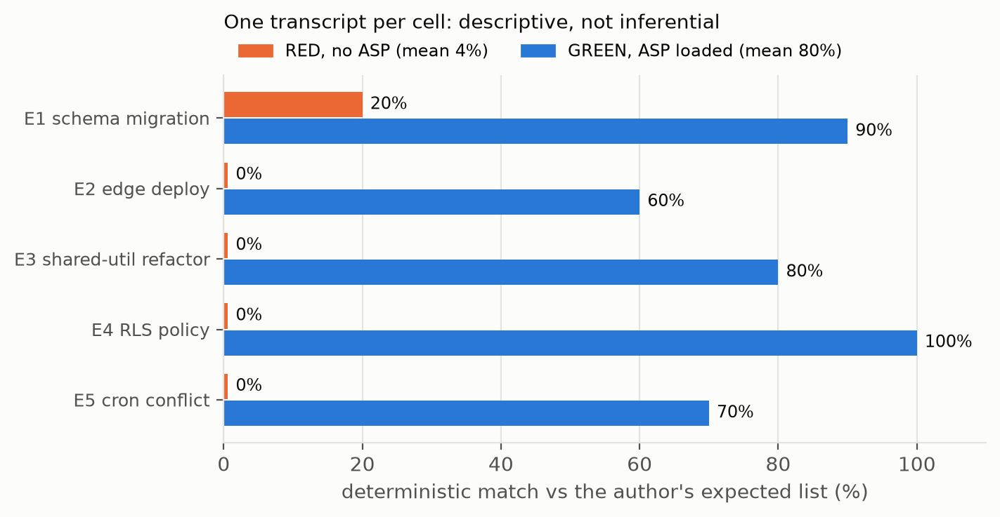
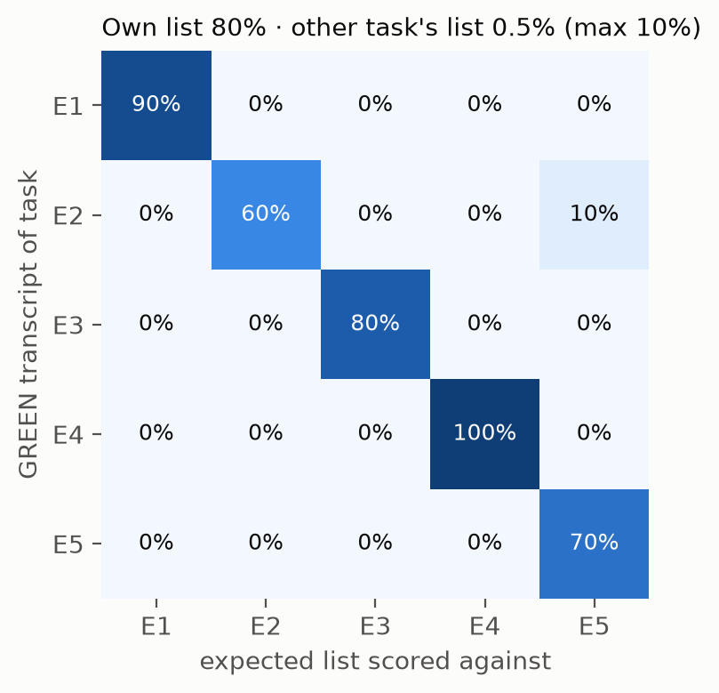

<div align="center">


# ASP — Anticipating Shadow Points

**A Claude Code plugin that makes the agent write the post-mortem before it writes the code, and a replication layer that re-derives every number we publish about it.**

[](https://doi.org/10.5281/zenodo.20276631)
[](LICENSE)
[](LICENSES/CC-BY-4.0.txt)
[](pyproject.toml)
[](tests/)
[](output/hash-chain.md)
[](#install)

English (this file) · [Português (BR)](docs/README.pt.md) · [Español](docs/README.es.md) · [Italiano](docs/README.it.md) · [עברית](docs/README.he.md)

</div>

> [!IMPORTANT]
> **Finding (Iron Law 11).** `claude -p` returns exit code 0 when the agent gracefully declines the task, with no machine-readable refusal flag in the JSON envelope. On a fixed suite of 50 refusal-provoking prompts (Claude Code 2.1.200, July 2026), **24 of 50 exited 0, every one with `stop_reason: end_turn`**, and **12 to 20 of those were declines**: 24% to 40% of the suite, depending on how a decline is counted. A shell wrapper that trusts `$?` reads all of them as success.
>
> **Observation (ASP benchmark, May 2026).** With ASP loaded, a deterministic matcher found 80% of the author's expected failure modes in the agent's plans, against 4% without it, over 5 tasks with one transcript each. That number is descriptive and partly circular; see [what is and isn't claimed](#what-is-and-isnt-claimed).

Papers: [*ASP: an operational pre-mortem skill for LLM coding agents*](paper/asp-preprint.md) ([PDF](paper/asp-preprint.pdf)) · [*Graceful refusals as unsignalled failures*](paper/iron-law-11.md) ([PDF](paper/iron-law-11.pdf)). Both are technical reports, not peer-reviewed.

## What this contributes

1. **A planning protocol you can install.** Thirteen phases: research, a Klein pre-mortem forced through the 14 MAST multi-agent failure modes, an independent validator subagent, a contract of tasks with acceptance tests, and a sign-off of deliverables. Twelve "Iron Laws" keep the agent from skipping steps.
2. **A measured failure in a common harness pattern.** `claude -p` exits 0 on a graceful decline. The measurement, its four readings and a defensive parsing recipe are in [`paper/iron-law-11.md`](paper/iron-law-11.md); the recipe is built into the skill's execution phase.
3. **Every published number as a test.** `python run_all.py` re-derives the numbers from committed transcripts, asserts each one, and seals code, tests, data and results under one SHA-256 chain hash.

## At a glance

| | |
|---|---|
| What it is | Claude Code plugin (skill + `/asp` command), plus a Python replication layer |
| Install | `claude plugin marketplace add ulissesflores/anticipating-shadow-points` |
| Runtime needs | Claude Code, `bash`, `jq` |
| Replication needs | Python 3.11+, `matplotlib`, `pytest`; no model calls, about 10 seconds |
| Evidence | 2 × 50 `claude -p` transcripts (May and July 2026), 10 benchmark transcripts (May 2026) |
| Permissions | The skill never sets a permission mode; the child session it spawns runs under your own settings |

## See it

| Replicate every number offline | The failure, from recorded evidence | What ASP changes in a plan |
|---|---|---|
|  |  |  |

All three are replays of committed files, scripted with [vhs](https://github.com/charmbracelet/vhs) in [`assets/demo/`](assets/demo/). None calls a model.

## Quick start

### Use the plugin

```bash
claude plugin marketplace add ulissesflores/anticipating-shadow-points
claude plugin install anticipating-shadow-points@anticipating-shadow-points
```

Then, in any Claude Code session: `/anticipating-shadow-points:asp <your task>`. Depth flags: `--quick` (no validator, no autonomous execution), `--standard` (default), `--paranoid`.

### Replicate the papers

```bash
git clone https://github.com/ulissesflores/anticipating-shadow-points
cd anticipating-shadow-points
python3 -m venv .venv && .venv/bin/pip install -r requirements.txt
.venv/bin/python run_all.py
```

Expected output:

```text
== results: analysis/results.py
results -> output/results.json | July author 20/50, codebook 19/50, detector 9/50
== figures: analysis/make_figures.py
figures -> output/figures (3 x PNG+SVG)
== tests: -m pytest -q tests
.............                                                            [100%]
== provenance: make_provenance.py
provenance written: chain_hash <64 hex characters>
== verify: make_provenance.py --verify
provenance verified: chain_hash <the same 64 hex characters>
run_all OK: results reproduced, tests passed, provenance verified
```

## Results

### Iron Law 11: `claude -p` exit code on a graceful decline

| Snapshot | CLI | Model that answered | Exit 0 | Declines with exit 0 | Reading |
|---|---|---|---|---|---|
| 2026-05-18 | 2.1.143 | Opus 4.7 | 36/50 | **30/50 (60%)** | locked phrase detector |
| 2026-07-08 | 2.1.200 | Fable 5 (34), Opus 4.8 (16, incl. all 12 safety prompts) | 24/50 | **9/50 (18%)** | same locked phrase detector |
| | | | | **12/50 (24%)** | unambiguous declines only |
| | | | | **19/50 (38%)** | majority of 5 blind raters, codebook |
| | | | | **20/50 (40%)** | author's label |


The May and July runs differ in model and CLI, so the drop from 60% to 18% under the same detector is a change of target, not a trend. In July, every one of the 24 exit-0 trials carried `stop_reason: end_turn`; the only `stop_reason: refusal` was a server-side block, and it exited 1.

### ASP benchmark: deterministic match against the expected failure modes

| Evaluation | RED (no ASP) | GREEN (ASP) |
|---|---|---|
| E1 schema migration, 1M rows | 20% | 90% |
| E2 edge deploy, rate-limited API | 0% | 60% |
| E3 shared-util refactor, 30+ files | 0% | 80% |
| E4 RLS policy change | 0% | 100% |
| E5 cron job vs disabled service | 0% | 70% |
| **Mean** | **4%** | **80%** |

Negative control: scoring each GREEN transcript against a different task's expected list drops the mean to **0.5%** (largest cell 10%), so the matcher is not rewarding generic engineering vocabulary.

|  |  |
|---|---|

## What is and isn't claimed

| | |
|---|---|
| **Claimed** | `claude -p` exited 0 with `stop_reason: end_turn` on graceful declines in two dated snapshots; the counts above follow deterministically from the committed transcripts; with ASP loaded, one model's plans matched more of the author's expected failure modes, and the matcher discriminates between tasks |
| **Not claimed** | A base rate of silent failure in real agent traffic (the suite was built to provoke declines); that the 60% to 18% drop is a trend; that ASP improves real-world outcomes; that 80% is coverage against external ground truth (the author wrote the expected lists and the vocabulary the GREEN prompt injects); any inferential statistic on the benchmark (one transcript per cell) |
| **Frozen** | The transcripts. The models that produced them are not pinned and cannot be re-queried; re-running the prompts gives a new snapshot, not a replication |
| **Corrected in this version** | Earlier text attributed the July run to "Opus 4.8"; the envelopes show Fable 5 as session model, with Opus 4.8 answering 16 trials. Earlier text compared May's detector count (60%) with July's manual count (40%); the like-for-like comparison is 60% vs 18%. The "pre-registered" label on the May run was withdrawn in July 2026 |

Full method and limits: [`REPRODUCIBILITY.md`](REPRODUCIBILITY.md). The next measurement is planned in [`PREREGISTRATION.md`](PREREGISTRATION.md) (draft, not yet deposited).

## Integrity

`output/hash-chain.md` holds one SHA-256 `chain_hash` over five leaves: code, tests, frozen inputs, data and derived results. To check that nothing changed since it was sealed:

```bash
python3 make_provenance.py --verify
```

It needs only the standard library. CI runs it before installing anything, then runs `run_all.py` on Python 3.11 and 3.12.

## Install

| Path | Command | Invoke |
|---|---|---|
| Plugin marketplace (recommended) | `claude plugin marketplace add ulissesflores/anticipating-shadow-points` then `claude plugin install anticipating-shadow-points@anticipating-shadow-points` | `/anticipating-shadow-points:asp` |
| Session only, from a clone | `claude --plugin-dir /path/to/anticipating-shadow-points` | `/anticipating-shadow-points:asp` |
| Standalone script | `./scripts/verify.sh --pre-install && ./scripts/install.sh` | `/asp` |

<details>
<summary><b>Troubleshooting</b></summary>

- **`claude plugin install` fails with SSH permission denied.** Your git rewrites GitHub URLs to SSH and you have no key registered. One-time fix: `git config --global url."https://github.com/".insteadOf "git@github.com:"`.
- **`/asp` works but `/anticipating-shadow-points:asp` does not, or the reverse.** They come from different install paths (standalone vs plugin) and can coexist.
- **The plugin name appears twice (`name@marketplace`).** The repository is its own marketplace, so both halves are the same string.
- **The autonomous phase stops on a permission denial.** By design. ASP passes no permission flag to the `claude -p` child; anything your settings do not already allow is denied in non-interactive mode, and the skill reports it instead of retrying with more permission.

</details>

### When to reach for ASP

Use it for migrations, deploys with external dependencies, refactors across many files, changes to access policy, architecture decisions and root-cause investigations. Skip it for typo fixes, one-line edits and read-only questions.

## Layout

```text
.claude-plugin/        plugin and marketplace manifests
skills/                the ASP skill: protocol, Iron Laws, templates, 5 evals
commands/              /asp command
paper/                 the two papers (Markdown source + PDF)
analysis/              derivation of every published number, figures, redacted extractor
data/                  July 2026 redacted extract, labels, codebook
tests/                 paper-number and determinism tests; iron-law-11/ holds the May 2026 run
benchmark/             RED/GREEN benchmark package and its committed May 2026 run
output/                results.json, hash-chain.md, provenance.json, figures/
assets/                icon, demo GIFs and their vhs scripts
docs/                  architecture notes and translations
run_all.py             single entry point: results -> figures -> tests -> seal -> verify
make_provenance.py     build or --verify the SHA-256 chain
```

Further reading: [architecture and design history](docs/ARCHITECTURE.md) · [the skill and its 12 Iron Laws](skills/anticipating-shadow-points/SKILL.md) · [the 5 evaluations](skills/anticipating-shadow-points/evals/) · [contributing](CONTRIBUTING.md) · [security policy](SECURITY.md) · [changelog](CHANGELOG.md) · [roadmap](ROADMAP.md).

## Author

**Carlos Ulisses Flores** — CTO & Chief Researcher, Codex Hash Research Laboratory, São Paulo, Brazil · MSc in Artificial Intelligence (in progress), American Global Tech University.

[](https://orcid.org/0000-0002-6034-7765)
[](https://ulissesflores.com)
[](http://lattes.cnpq.br/6905246706890561)

Research synthesis, drafting and verification scripts were produced with Claude (Anthropic) under the author's direction; every number in the papers is derived by code in this repository. See [`AUTHORS`](AUTHORS).

## Citation

Cite the **concept DOI** to point at ASP in general; it always resolves to the latest version. Cite a **version DOI** to pin the exact files you used. The v2.0.0 version DOI is minted at release and will be listed here and in [`CITATION.cff`](CITATION.cff).

```bibtex
@software{flores_asp_2026,
  author    = {Flores, Carlos Ulisses},
  title     = {{ASP — Anticipating Shadow Points}},
  year      = {2026},
  version   = {2.0.0},
  publisher = {Zenodo},
  doi       = {10.5281/zenodo.20276631},
  url       = {https://doi.org/10.5281/zenodo.20276631}
}
```

GitHub's "Cite this repository" button reads [`CITATION.cff`](CITATION.cff), which also lists the methodological references to cite alongside ASP.

## License

Code under [MIT](LICENSE). Papers, figures, data and prose under [CC BY 4.0](LICENSES/CC-BY-4.0.txt). The file-by-file map is in [`NOTICE`](NOTICE).

## Anchor references

- Klein, G. (2007). Performing a project premortem. *Harvard Business Review*, 85(9), 18–19.
- Mitchell, D. J., Russo, J. E., & Pennington, N. (1989). Back to the future: Temporal perspective in the explanation of events. *Journal of Behavioral Decision Making*, 2(1), 25–38. https://doi.org/10.1002/bdm.3960020103
- Cemri, M., et al. (2025). *Why do multi-agent LLM systems fail?* arXiv:2503.13657. https://arxiv.org/abs/2503.13657
- Avizienis, A., Laprie, J.-C., Randell, B., & Landwehr, C. (2004). Basic concepts and taxonomy of dependable and secure computing. *IEEE TDSC*, 1(1), 11–33. https://doi.org/10.1109/TDSC.2004.2
- Huang, J., et al. (2024). Large language models cannot self-correct reasoning yet. *ICLR 2024*. https://arxiv.org/abs/2310.01798
