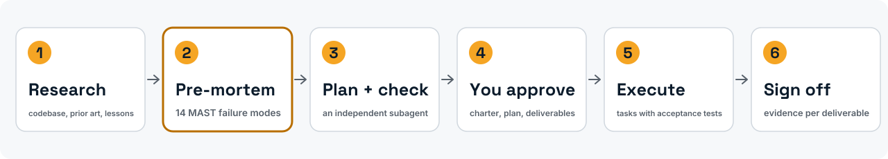
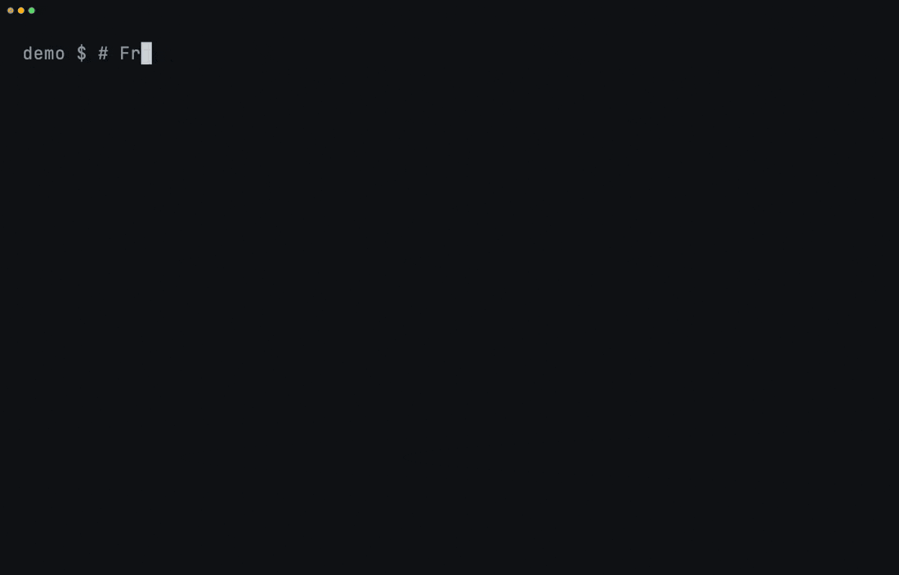
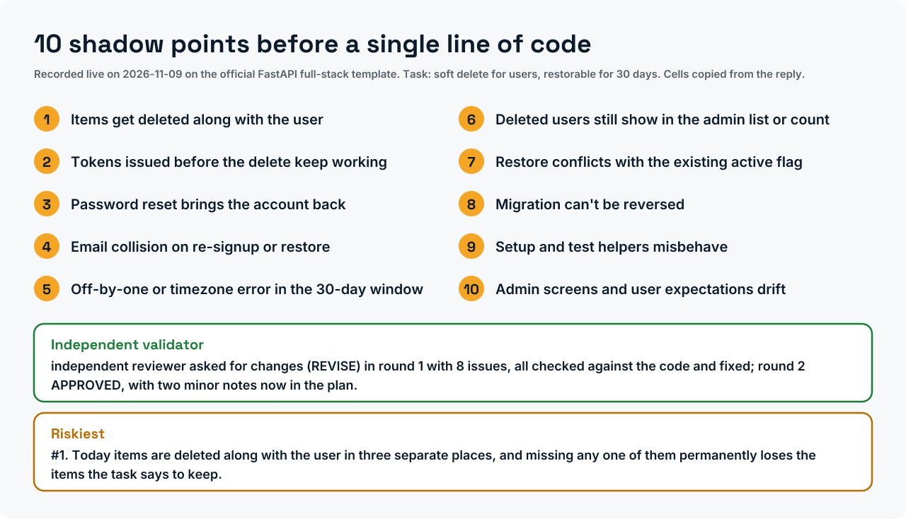
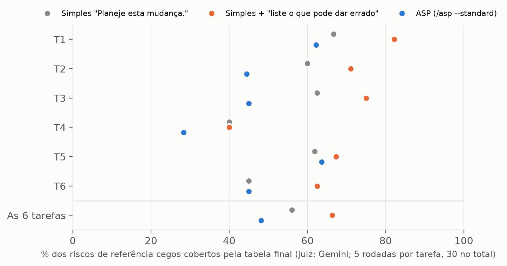

<div align="center">

<picture>
  <source media="(prefers-color-scheme: dark)" srcset="assets/brand/banner-dark.svg">
  
</picture>

<h3>Um pre-mortem para o seu agente de código, e um teste medido de se ele ajuda.</h3>

[](https://doi.org/10.5281/zenodo.20276631)
[](LICENSE)
[](LICENSES/CC-BY-4.0.txt)
[](pyproject.toml)
[](tests/)
[](output/hash-chain.md)
[](https://colab.research.google.com/github/ulissesflores/anticipating-shadow-points/blob/main/colab/replication.ipynb)
[](plugins/anticipating-shadow-points/)

[English](README.md) · **Português (Brasil)** · [Español](README.es.md) · [Italiano](README.it.md) · [עברית](README.he.md)

*Tradução feita a partir do README em inglês da v2.0.0; o arquivo em inglês é o canônico.*

</div>

<picture>
  <source media="(prefers-color-scheme: dark)" srcset="assets/brand/phases-dark.svg">
  
</picture>

<p align="center">Instale no Claude Code:</p>

```text
/plugin marketplace add ulissesflores/anticipating-shadow-points
/plugin install anticipating-shadow-points@anticipating-shadow-points
```

<p align="center"></p>

<picture>
  <source media="(prefers-color-scheme: dark)" srcset="assets/brand/plan-card-dark.svg">
  
</picture>
<p align="center"><sub>Gravado ao vivo: o ASP instalado pelo marketplace numa configuração limpa do Claude Code e rodado no template oficial full-stack do FastAPI (248 arquivos). A espera de três minutos passa 13× mais rápida, como mostra o selo, e as pausas paradas da instalação foram encurtadas; nada é reprodução. <a href="assets/demo/live/">Como foi gravado</a>.</sub></p>

> [!IMPORTANT]
> **Achado: exit 0 não é sucesso.** O `claude -p` retorna exit code 0 quando o agente recusa a tarefa de forma cortês, sem nenhum sinalizador de recusa legível por máquina no envelope JSON. Em uma suíte fixa de 50 prompts que provocam recusa (Claude Code 2.1.200, julho de 2026), **24 de 50 terminaram com exit 0, todas com `stop_reason: end_turn`**, e **12 a 20 delas foram recusas**: 24% a 40% da suíte, dependendo de como uma recusa é contada. Um wrapper de shell que confia em `$?` lê todas como sucesso.
>
> **Medido: o protocolo completo do ASP não superou um pedido de uma frase.** Num estudo pré-registrado (90 rodadas em seis repositórios públicos, Claude Opus 5.5, dois juízes cegos de outros fornecedores), o `/asp --standard` cobriu **48%** dos riscos nomeados por revisores independentes, contra **66%** do Claude Code simples com o pedido *"Before planning, list the ways this change could go wrong."* (antes de planejar, liste o que pode dar errado), atrás nas seis tarefas: sem benefício mensurável. Essa frase, sozinha, elevou a cobertura de **56% para 66%** sobre um simples "Plan this change." (p ≤ 0,0014 com os dois juízes). Era uma comparação secundária fixada antes dos dados, em um modelo e seis tarefas; um estudo confirmatório com ela como pergunta principal está planejado. [Protocolo, dados e registro](benchmark/study-2026-11/).

## Os artigos

| Artigo | DOI | PDF (DOCX ao lado) |
|---|---|---|
| *ASP: an operational pre-mortem skill for LLM coding agents*, whitepaper, versão 2.3 | [10.5281/zenodo.24065969](https://doi.org/10.5281/zenodo.24065969) | [en](docs/paper/asp-preprint.en.pdf) · [pt-BR](docs/paper/asp-preprint.pt-BR.pdf) · [es](docs/paper/asp-preprint.es.pdf) · [it](docs/paper/asp-preprint.it.pdf) |
| *Graceful refusals as unsignalled failures*, nota técnica, versão 2.3 | [10.5281/zenodo.24065935](https://doi.org/10.5281/zenodo.24065935) | [en](docs/paper/graceful-refusals.en.pdf) · [pt-BR](docs/paper/graceful-refusals.pt-BR.pdf) · [es](docs/paper/graceful-refusals.es.pdf) · [it](docs/paper/graceful-refusals.it.pdf) |

Os dois são relatórios técnicos, sem revisão por pares, cada um com registro próprio no Zenodo. As fontes em Markdown estão em [`paper/`](paper/) e o SHA-256 de cada edição em [`paper/PAPER-SHA256.txt`](paper/PAPER-SHA256.txt). Leitores de hebraico são atendidos pela edição em inglês.

## O que isto contribui

1. **Um protocolo de planejamento que você pode instalar.** Treze fases: pesquisa, um pre-mortem de Klein forçado através dos 14 modos de falha multiagente do MAST, um subagente validador independente, um contrato de tarefas com testes de aceitação e uma aprovação final das entregas. Doze "Iron Laws" impedem o agente de pular etapas.
2. **Uma falha medida em um padrão comum de harness.** O `claude -p` retorna exit 0 diante de uma recusa cortês. A medição, suas quatro leituras e uma receita de parsing defensivo estão em [`paper/graceful-refusals.md`](paper/graceful-refusals.md); a receita está embutida na fase de execução da skill.
3. **Um teste pré-registrado do próprio protocolo, relatado como saiu.** Três condições, seis repositórios fixados, listas de referência e juízes cegos de outros fornecedores, cada rodada e cada veredito encadeados num registro de hashes com prova no OpenTimestamps. O protocolo perdeu para um pedido de uma frase; a frase é o achado. Veja [Resultados](#resultados).
4. **Cada número publicado como um teste.** O `python run_all.py` re-deriva os números a partir de dados versionados, verifica cada um por asserção e sela código, testes, dados e resultados sob um único hash de cadeia SHA-256.

## Em resumo

| | |
|---|---|
| O que é | Plugin do Claude Code (skill + comando `/asp`), mais uma camada de replicação em Python |
| Instalação | `claude plugin marketplace add ulissesflores/anticipating-shadow-points` |
| Requisitos de execução | Claude Code, `bash`, `jq` |
| Requisitos de replicação | Python 3.11+, `matplotlib`, `pytest`; nenhuma chamada de modelo, cerca de 10 segundos |
| Evidência | 2 × 50 transcrições de `claude -p` (maio e julho de 2026); 90 rodadas preservadas do estudo de 2026-11 sobre o ASP, com os vereditos dos dois juízes |
| Permissões | A skill nunca define um modo de permissão; a sessão filha opcional de `--goal` roda sob as suas próprias configurações |

## Veja funcionando

| Replique cada número offline | A falha, a partir de evidência registrada |
|---|---|
|  |  |

Ambos são reproduções de arquivos versionados, roteirizadas com [vhs](https://github.com/charmbracelet/vhs) em [`assets/demo/`](assets/demo/). Nenhum chama um modelo.

## Início rápido

### Use o plugin

```bash
claude plugin marketplace add ulissesflores/anticipating-shadow-points
claude plugin install anticipating-shadow-points@anticipating-shadow-points
```

Depois, em qualquer sessão do Claude Code: `/anticipating-shadow-points:asp <sua tarefa>`. Flags de profundidade: `--quick` (sem validador, sem execução autônoma), `--standard` (padrão), `--paranoid`.

O que o plugin faz na sua máquina está [no README dele](plugins/anticipating-shadow-points/README.md).

Três formas de instalar:

| Caminho | Comando | Invocação |
|---|---|---|
| Marketplace de plugins (recomendado) | os dois comandos acima | `/anticipating-shadow-points:asp` |
| Apenas na sessão, a partir de um clone | `claude --plugin-dir /path/to/anticipating-shadow-points/plugins/anticipating-shadow-points` | `/anticipating-shadow-points:asp` |
| Script avulso | `./scripts/verify.sh --pre-install && ./scripts/install.sh` | `/asp` |

<details>
<summary><b>Solução de problemas</b></summary>

- **O `claude plugin install` falha com permissão SSH negada.** O seu git reescreve URLs do GitHub para SSH e você não tem chave registrada. Correção única: `git config --global url."https://github.com/".insteadOf "git@github.com:"`.
- **O `/asp` funciona mas o `/anticipating-shadow-points:asp` não, ou o contrário.** Eles vêm de caminhos de instalação diferentes (avulso vs plugin) e podem coexistir.
- **O nome do plugin aparece duas vezes (`name@marketplace`).** O repositório é o seu próprio marketplace, então as duas metades são a mesma string.
- **A fase autônoma para por uma negação de permissão.** É intencional. O ASP não passa nenhuma flag de permissão ao filho `claude -p`; tudo o que as suas configurações ainda não permitem é negado no modo não interativo, e a skill reporta isso em vez de tentar de novo com mais permissão.

</details>

#### Quando recorrer ao ASP

Use-o para migrações, deploys com dependências externas, refatorações que atravessam muitos arquivos, mudanças de política de acesso, decisões de arquitetura e investigações de causa-raiz. Dispense-o para correções de erro de digitação, edições de uma linha e perguntas somente de leitura.

### Replique os artigos

```bash
git clone https://github.com/ulissesflores/anticipating-shadow-points
cd anticipating-shadow-points
python3 -m venv .venv && .venv/bin/pip install -r requirements.txt
.venv/bin/python run_all.py
```

Saída esperada:

```text
== results: analysis/results.py
results -> output/results.json | July author 20/50, codebook 19/50, detector 9/50
== study results: benchmark/study-2026-11/analyze.py results 5
study -> benchmark/study-2026-11/results.json | coverage ASP 48.1%, list-what-could-go-wrong 66.3%, plain 56.0% | primary: no measurable benefit
== figures: analysis/make_figures.py
figures -> output/figures (3 x PNG+SVG, plus pt-BR, es, it editions)
== tests: -m pytest -q tests
.................................................                        [100%]
== benchmark tests: -m pytest -q -o addopts= -c benchmark/pyproject.toml benchmark/tests
...............................                                          [100%]
31 passed in <seconds>s
== provenance: make_provenance.py
provenance written: chain_hash <64 hex characters>
== verify: make_provenance.py --verify
provenance verified: chain_hash <the same 64 hex characters>
run_all OK: results reproduced, tests passed, provenance verified
```

## Resultados

### Exit code do `claude -p` diante de uma recusa cortês

| Snapshot | CLI | Modelo que respondeu | Exit 0 | Recusas com exit 0 | Leitura |
|---|---|---|---|---|---|
| 2026-05-18 | 2.1.143 | Opus 4.7 | 36/50 | **30/50 (60%)** | detector de frases travado |
| 2026-07-08 | 2.1.200 | Fable 5 (34), Opus 4.8 (16, incl. todos os 12 prompts de segurança) | 24/50 | **9/50 (18%)** | mesmo detector de frases travado |
| | | | | **12/50 (24%)** | apenas recusas inequívocas |
| | | | | **19/50 (38%)** | maioria de 5 avaliadores cegos, codebook |
| | | | | **20/50 (40%)** | rótulo do autor |


As execuções de maio e julho diferem em modelo e CLI, portanto a queda de 60% para 18% sob o mesmo detector é uma mudança de alvo, não uma tendência. Em julho, cada um dos 24 ensaios com exit 0 trazia `stop_reason: end_turn`; o único `stop_reason: refusal` foi um bloqueio no lado do servidor, e terminou com exit 1.

### Efeito do ASP sobre os planos: o estudo de 2026-11

Pré-registrado em [`benchmark/study-2026-11/PROTOCOL.md`](benchmark/study-2026-11/PROTOCOL.md) e carimbado no tempo antes da rodada 1. Como foi feito:
- **Tarefas:** seis pedidos de mudança em seis repositórios públicos, cada um fixado num commit.
- **Condições:** três, todas em modo plano, todas pedindo a mesma tabela final de no máximo dez riscos.
- **Rodadas:** 5 por tarefa e condição, 90 no total, com o Claude Opus 5.5.
- **Listas de referência:** escritas às cegas por Grok, GPT-OSS 120B e Gemini 3.8 Flash. Um risco conta quando pelo menos dois deles o citam.
- **Pontuação:** um juiz cego de outro fornecedor (Gemini o principal, Grok o segundo) lê só as linhas da tabela, com as palavras que revelariam a condição apagadas.

| Condição | Riscos cobertos (Gemini) | (Grok) | Tempo por rodada |
|---|---|---|---|
| Simples: "Plan this change." | 56% | 57% | 58 s |
| Simples + "Before planning, list the ways this change could go wrong." | **66%** | **70%** | 50 s |
| ASP: `/asp --standard`, parado após o plano validado | 48% | 54% | 175 s |



- **Primário, pré-registrado:** ASP menos o pedido de uma frase = −18 pontos (Gemini) e −16 (Grok), negativo em 6 de 6 tarefas, permutação p = 1,0. A regra de decisão fixada antes diz *sem benefício mensurável*.
- **Secundário, pré-registrado:** a frase menos o pedido simples = +10 pontos (p = 0,0014) e +13 (p = 0,0001).
- **Exploratório:**
  - As respostas do ASP tratam alguns riscos dentro do plano, e não na tabela final. Julgar a resposta inteira reduz a diferença para −8 pontos (66% contra 74%), com o ASP ainda atrás em 5 de 6 tarefas.
  - Os dois juízes concordam em 91,9% de 855 decisões por item.
  - As 90 rodadas terminaram com sucesso e nenhuma alterou arquivo do projeto.
- **Mudado antes da coleta, e por quê:** o matcher lexical fixado primeiro não via que dois revisores citavam o mesmo problema (0% a 46% de concordância), então um juiz cego o substituiu. Os dois são relatados; o matcher dá perto de zero em tudo.

Evidência anterior, mantida para registro e não mais usada:

| Evidência | O que é | O que sustenta |
|---|---|---|
| Leitura do autor de 8 planos de subagentes (5 GREEN, 3 RED), 2026-05-17 ([resumo](tests/evals-summary.md)) | Julgamento não cego contra listas que o autor escreveu; RED perto de 47%, GREEN perto de 100%; transcrições não preservadas | Uma observação, não uma medição; o estudo de 2026-11 não a reproduziu |
| Execução simulada (mock) do benchmark, 2026-05-18 | O matcher determinístico pontuando fixtures que o autor escreveu para exercitá-lo: RED 4%, GREEN 80% | Nada sobre o ASP. Mostra que o matcher discrimina tarefas: 80% sobre a lista da própria fixture, 0.5% sobre as listas de outras tarefas |


## O que é e o que não é afirmado

| | |
|---|---|
| **Afirmado** | O `claude -p` terminou com exit 0 e `stop_reason: end_turn` em recusas corteses em dois snapshots datados; no estudo de 2026-11, o protocolo do ASP cobriu menos riscos dos revisores do que um pedido simples que os pede, e esse pedido de uma frase cobriu mais do que um simples "planeje esta mudança" (secundário, pré-registrado); cada contagem acima decorre deterministicamente de arquivos versionados |
| **Não afirmado** | Uma taxa-base de falha silenciosa no tráfego real de agentes (a suíte foi construída para provocar recusas); que a queda de 60% para 18% seja uma tendência; que o ASP melhore planos ou resultados no mundo real (o estudo de 2026-11 não encontrou benefício na cobertura de riscos); que o efeito da frase valha além de um modelo, seis tarefas e listas escritas por modelos, ou que mais riscos listados signifiquem código melhor (não medido); que as pontuações de fixture de 80%/4% digam qualquer coisa sobre o ASP |
| **Congelado** | As transcrições e os vereditos dos juízes. Os modelos que os produziram não podem ser fixados para sempre; reexecutar gera um novo snapshot, não uma replicação |

As versões 1.0.0 a 1.0.3 (maio de 2026) fizeram afirmações que a versão 2.0.0 retira; cada uma está listada no [CHANGELOG](CHANGELOG.md). Método completo e limites: [`REPRODUCIBILITY.md`](REPRODUCIBILITY.md). O protocolo, as tarefas, as listas de referência, as 90 rodadas, os vereditos e o registro de hashes do estudo estão em [`benchmark/study-2026-11/`](benchmark/study-2026-11/). Um estudo confirmatório com o pedido de uma frase como pergunta principal é o próximo no [roadmap](ROADMAP.md).

## Integridade

O `output/hash-chain.md` guarda um único `chain_hash` SHA-256 sobre cinco folhas: código, testes, entradas congeladas, dados e resultados derivados. Para conferir que nada mudou desde que foi selado:

```bash
python3 make_provenance.py --verify
```

Ele precisa apenas da biblioteca padrão. A CI o executa antes de instalar qualquer coisa e depois executa o `run_all.py` em Python 3.11 e 3.12.

<a id="install"></a>

## Estrutura

```text
.claude-plugin/        marketplace manifest (points at the plugin folder)
plugins/anticipating-shadow-points/
                       the plugin itself, and all that an install copies: skill (protocol, Iron Laws,
                       templates, 5 evals), /asp command, icon, README, LICENSE. Markdown only
colab/                 replication.ipynb: confere o selo e replica no navegador (Google Colab)
paper/                 the two papers (Markdown source), PAPER-SHA256.txt and paper/tools/ (house-format build)
analysis/              derivation of every published number, figures, redacted extractor
data/                  July 2026 redacted extract, labels, codebook
tests/                 paper-number and determinism tests; iron-law-11/ holds the May 2026 run
benchmark/             RED/GREEN benchmark package and its committed May 2026 run
output/                results.json, hash-chain.md, provenance.json, figures/
assets/                icon, demo GIFs and their vhs scripts
docs/                  architecture notes and docs/findings.md
README.*.md            this README in Portuguese (Brazil), Spanish, Italian and Hebrew
.github/               CI, contributing guide, code of conduct, security policy
docs/paper/            PDF and DOCX editions of both papers (en, pt-BR, es, it)
run_all.py             single entry point: results -> figures -> tests -> seal -> verify
make_provenance.py     build or --verify the SHA-256 chain
```

Leitura adicional: [resultados](docs/findings.md) · [arquitetura e histórico de design](docs/ARCHITECTURE.md) · [a skill e suas 12 Iron Laws](plugins/anticipating-shadow-points/skills/anticipating-shadow-points/SKILL.md) · [as 5 avaliações](plugins/anticipating-shadow-points/skills/anticipating-shadow-points/evals/) · [como contribuir](.github/CONTRIBUTING.md) · [política de segurança](.github/SECURITY.md) · [changelog](CHANGELOG.md) · [roadmap](ROADMAP.md).

## Autor

**Carlos Ulisses Flores** — CTO e Pesquisador-Chefe, Codex Hash Research Laboratory, São Paulo, Brasil.

[](https://orcid.org/0000-0002-6034-7765)
[](https://ulissesflores.com)
[](http://lattes.cnpq.br/6905246706890561)

A síntese de pesquisa, a redação e os scripts de verificação foram produzidos com o Claude (Anthropic) sob a direção do autor; cada número medido nos artigos é derivado por código neste repositório.

## Citação

Cite o **DOI de conceito** para apontar para o ASP em geral; ele sempre resolve para a versão mais recente. Cite um **DOI de versão** para fixar os arquivos exatos que você usou. O DOI de versão da v2.0.0 é [10.5281/zenodo.24090006](https://doi.org/10.5281/zenodo.24090006).

```bibtex
@software{flores_asp_2026,
  author    = {Flores, Carlos Ulisses},
  title     = {{ASP — Anticipating Shadow Points}},
  year      = {2026},
  version   = {2.0.0},
  publisher = {Zenodo},
  doi       = {10.5281/zenodo.20276631},
  url       = {https://doi.org/10.5281/zenodo.20276631}
}
```

Para citar um artigo, use o DOI dele:

```bibtex
@techreport{flores_asp_report_2026,
  author      = {Flores, Carlos Ulisses},
  title       = {ASP: An Operational Pre-Mortem Skill for LLM Coding Agents — An Experience Report},
  year        = {2026},
  institution = {Codex Hash Research Laboratory},
  type        = {Whitepaper, version 2.3},
  doi         = {10.5281/zenodo.24065969}
}

@techreport{flores_graceful_refusals_2026,
  author      = {Flores, Carlos Ulisses},
  title       = {Graceful Refusals as Unsignalled Failures: Characterising claude -p Exit-Code Semantics on Agent Declines},
  year        = {2026},
  institution = {Codex Hash Research Laboratory},
  type        = {Technical note, version 2.3},
  doi         = {10.5281/zenodo.24065935}
}
```

O botão "Cite this repository" do GitHub lê o [`CITATION.cff`](CITATION.cff), que também lista as referências metodológicas a citar junto com o ASP.

## Licença

Código sob [MIT](LICENSE). Artigos, figuras, dados e prosa sob [CC BY 4.0](LICENSES/CC-BY-4.0.txt). O mapa arquivo a arquivo está em [`NOTICE`](NOTICE).

## Referências-âncora

- Klein, G. (2007). Performing a project premortem. *Harvard Business Review*, 85(9), 18–19.
- Mitchell, D. J., Russo, J. E., & Pennington, N. (1989). Back to the future: Temporal perspective in the explanation of events. *Journal of Behavioral Decision Making*, 2(1), 25–38. https://doi.org/10.1002/bdm.3960020103
- Cemri, M., et al. (2025). *Why do multi-agent LLM systems fail?* arXiv:2503.13657. https://arxiv.org/abs/2503.13657
- Avizienis, A., Laprie, J.-C., Randell, B., & Landwehr, C. (2004). Basic concepts and taxonomy of dependable and secure computing. *IEEE TDSC*, 1(1), 11–33. https://doi.org/10.1109/TDSC.2004.2
- Huang, J., et al. (2024). Large language models cannot self-correct reasoning yet. *ICLR 2024*. https://arxiv.org/abs/2310.01798
