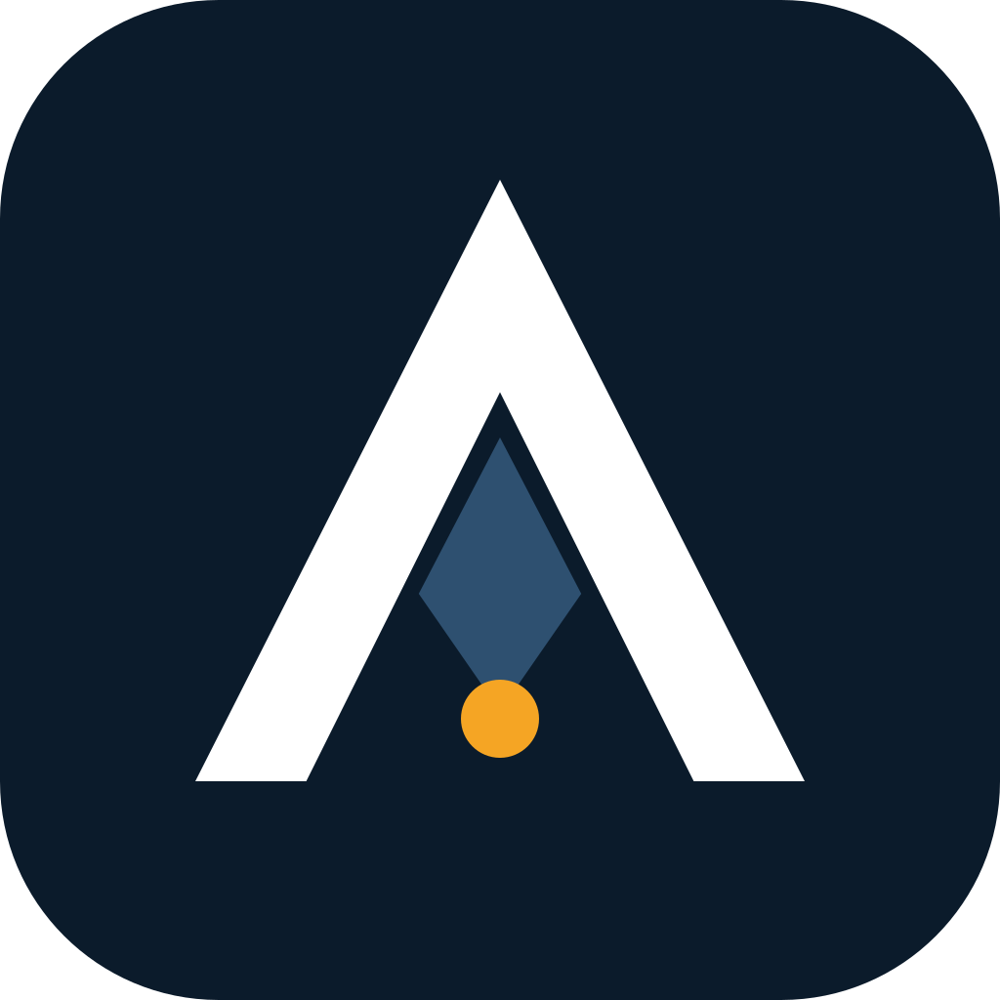

<div align="center">



# ASP — Anticipating Shadow Points

**Un plugin de Claude Code que hace que el agente escriba el post-mortem antes de escribir el código, y una capa de replicación que vuelve a derivar cada número que publicamos sobre él.**

[](https://doi.org/10.5281/zenodo.20276631)
[](../LICENSE)
[](../LICENSES/CC-BY-4.0.txt)
[](../pyproject.toml)
[](../tests/)
[](../output/hash-chain.md)
[](#instalación)

[English](../README.md) · [Português (BR)](README.pt.md) · Español (este archivo) · [Italiano](README.it.md) · [עברית](README.he.md)

*Traducido del README en inglés de la v2.0.0; el archivo en inglés es el canónico.*

*Traducción asistida por máquina; se agradece la revisión de hablantes nativos.*

</div>

> [!IMPORTANT]
> **Hallazgo (Iron Law 11).** `claude -p` devuelve exit code 0 cuando el agente rechaza amablemente la tarea, sin ninguna marca de rechazo legible por máquina en el sobre JSON. En una suite fija de 50 prompts diseñados para provocar rechazos (Claude Code 2.1.200, julio de 2026), **24 de 50 terminaron con exit code 0, todos ellos con `stop_reason: end_turn`**, y **entre 12 y 20 de esos fueron rechazos**: del 24% al 40% de la suite, según cómo se cuente un rechazo. Un wrapper de shell que confíe en `$?` los lee todos como éxito.
>
> **Aún no medido: si ASP mejora los planes.** El autor lo observó sin cegamiento en cinco tareas en mayo de 2026, y esas transcripciones no se conservaron. La cifra "80% vs 4%" de versiones anteriores salió de puntuar fixtures que el autor escribió para probar el matcher, no salidas de modelos; queda retirada como evidencia. Un benchmark real y preregistrado está [planificado](../PREREGISTRATION.md).

Papers: [*ASP: an operational pre-mortem skill for LLM coding agents*](../paper/asp-preprint.md) ([PDF](../paper/asp-preprint.pdf)) · [*Graceful refusals as unsignalled failures*](../paper/iron-law-11.md) ([PDF](../paper/iron-law-11.pdf)). Ambos son informes técnicos, no han sido revisados por pares.

## Qué aporta

1. **Un protocolo de planificación que puedes instalar.** Trece fases: investigación, un pre-mortem de Klein forzado a través de los 14 modos de fallo multiagente de MAST, un subagente validador independiente, un contrato de tareas con pruebas de aceptación y una firma de entregables. Doce "Iron Laws" impiden que el agente se salte pasos.
2. **Un fallo medido en un patrón común de harness.** `claude -p` sale con código 0 ante un rechazo amable. La medición, sus cuatro lecturas y una receta de parseo defensivo están en [`paper/iron-law-11.md`](../paper/iron-law-11.md); la receta está integrada en la fase de ejecución de la skill.
3. **Cada número publicado como un test.** `python run_all.py` vuelve a derivar los números a partir de datos confirmados en el repositorio, verifica cada uno con una aserción y sella código, tests, datos y resultados bajo un único chain hash SHA-256.

## De un vistazo

| | |
|---|---|
| Qué es | Plugin de Claude Code (skill + comando `/asp`), más una capa de replicación en Python |
| Instalación | `claude plugin marketplace add ulissesflores/anticipating-shadow-points` |
| Requisitos de ejecución | Claude Code, `bash`, `jq` |
| Requisitos de replicación | Python 3.11+, `matplotlib`, `pytest`; sin llamadas a modelos, unos 10 segundos |
| Evidencia | 2 × 50 transcripciones de `claude -p` (mayo y julio de 2026); aún no hay transcripciones conservadas para el efecto de ASP |
| Permisos | La skill nunca establece un modo de permisos; la sesión hija que lanza se ejecuta con tu propia configuración |

## Velo en acción

| Replica cada número sin conexión | El fallo, a partir de evidencia registrada |
|---|---|
|  |  |

Ambos son reproducciones de archivos confirmados en el repositorio, guionizadas con [vhs](https://github.com/charmbracelet/vhs) en [`assets/demo/`](../assets/demo/). Ninguno llama a un modelo.

## Inicio rápido

### Usar el plugin

```bash
claude plugin marketplace add ulissesflores/anticipating-shadow-points
claude plugin install anticipating-shadow-points@anticipating-shadow-points
```

Luego, en cualquier sesión de Claude Code: `/anticipating-shadow-points:asp <your task>`. Flags de profundidad: `--quick` (sin validador, sin ejecución autónoma), `--standard` (predeterminado), `--paranoid`.

### Replicar los papers

```bash
git clone https://github.com/ulissesflores/anticipating-shadow-points
cd anticipating-shadow-points
python3 -m venv .venv && .venv/bin/pip install -r requirements.txt
.venv/bin/python run_all.py
```

Salida esperada:

```text
== results: analysis/results.py
results -> output/results.json | July author 20/50, codebook 19/50, detector 9/50
== figures: analysis/make_figures.py
figures -> output/figures (3 x PNG+SVG)
== tests: -m pytest -q tests
.............                                                            [100%]
== provenance: make_provenance.py
provenance written: chain_hash <64 hex characters>
== verify: make_provenance.py --verify
provenance verified: chain_hash <the same 64 hex characters>
run_all OK: results reproduced, tests passed, provenance verified
```

## Resultados

### Iron Law 11: exit code de `claude -p` ante un rechazo amable

| Instantánea | CLI | Modelo que respondió | Exit 0 | Rechazos con exit 0 | Lectura |
|---|---|---|---|---|---|
| 2026-05-18 | 2.1.143 | Opus 4.7 | 36/50 | **30/50 (60%)** | detector de frases bloqueado |
| 2026-07-08 | 2.1.200 | Fable 5 (34), Opus 4.8 (16, incl. los 12 prompts de seguridad) | 24/50 | **9/50 (18%)** | el mismo detector de frases bloqueado |
| | | | | **12/50 (24%)** | solo rechazos inequívocos |
| | | | | **19/50 (38%)** | mayoría de 5 evaluadores ciegos, libro de códigos |
| | | | | **20/50 (40%)** | etiqueta del autor |


Las ejecuciones de mayo y julio difieren en modelo y CLI, de modo que la caída del 60% al 18% con el mismo detector es un cambio de objetivo, no una tendencia. En julio, cada uno de los 24 ensayos con exit 0 llevaba `stop_reason: end_turn`; el único `stop_reason: refusal` fue un bloqueo del lado del servidor, y salió con código 1.

### Efecto de ASP sobre los planes: aún no medido

| Evidencia | Qué es | Qué respalda |
|---|---|---|
| Lectura del autor de 10 planes de subagentes, 2026-05-17 ([resumen](../tests/evals-summary.md)) | Juicio no ciego contra listas escritas por el autor; RED cerca del 47%, GREEN cerca del 100%; transcripciones no conservadas | Una observación, no una medición |
| Ejecución de benchmark simulado (mock), 2026-05-18 | El matcher determinista puntuando fixtures que el autor escribió para ejercitarlo: RED 4%, GREEN 80% | Nada sobre ASP. Muestra que el matcher discrimina entre tareas: 80% sobre la lista propia de un fixture, 0,5% sobre las listas de otras tareas |


## Qué se afirma y qué no

| | |
|---|---|
| **Afirmado** | `claude -p` salió con código 0 y `stop_reason: end_turn` ante rechazos amables en dos instantáneas fechadas; los recuentos anteriores se derivan de forma determinista de las transcripciones confirmadas en el repositorio; el matcher incluido discrimina entre tareas en fixtures construidos |
| **No afirmado** | Una tasa base de fallo silencioso en tráfico real de agentes (la suite se construyó para provocar rechazos); que la caída del 60% al 18% sea una tendencia; que ASP mejore los planes o los resultados en el mundo real (no medido sobre salidas de modelo conservadas); que las puntuaciones de fixtures del 80%/4% digan algo sobre ASP |
| **Congelado** | Las transcripciones. Los modelos que las produjeron no están fijados y no pueden volver a consultarse; volver a ejecutar los prompts produce una nueva instantánea, no una replicación |
| **Corregido en esta versión** | Un texto anterior atribuía la ejecución de julio a "Opus 4.8"; los sobres muestran Fable 5 como modelo de sesión, con Opus 4.8 respondiendo 16 ensayos. Un texto anterior comparaba el recuento del detector de mayo (60%) con el recuento manual de julio (40%); la comparación equivalente es 60% vs 18%. Versiones anteriores presentaban las puntuaciones del matcher sobre fixtures escritos por el autor (80% vs 4%) como una lectura de diez transcripciones de modelos; la ejecución es una ejecución mock, y la afirmación queda retirada. Un título de referencia para la issue #15685 de GitHub había sido inventado y ahora es el real. La etiqueta "preregistrado" de la ejecución de mayo se retiró en julio de 2026 |

Método completo y límites: [`REPRODUCIBILITY.md`](../REPRODUCIBILITY.md). La próxima medición está planificada en [`PREREGISTRATION.md`](../PREREGISTRATION.md) (borrador, aún no depositado).

## Integridad

`output/hash-chain.md` contiene un único `chain_hash` SHA-256 sobre cinco hojas: código, tests, entradas congeladas, datos y resultados derivados. Para comprobar que nada ha cambiado desde que se selló:

```bash
python3 make_provenance.py --verify
```

Solo necesita la biblioteca estándar. La CI lo ejecuta antes de instalar nada y luego ejecuta `run_all.py` en Python 3.11 y 3.12.

## Instalación

| Vía | Comando | Invocación |
|---|---|---|
| Marketplace de plugins (recomendada) | `claude plugin marketplace add ulissesflores/anticipating-shadow-points` y luego `claude plugin install anticipating-shadow-points@anticipating-shadow-points` | `/anticipating-shadow-points:asp` |
| Solo la sesión, desde un clon | `claude --plugin-dir /path/to/anticipating-shadow-points` | `/anticipating-shadow-points:asp` |
| Script independiente | `./scripts/verify.sh --pre-install && ./scripts/install.sh` | `/asp` |

<details>
<summary><b>Solución de problemas</b></summary>

- **`claude plugin install` falla con SSH permission denied.** Tu git reescribe las URL de GitHub a SSH y no tienes ninguna clave registrada. Solución única: `git config --global url."https://github.com/".insteadOf "git@github.com:"`.
- **`/asp` funciona pero `/anticipating-shadow-points:asp` no, o al revés.** Provienen de vías de instalación distintas (independiente vs plugin) y pueden coexistir.
- **El nombre del plugin aparece dos veces (`name@marketplace`).** El repositorio es su propio marketplace, así que ambas mitades son la misma cadena.
- **La fase autónoma se detiene por una denegación de permiso.** Es intencional. ASP no pasa ningún flag de permisos al hijo `claude -p`; todo lo que tu configuración no permita ya se deniega en modo no interactivo, y la skill lo reporta en lugar de reintentar con más permisos.

</details>

### Cuándo recurrir a ASP

Úsalo para migraciones, despliegues con dependencias externas, refactors que abarcan muchos archivos, cambios en políticas de acceso, decisiones de arquitectura e investigaciones de causa raíz. Sáltalo para correcciones de erratas, ediciones de una línea y preguntas de solo lectura.

## Estructura

```text
.claude-plugin/        plugin and marketplace manifests
skills/                the ASP skill: protocol, Iron Laws, templates, 5 evals
commands/              /asp command
paper/                 the two papers (Markdown source + PDF)
analysis/              derivation of every published number, figures, redacted extractor
data/                  July 2026 redacted extract, labels, codebook
tests/                 paper-number and determinism tests; iron-law-11/ holds the May 2026 run
benchmark/             RED/GREEN benchmark package and its committed May 2026 run
output/                results.json, hash-chain.md, provenance.json, figures/
assets/                icon, demo GIFs and their vhs scripts
docs/                  architecture notes and translations
run_all.py             single entry point: results -> figures -> tests -> seal -> verify
make_provenance.py     build or --verify the SHA-256 chain
```

Lecturas adicionales: [arquitectura e historia del diseño](ARCHITECTURE.md) · [la skill y sus 12 Iron Laws](../skills/anticipating-shadow-points/SKILL.md) · [las 5 evaluaciones](../skills/anticipating-shadow-points/evals/) · [cómo contribuir](../CONTRIBUTING.md) · [política de seguridad](../SECURITY.md) · [registro de cambios](../CHANGELOG.md) · [hoja de ruta](../ROADMAP.md).

## Autor

**Carlos Ulisses Flores** — CTO e Investigador Principal, Codex Hash Research Laboratory, São Paulo, Brasil · Maestría en Inteligencia Artificial (en curso), American Global Tech University.

[](https://orcid.org/0000-0002-6034-7765)
[](https://ulissesflores.com)
[](http://lattes.cnpq.br/6905246706890561)

La síntesis de investigación, la redacción y los scripts de verificación se produjeron con Claude (Anthropic) bajo la dirección del autor; cada número de los papers se deriva mediante código de este repositorio. Véase [`AUTHORS`](../AUTHORS).

## Cita

Cita el **DOI de concepto** para referirte a ASP en general; siempre apunta a la última versión. Cita un **DOI de versión** para fijar los archivos exactos que usaste. El DOI de versión de v2.0.0 se emite en el momento del release y se listará aquí y en [`CITATION.cff`](../CITATION.cff).

```bibtex
@software{flores_asp_2026,
  author    = {Flores, Carlos Ulisses},
  title     = {{ASP — Anticipating Shadow Points}},
  year      = {2026},
  version   = {2.0.0},
  publisher = {Zenodo},
  doi       = {10.5281/zenodo.20276631},
  url       = {https://doi.org/10.5281/zenodo.20276631}
}
```

El botón "Cite this repository" de GitHub lee [`CITATION.cff`](../CITATION.cff), que también lista las referencias metodológicas que conviene citar junto con ASP.

## Licencia

Código bajo [MIT](../LICENSE). Papers, figuras, datos y prosa bajo [CC BY 4.0](../LICENSES/CC-BY-4.0.txt). El mapa archivo por archivo está en [`NOTICE`](../NOTICE).

## Referencias ancla

- Klein, G. (2007). Performing a project premortem. *Harvard Business Review*, 85(9), 18–19.
- Mitchell, D. J., Russo, J. E., & Pennington, N. (1989). Back to the future: Temporal perspective in the explanation of events. *Journal of Behavioral Decision Making*, 2(1), 25–38. https://doi.org/10.1002/bdm.3960020103
- Cemri, M., et al. (2025). *Why do multi-agent LLM systems fail?* arXiv:2503.13657. https://arxiv.org/abs/2503.13657
- Avizienis, A., Laprie, J.-C., Randell, B., & Landwehr, C. (2004). Basic concepts and taxonomy of dependable and secure computing. *IEEE TDSC*, 1(1), 11–33. https://doi.org/10.1109/TDSC.2004.2
- Huang, J., et al. (2024). Large language models cannot self-correct reasoning yet. *ICLR 2024*. https://arxiv.org/abs/2310.01798
