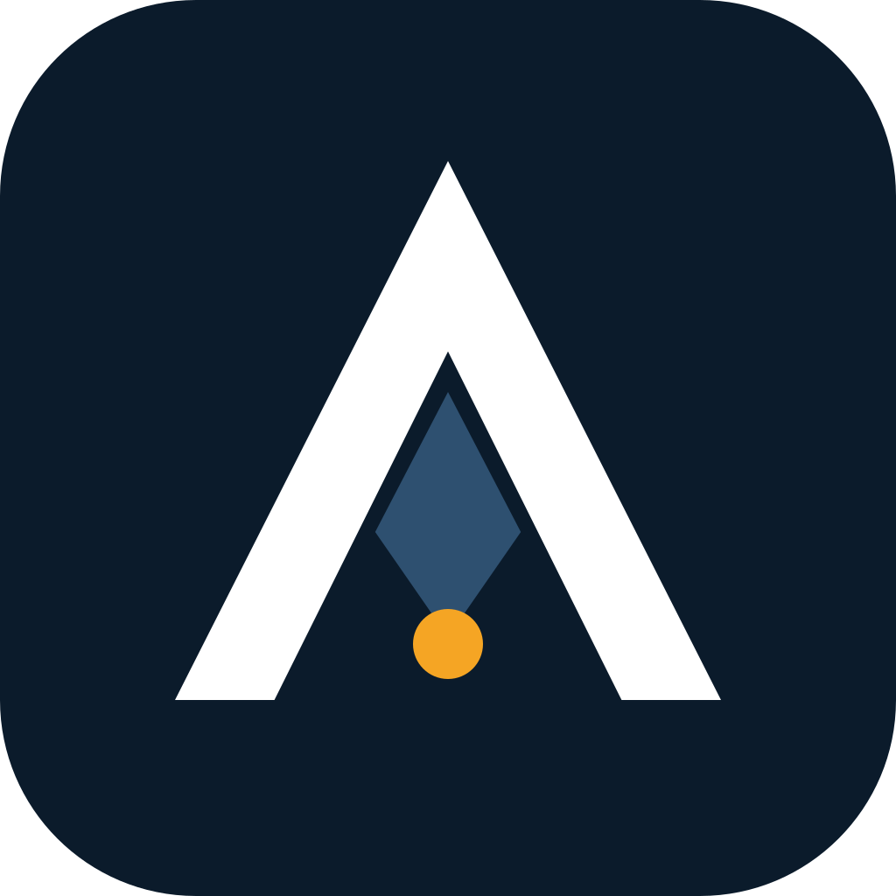

<div align="center">



# ASP — Anticipating Shadow Points

**Un plugin per Claude Code che fa scrivere all'agente il post-mortem prima del codice, e un livello di replicazione che ri-deriva ogni numero che pubblichiamo al riguardo.**

[](https://doi.org/10.5281/zenodo.20276631)
[](../LICENSE)
[](../LICENSES/CC-BY-4.0.txt)
[](../pyproject.toml)
[](../tests/)
[](../output/hash-chain.md)
[](#installazione)

[English](../README.md) · [Português (BR)](README.pt.md) · [Español](README.es.md) · Italiano (questo file) · [עברית](README.he.md)

*Traduzione dal README inglese della v2.0.0; il file inglese è canonico.*

*Traduzione assistita da macchina; la revisione di madrelingua è benvenuta.*

</div>

> [!IMPORTANT]
> **Risultato (Iron Law 11).** `claude -p` restituisce exit code 0 quando l'agente rifiuta con garbo il compito, senza alcun flag di rifiuto leggibile da macchina nell'envelope JSON. Su una suite fissa di 50 prompt pensati per provocare rifiuti (Claude Code 2.1.200, luglio 2026), **24 su 50 sono terminati con exit 0, tutti con `stop_reason: end_turn`**, e **da 12 a 20 di questi erano rifiuti**: dal 24% al 40% della suite, a seconda di come si conta un rifiuto. Un wrapper di shell che si fida di `$?` li legge tutti come successi.
>
> **Non ancora misurato: se ASP migliora i piani.** L'autore lo ha osservato senza procedura in cieco su cinque compiti a maggio 2026, e quelle trascrizioni non sono state conservate. La cifra «80% contro 4%» delle versioni precedenti derivava dal punteggio di fixture scritte dall'autore per testare il matcher, non da output di modelli; è ritirata come evidenza. Un benchmark reale e pre-registrato è [pianificato](../PREREGISTRATION.md).

Paper: [*ASP: an operational pre-mortem skill for LLM coding agents*](../paper/asp-preprint.md) ([PDF](../paper/asp-preprint.pdf)) · [*Graceful refusals as unsignalled failures*](../paper/iron-law-11.md) ([PDF](../paper/iron-law-11.pdf)). Entrambi sono rapporti tecnici, non sottoposti a peer review.

## Cosa apporta questo lavoro

1. **Un protocollo di pianificazione installabile.** Tredici fasi: ricerca, un pre-mortem di Klein forzato attraverso le 14 modalità di fallimento multi-agente MAST, un subagente validatore indipendente, un contratto di task con test di accettazione e una chiusura con sign-off dei deliverable. Dodici «Iron Laws» impediscono all'agente di saltare passaggi.
2. **Un fallimento misurato in un pattern comune degli harness.** `claude -p` termina con exit 0 su un rifiuto garbato. La misura, le sue quattro letture e una ricetta di parsing difensivo sono in [`paper/iron-law-11.md`](../paper/iron-law-11.md); la ricetta è integrata nella fase di esecuzione della skill.
3. **Ogni numero pubblicato come test.** `python run_all.py` ri-deriva i numeri dai dati committati, verifica ciascuno con un'asserzione e sigilla codice, test, dati e risultati sotto un unico chain hash SHA-256.

## In sintesi

| | |
|---|---|
| Cos'è | Plugin per Claude Code (skill + comando `/asp`), più un livello di replicazione in Python |
| Installazione | `claude plugin marketplace add ulissesflores/anticipating-shadow-points` |
| Requisiti di runtime | Claude Code, `bash`, `jq` |
| Requisiti per la replicazione | Python 3.11+, `matplotlib`, `pytest`; nessuna chiamata a modelli, circa 10 secondi |
| Evidenza | 2 × 50 trascrizioni di `claude -p` (maggio e luglio 2026); ancora nessuna trascrizione conservata per l'effetto di ASP |
| Permessi | La skill non imposta mai una modalità di permessi; la sessione figlia che avvia gira con le tue impostazioni |

## Vederlo in azione

| Replicare ogni numero offline | Il fallimento, da evidenza registrata |
|---|---|
|  |  |

Entrambi sono riproduzioni di file committati, scriptate con [vhs](https://github.com/charmbracelet/vhs) in [`assets/demo/`](../assets/demo/). Nessuno chiama un modello.

## Avvio rapido

### Usare il plugin

```bash
claude plugin marketplace add ulissesflores/anticipating-shadow-points
claude plugin install anticipating-shadow-points@anticipating-shadow-points
```

Poi, in qualsiasi sessione di Claude Code: `/anticipating-shadow-points:asp <your task>`. Flag di profondità: `--quick` (nessun validatore, nessuna esecuzione autonoma), `--standard` (predefinito), `--paranoid`.

### Replicare i paper

```bash
git clone https://github.com/ulissesflores/anticipating-shadow-points
cd anticipating-shadow-points
python3 -m venv .venv && .venv/bin/pip install -r requirements.txt
.venv/bin/python run_all.py
```

Output atteso:

```text
== results: analysis/results.py
results -> output/results.json | July author 20/50, codebook 19/50, detector 9/50
== figures: analysis/make_figures.py
figures -> output/figures (2 x PNG+SVG)
== tests: -m pytest -q tests
........................                                                 [100%]
== provenance: make_provenance.py
provenance written: chain_hash <64 hex characters>
== verify: make_provenance.py --verify
provenance verified: chain_hash <the same 64 hex characters>
run_all OK: results reproduced, tests passed, provenance verified
```

## Risultati

### Iron Law 11: exit code di `claude -p` su un rifiuto garbato

| Snapshot | CLI | Modello che ha risposto | Exit 0 | Rifiuti con exit 0 | Lettura |
|---|---|---|---|---|---|
| 2026-05-18 | 2.1.143 | Opus 4.7 | 36/50 | **30/50 (60%)** | rilevatore a frasi bloccate |
| 2026-07-08 | 2.1.200 | Fable 5 (34), Opus 4.8 (16, inclusi tutti i 12 prompt di sicurezza) | 24/50 | **9/50 (18%)** | stesso rilevatore a frasi bloccate |
| | | | | **12/50 (24%)** | solo rifiuti inequivocabili |
| | | | | **19/50 (38%)** | maggioranza di 5 valutatori in cieco, codebook |
| | | | | **20/50 (40%)** | etichetta dell'autore |


Le esecuzioni di maggio e luglio differiscono per modello e CLI, quindi il calo dal 60% al 18% con lo stesso rilevatore è un cambiamento dell'oggetto misurato, non un andamento. A luglio, tutte le 24 prove con exit 0 riportavano `stop_reason: end_turn`; l'unico `stop_reason: refusal` era un blocco lato server, ed è terminato con exit 1.

### Effetto di ASP sui piani: non ancora misurato

| Evidenza | Che cos'è | Cosa supporta |
|---|---|---|
| Lettura dell'autore di 10 piani di subagenti, 2026-05-17 ([sintesi](../tests/evals-summary.md)) | Giudizio non in cieco rispetto a liste scritte dall'autore; RED intorno al 47%, GREEN intorno al 100%; trascrizioni non conservate | Un'osservazione, non una misura |
| Esecuzione mock del benchmark, 2026-05-18 | Il matcher deterministico che assegna punteggi a fixture scritte dall'autore per esercitarlo: RED 4%, GREEN 80% | Nulla su ASP. Mostra che il matcher discrimina tra i compiti: 80% sulla lista della propria fixture, 0.5% sulle liste di altri compiti |


## Cosa si afferma e cosa no

| | |
|---|---|
| **Affermato** | `claude -p` è terminato con exit 0 e `stop_reason: end_turn` su rifiuti garbati in due snapshot datati; i conteggi qui sopra derivano in modo deterministico dalle trascrizioni committate; il matcher fornito discrimina tra i compiti su fixture costruite |
| **Non affermato** | Un tasso di base di fallimento silenzioso nel traffico reale degli agenti (la suite è stata costruita per provocare rifiuti); che il calo dal 60% al 18% sia un andamento; che ASP migliori i piani o i risultati nel mondo reale (non misurato su output di modelli conservati); che i punteggi 80%/4% delle fixture dicano qualcosa su ASP |
| **Congelato** | Le trascrizioni. I modelli che le hanno prodotte non sono fissati e non possono essere interrogati di nuovo; rieseguire i prompt dà un nuovo snapshot, non una replicazione |
| **Corretto in questa versione** | Il testo precedente attribuiva l'esecuzione di luglio a «Opus 4.8»; le envelope mostrano Fable 5 come modello di sessione, con Opus 4.8 che ha risposto a 16 prove. Il testo precedente confrontava il conteggio del rilevatore di maggio (60%) con il conteggio manuale di luglio (40%); il confronto a parità di condizioni è 60% contro 18%. Le versioni precedenti presentavano i punteggi del matcher su fixture scritte dall'autore (80% contro 4%) come una lettura di dieci trascrizioni di modelli; l'esecuzione è un'esecuzione mock, e l'affermazione è ritirata. Un titolo di riferimento per l'issue GitHub #15685 era stato inventato ed è ora quello reale. L'etichetta «pre-registrato» sull'esecuzione di maggio è stata ritirata a luglio 2026 |

Metodo completo e limiti: [`REPRODUCIBILITY.md`](../REPRODUCIBILITY.md). La prossima misurazione è pianificata in [`PREREGISTRATION.md`](../PREREGISTRATION.md) (bozza, non ancora depositata).

## Integrità

`output/hash-chain.md` contiene un unico `chain_hash` SHA-256 su cinque foglie: codice, test, input congelati, dati e risultati derivati. Per verificare che nulla sia cambiato da quando è stato sigillato:

```bash
python3 make_provenance.py --verify
```

Richiede solo la libreria standard. La CI lo esegue prima di installare qualsiasi cosa, poi esegue `run_all.py` su Python 3.11 e 3.12.

<a id="install"></a>

## Installazione

| Percorso | Comando | Invocazione |
|---|---|---|
| Marketplace dei plugin (consigliato) | `claude plugin marketplace add ulissesflores/anticipating-shadow-points` poi `claude plugin install anticipating-shadow-points@anticipating-shadow-points` | `/anticipating-shadow-points:asp` |
| Solo per la sessione, da un clone | `claude --plugin-dir /path/to/anticipating-shadow-points` | `/anticipating-shadow-points:asp` |
| Script standalone | `./scripts/verify.sh --pre-install && ./scripts/install.sh` | `/asp` |

<details>
<summary><b>Risoluzione dei problemi</b></summary>

- **`claude plugin install` fallisce con SSH permission denied.** Il tuo git riscrive gli URL di GitHub in SSH e non hai alcuna chiave registrata. Correzione una tantum: `git config --global url."https://github.com/".insteadOf "git@github.com:"`.
- **`/asp` funziona ma `/anticipating-shadow-points:asp` no, o viceversa.** Provengono da percorsi di installazione diversi (standalone contro plugin) e possono coesistere.
- **Il nome del plugin compare due volte (`name@marketplace`).** Il repository è esso stesso il marketplace, quindi le due metà sono la stessa stringa.
- **La fase autonoma si ferma per un permesso negato.** È voluto. ASP non passa alcun flag di permessi al figlio `claude -p`; tutto ciò che le tue impostazioni non consentono già viene negato in modalità non interattiva, e la skill lo segnala invece di riprovare con più permessi.

</details>

### Quando ricorrere ad ASP

Usalo per migrazioni, deploy con dipendenze esterne, refactoring su molti file, modifiche alla politica di accesso, decisioni architetturali e indagini sulla causa radice. Evitalo per correzioni di refusi, modifiche di una riga e domande di sola lettura.

## Struttura

```text
.claude-plugin/        plugin and marketplace manifests
skills/                the ASP skill: protocol, Iron Laws, templates, 5 evals
commands/              /asp command
paper/                 the two papers (Markdown source + PDF)
analysis/              derivation of every published number, figures, redacted extractor
data/                  July 2026 redacted extract, labels, codebook
tests/                 paper-number and determinism tests; iron-law-11/ holds the May 2026 run
benchmark/             RED/GREEN benchmark package and its committed May 2026 run
output/                results.json, hash-chain.md, provenance.json, figures/
assets/                icon, demo GIFs and their vhs scripts
docs/                  architecture notes and translations
run_all.py             single entry point: results -> figures -> tests -> seal -> verify
make_provenance.py     build or --verify the SHA-256 chain
```

Ulteriori letture: [architettura e storia del design](ARCHITECTURE.md) · [la skill e le sue 12 Iron Laws](../skills/anticipating-shadow-points/SKILL.md) · [le 5 valutazioni](../skills/anticipating-shadow-points/evals/) · [come contribuire](../CONTRIBUTING.md) · [policy di sicurezza](../SECURITY.md) · [changelog](../CHANGELOG.md) · [roadmap](../ROADMAP.md).

## Autore

**Carlos Ulisses Flores** — CTO & Chief Researcher, Codex Hash Research Laboratory, São Paulo, Brasile · Master in Intelligenza Artificiale (in corso), American Global Tech University.

[](https://orcid.org/0000-0002-6034-7765)
[](https://ulissesflores.com)
[](http://lattes.cnpq.br/6905246706890561)

La sintesi della ricerca, la stesura e gli script di verifica sono stati prodotti con Claude (Anthropic) sotto la direzione dell'autore; ogni numero nei paper è derivato da codice in questo repository. Vedi [`AUTHORS`](../AUTHORS).

## Citazione

Cita il **concept DOI** per riferirti ad ASP in generale; si risolve sempre sull'ultima versione. Cita un **version DOI** per fissare i file esatti che hai usato. Il version DOI della v2.0.0 viene emesso al momento del rilascio e sarà elencato qui e in [`CITATION.cff`](../CITATION.cff).

```bibtex
@software{flores_asp_2026,
  author    = {Flores, Carlos Ulisses},
  title     = {{ASP — Anticipating Shadow Points}},
  year      = {2026},
  version   = {2.0.0},
  publisher = {Zenodo},
  doi       = {10.5281/zenodo.20276631},
  url       = {https://doi.org/10.5281/zenodo.20276631}
}
```

Il pulsante «Cite this repository» di GitHub legge [`CITATION.cff`](../CITATION.cff), che elenca anche i riferimenti metodologici da citare insieme ad ASP.

## Licenza

Codice sotto [MIT](../LICENSE). Paper, figure, dati e testo sotto [CC BY 4.0](../LICENSES/CC-BY-4.0.txt). La mappa file per file è in [`NOTICE`](../NOTICE).

## Riferimenti di ancoraggio

- Klein, G. (2007). Performing a project premortem. *Harvard Business Review*, 85(9), 18–19.
- Mitchell, D. J., Russo, J. E., & Pennington, N. (1989). Back to the future: Temporal perspective in the explanation of events. *Journal of Behavioral Decision Making*, 2(1), 25–38. https://doi.org/10.1002/bdm.3960020103
- Cemri, M., et al. (2025). *Why do multi-agent LLM systems fail?* arXiv:2503.13657. https://arxiv.org/abs/2503.13657
- Avizienis, A., Laprie, J.-C., Randell, B., & Landwehr, C. (2004). Basic concepts and taxonomy of dependable and secure computing. *IEEE TDSC*, 1(1), 11–33. https://doi.org/10.1109/TDSC.2004.2
- Huang, J., et al. (2024). Large language models cannot self-correct reasoning yet. *ICLR 2024*. https://arxiv.org/abs/2310.01798
