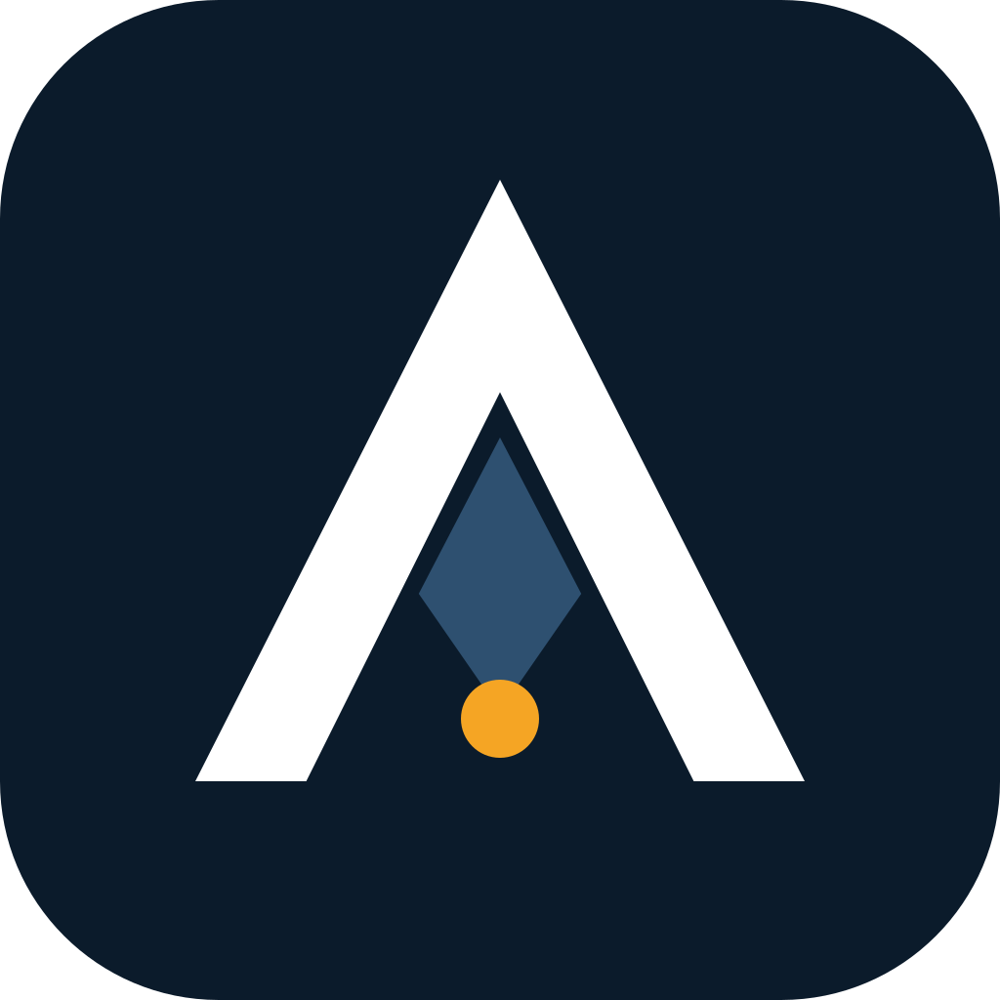
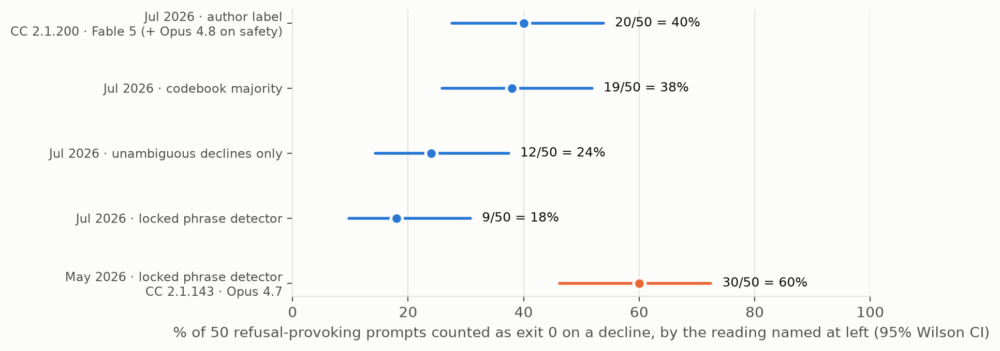

<div align="center">



# ASP — Anticipating Shadow Points

**Um plugin do Claude Code que faz o agente escrever o post-mortem antes de escrever o código, e uma camada de replicação que re-deriva cada número medido que publicamos sobre ele.**

[](https://doi.org/10.5281/zenodo.20276631)
[](../LICENSE)
[](../LICENSES/CC-BY-4.0.txt)
[](../pyproject.toml)
[](../tests/)
[](../output/hash-chain.md)
[](#install)

[English](../README.md) · Português (BR) (este arquivo) · [Español](README.es.md) · [Italiano](README.it.md) · [עברית](README.he.md)

*Tradução feita a partir do README em inglês da v2.0.0; o arquivo em inglês é o canônico.*

</div>

> [!IMPORTANT]
> **Achado (Iron Law 11).** O `claude -p` retorna exit code 0 quando o agente recusa a tarefa de forma cortês, sem nenhum sinalizador de recusa legível por máquina no envelope JSON. Em uma suíte fixa de 50 prompts que provocam recusa (Claude Code 2.1.200, julho de 2026), **24 de 50 terminaram com exit 0, todas com `stop_reason: end_turn`**, e **12 a 20 delas foram recusas**: 24% a 40% da suíte, dependendo de como uma recusa é contada. Um wrapper de shell que confia em `$?` lê todas como sucesso.
>
> **Ainda não medido: se o ASP melhora os planos.** O autor observou sem cegamento em cinco tarefas em maio de 2026, e essas transcrições não foram preservadas. O número "80% vs 4%" das versões anteriores veio da pontuação de fixtures que o autor escreveu para testar o matcher, não de saídas de modelo; ele está retirado como evidência. Um benchmark real, pré-registrado, está [planejado](../PREREGISTRATION.md).

Artigos: [*ASP: an operational pre-mortem skill for LLM coding agents*](../paper/asp-preprint.md) · [*Graceful refusals as unsignalled failures*](../paper/iron-law-11.md). Ambos são relatórios técnicos, não revisados por pares. As edições em PDF e DOCX (en, pt-BR, es, it) entram em `docs/paper/` com a versão 2.0.0.

## O que isto contribui

1. **Um protocolo de planejamento que você pode instalar.** Treze fases: pesquisa, um pre-mortem de Klein forçado através dos 14 modos de falha multiagente do MAST, um subagente validador independente, um contrato de tarefas com testes de aceitação e uma aprovação final das entregas. Doze "Iron Laws" impedem o agente de pular etapas.
2. **Uma falha medida em um padrão comum de harness.** O `claude -p` retorna exit 0 diante de uma recusa cortês. A medição, suas quatro leituras e uma receita de parsing defensivo estão em [`paper/iron-law-11.md`](../paper/iron-law-11.md); a receita está embutida na fase de execução da skill.
3. **Cada número publicado como um teste.** O `python run_all.py` re-deriva os números a partir de dados versionados, verifica cada um por asserção e sela código, testes, dados e resultados sob um único hash de cadeia SHA-256.

## Em resumo

| | |
|---|---|
| O que é | Plugin do Claude Code (skill + comando `/asp`), mais uma camada de replicação em Python |
| Instalação | `claude plugin marketplace add ulissesflores/anticipating-shadow-points` |
| Requisitos de execução | Claude Code, `bash`, `jq` |
| Requisitos de replicação | Python 3.11+, `matplotlib`, `pytest`; nenhuma chamada de modelo, cerca de 10 segundos |
| Evidência | 2 × 50 transcrições de `claude -p` (maio e julho de 2026); ainda sem transcrições preservadas para o efeito do ASP |
| Permissões | A skill nunca define um modo de permissão; a sessão filha que ela inicia roda sob as suas próprias configurações |

## Veja funcionando

| Replique cada número offline | A falha, a partir de evidência registrada |
|---|---|
|  |  |

Ambos são reproduções de arquivos versionados, roteirizadas com [vhs](https://github.com/charmbracelet/vhs) em [`assets/demo/`](../assets/demo/). Nenhum chama um modelo.

## Início rápido

### Use o plugin

```bash
claude plugin marketplace add ulissesflores/anticipating-shadow-points
claude plugin install anticipating-shadow-points@anticipating-shadow-points
```

Depois, em qualquer sessão do Claude Code: `/anticipating-shadow-points:asp <sua tarefa>`. Flags de profundidade: `--quick` (sem validador, sem execução autônoma), `--standard` (padrão), `--paranoid`.

### Replique os artigos

```bash
git clone https://github.com/ulissesflores/anticipating-shadow-points
cd anticipating-shadow-points
python3 -m venv .venv && .venv/bin/pip install -r requirements.txt
.venv/bin/python run_all.py
```

Saída esperada:

```text
== results: analysis/results.py
results -> output/results.json | July author 20/50, codebook 19/50, detector 9/50
== figures: analysis/make_figures.py
figures -> output/figures (2 x PNG+SVG)
== tests: -m pytest -q tests
........................                                                 [100%]
== provenance: make_provenance.py
provenance written: chain_hash <64 hex characters>
== verify: make_provenance.py --verify
provenance verified: chain_hash <the same 64 hex characters>
run_all OK: results reproduced, tests passed, provenance verified
```

## Resultados

### Iron Law 11: exit code do `claude -p` diante de uma recusa cortês

| Snapshot | CLI | Modelo que respondeu | Exit 0 | Recusas com exit 0 | Leitura |
|---|---|---|---|---|---|
| 2026-05-18 | 2.1.143 | Opus 4.7 | 36/50 | **30/50 (60%)** | detector de frases travado |
| 2026-07-08 | 2.1.200 | Fable 5 (34), Opus 4.8 (16, incl. todos os 12 prompts de segurança) | 24/50 | **9/50 (18%)** | mesmo detector de frases travado |
| | | | | **12/50 (24%)** | apenas recusas inequívocas |
| | | | | **19/50 (38%)** | maioria de 5 avaliadores cegos, codebook |
| | | | | **20/50 (40%)** | rótulo do autor |



As execuções de maio e julho diferem em modelo e CLI, portanto a queda de 60% para 18% sob o mesmo detector é uma mudança de alvo, não uma tendência. Em julho, cada um dos 24 ensaios com exit 0 trazia `stop_reason: end_turn`; o único `stop_reason: refusal` foi um bloqueio no lado do servidor, e terminou com exit 1.

### Efeito do ASP sobre os planos: ainda não medido

| Evidência | O que é | O que sustenta |
|---|---|---|
| Leitura do autor de 8 planos de subagentes (5 GREEN, 3 RED), 2026-05-17 ([resumo](../tests/evals-summary.md)) | Julgamento não cego contra listas que o autor escreveu; RED perto de 47%, GREEN perto de 100%; transcrições não preservadas | Uma observação, não uma medição |
| Execução simulada (mock) do benchmark, 2026-05-18 | O matcher determinístico pontuando fixtures que o autor escreveu para exercitá-lo: RED 4%, GREEN 80% | Nada sobre o ASP. Mostra que o matcher discrimina tarefas: 80% sobre a lista da própria fixture, 0.5% sobre as listas de outras tarefas |


## O que é e o que não é afirmado

| | |
|---|---|
| **Afirmado** | O `claude -p` terminou com exit 0 e `stop_reason: end_turn` em recusas corteses em dois snapshots datados; as contagens acima decorrem deterministicamente das transcrições versionadas; o matcher distribuído discrimina entre tarefas em fixtures construídas |
| **Não afirmado** | Uma taxa-base de falha silenciosa no tráfego real de agentes (a suíte foi construída para provocar recusas); que a queda de 60% para 18% seja uma tendência; que o ASP melhore planos ou resultados no mundo real (não medido sobre saída de modelo preservada); que as pontuações de fixture de 80%/4% digam qualquer coisa sobre o ASP |
| **Congelado** | As transcrições. Os modelos que as produziram não estão fixados e não podem ser consultados de novo; reexecutar os prompts gera um novo snapshot, não uma replicação |
| **Corrigido nesta versão** | O texto anterior atribuía a execução de julho ao "Opus 4.8"; os envelopes mostram o Fable 5 como modelo da sessão, com o Opus 4.8 respondendo a 16 ensaios. O texto anterior comparava a contagem do detector de maio (60%) com a contagem manual de julho (40%); a comparação em condições equivalentes é 60% vs 18%. Versões anteriores apresentavam as pontuações do matcher sobre fixtures escritas pelo autor (80% vs 4%) como uma leitura de dez transcrições de modelo; a execução é uma execução simulada (mock), e a afirmação está retirada. Um título de referência para a issue #15685 do GitHub havia sido inventado e agora é o real. O rótulo "pré-registrada" da execução de maio foi retirado em julho de 2026 |

Método completo e limites: [`REPRODUCIBILITY.md`](../REPRODUCIBILITY.md). A próxima medição está planejada em [`PREREGISTRATION.md`](../PREREGISTRATION.md) (rascunho, ainda não depositado).

## Integridade

O `output/hash-chain.md` guarda um único `chain_hash` SHA-256 sobre cinco folhas: código, testes, entradas congeladas, dados e resultados derivados. Para conferir que nada mudou desde que foi selado:

```bash
python3 make_provenance.py --verify
```

Ele precisa apenas da biblioteca padrão. A CI o executa antes de instalar qualquer coisa e depois executa o `run_all.py` em Python 3.11 e 3.12.

<a id="install"></a>

## Instalação

| Caminho | Comando | Invocação |
|---|---|---|
| Marketplace de plugins (recomendado) | `claude plugin marketplace add ulissesflores/anticipating-shadow-points` e depois `claude plugin install anticipating-shadow-points@anticipating-shadow-points` | `/anticipating-shadow-points:asp` |
| Apenas na sessão, a partir de um clone | `claude --plugin-dir /path/to/anticipating-shadow-points` | `/anticipating-shadow-points:asp` |
| Script avulso | `./scripts/verify.sh --pre-install && ./scripts/install.sh` | `/asp` |

<details>
<summary><b>Solução de problemas</b></summary>

- **O `claude plugin install` falha com permissão SSH negada.** O seu git reescreve URLs do GitHub para SSH e você não tem chave registrada. Correção única: `git config --global url."https://github.com/".insteadOf "git@github.com:"`.
- **O `/asp` funciona mas o `/anticipating-shadow-points:asp` não, ou o contrário.** Eles vêm de caminhos de instalação diferentes (avulso vs plugin) e podem coexistir.
- **O nome do plugin aparece duas vezes (`name@marketplace`).** O repositório é o seu próprio marketplace, então as duas metades são a mesma string.
- **A fase autônoma para por uma negação de permissão.** É intencional. O ASP não passa nenhuma flag de permissão ao filho `claude -p`; tudo o que as suas configurações ainda não permitem é negado no modo não interativo, e a skill reporta isso em vez de tentar de novo com mais permissão.

</details>

### Quando recorrer ao ASP

Use-o para migrações, deploys com dependências externas, refatorações que atravessam muitos arquivos, mudanças de política de acesso, decisões de arquitetura e investigações de causa-raiz. Dispense-o para correções de erro de digitação, edições de uma linha e perguntas somente de leitura.

## Estrutura

```text
.claude-plugin/        plugin and marketplace manifests
skills/                the ASP skill: protocol, Iron Laws, templates, 5 evals
commands/              /asp command
paper/                 the two papers (Markdown source + PDF)
analysis/              derivation of every published number, figures, redacted extractor
data/                  July 2026 redacted extract, labels, codebook
tests/                 paper-number and determinism tests; iron-law-11/ holds the May 2026 run
benchmark/             RED/GREEN benchmark package and its committed May 2026 run
output/                results.json, hash-chain.md, provenance.json, figures/
assets/                icon, demo GIFs and their vhs scripts
docs/                  architecture notes and translations
run_all.py             single entry point: results -> figures -> tests -> seal -> verify
make_provenance.py     build or --verify the SHA-256 chain
```

Leitura adicional: [arquitetura e histórico de design](ARCHITECTURE.md) · [a skill e suas 12 Iron Laws](../skills/anticipating-shadow-points/SKILL.md) · [as 5 avaliações](../skills/anticipating-shadow-points/evals/) · [como contribuir](../CONTRIBUTING.md) · [política de segurança](../SECURITY.md) · [changelog](../CHANGELOG.md) · [roadmap](../ROADMAP.md).

## Autor

**Carlos Ulisses Flores** — CTO e Pesquisador-Chefe, Codex Hash Research Laboratory, São Paulo, Brasil.

[](https://orcid.org/0000-0002-6034-7765)
[](https://ulissesflores.com)
[](http://lattes.cnpq.br/6905246706890561)

A síntese de pesquisa, a redação e os scripts de verificação foram produzidos com o Claude (Anthropic) sob a direção do autor; cada número medido nos artigos é derivado por código neste repositório. Veja [`AUTHORS`](../AUTHORS).

## Citação

Cite o **DOI de conceito** para apontar para o ASP em geral; ele sempre resolve para a versão mais recente. Cite um **DOI de versão** para fixar os arquivos exatos que você usou. O DOI de versão da v2.0.0 é emitido no release e será listado aqui e em [`CITATION.cff`](../CITATION.cff).

```bibtex
@software{flores_asp_2026,
  author    = {Flores, Carlos Ulisses},
  title     = {{ASP — Anticipating Shadow Points}},
  year      = {2026},
  version   = {2.0.0},
  publisher = {Zenodo},
  doi       = {10.5281/zenodo.20276631},
  url       = {https://doi.org/10.5281/zenodo.20276631}
}
```

O botão "Cite this repository" do GitHub lê o [`CITATION.cff`](../CITATION.cff), que também lista as referências metodológicas a citar junto com o ASP.

## Licença

Código sob [MIT](../LICENSE). Artigos, figuras, dados e prosa sob [CC BY 4.0](../LICENSES/CC-BY-4.0.txt). O mapa arquivo a arquivo está em [`NOTICE`](../NOTICE).

## Referências-âncora

- Klein, G. (2007). Performing a project premortem. *Harvard Business Review*, 85(9), 18–19.
- Mitchell, D. J., Russo, J. E., & Pennington, N. (1989). Back to the future: Temporal perspective in the explanation of events. *Journal of Behavioral Decision Making*, 2(1), 25–38. https://doi.org/10.1002/bdm.3960020103
- Cemri, M., et al. (2025). *Why do multi-agent LLM systems fail?* arXiv:2503.13657. https://arxiv.org/abs/2503.13657
- Avizienis, A., Laprie, J.-C., Randell, B., & Landwehr, C. (2004). Basic concepts and taxonomy of dependable and secure computing. *IEEE TDSC*, 1(1), 11–33. https://doi.org/10.1109/TDSC.2004.2
- Huang, J., et al. (2024). Large language models cannot self-correct reasoning yet. *ICLR 2024*. https://arxiv.org/abs/2310.01798
