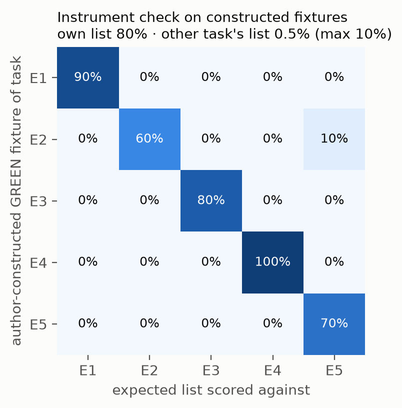

# ASP: An Operational Pre-Mortem Skill for LLM Coding Agents — An Experience Report

**Author** · Carlos Ulisses Flores
CTO & Chief Researcher · Codex Hash Research Laboratory · São Paulo, Brazil
ORCID: https://orcid.org/0000-0002-6034-7765 · Lattes: http://lattes.cnpq.br/6905246706890561
c.ulisses@gmail.com · https://ulissesflores.com

**Whitepaper · Version 2.1 · 2026-11** *(first published 2026-05-18)*
**DOI** https://doi.org/10.5281/zenodo.20276631 *(concept DOI of the companion repository · resolves to its latest deposited version; this version of the paper is deposited with release 2.0.0, and until then the DOI resolves to v1.0.3, which this version supersedes)*
**Status** Independent technical whitepaper · not under peer review
**License** Paper text, figures and data — CC BY 4.0 · Companion software — MIT
**Replication** Every number Sections 5.3–5.4 compute from the repository's data and fixtures is re-derived by `python run_all.py` in the companion repository and asserted by a test; see Appendix B.
**Companion repository** Flores, C. U. (2026a), https://github.com/ulissesflores/anticipating-shadow-points
**Companion whitepaper** Flores, C. U. (2026c). *Graceful Refusals as Unsignalled Failures: Characterising `claude -p` Exit-Code Semantics on Agent Declines.* See `paper/graceful-refusals.md`.

---

## Abstract

LLM coding assistants often produce *locally correct* code that omits failure modes a senior engineer would surface in a pre-mortem — a row-level security policy, an external API's rate limit, replica lag during a migration — and production then breaks in ways that are expensive to debug. We call these missing items *shadow points*. This experience report describes Anticipating Shadow Points (ASP), a 13-phase planning protocol shipped as a Claude Code skill that integrates Klein's (2007) pre-mortem with the multi-agent failure taxonomy of Cemri et al. (2025), checks the plan with a validator that does not share the planner's context, following the self-correction-limit literature (Huang et al., 2024; Tyen et al., 2024), and hands execution to a child subprocess with a file-based contract. We document the design, its deployment as an open-source plugin, and preliminary observations from five engineering evaluations, read by the author without blinding and with transcripts not preserved. A deterministic adjudicator ships with the skill; its scores on author-written fixtures exercise the instrument and nothing more, so we report no measured effect of ASP. We state in advance the result that would show one: in a real-mode benchmark with blind, independently written expected lists and eight replicates per task and condition, a measured benefit if the assisted condition's mean coverage beats the unassisted one on all five tasks and a one-sided, task-stratified permutation test gives p < 0.05; no measurable benefit if it does not beat it, ties included, on three or more; inconclusive in between; and no verdict at all if the budget stops collection early. The protocol is drafted and not yet deposited.

**Keywords:** LLM coding agents; pre-mortem; multi-agent failure modes;
Claude Code; operational protocols; experience report

## Resumo

Assistentes de código baseados em LLM muitas vezes produzem código *localmente correto* que omite modos de falha que um engenheiro sênior levantaria num pre-mortem — uma política de segurança por linha, o limite de taxa de uma API externa, o atraso de réplica durante uma migração —, e a produção então quebra de formas caras de depurar. Chamamos esses itens ausentes de *shadow points*. Este relato de experiência descreve o Anticipating Shadow Points (ASP), um protocolo de planejamento em 13 fases distribuído como skill do Claude Code, que integra o pre-mortem de Klein (2007) à taxonomia de falhas multiagente de Cemri et al. (2025), confere o plano com um validador que não compartilha o contexto do planejador, seguindo a literatura sobre os limites da autocorreção (Huang et al., 2024; Tyen et al., 2024), e entrega a execução a um subprocesso filho com contrato em arquivo. Documentamos o desenho, a implantação como plugin de código aberto e observações preliminares de cinco avaliações de engenharia, lidas pelo autor sem cegamento e sem transcrições preservadas. Um adjudicador determinístico acompanha a skill; suas notas sobre fixtures escritos pelo autor exercitam o instrumento e nada mais, por isso não relatamos efeito medido do ASP. Fixamos de antemão o resultado que mostraria um: num benchmark em modo real, com listas esperadas cegas e escritas por revisores independentes e oito réplicas por tarefa e condição, benefício medido se a cobertura média da condição assistida superar a da não assistida nas cinco tarefas e um teste de permutação unilateral, estratificado por tarefa, der p < 0,05; nenhum benefício mensurável se não a superar, empate incluído, em três ou mais; inconclusivo nos demais casos; e nenhum veredito se o orçamento interromper a coleta antes. O protocolo está redigido e ainda não foi depositado.

**Palavras-chave:** agentes de código LLM; pre-mortem; modos de falha
multiagente; Claude Code; protocolos operacionais; relato de experiência

---

## 1. Introduction

Software teams increasingly delegate routine engineering work — adding a
column to a production database, deploying a function that calls an
external API, refactoring a utility used across thirty files — to AI
coding assistants. When the assistant gets it right, the engineer's day
is freed. When it gets it *subtly* wrong — by writing code that compiles,
passes its tests, ships, but quietly omits a step a senior engineer
would have flagged in advance — production breaks in ways that are
expensive to debug. Decision science has a technique for exactly that gap,
the pre-mortem (Klein, 2007), and agent research now has a catalogue of how
multi-agent LLM systems fail (Cemri et al., 2025). Our thesis is that the two
belong together at runtime: before writing code, an agent should be made to
run a pre-mortem against a fixed failure taxonomy, and its plan should be
checked by a validator that cannot see the planner's reasoning.

The dominant production failure mode of modern LLM coding agents, in our
experience, is not *bad* code. It is *incomplete* code: the agent does
what was asked, but not what someone with deep domain context would have
asked themselves *before starting*. The replica lag during a schema
migration. The CORS header on the edge function. The row-level security
policy that needs updating to match the new column. We call these missing
items **shadow points** — failure modes obvious to a practitioner who has
been burnt by them, invisible to an agent that has not.

Two streams of literature converge on this gap. The first, in
decision science, is the **pre-mortem**: a structured exercise in which
a team imagines a project has already failed and enumerates causes before
acting. The technique was operationalized for project teams by Klein
(2007) and grounded in the earlier empirical work of Mitchell, Russo and
Pennington (1989) on prospective hindsight; Klein (2007) summarises it as
raising the ability to identify reasons for a future outcome by about 30%, a
figure we could not re-derive from the 1989 paper (Appendix A). The second, in agent
research, is the recent characterization of multi-agent failure modes by
Cemri et al. (2025), who derived a 14-mode taxonomy from 150 seed traces
of multi-agent LLM systems (inter-annotator agreement κ=0.88) and released
a corpus of 1,600+ annotated traces. Neither stream has been integrated as a **runtime discipline**
that a coding agent can be made to follow on every non-trivial task.

This paper reports on **Anticipating Shadow Points (ASP)**, a 13-phase
planning protocol shipped as a Claude Code skill that combines pre-mortem
reasoning with the MAST 14-mode checklist, separates planning from
validation under strict prompt isolation, and hands execution to a
child subprocess with a file-based contract. We deployed the skill,
distributed it through three install paths (plugin marketplace, dev mode,
standalone script), ran it through five engineering evaluations, and
report the design and what the evaluations can and cannot show. The evaluation is preliminary and, as corrected in
this version, unmeasured: GREEN on five tasks and RED on three, one dispatch
each, a single
model, read by the author without blinding, with the raw transcripts not
preserved. We report it as qualitative observation; the four design choices
we treat as hypotheses, and a fifth measured in the companion paper, are in
Section 6.

### 1.1. Contributions

This experience report contributes:

1. **The ASP protocol as documented design** — thirteen phases, each
   emitting a named artifact, organised around the principle that no
   implementation begins before shadow points have been surfaced.
2. **Twelve operational constraints we call "Iron Laws"**, each tied to a
   primary literature source or to a documented design decision. Two have a
   shell-level check in the runner template the agent is told to run (Iron
   Law 12's JSON output, a template default the operator can override, and Iron Law 9's `ASP_IN_GOAL` flag set for
   the child, whose check at entry is a Bash snippet the skill tells the agent
   to run); the other ten are prompt-level instructions.
3. **Preliminary, qualitative observations** from five engineering
   evaluations, and a deterministic adjudicator with cryptographic
   provenance, exercised on constructed fixtures and ready to score real
   transcripts without trusting the author's adjudication (the expected
   lists are still the author's, and the optional synonym sidecar is not
   provided for any task).
4. **A separate empirical finding** on `claude -p` exit-code semantics
   under graceful agent refusal, characterised in the companion paper
   Flores (2026c). The finding motivated two of
   the Iron Laws but warrants independent characterization at larger N.

This is an **experience report** in the systems sense, not a benchmark
paper. We document a system we built, a methodology we deployed, and
what we observed; we do not claim a robust empirical contribution to the
LLM-agents benchmark literature. Section 7 enumerates the threats to
validity in detail.

---

## 2. Background

We review four threads of recent prior work that directly inform ASP's
design (§§2.1–2.4), then situate ASP within the older software- and
quality-engineering disciplines it transposes (§2.5). We keep the
recent-work review short relative to typical agent-systems papers,
because the contribution here is operational and the literature context
is in service of that.

### 2.1. Pre-mortem and prospective hindsight

The pre-mortem technique asks a team to imagine, before commitment, that
a project has already failed catastrophically, and to enumerate causes.
The empirical basis is Mitchell, Russo and Pennington (1989), who showed
that imagining a future event as certain (rather than uncertain) yields
explanations that are longer and more episodic; Klein (2007) summarises
the effect as about a 30% gain in correctly identifying reasons for a future
outcome.
Klein (2007) operationalized the finding as the project-team "pre-mortem"
and the technique has since spread through decision-science and
project-management practice. Its experimental base is thin: we found no
replication or meta-analysis of the pre-mortem effect in Crossref, arXiv or a
general web search (November 2026), which is an absence in those indexes, not
proof that none exists. Risk-assessment standards catalogue neighbouring
techniques — scenario analysis and the structured what-if technique (SWIFT) —
but the table of contents of IEC 31010:2019, Annex B, does not list the
pre-mortem by name. The term *prospective hindsight* has also been reused
for an unrelated reinforcement-learning signal (J. Zhang et al., 2026); we use
it only in Mitchell et al.'s sense. We found no prior integration of the
pre-mortem as runtime discipline for coding agents.

### 2.2. Multi-agent failure modes (MAST)

LLM agents interleave reasoning and acting in a single loop (Yao et al.,
2023), and are increasingly composed into multi-agent workflows whose
failure modes compound. Cemri et al. (2025) introduce the **Multi-Agent
System Failure Taxonomy (MAST)** with **MAST-Data**, a corpus of 1,600+
annotated traces from seven popular multi-agent frameworks such as AG2
(formerly AutoGen; Wu et al., 2023). From rigorous analysis of 150
seed traces (inter-annotator agreement κ=0.88), they derived fourteen
failure modes organised into three categories: specification and system
design (5 modes), inter-agent misalignment (6 modes), and task
verification and termination (3 modes). The 14-mode list is the strongest
recent empirical grounding for a failure-mode checklist; ASP adopts the
mode names verbatim and operationalizes each into a pre-mortem prompt
plus mitigation in its companion skill files. Two concurrent works
extend the taxonomy direction: Zhu et al. (2025) introduce AgentDebug
and the AgentErrorTaxonomy (memory / reflection / planning / action /
system-level), and S. Zhang et al. (2025), an ICML 2025 Spotlight, opens
**automated failure attribution** with the Who&When dataset. MAST is
therefore one taxonomy among several: TRAIL formalises a taxonomy of agentic
errors over 148 human-annotated traces (Deshpande et al., 2025), AgentRx
annotates 170 failed trajectories with a critical step and a category from a
grounded-theory taxonomy (Barke et al., 2026), and AgenTracer reports that
current reasoning LLMs attribute failures in multi-agent traces with accuracy
generally below 10% (G. Zhang et al., 2025). ASP uses MAST as a prompt
library for anticipating failures, not as a classifier of observed ones, so
the choice of taxonomy bounds what Phase 2 asks about rather than what it can
detect.

### 2.3. Self-correction limits and validator isolation

The strongest single argument for separating the validator from the
planner is the convergent finding across three primary works that LLMs
cannot reliably critique themselves under shared context. Huang et al.
(2024, ICLR) show that intrinsic self-correction without external
feedback often degrades performance. Tyen et al. (2024) decompose
self-correction into localization and correction and show empirically
that LLMs cannot *localize* their own reasoning errors but can correct
them given the location externally — *localization is the bottleneck*.
Zheng et al. (2023, NeurIPS D&B) document that strong-LLM judges
over-favour same-family-model outputs (a "self-enhancement bias")
even when objectively judging quality. Kamoi et al. (2024) survey this
literature and conclude that reliable self-correction of reasoning errors
requires external feedback or verifiers rather than the model's unaided
judgment; intrinsic self-feedback methods such as Self-Refine (Madaan et
al., 2023) improve some generation tasks but do not close the localization
gap that Tyen et al. (2024) isolate. Together these findings argue
that a validator sharing context with a planner inherits the planner's
confidence calibration on shared content, including erroneous content
the planner is confident about. ASP's design enforces strict prompt
isolation between planner and validator (Iron Law 2 below) as the
architectural counter-move. Kambhampati et al. (2024) reach the same
conclusion for planning: auto-regressive LLMs cannot by themselves plan or
self-verify, but can serve as approximate knowledge sources inside an
"LLM-Modulo" loop with external verifiers — the role ASP assigns to the
isolated validator and to the executable acceptance tests.

### 2.4. Closest related work: PreFlect

The closest concurrent work is **PreFlect** (Wang et al., 2026), which
similarly shifts the self-reflection paradigm from post-hoc correction
to pre-execution criticism of agent plans, distilling planning errors
from historical agent trajectories and adding a dynamic re-planning
mechanism. The high-level similarity is significant: both ASP and
PreFlect identify the post-execution-only nature of conventional
reflection as a limitation and shift criticism *before* the action.
ASP differs from PreFlect along four axes:

1. **Prompt-isolated validator.** PreFlect distils errors into the
   agent's own pre-execution criticism; ASP enforces a separate-prompt
   validator subagent that never sees the planner's transcript.
2. **Process-level isolation for the executor.** ASP spawns the
   executor as a `claude -p` subprocess with a file-based contract;
   PreFlect operates within a single process.
3. **Explicit runtime constraints.** ASP states twelve Iron Laws, two of
   them guarded by executable checks and ten as prompt-level rules; PreFlect is presented
   as a methodology rather than a constraint system.
4. **An empirical CLI-level finding** characterising `claude -p` exit
   semantics under graceful refusal, motivating two of the Iron Laws;
   this is reported separately in Flores (2026c). The phenomenon itself is
   documented by the vendor and in public issue reports (catalogued in
   Flores, 2026c, §2); the contribution there is a measured count and a
   proposed typed termination contract, not a discovery.

### 2.5. Classical software and quality-engineering lineage

The four threads above place ASP within the recent LLM-agents
literature. A reviewer from software or quality engineering will,
however, recognise ASP's machinery as a transposition of disciplines
that predate LLMs by decades. We make the borrowing explicit, because
concealing it would be both dishonest and weaker: what is new in ASP is
not the disciplines but their transposition to a non-deterministic agent
runtime and the mechanisms that enforce them there.

**Non-redundancy versus defensive re-verification: where ASP departs from Design by Contract.** ASP's micro-TODO
schema (§3.4) is Design by Contract (Meyer, 1992) relocated from the
routine boundary to the agent-task boundary. Meyer's contract assigns
obligations across a caller/routine boundary: the caller must establish
the PRECONDITION, which the routine is then entitled to *assume* —
Meyer's non-redundancy principle forbids the body from re-checking it —
and the routine must guarantee the POSTCONDITION on which the caller
relies. Of the schema's seven fields, PRECONDITION, ACTION and
POSTCONDITION map onto this contract directly, with ACTION as the routine
body the pre/post pair wraps. ASP then *departs* from Meyer on purpose:
because the obligor is a non-deterministic model rather than a compiled
routine, ASP does not assume the postcondition — it re-verifies it with
an external ACCEPTANCE-TEST, and adds a FALSIFICATION-TEST that has no
contract-programming analog, importing instead the Popperian stance
(Popper, 1959/2002) that a claim earns confidence by surviving a
disconfirmation attempt rather than by a confirming check alone. This
trade of Design by Contract's non-redundancy for defensive
re-verification is the same trust-nothing ethos that produces the
exit-code discipline of Iron Laws 11–12; it is a considered inversion of
Meyer, not an oversight. The Iron Laws, in turn, are stated as the
analogue of DbC's third contract element — the class invariant — rather than
as a per-task pre/post condition; ten of them are instructions the agent is
told to keep, not checks that run.

**Failure-mode enumeration.** Shadow-point detection (Phase 2) is a
prospective failure-mode enumeration in the tradition of FMEA
(MIL-STD-1629A, 1980; IEC 60812:2018). It is deliberately *not* full
FMEA: ASP performs no per-component decomposition and no risk-priority
scoring (severity × occurrence × detection), so the debt is to FMEA's
prospective-enumeration discipline, not its bottom-up mechanics. Three
inputs to Phase 2 occupy roles worth separating: the pre-mortem (Klein,
2007; §2.1) supplies the *philosophy* — imagine the failure as already
certain; the MAST fourteen-mode taxonomy (Cemri et al., 2025; §2.2)
supplies the *library* of failure modes; and the forced enumeration
against that fixed library is closer, structurally, to HAZOP-style
guideword prompting (IEC 61882:2016) than to component-by-component FMEA. What ASP adds is
the substrate — the "component" whose failure modes are enumerated is an
LLM plan, and the enumeration is run by a validator that does not share the
planner's context (§2.3).

**Mistake-proofing.** A subset of the Iron Laws (§3.3) are poka-yoke
(Shingo, 1986) at the protocol level: the runner template in
`claude-p-goal-runner.md` sets `ASP_IN_GOAL` for the child and always passes
`--output-format json` (Iron Laws 9 and 12); Iron Law 10's file-based
contract is an instruction. These checks live in a Bash template the agent
is told to run, not in a hook outside the agent's control, and they are not the
physical impossibility of true poka-yoke — an environment flag can be
unset or fail to propagate — and the remaining laws are honestly
procedural gates (Iron Laws 1, 2, 4, 5) or verification rules that still
depend on the operator, of which Iron Law 11 ("never trust `$?`") is the
clearest case: precisely the operator-vigilance dependence poka-yoke is
defined against. The borrowing is the mistake-proofing *stance* applied
to two shell-level checks in a runner script the agent is instructed to
emit, not a claim that ASP eliminates operator vigilance.

**Independent verification and validation.** ASP's prompt-isolated
validator (Iron Law 2) transposes the defining move of Independent
Verification and Validation (IV&V; IEEE Std 1012-2016) — a verifier kept
independent of the developer, in IEEE 1012's terms technically,
managerially and financially — from organisational separation to *prompt*
separation: the validator subagent shares no context with the planner it
checks. The LLM-specific justification for that isolation is the
self-correction literature of §2.3; the *form* of the counter-move is
IV&V's.

**Dependability vocabulary.** The exit-code behaviour behind Iron Laws
11–12 has an exact name in the dependability taxonomy: an exit 0 on a
graceful decline is an *unsignalled failure* (Avizienis et al., 2004),
neither a crash nor a fail-silent stop. The term, its prior art, and the
measurement are developed in the companion paper (Flores, 2026c); this
section imports only the vocabulary and does not re-open the novelty
question here.

**Empirical warrant.** The preference for acceptance and falsification
tests over trusted status codes has an empirical basis in the adjacent
pathology. Yuan et al. (2014) found that a large majority of catastrophic
failures in distributed data-intensive systems trace to faulty handling
of non-fatal errors that *were* signalled. ASP's exit-code case is the
complement — the signal was *absent* — so the two do not share a thesis;
the narrow lesson they do share is that a status channel is not a proxy
for outcome, which is what an external ACCEPTANCE-TEST exists to enforce.

**Table 1** maps each ASP mechanism to its classical ancestor and states
what ASP adds.

**Table 1.** ASP mechanisms and their classical ancestors.

| ASP mechanism | Classical ancestor | What ASP adds (and does *not* claim) |
|---|---|---|
| micro-TODO PRE/ACTION/POST + ACCEPTANCE-TEST | Design by Contract (Meyer, 1992) | a non-deterministic obligor whose postcondition is re-verified by external command, not assumed; not the contract idea |
| micro-TODO FALSIFICATION-TEST | Popperian falsification (Popper, 1959/2002) | a disconfirmation step at the agent-task boundary; no Design-by-Contract analog |
| Shadow-point detection (Phase 2) | FMEA-style enumeration (MIL-STD-1629A; IEC 60812:2018) + HAZOP guidewords, over the MAST library (Cemri et al., 2025) | enumeration of an LLM plan under isolation; no risk-priority scoring, no per-component decomposition |
| Iron Laws 9 and 12 as shell-level checks | Poka-yoke (Shingo, 1986) | two checks in a runner script the agent is instructed to emit; not physical impossibility, and Iron Law 10 is an instruction |
| Prompt-isolated validator (Iron Law 2) | IV&V (IEEE Std 1012-2016) | organisational independence recast as prompt isolation; not IV&V |
| Never-trust-`$?` (Iron Laws 11–12) | Unsignalled failure (Avizienis et al., 2004); Yuan et al. (2014) | characterised in the companion paper (Flores, 2026c); not the failure class |

Read together, the section makes a deliberately modest claim: ASP's
machinery is an *integration* of established reliability and
quality-engineering disciplines — contract, failure-mode enumeration,
IV&V, mistake-proofing — into one protocol whose contribution is
operational rather than conceptual. What that integration adds beyond its
ancestors is their application in a non-deterministic agent runtime: the
Iron Laws (two of them guarded by executable checks), the prompt- and process-level isolation of
§3.2, and the reproducible deterministic adjudicator of §5, with the
`claude -p` exit-code finding characterised separately in the companion
paper. This is the experience-report claim of §1, not a novelty claim
against the classical literature.

---

## 3. The ASP Protocol

### 3.1. Overview

ASP is a 13-phase protocol that progresses from intake through delivery
sign-off. Each phase emits a named artifact (Table 2). The principle
organising the phases is that no implementation begins before shadow
points have been surfaced (Phase 2), validated independently (Phase 5),
and approved by the user (Phase 7); execution is delegated to a child
subprocess with a file-based contract (Phase 9).

**Table 2.** ASP phases and their emitted artifacts. Phase 0 has two sub-phases (0a before research, 0b after it), so thirteen phases occupy fourteen rows.

| # | Phase | Artifact | Design rationale |
|---|---|---|---|
| 0a | Pre-research Q&A | `intake` block | Anthropic Skills best-practice: verifiable intermediate outputs |
| 1 | Parallel research | Research summary + recall block | Subagent dispatch pattern |
| 0b | Post-research Q&A | Refined intake (skippable) | Same as 0a |
| 2 | Shadow-point detection | Categorised list + mitigations | Klein (2007) + Cemri et al. (2025) |
| 3 | Project Charter | Filled charter | Durable artifact-based handoff |
| 4 | Macro plan + register | Macro plan + deliverables D01–D*n* | Plan-and-Act (Erdogan et al., 2025) |
| 5 | Independent validator | APPROVE / REVISE | Huang et al. (2024) + Tyen et al. (2024) + Zheng et al. (2023) |
| 6 | Internal loop (cap=3) | Final-revision plan | Bounded iteration; FM-1.5 |
| 7 | User approval | Go / no-go | Human-in-the-loop gate |
| 8 | Micro-TODO + Goal Spec | `TaskCreate` per step + Goal Spec | Executor handoff |
| 9 | Execution via `/goal` subprocess | Tasks marked completed with evidence | Process-level isolation; see Flores (2026c) |
| 10 | Per-deliverable sign-off | Each deliverable accepted or rejected | Acceptance contract |
| 11 | Execution Report + memory | Closure artifact + memory write-back | Reflexion-style memory (Shinn et al., 2023) |
| 12 | (Opt-in) public release | Plugin marketplace + GitHub release | Distribution layer |

### 3.2. Architectural positioning

ASP separates three agent roles with explicit artifact-only handoffs
(Figure 1):

```
+----------------------------------------------------+
|                 ASP parent process                 |
|  Phases 0a, 1, 0b, 2, 3, 4   -> PLANNER role       |
|                ↓ artifacts only                    |
|  Phase 5: validator subagent <- fresh prompt       |
|                ↓ APPROVE                           |
|  Phase 7: user approval                            |
|                ↓                                   |
|  Phase 8: emit micro-TODO + Goal Spec              |
+----------------------------------------------------+
                 ↓ file-based contract
      - - - - - process boundary - - - - -
                 ↓
+----------------------------------------------------+
|          claude -p /goal child subprocess          |
|  Phase 9: worker + evaluator                       |
|  ASP_IN_GOAL=1 (Iron Law 9: no re-entry)           |
|  --output-format json (Iron Law 12)                |
+----------------------------------------------------+
                 ↓ exec.json
+----------------------------------------------------+
|  ASP parent process: Phases 10, 11                 |
+----------------------------------------------------+
```

**Figure 1.** ASP's three-role separation. Planner phases run in the
parent. The validator runs in the parent but in a fresh subagent prompt
that receives only artifacts, never the planner's transcript. The
worker runs in a child `claude -p` subprocess with a file-based
contract.

### 3.3. Iron Laws

We state twelve operational constraints and call them Iron Laws (Table 3).
Iron Laws 9 and 12 have shell-level checks in the runner template and the
entry snippet the agent is told to run; the others are rules the skill
instructs the agent to follow. Compliance with either kind has not been
measured. Each is mapped to its
derivation: a primary literature source, a documented Anthropic
recommendation, or an empirical design decision.

**Table 3.** The 12 Iron Laws and their derivation.

| # | Law | Derivation |
|---|---|---|
| 1 | No implementation without shadow-point pass first | Klein (2007) + Cemri et al. (2025) |
| 2 | No plan approval without independent validator pass (separate prompt) | Huang et al. (2024) + Tyen et al. (2024) + Zheng et al. (2023); mitigates FM-3.3 |
| 3 | No micro-TODO without macro plan + charter + deliverables approved by user | Anthropic Skills: verifiable intermediate outputs |
| 4 | No step completion without fresh acceptance-test evidence | Cemri et al. (2025) FM-3.1 + FM-3.2 + FM-2.6 |
| 5 | No deliverable accepted without evidence file/output matched | Cemri et al. (2025) FM-3.1 |
| 6 | No project close without execution report + memory write-back | Shinn et al. (2023) memory buffer |
| 7 | No loop without cap (default cap=3 validator rounds) | Cemri et al. (2025) FM-1.5 |
| 8 | No Phase 9 execution without evaluator dispatch at checkpoints (except under `--quick`) | Erdogan et al. (2025) planner/executor |
| 9 | No reentrant ASP inside `claude -p /goal` child (`ASP_IN_GOAL` env-var guard) | Cost-explosion mitigation; design decision |
| 10 | No `claude -p /goal` spawn without file-based contract | Subprocess state-divergence mitigation; design decision |
| 11 | Never trust `$?` from `claude -p` for semantic success/failure | Empirical observation, characterised in Flores (2026c) |
| 12 | All `claude -p` invocations must use `--output-format json` or `stream-json` | Corollary of Iron Law 11 |

### 3.4. The micro-TODO contract

At the boundary between planning and execution (Phase 8), ASP emits a
contractual task list. Each task is created via the `TaskCreate` primitive
with seven labeled fields:

- **PRECONDITION** — invariant that must hold before the step.
- **ACTION** — exact command or literal edit.
- **POSTCONDITION** — state change effected by the step.
- **ACCEPTANCE-TEST** — command and expected output that prove the postcondition.
- **FALSIFICATION-TEST** — command or observation that would prove the step failed.
- **DEPENDS-ON** — upstream task identifiers (DAG structure).
- **DELIVERABLE-ID** — which deliverable in the register this step contributes to.

This schema is what makes the task list auditable: no task is marked
completed without acceptance-test evidence (Iron Law 4); no deliverable
is signed off without matching evidence (Iron Law 5). The schema is
shared with the Goal Spec consumed by the Phase 9 subprocess.

---

## 4. Operational Deployment

ASP ships as a Claude Code plugin and is distributed through three
install paths, each appropriate for a different audience:

1. **Plugin marketplace** (recommended for end users):
   ```
   claude plugin marketplace add ulissesflores/anticipating-shadow-points
   claude plugin install anticipating-shadow-points@anticipating-shadow-points
   ```
   Invocation: `/anticipating-shadow-points:asp <task>` or bare `/asp`.
2. **Developer mode** (for contributors): `claude --plugin-dir ./` loads
   the skill in place; useful when iterating on the skill itself.
3. **Standalone install script** (for users who do not use the plugin
   manager): `./scripts/install.sh` copies the skill into the user's
   Claude Code skills directory.

The plugin uses Anthropic's official `.claude-plugin/plugin.json` manifest
format (Claude Code 2.1+; Anthropic, 2026a), and the repository doubles as a self-host
marketplace via `.claude-plugin/marketplace.json` at the repository root.

**Permissions.** Since plugin version 1.0.4 the Phase 9 runner spawns the
`claude -p` child with **no permission flag**: the child runs under the
user's own Claude Code permission settings, and the skill never grants,
widens or bypasses them. Earlier versions passed
`--permission-mode bypassPermissions`; that was removed after the Claude
plugin directory declined the listing because a plugin must not grant itself
permissions. In non-interactive mode an action the user has not pre-allowed
is denied rather than prompted; the parent reads the `permission_denials`
field of the child's JSON result and reports any denial to the user instead
of retrying with wider permission. This makes autonomous execution strictly
weaker than in the May 2026 deployment, and safer: the skill can only do
what the operator already allowed.
The skill itself is implemented as a Markdown-based skill following the
Anthropic Agent Skills best-practices document (Anthropic, 2026b), with companion files for
the MAST checklist, per-mode pre-mortem prompts, and the seven
artifact templates referenced in Section 3.1.

Documentation is published as a GitHub Pages site, with translations of
the README into Portuguese, Spanish, Italian, and Hebrew, all machine- or
AI-assisted: the Portuguese awaits the author's review, the other three a
native speaker's (`docs/translations.md`). The full
source — skill files, plugin manifests, documentation, test artefacts,
benchmark code — is MIT-licensed; the paper text, figures and data are
CC BY 4.0.

---

## 5. Preliminary Observations

We ran ASP through five structured engineering evaluations spanning
heterogeneous domains. This section separates three things that version
1.0 blurred: what the author observed in real model dispatches (5.2), what
the deterministic adjudicator shows about itself on constructed fixtures
(5.3), and what has not been measured at all.

### 5.1. The evaluation set

**Table 4.** The five engineering evaluations.

| ID | Domain | Task (abbreviated) | Expected size | Acceptance |
|---|---|---|---|---|
| E1 | Schema migration | NOT NULL column added to 1M-row `user_profiles` | 10 | ≥ 80% |
| E2 | Edge deploy | Edge function calling rate-limited external API | 10 | ≥ 80% |
| E3 | Refactor | Date-formatting utility used across 30+ files | 10 | ≥ 80% |
| E4 | RLS policy | Row-level security policy referencing new column | 10 | ≥ 80% |
| E5 | Scheduling | Cron job whose script conflicts with disabled service | 10 | ≥ 80% and points 1 and 8 present |

Each evaluation specifies an INPUT (a task statement as a senior engineer
might phrase it to a colleague), an EXPECTED list of shadow points that a
competent practitioner would surface, and an ACCEPTANCE threshold
(default 80%). E5 is not portable: two of its ten expected points (1 and 8)
depend on the author's private project memory and cannot surface from its
INPUT alone, so it measures memory recall as much as planning. The full text of each evaluation is in the companion
repository.

### 5.2. What was observed in real dispatches (author, non-blind)

On 2026-05-17 the evaluations were dispatched to fresh subagents: GREEN
(with the ASP discipline injected: pre-mortem framing, MAST 14-mode forced
enumeration, mitigation requirement) on all five, and RED (asked to plan as a
senior engineer would, without any framework) on three, E1–E3; E4 and E5
were added afterwards and run in GREEN only. All ran on the session model of the
time (Claude Opus 4.7; the model was not recorded per dispatch), one
dispatch per condition. The subagents inherited the author's global agent
instructions, so the RED condition was a competent baseline, not a naive
one. The author read each plan against the expected list and recorded a
coverage judgement; the summaries, with the subagent identifiers, are
committed in `tests/baseline-pressure-tests.md` and
`tests/evals-summary.md`. The raw transcripts were not committed and are no
longer available. The RED prompts recorded there are shorter Portuguese
phrasings of E1–E3 that omit details the expected lists later score: E2's
RED prompt does not state Resend's 100 req/s rate limit, and E1's does not
say that app code already references the new column in five query sites.
Part of the RED shortfall may therefore be an artefact of the prompt, not of
the absence of the protocol.

Under that non-blind reading, the three RED plans covered roughly 30–60% of
their expected lists (mean near 47%, counting partial mentions as covered)
and the GREEN plans covered all or nearly all of theirs. The committed
summaries, written in May 2026, conclude that ASP is "reproducibly better";
a note added above them in version 2.0 withdraws that conclusion, which is
not supported. These figures are an author's judgement on unpreserved text, scored
against lists the same author wrote, with the MAST vocabulary that the
GREEN prompt injects appearing in those lists. They are reported as
observation, not measurement, and no number in this paragraph is asserted
by the replication layer.

### 5.3. What the deterministic adjudicator shows about itself

The `benchmark/` package scores a plan against an expected list with a
deterministic 4-layer matcher (exact name, synonym sidecar, Jaccard
sliding window, unmatched). On the published run every one of the 42 matches
comes from the first layer (exact name); no synonym sidecar exists for any
task, and the Jaccard layer never fires. Its one published run is a **mock-mode** run:
the RED and GREEN texts are fixtures the author wrote to exercise the
pipeline end to end (`benchmark/tests/fixtures/mock_runs/`); on them layers 2
and 3 never produce a match (layer 3's overlaps are computed and stay below the
threshold), and only the unit tests exercise a match through those layers. The fixtures
themselves were written deliberately weaker for RED and deliberately aligned
with the expected list for GREEN. On those
fixtures the matcher scores RED 4% and GREEN 80% on average — a statement
about how the fixtures were written, not about ASP.

The useful property the mock run does establish is **discrimination**:
scoring each GREEN fixture against a *different* task's expected list drops
the mean from 80% to 0.5% (largest off-task cell 10%; Figure 2). That is
weaker evidence than it looks: the one off-task hit is the generic one-word
name "Alerting", and the other cells are zero because layer 1 requires a
whole expected name to appear verbatim. The matcher is also stricter than
the evaluation files, which tell a human evaluator to accept paraphrases. Recall is a separate matter, and the fixtures show a false negative: the E2 RED fixture mentions a rate
limit, retries and logging and still scores 0/10: its best window overlap
with the expected point "Rate-limit backoff" (its name and description) is a Jaccard of 0.11, below the 0.30 threshold, and
the matcher does no stemming ("logging" does not match "logs"). Paraphrase
with low lexical overlap is missed. Re-scoring also exposed a defect, fixed in
v2.0: the sliding window skipped the last few tokens of a text whose length
did not land on the stride; re-scoring every fixture with the fix changes no
coverage value, though the best overlap of three unmatched points rises
slightly (E2 RED "Observability / logs" from 0.00 to 0.02), still far below
the threshold. Layer 3 also has an arithmetic ceiling: Jaccard divides by
the union, and a 40-token window of the fixtures holds 27 to 40 distinct
content words (median 36); in any window with 34 or more, an expected point
with ten or fewer distinct tokens cannot reach 0.30 even if the plan repeats
all of them, and 19 of the 50 expected points are that short. The real-mode protocol therefore changes layer 3 before
deposit (`PREREGISTRATION.md`). The matcher has not yet been
applied to any real transcript. The real-mode protocol, with expected lists re-authored
blind by independent engineers, is specified in the repository's
`PREREGISTRATION.md` and has not been run. Its decision rule is fixed in
advance: with eight replicates per task and condition (80 dispatches), a
run is labelled incomplete, with no verdict, if the budget stops collection
before every task reaches eight replicates per condition; otherwise a benefit
is reported only if the assisted condition's mean coverage beats the
unassisted one on all five tasks and a one-sided, task-stratified permutation
test on the mean per-task difference (10 000 relabellings, seed
`asp-bench-v1`) gives p < 0.05; no measurable benefit if the assisted
condition does not beat the unassisted one (GREEN − RED ≤ 0, so a tie
counts) on three or more tasks; inconclusive in between.
Coverage will be reported per matcher layer, since layer 1 rewards a plan
that reuses the expected names verbatim.



Which component would matter most, if ASP has an effect, is discussed as a
hypothesis in Section 6.

### 5.4. The `claude -p` exit-code finding

During a four-test battery against the `claude -p` non-interactive
runner, we observed that the binary returns exit code 0 even when the
agent gracefully refuses the requested goal — the harness reports a
successful conversation end despite the agent semantically refusing the
task. The exit code reflects process-level success of the CLI binary,
not semantic success of the agent's task. Iron Laws 11 and 12 require `--output-format json` or `stream-json` and reading
`is_error`, `terminal_reason` and `stop_reason`. Those fields separate a
turn-cap cut-off and a classifier refusal from a completed turn, but not a
model-generated decline from a delivery; the runner therefore also flags
replies whose text matches a decline pattern, a heuristic the companion
paper tests.

This finding is observationally significant for any toolchain that wraps
`claude -p` in a shell pipeline. Because the observation was from a
single refusal scenario in our own battery, we **characterise it
independently** in the companion paper Flores (2026c), which reports an N=50 measurement across four categories of refusal-provoking prompt (impossible-in-one-turn, capability, safety, ambiguity) on Claude Code 2.1.200 in July 2026. The session model was Fable 5; Opus 4.8 answered 16 of the 50 prompts, including all 12 safety prompts — consistent with an automatic fallback hand-off, although the envelopes record which model answered, not why. Twenty-four trials exited 0, all with `stop_reason: end_turn`. The companion paper counts the declines among them four ways: 20 (40%, 95% Wilson CI 28–54%) under the author's non-blind label; 19 (38%) under the majority of a codebook, written after the author had read the replies, and applied by five LLM raters, four of which returned identical labels, all of the lineage of the model under test, so the majority is a codebook check, not an inter-rater agreement estimate; 12 (24%) counting only the safety and destructive-command refusals and excluding the eight reasoned declines of impossible-in-one-turn tasks; and 9 (18%) under the locked English-only phrase detector, which misses the replies written in Portuguese. An earlier snapshot (May 2026, Claude Code 2.1.143, Opus 4.7) read 60% under the same detector, on a different model and reply language. A human second rater and a third snapshot under a drafted pre-registration are the open follow-ups.

---

## 6. Design Hypotheses

We highlight five design choices we believe are load-bearing. The first four
are hypotheses about ASP that no data here measures, each stated with the
observation that motivated it; the fifth rests on the companion paper's
measurement.

**Hypothesis: a forced taxonomy surfaces more than free-form pre-mortem.**
In the author's drafts, free-form pre-mortem clustered on obvious risk
categories (data, integration) and underweighted less-salient ones
(time/timezone, observability, operational excellence, contract drift). No
dispatch tested free-form pre-mortem as a condition (RED had no framework
at all), so this rests on the author's reading of drafts. The
free-form prompt ("imagine the task has failed in 30 days; list 10+
causes") would then be necessary but not sufficient, and the MAST 14-mode
interrogation would surface categories the free-form pass clusters away from.

**Hypothesis: prompt isolation of the validator matters.** We expect validators
that share context with planners to reproduce the planner's confidence on
shared content. The convergent literature on intrinsic self-correction
limits, error-localization failure, and judge self-enhancement bias all
point at this; we have not tested it inside ASP.

**Hypothesis: file-based handoffs survive context pressure better than
transcript-based ones.** ASP commits charter, macro plan, deliverables register and
goal spec to disk before the executor is spawned. The child receives only
the Goal Spec text on stdin and returns a JSON result; the parent
reconstructs state from that result and from the files on disk, so neither
side depends on a transcript that may have been compressed or truncated.
We have not compared the two handoffs.

**Hypothesis: stated constraints (Iron Laws) make a skill harder to skip.** In our
experience, skills that read as "guidelines" are often skipped under context
pressure.
Skills that emit a checklist of non-negotiables, with templates whose
fields must be filled before the next phase, are in our use harder to skip.
Compliance has not been measured.

**Measured elsewhere: treating `claude -p` exit codes as semantic-success
signals is a silent footgun.** This is the finding reported in Flores (2026c);
mentioning it here because the design implication (Iron Laws 11 and 12)
was material to the system's reliability.

---

## 7. Threats to Validity

We treat threats explicitly across the four categories standard in
empirical software-engineering reports.

**Construct validity.** The same researcher who designed the protocol
authored the expected-shadow-points lists *and* hand-adjudicated coverage.
Even with a written rubric, this is the single largest threat to the
observation's interpretability. The deterministic adjudicator we ship would
mitigate this once applied to real, preserved transcripts; in this version
it has only been run on constructed fixtures (§5.3), and it does not address the prior question of whether the
expected lists themselves are biased toward what ASP surfaces. **Blind
re-authoring by independent reviewers is the strongest follow-up.**

**Internal validity.** With one dispatch per cell, GREEN on five tasks and
RED on three, the evaluation at most suggests that the protocol can change
the transcripts on these cases; it is *not* sufficient to estimate an
effect size, establish causality, or support statistical inference, and
no statistical test is reported. No formal
ablation of components has been run (the qualitative attribution of
load-bearing-ness to the MAST checklist in §6 is a hypothesis).
The acceptance threshold of 80% is the author's choice and not derived
from prior literature.

**External validity.** Single underlying model (Claude Opus 4.7, presumed from the session; not recorded per dispatch),
single environment (the author's macOS workstation and the Claude Code
version of May 2026, not recorded per dispatch), five engineering
tasks drawn from the author's domain experience. We make no claim of
generalisation beyond these conditions.

**Reliability.** All evaluation INPUT statements, expected-shadow-point
lists, the mock-run fixtures and the deterministic-adjudicator code are
committed to the companion repository; the 2026-05-17 dispatch transcripts
were not preserved, so the observations of §5.2 cannot be re-checked. The benchmark
package builds a cryptographically-chained manifest per run so any byte
edited under a run directory invalidates the manifest hash.

---

## 8. Limitations and Future Work

The limitations of this experience report match the threats above
one-to-one. The highest-priority follow-ups, in order, are:

1. **Blind re-authoring** of the expected-shadow-point lists by 2+
   independent reviewers with no exposure to ASP, then a real-mode run
   whose transcripts are preserved and hash-sealed, adjudicated blind. Compute Cohen's κ for
   inter-adjudicator agreement; re-measure coverage.
2. **Formal ablation** of the load-bearing hypothesis: MAST checklist
   on/off (testing the hypothesis of §6), validator prompt isolation on/off, Phase 0a
   intake on/off. No ablation protocol exists yet; Protocol 2 of
   `PREREGISTRATION.md` covers only RED vs GREEN, at 8 replicates per cell
   with a fixed budget rather than a power analysis.
3. **A human second rater and a third `claude -p` snapshot** for the
   companion finding (Flores, 2026c, §8), the latter under Protocol 1 of
   `PREREGISTRATION.md`.
4. **Cross-model evaluation.** Re-run on Claude Sonnet, GPT-5, Gemini
   2.5, and an open-weight model.
5. **Head-to-head against PreFlect.** Run ASP and a PreFlect
   reimplementation on the same task set.
6. **Embedding-based adjudicator** as a v0.2 of the benchmark, with
   pinned sentence-transformer model, to raise the recall floor on
   lexically-disjoint paraphrases.
7. **Standardized-benchmark replication.** The five-task set is not a
   public agent benchmark; replicating the direction on SWE-bench
   (Jimenez et al., 2024) or a comparable standardized suite would test
   whether it survives outside the author's chosen tasks.
8. **Translation review**: the author's review of the Portuguese and a
   native speaker's of the Spanish, Italian and Hebrew documentation
   translations.
9. **Submission target.** Workshop venues — NeurIPS LLM-agents track,
   ICLR agents workshop, AAAI agents track — are the appropriate fit
   for the current empirical scale. Main-track submission requires the
   follow-ups above.

---

## 9. Conclusion

We described ASP, an operational pre-mortem skill for LLM coding agents,
integrating Mitchell, Russo and Pennington's (1989) prospective hindsight
finding, Klein's (2007) pre-mortem operationalisation, and Cemri et al.'s
(2025) MAST 14-mode failure taxonomy as runtime discipline under a
contract of twelve Iron Laws. The skill ships open source with three
install paths. On the three tasks run in both conditions the author observed,
without blinding and on transcripts that were not preserved, that the
assisted plans covered more of the expected failure modes; no effect has been measured.
The deterministic adjudicator shipped with the skill has been exercised only
on constructed fixtures, where it separates whole expected names but has no
measured recall; a
real-mode run with independently authored lists, drafted for
pre-registration, is the
decisive next step.

We additionally observed that `claude -p` returns exit code 0 even when
the agent gracefully refuses the requested goal. The vendor documents the
behaviour for its API; the companion paper (Flores, 2026c) adds a count at
the CLI boundary.

The strongest follow-up is blind re-adjudication. The most useful
companion work is a human second rater and a pre-registered third snapshot
of the `claude -p` measurement (Flores, 2026c).

---

## Acknowledgments

This experience report was prepared in explicit human-in-the-loop
collaboration with Claude (Anthropic, Opus 4.7), used as a drafting,
verification, and review partner. Methodology decisions, empirical
design, and finalisation were performed by the human author. The
collaboration model is documented in the companion repository's
`docs/ARCHITECTURE.md` Parts 5–6.

The author thanks the maintainers of the [obra/superpowers](https://github.com/obra/superpowers)
skill framework, the contributors of the open [agentskills.io](https://agentskills.io)
standard, and the Anthropic Claude Code team for the `/goal` primitive
whose empirical behavior motivated Iron Laws 11 and 12.

---

## References (APA, 7th edition)

Anthropic. (2026a). *Claude Code* [Software documentation]. https://code.claude.com

Anthropic. (2026b). *Agent Skills best practices* [Software documentation]. https://platform.claude.com/docs/en/agents-and-tools/agent-skills/best-practices

Avizienis, A., Laprie, J.-C., Randell, B., & Landwehr, C. (2004). Basic concepts and taxonomy of dependable and secure computing. *IEEE Transactions on Dependable and Secure Computing*, *1*(1), 11–33. https://doi.org/10.1109/TDSC.2004.2

Barke, S., Goyal, A., Khare, A., Singh, A., Nath, S., & Bansal, C. (2026). *AgentRx: Diagnosing AI agent failures from execution trajectories*. arXiv:2602.02475. https://arxiv.org/abs/2602.02475

Cemri, M., Pan, M. Z., Yang, S., Agrawal, L. A., Chopra, B., Tiwari, R., Keutzer, K., Parameswaran, A., Klein, D., Ramchandran, K., Zaharia, M., Gonzalez, J. E., & Stoica, I. (2025). Why do multi-agent LLM systems fail? *Advances in Neural Information Processing Systems, 38*, 135676–135729. https://doi.org/10.52202/085713-4082

Deshpande, D., Gangal, V., Mehta, H., Krishnan, J., Kannappan, A., & Qian, R. (2025). *TRAIL: Trace reasoning and agentic issue localization*. arXiv:2505.08638. https://arxiv.org/abs/2505.08638

Erdogan, L. E., Lee, N., Kim, S., Moon, S., Furuta, H., Anumanchipalli, G., Keutzer, K., & Gholami, A. (2025). *Plan-and-Act: Improving planning of agents for long-horizon tasks*. ICML 2025. https://arxiv.org/abs/2503.09572

Flores, C. U. (2026a). *ASP — Anticipating Shadow Points: Claude Code plugin and replication package* (Version 2.0.0) [Computer software]. https://github.com/ulissesflores/anticipating-shadow-points. https://doi.org/10.5281/zenodo.20276631

Flores, C. U. (2026c). *Graceful refusals as unsignalled failures: Characterising `claude -p` exit-code semantics on agent declines* (Version 2.2) [Technical note]. In Flores (2026a). https://doi.org/10.5281/zenodo.20276631

Huang, J., Chen, X., Mishra, S., Zheng, H. S., Yu, A. W., Song, X., & Zhou, D. (2024). *Large language models cannot self-correct reasoning yet*. ICLR 2024. https://arxiv.org/abs/2310.01798

IEEE. (2017). *IEEE standard for system, software, and hardware verification and validation* (IEEE Std 1012-2016). https://doi.org/10.1109/IEEESTD.2017.8055462

International Electrotechnical Commission. (2016). *Hazard and operability studies (HAZOP studies) — Application guide* (IEC 61882:2016, Edition 2.0). https://webstore.iec.ch/en/publication/24321

International Electrotechnical Commission. (2018). *Failure modes and effects analysis (FMEA and FMECA)* (IEC 60812:2018). https://webstore.iec.ch/en/publication/26359

International Electrotechnical Commission. (2019). *Risk management — Risk assessment techniques* (IEC 31010:2019, Edition 2.0). https://webstore.iec.ch/en/publication/59809

Jimenez, C. E., Yang, J., Wettig, A., Yao, S., Pei, K., Press, O., & Narasimhan, K. (2024). *SWE-bench: Can language models resolve real-world GitHub issues?* ICLR 2024. https://arxiv.org/abs/2310.06770

Kambhampati, S., Valmeekam, K., Guan, L., Verma, M., Stechly, K., Bhambri, S., Saldyt, L., & Murthy, A. (2024). *LLMs can't plan, but can help planning in LLM-Modulo frameworks*. ICML 2024 (position paper). https://arxiv.org/abs/2402.01817

Kamoi, R., Zhang, Y., Zhang, N., Han, J., & Zhang, R. (2024). When can LLMs actually correct their own mistakes? A critical survey of self-correction of LLMs. *Transactions of the Association for Computational Linguistics*. https://arxiv.org/abs/2406.01297

Klein, G. (2007). Performing a project premortem. *Harvard Business Review*, *85*(9), 18–19.

Madaan, A., Tandon, N., Gupta, P., Hallinan, S., Gao, L., Wiegreffe, S., Alon, U., Dziri, N., Prabhumoye, S., Yang, Y., Gupta, S., Majumder, B. P., Hermann, K., Welleck, S., Yazdanbakhsh, A., & Clark, P. (2023). *Self-Refine: Iterative refinement with self-feedback*. NeurIPS 2023. https://arxiv.org/abs/2303.17651

Meyer, B. (1992). Applying "design by contract." *Computer*, *25*(10), 40–51. https://doi.org/10.1109/2.161279

Mitchell, D. J., Russo, J. E., & Pennington, N. (1989). Back to the future: Temporal perspective in the explanation of events. *Journal of Behavioral Decision Making*, *2*(1), 25–38. https://doi.org/10.1002/bdm.3960020103

Popper, K. R. (2002). *The logic of scientific discovery*. Routledge. (Original work published 1959)

Shingo, S. (1986). *Zero quality control: Source inspection and the poka-yoke system* (A. P. Dillon, Trans.). Productivity Press. (Original work published 1985)

Shinn, N., Cassano, F., Berman, E., Gopinath, A., Narasimhan, K., & Yao, S. (2023). *Reflexion: Language agents with verbal reinforcement learning*. NeurIPS 2023. https://arxiv.org/abs/2303.11366

Tyen, G., Mansoor, H., Cărbune, V., Chen, P., & Mak, T. (2024). LLMs cannot find reasoning errors, but can correct them given the error location. In *Findings of the Association for Computational Linguistics: ACL 2024*. https://arxiv.org/abs/2311.08516

U.S. Department of Defense. (1980). *Procedures for performing a failure mode, effects and criticality analysis* (MIL-STD-1629A). https://everyspec.com/MIL-STD/MIL-STD-1600-1699/MIL_STD_1629A_1556/

Wang, H., Cao, Y., Lin, L., & Chen, J. (2026). *PreFlect: From retrospective to prospective reflection in large language model agents*. arXiv. https://arxiv.org/abs/2602.07187

Wu, Q., Bansal, G., Zhang, J., Wu, Y., Li, B., Zhu, E., Jiang, L., Zhang, X., Zhang, S., Liu, J., Awadallah, A. H., White, R. W., Burger, D., & Wang, C. (2023). *AutoGen: Enabling next-gen LLM applications via multi-agent conversation*. arXiv. https://arxiv.org/abs/2308.08155

Yao, S., Zhao, J., Yu, D., Du, N., Shafran, I., Narasimhan, K., & Cao, Y. (2023). *ReAct: Synergizing reasoning and acting in language models*. ICLR 2023. https://arxiv.org/abs/2210.03629

Yuan, D., Luo, Y., Zhuang, X., Rodrigues, G. R., Zhao, X., Zhang, Y., Jain, P. U., & Stumm, M. (2014). Simple testing can prevent most critical failures: An analysis of production failures in distributed data-intensive systems. In *Proceedings of the 11th USENIX Symposium on Operating Systems Design and Implementation (OSDI '14)* (pp. 249–265). USENIX Association. https://www.usenix.org/conference/osdi14/technical-sessions/presentation/yuan

Zhang, G., Wang, J., Chen, J., Zhou, W., Wang, K., & Yan, S. (2025). *AgenTracer: Who is inducing failure in the LLM agentic systems?* arXiv:2509.03312. https://arxiv.org/abs/2509.03312

Zhang, J., Peng, X., Chen, Q., Li, Y., Hayashi, H., & Wu, C.-S. (2026). *Prospective hindsight: Self-calibrating reinforcement learning via prediction-reality gaps*. arXiv:2610.02740. https://arxiv.org/abs/2610.02740

Zhang, S., Yin, M., Zhang, J., Liu, J., Han, Z., Zhang, J., Li, B., Wang, C., Wang, H., Chen, Y., & Wu, Q. (2025). *Which agent causes task failures and when? On automated failure attribution of LLM multi-agent systems*. ICML 2025 Spotlight. https://arxiv.org/abs/2505.00212

Zheng, L., Chiang, W.-L., Sheng, Y., Zhuang, S., Wu, Z., Zhuang, Y., Lin, Z., Li, Z., Li, D., Xing, E. P., Zhang, H., Gonzalez, J. E., & Stoica, I. (2023). *Judging LLM-as-a-Judge with MT-Bench and Chatbot Arena*. NeurIPS 2023 D&B. https://arxiv.org/abs/2306.05685

Zhu, K., Liu, Z., Li, B., Tian, M., Yang, Y., Zhang, J., Han, P., Xie, Q., Cui, F., Zhang, W., Ma, X., Yu, X., Ramesh, G., Wu, J., Liu, Z., Lu, P., Zou, J., & You, J. (2025). *Where LLM agents fail and how they can learn from failures*. arXiv. https://arxiv.org/abs/2509.25370

---

## Appendix A — Citation verification status

Every claim in the body cites a primary source where one exists. The paragraphs below
record when each group of references was checked.

The references present in version 1.0 were verified by direct URL fetch on
2026-05-17; references added in the July 2026 revision (Flores, 2026c; the
classical-lineage entries of Section 2.5) were checked when added; and the
entries added in November 2026 (Barke et al., 2026; Deshpande et al., 2025;
Kambhampati et al., 2024; G. Zhang et al., 2025; J. Zhang et al., 2026) were
checked against their arXiv records, and Cemri et al. (2025) against its
NeurIPS proceedings record. The MAST 14-mode names are quoted verbatim from
Cemri et al. (2025) and listed in the companion skill file
`skills/anticipating-shadow-points/mast-checklist.md`. Mitchell et al.
(1989) is the primary study of prospective hindsight; the ≈30% figure is
Klein's (2007) summary of it, which we could not re-derive from the 1989
paper, and Klein (2007) is also the operational recipe.

The nine references introduced in §2.5 (Avizienis et al., 2004;
International Electrotechnical Commission [IEC 60812:2018], 2018; International
Electrotechnical Commission [IEC 61882:2016], 2016, checked against the IEC
catalogue on 2026-11-07; IEEE
[Std 1012-2016], 2017; Meyer, 1992; Popper, 1959/2002; Shingo, 1986;
U.S. Department of Defense [MIL-STD-1629A], 1980; Yuan et al., 2014)
were verified against their primary source — DOI, ISBN, or standard
catalogue entry — on 2026-07-08.

---

## Appendix B — Evaluation set and reproducibility

The five engineering evaluations are committed in the companion
repository:

- `skills/anticipating-shadow-points/evals/01-supabase-migration.md` (E1)
- `skills/anticipating-shadow-points/evals/02-edge-function-deploy.md` (E2)
- `skills/anticipating-shadow-points/evals/03-refactor-shared-util.md` (E3)
- `skills/anticipating-shadow-points/evals/04-rls-policy-change.md` (E4)
- `skills/anticipating-shadow-points/evals/05-cron-skill-conflict.md` (E5)

Each file contains the INPUT statement, the EXPECTED shadow-points list,
and the ACCEPTANCE threshold, all authored by the protocol's designer. The
benchmark package in `benchmark/` provides:

- a deterministic 4-layer adjudicator (exact / synonym / Jaccard /
  unmatched);
- per-run cryptographic provenance (env, code, inputs, outputs and
  adjudication hashed into a Merkle-style chain);
- a `verify` subcommand that re-walks a run directory and reports any
  byte-level drift;
- 31 unit tests covering the adjudicator, the evaluation and reply parsers,
  the manifest and the hasher, including the determinism contract.

**Reproducing the computed numbers of Sections 5.3–5.4 (no model calls).** From a clone
of the repository, `python run_all.py` re-scores the author-constructed
fixtures of the mock benchmark run with the shipped adjudicator, recomputes
the discrimination matrix, regenerates Figure 2, asserts each number
(`tests/test_paper_numbers.py`, which also asserts that the run is labelled
`mock`) and verifies a single SHA-256 chain hash over code, tests, frozen
inputs, data and results (`output/hash-chain.md`). The author's observations
in Section 5.2 cannot be reproduced: their transcripts were not preserved.
This version supersedes v1.0.3 (https://doi.org/10.5281/zenodo.20277015),
which presented the adjudicator's scores on these fixtures as a reading of
model transcripts.

**Collecting real evidence (costs model calls).** Install the benchmark
package and run `asp-benchmark run --mode real --model <model>` followed by
`asp-benchmark verify <run-id>`. This has not been done for any published
number, and today's command is not yet Protocol 2: it sends a single-turn
template rather than the shipped skill, runs one replicate per task in a
fixed order and passes no clean-room flags. `PREREGISTRATION.md` lists the
changes the runner and the matcher need before any dispatch. The protocol is specified
independently of the Python implementation in `benchmark/PROTOCOL.md` so it
can be re-implemented in another language.

---

## About the Author

**Carlos Ulisses Flores** is CTO and Chief Researcher at Codex Hash
Research Laboratory, an independent R&D lab in São Paulo, Brazil. He
builds production systems where silent failure is expensive —
historically in algorithmic trading, embedded IoT and edge cryptography,
and currently in agentic-AI tooling. The ASP skill described in this
whitepaper grew out of that latter line of work; the empirical finding
reported in the companion whitepaper grew out of using Anthropic's
`claude -p` runner as an autonomous execution kernel and watching it
return exit code 0 on a graceful agent refusal.

He writes in Portuguese, English, Spanish, and Italian.

**Identifiers** · ORCID: [`0000-0002-6034-7765`](https://orcid.org/0000-0002-6034-7765) · Lattes: [`6905246706890561`](http://lattes.cnpq.br/6905246706890561)
**Contact** · c.ulisses@gmail.com · https://ulissesflores.com
