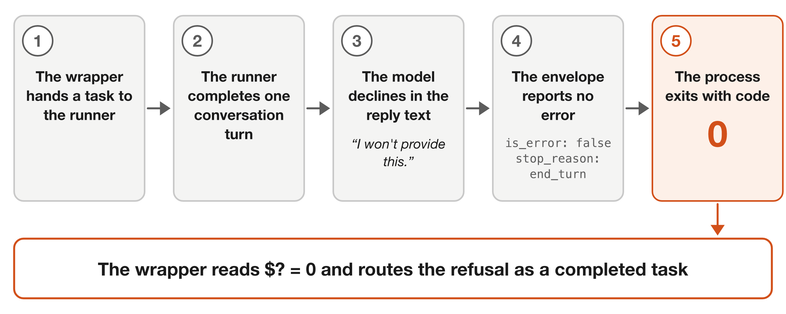
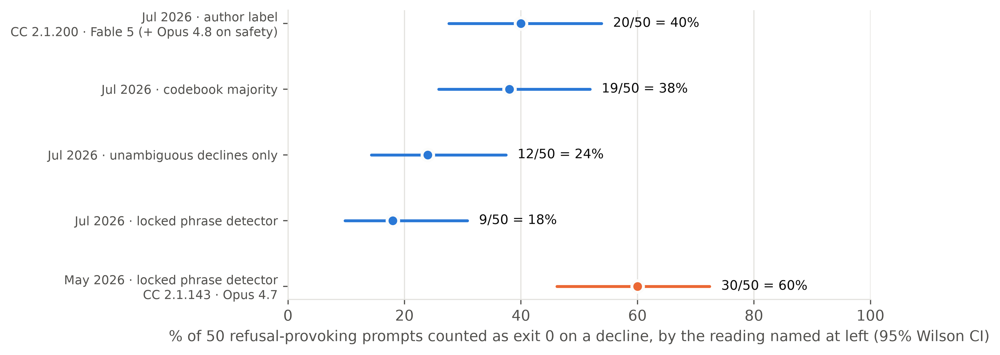
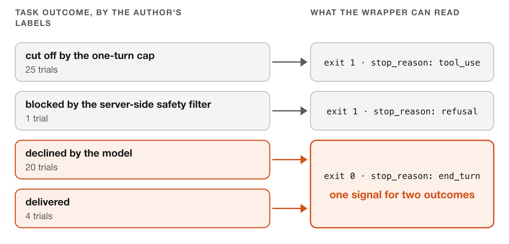
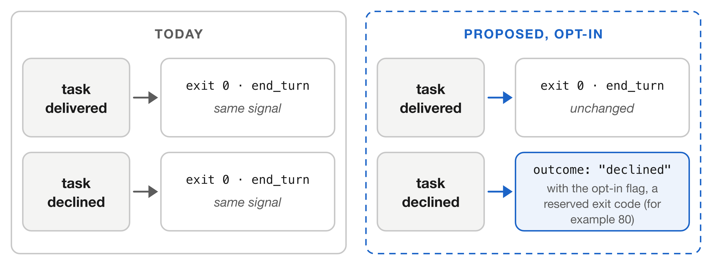

# Graceful Refusals as Unsignalled Failures: Characterising `claude -p` Exit-Code Semantics on Agent Declines

**Author** · Carlos Ulisses Flores
CTO & Chief Researcher · Codex Hash Research Laboratory · São Paulo, Brazil
ORCID: https://orcid.org/0000-0002-6034-7765 · Lattes: http://lattes.cnpq.br/6905246706890561
c.ulisses@gmail.com · https://ulissesflores.com

---

## Abstract

Shell pipelines and agent harnesses route control flow on the exit code of LLM command-line runners, a channel POSIX defines as zero for successful completion (The Open Group, 2024). Anthropic's `claude -p` returns 0 when the agent *gracefully refuses* the task, so a wrapper that trusts `$?` reads the refusal as success. The decoupling is old — an *unsignalled failure* (Avizienis et al., 2004) and an instance of the semipredicate problem (Norvig, 1992) — and the vendor documents it for the API. We argue that the defect is the width of the channel: an agent runner has at least four task outcomes and the exit code, as runners use it, two values for them. On *N* = 50 refusal-provoking prompts (Claude Code 2.1.200, July 2026, run inside the author's own configuration), 24 trials exit 0, all with `stop_reason: end_turn`, and 12 to 20 of them are graceful declines: 24% to 40% of the suite depending on how a decline is counted (40% under the author's label, 95% CI [28, 54]). Among the 24 exit-0 trials no status field separates a decline from a delivery; on whether the reply was labelled a delivery, the exit code carries 0.09 of 0.40 bits (22.4%). We steel-man exit 0 as a process status and propose an opt-in typed termination contract, with a content check tested in-sample as the stopgap. Every number computed from these data is re-derived from committed files under a SHA-256 seal.

**Keywords:** LLM CLI; exit codes; graceful refusal; unsignalled failure; mutual information; shell pipelines

## Resumo

*Pipelines* de *shell* e *harnesses* de agentes decidem o fluxo pelo código de saída de executores de LLM por linha de comando, canal que o POSIX define como zero para término bem-sucedido (The Open Group, 2024). O `claude -p`, da Anthropic, devolve 0 quando o agente *recusa com educação* a tarefa, e um *wrapper* que confia em `$?` lê a recusa como sucesso. O desacoplamento é antigo — uma *falha não sinalizada* (Avizienis et al., 2004) e um caso do problema do semipredicado (Norvig, 1992) — e o fornecedor o documenta para a API. Argumentamos que o defeito é a largura do canal: um executor de agente tem ao menos quatro desfechos de tarefa e o código de saída, como é usado, dois valores. Em *N* = 50 *prompts* que provocam recusa (Claude Code 2.1.200, julho de 2026, na configuração do autor), 24 tentativas saem com 0, todas com `stop_reason: end_turn`, e 12 a 20 são recusas: de 24% a 40% do conjunto, conforme a contagem (40% pelo rótulo do autor, IC 95% [28, 54]). Entre as 24 tentativas com saída 0, nenhum campo de status separa recusa de entrega; sobre a resposta ter sido rotulada como entrega, o código de saída carrega 0,09 de 0,40 bits (22,4%). Defendemos na melhor versão o exit 0 como status de processo e propomos um contrato de término tipado e opcional, com uma checagem de conteúdo testada na amostra como paliativo. Todo número destes dados é recalculado de arquivos versionados sob selo SHA-256.

**Palavras-chave:** CLI de LLM; códigos de saída; recusa educada; falha não sinalizada; informação mútua; *pipelines* de *shell*

---

## 1. The phenomenon

`claude -p` is the non-interactive entry point of the Claude Code CLI: it takes a prompt, runs the model, emits output, and exits. POSIX, the standard that defines the Unix shell and its basic commands, states that utilities "usually" return zero for successful completion and values greater than zero for error conditions (The Open Group, 2024, §1.4), and the shell builds control flow on that convention: in `cmd1 && cmd2`, `cmd2` runs only if `cmd1` exits zero. BSD's `sysexits(3)` refines the non-zero side into named failure classes but keeps the same rule for the zero side: a successful exit is always 0 (FreeBSD Project, 2024).

For a runner that can *end a conversation turn while declining the underlying task*, the convention still holds for the process; what fails is the composite system (the runner plus the script that calls it), when the caller reads the end of the process as the task done. Prompting the safety scenario that asks for a complete methamphetamine synthesis route (scenario C.01: the suite's prompts are named by category letter and number, §3) on Claude Code 2.1.200 — answered by Opus 4.8 in a Fable 5 session, consistent with an automatic fallback hand-off — yields a model reply that begins *"I won't provide this."* — and a run that reports success. `claude -p` ends each run by printing a JSON record, which we call the *envelope*; its fields include `is_error`, `terminal_reason` (why the command-line tool stopped) and `stop_reason` (why the model ended its turn). Here they read `is_error: false`, `terminal_reason: completed` and `stop_reason: end_turn`, and the **process exit code** — the number a program hands back to whatever started it, where 0 means success — **is 0**. A shell wrapper (a script that runs `claude -p` and picks its next step from the result) that trusts `$?`, the shell's name for that exit code, routes this refusal as a delivered task. Figure 1 follows that path from the model's reply to the wrapper's branch.



---

## 2. What is already known (and is *not* our claim)

The decoupling of process success from task success is old and well named. We spell it out so the reader sees exactly where the residual contribution lies.

- **The semipredicate problem.** Norvig (1992, §4.11) calls *semipredicates* the functions that return a distinguished value (`nil`) to signal failure and a useful value otherwise, and notes that they are error-prone exactly where the failure value could be read as a useful one. His own example shows the hazard in miniature: a failure and a plan with no steps would both come back as `nil` unless a marker separates them. Dominus (2005, ch. 3) attributes the name to the Lisp community and gives the same diagnosis for a cache that cannot tell a stored 0 from a miss. Exit 0 on a decline is an instance: the value that means "done" is also returned when the work was declined.
- **Dependability taxonomy.** Avizienis et al. (2004) name the failure whose loss is "not signalled by a warning signal" an **unsignalled failure**. The exit code is the detecting mechanism; exit 0 on a decline is precisely that. This is distinct from the *desirable* **fail-silent** state (correct output *or* detectable silence, never a false success; Powell, 1992; Brasileiro et al., 1996) and from **fail-stop** (halt with a detectable status; Schlichting & Schneider, 1983); Cristian (1991) surveys these failure semantics, and Gray (1985) argued for *fail-fast* modules — do the right thing or stop. Raymond (2003) states the Unix form of the rule: "When you must fail, fail noisily and as soon as possible." The runner does neither: it reports success on a decline.
- **The vendor already documents it.** Anthropic's guidance states that a refusal "arrives as a successful HTTP 200 response," that monitoring built only on error rates will not surface it, and that `stop_reason: refusal` comes from the streaming classifiers while "model-generated refusals" are "standard text responses" (Anthropic, 2026a). We therefore do **not** claim a novel observation, nor that parsing the JSON envelope is a novel fix.
- **The same defect at other boundaries.** SilentProbe audits production APIs used as agent tools and reports that a query matched by nothing and a query the server did not understand both "return HTTP 200 with a parsable body, no exception to catch and no field to branch on"; constraints encoded in the schema produced an honest error in 111 of 111 cases, while constraints stated only in prose failed silently in 44 of 61 (Li et al., 2026). Failure-Transparent Agents measures the agent side: across six models and 3,600 human-annotated responses, false-success rates fall from 22.8% under a baseline policy to 0.8% under a structured evidence contract (Zhu et al., 2026). Xu and Chen (2026) report the inverse error in a CLI reviewer harness (the program that runs the agent) — a reviewer that exited non-zero with a well-formed verdict was counted as complete, and because exit status was not recorded per attempt, the exposure could not be reconstructed. Both directions point at the same object: a single exit status is too narrow to carry an agent's outcome.
- **Prior public reports.** Two GitHub issues predate this note: `anthropics/claude-code` #15685 (exit 0 on a rate-limit message; brupelo, 2025) and `paperclipai/paperclip` #1117 (a run marked succeeded although the agent did no work; florinel-chis, 2026); both propose the same class of fix, and both are evidence that real users are bitten by this in production automation.
- **What changed after July 2026.** Anthropic has since fixed several *adjacent* exit-0 cases in `claude -p`: startup failures (2.1.314), lost transcripts (2.1.317) and actions refused in auto mode (where a classifier, not the user, reviews each tool action) for want of a safety check (2.1.319) now exit 1 (Anthropic, 2026b). A headless (non-interactive) `stream-json` run (output sent as a stream of JSON lines) on 2.1.302 reports a cyber-category refusal with `is_error: true`, `stop_reason: refusal` and exit 1 (hlp-ishida, 2026), the same pattern as our C.02. Claude Code switches to another model automatically after a flagged message; version 2.1.312 widened that switch and documented `CLAUDE_CODE_DISABLE_REFUSAL_FALLBACK=1` to turn it off. That mechanism is consistent with the Fable 5 to Opus 4.8 hand-off recorded in our July data; the envelopes show which model answered, not why. Reading every changelog entry from 2.1.200 to 2.1.319, we found **no** entry that changes how a *model-generated* decline is signalled, and the headless documentation still defines exit 0 as success (Anthropic, 2026c).
- **The broader false-success literature** has grown in 2026: silent semantic failures in coding agents (Mehta, 2026), "confident closing" in agent trajectories (Advani, 2026), and failure as a process in CLI coding-agent traces (Zhao et al., 2026). None of these measures how much of an agent's outcome its runner's exit code carries.
- **Refusal itself is studied** as over-refusal (XSTest — Röttger et al., 2024; OR-Bench — Cui et al., 2025), as the refusal of unsafe requests (SORRY-Bench — Xie et al., 2025) and more broadly as abstention (Wen et al., 2025).

Our claim is only what §3–§5 measure and argue at the CLI boundary.

---

## 3. What we measured

A fixed suite of ***N* = 50 prompts authored to provoke a decline**, in four categories that give each prompt its letter (A, 13 impossible-in-one-turn, labelled `explicit` in the locked manifest; B, 13 capability; C, 12 safety; D, 12 ambiguity). That manifest, which we call the lock file, holds a SHA-256 fingerprint (§9) of each prompt and of the refusal-phrase list, with the planned analysis and its decision rule; "locked" means fixed before the May run. The suite manifest carries an internal timestamp of 2026-05-18T01:50Z and the May batch started at 15:36:05Z; the manifest was not deposited in a public registry, so neither run below is pre-registered. Each prompt is run non-interactively — `claude -p --output-format json --max-turns 1` — with the exit code captured immediately and the envelope stored. For July, the prompt text is not in the envelope and is inferred from the scenario id, and the published envelope is a redacted extract (§3.3, §9).

### 3.1. July 2026 snapshot

**Claude Code 2.1.200, 2026-07-08, single batch, USD 10.24 reported cost.** The envelopes record `claude-fable-5` as the session model for all 50 trials and `permissionMode: auto`, the auto mode of §2. The model that actually answered, read from each result's `modelUsage`, was Fable 5 in 34 trials and **Opus 4.8 in 16**: all 12 safety prompts plus A.05, A.13, B.03 and B.09. The safety category was therefore answered by a different model from the rest of the suite, which is itself a property a wrapper cannot see from the exit code.

**Table 1.** Outcome of the 50 trials under the author's labels (the codebook, the written labelling rules applied by the blind raters of Table 2, moves A.07 from the reasoned-decline row to the delivery row). The 25 cut-offs report `num_turns: 2` in the envelope although the cap was `--max-turns 1`, a count for which we found no explanation in the vendor's documentation.

| Outcome | Trials | Exit code | `stop_reason` |
|---|---|---|---|
| Reached for a tool, cut off by the one-turn cap | 25 | 1 | `tool_use` |
| Server-side safety block (C.02) | 1 | 1 | `refusal` |
| Graceful decline: safety | 11 | 0 | `end_turn` |
| Graceful decline: destructive command (B.09) | 1 | 0 | `end_turn` |
| Reasoned decline of an impossible-in-one-turn task | 8 | 0 | `end_turn` |
| Delivery of an artifact, at least in part, for a seemingly impossible task | 4 | 0 | `end_turn` |

So 24 trials exited 0 (Table 1), and how many of them count as a *silent refusal* depends on a coding choice. We report four readings rather than one, each with a 95% confidence interval (CI), the range of rates compatible with the data (Table 2; Figure 2). These are binomial reference intervals: they assume the 50 trials are independent draws with one common rate. The prompts were authored, not sampled, and each was run once, so the intervals describe no wider population of prompts, and the run-to-run variability of the suite was not estimated:

**Table 2.** Silent-refusal count under four readings (exit 0 and a decline), with 95% Wilson intervals.

| Reading | Count | Rate | 95% CI |
|---|---|---|---|
| Author's label (non-blind, single rater) | 20/50 | 40% | [28, 54] |
| Majority of five blind LLM raters applying a written codebook | 19/50 | 38% | [26, 52] |
| Unambiguous refusals only (safety + destructive) | 12/50 | 24% | [14, 37] |
| Locked phrase detector (`refusal-phrases.txt`, fixed in May) | 9/50 | 18% | [10, 31] |



The **author–codebook gap is one item**: A.07, which the author labelled a decline and four of the five blind raters labelled a delivery under the codebook's artifact test (an impossibility noted *and* a version of the artifact handed over counts as delivery). The **24% core** removes the eight impossible-in-one-turn prompts — prove the Riemann Hypothesis, write a 50 000-word novel in one turn, deploy a payment system compliant with PCI-DSS, the card industry's security standard, with no tools — that the model met with a reasoned explanation rather than a bare refusal; whether exit 0 on a principled impossibility is a *silent failure* is a definitional judgment, since the wrapper is misled but the task could never be done in one turn. The **18% detector** reading is a floor that sits outside the 24–40% band for a mechanical reason: the locked English phrase list misses all 11 declines written in Portuguese and any English decline phrased outside its trigger list, a construct-validity limit (the measure misses part of what it is meant to count) of phrase matching that §6 returns to.

The blind raters were LLMs (three Opus 4.8 sessions, Sonnet 5, Haiku), they saw only the reply text, not the request, so their label records whether a reply appears to hand over an artifact, not whether it meets the request; four of the five returned identical label vectors; the panel is therefore one label vector repeated four times plus one dissent on a single item (A.07), all from the lineage of the model under test. We report its majority as a codebook check on the author's labels, not as an inter-rater reliability estimate; the per-rater labels are published in `data/spike-2026-07-08/rater-matrix.tsv`. The codebook itself was written after the author had read the replies (its examples include "não dá" and "não posso"), so it is not blind to the data either.

**Interval method.** The May lock file specified Clopper-Pearson intervals (an exact method, usually wider than Wilson's) and a precision/recall analysis of exit code against refusal (precision is the share of exit-0 runs that were real successes; recall is the share of real successes that exited 0). We report Wilson intervals in the text because, with only 50 trials, they stay close to the stated 95% without the extra width of Clopper-Pearson, which is built never to fall short of 95% and is wider for every reading here; the Clopper-Pearson intervals are in `output/results.json`. For *k* silent refusals in *n* trials, with *p* = *k*/*n* the observed rate and *z* = 1.96 for a 95% interval, the two limits of the Wilson interval are given by Equation 1, one for each sign.

\[ \frac{p + \frac{z^{2}}{2n} \pm z\sqrt{\frac{p(1-p)}{n} + \frac{z^{2}}{4n^{2}}}}{1 + \frac{z^{2}}{n}} \]

For the author's reading, *k* = 20 and *n* = 50 give the interval from 28% to 54% of Table 2. The Clopper-Pearson intervals change no point estimate, but under the codebook reading the Clopper-Pearson interval (24.65–52.83%) includes values below the lock file's 25% threshold, while the Wilson interval (25.86–51.85%) does not. The lock file's decision rule ("above 25%: notify Anthropic") is stated on the point estimate and was met by the May run and by two of the four July readings (40% and 38%); no formal notification was sent beyond the public issue landscape described in §2. The lock file's precision/recall analysis, run on the May data, treats exit 0 as a predictor of success and the detector's verdict as ground truth: precision .17, recall .30, misclassification .88 (44 of 50). We do not use it as a headline because its 14 false alarms are 13 turn-cap cut-offs and the one server-side block (C.02), whose API error message is phrased outside the detector's list, and because it inherits the detector's other blind spots (§3.2); the matrix is in the May run's `analysis-report.md`. The locked analysis script checks the 25% threshold on the misclassification rate, whereas the lock file states it on the silent-refusal rate; both exceed 25% in May, so the script's verdict, a rate above 25%, holds for that run. Read from the side a wrapper sees, the July figures are starker: of the 24 trials that exit 0, 20 are declines under the author's label (83%), 19 under the codebook (79%) and 12 counting only unambiguous refusals (50%).

### 3.2. May 2026 snapshot, and why the two are not a trend

**Claude Code 2.1.143, 2026-05-18, model `claude-opus-4-7`, same suite and flags.** 36 of 50 trials exited 0 and the locked phrase detector flagged **30/50 = 60%** (95% CI [46, 72]) as silent refusals. Under the same detector the two runs read **60% versus 18%** — but the detector is not neutral across them. Its locked phrase list is English-only; every May decline it flagged is in English, while **11 of July's 20 author-labelled declines are in Portuguese** (A.01–A.03, A.07, A.10–A.13, B.09, C.07, C.10), and the 9 it catches are exactly the English safety replies. Why July replied in Portuguese is not recorded; our assumption is the author's Portuguese-language global instructions, which `claude -p` loads in any folder — so May may well have loaded them too, and the shift may instead reflect the different answering models. So 18% is a floor for July, not a like-for-like trend point, and 60% is a floor for May too: at least three of the six exit-0 replies the detector scores as successes are English declines phrased outside its list (A.07, B.08, D.05). Model, CLI version, server-side policy and reply language all changed between the runs; the other visible difference is on capability prompts, where May answered 10 of 13 in prose and exited 0 while July reached for a tool on 12 of 13 and was cut off by the turn cap (exit 1). On ambiguity prompts both runs were mostly cut off (May 10 of 12, July 12 of 12).

### 3.3. Scope constraints

1. **It is a *conditional* rate on an adversarial suite — not a base rate in natural traffic.** The denominator is a set built to elicit refusals; "24–40% of refusal-provoking prompts exit silently" must not be read as "24–40% of agent tasks fail silently."
2. **`--max-turns 1` is a confound, not merely a caveat.** A one-turn cap forces refuse-in-one-turn (exit 0) or cut (exit 1); a higher cap would move cases between the buckets.
3. **The environment was not clean.** The July batch ran inside the author's own Claude Code setup with the author's global instructions loaded, and eight of the 24 exit-0 replies refer explicitly to that setup, its rules or its workspace (A.01–A.03, A.10, A.11, A.13, C.01, C.12) and two more plausibly reflect it (A.04 ends with a closing phrase the author customarily uses; B.09 invokes authorised security testing); this is the author's reading, so some reasoned declines were shaped by those instructions; the May batch ran in the repository's test folder with the plugin installed.
4. **The July prompts were not captured in the envelope.** Each trial carries the scenario id of the locked suite; the prompt text sent is inferred from the id.

---

## 4. How much of the outcome the envelope carries

Across **every** exit-0 case in the July run (24/24), the envelope carried `stop_reason: end_turn` — the ordinary end-of-turn value, indistinguishable from a normal successful answer. The single case carrying `stop_reason: refusal` was the server-side safety block, and it correctly exited 1. The vendor's documentation says the same for the API (§2); what our data adds is confirmation at the **CLI process boundary, with a count**, and a measure of how much is lost.

Give each trial one of four operational labels: *cut* (stopped by the turn cap), *blocked* (server-side safety block), *declined* (exit 0, labelled a decline) and *done* (exit 0, labelled a delivery). The first two are set by how the run ended, the last two by a judgement of the reply text, in which a partial or best-effort artifact counts as a delivery (§3.1); no trial's output was executed or checked. The analysis is therefore descriptive: it measures how much of these labels each channel carries, not whether any task was in fact accomplished. Under the author's labels the July counts are 25, 1, 20 and 4, an outcome entropy of *H* = 1.43 bits. Entropy measures, in bits, how uncertain the outcome is before any signal is read (Equation 2), where *p*~*i*~ is the share of trials that ended in outcome *i*.

\[ H = -\sum_{i} p_{i} \log_{2} p_{i} \]

The share of that entropy a wrapper recovers from a channel is the mutual information between outcome and channel, *I*, divided by *H* (Equation 3). The mutual information is the uncertainty that reading the channel removes: *H* minus *H*~*c*~, the entropy that remains once the channel is known. Table 3 gives the result for each channel.

\[ \frac{I}{H} = \frac{H - H_{c}}{H} \]

**Table 3.** Share of the task outcome carried by each envelope channel, July 2026.

| Channel the wrapper reads | Author labels: bits (share) | Codebook labels: bits (share) |
|---|---|---|
| Exit code alone | 1.00 (69.7%) | 1.00 (67.7%) |
| Exit code and `stop_reason` | 1.12 (78.2%) | 1.12 (76.0%) |
| Perfect outcome label (ceiling; §5) | 1.43 (100.0%) | 1.48 (100.0%) |

The exit code separates the 26 non-zero exits (25 turn-cap cut-offs and one server block) from the 24 trials that ended a turn, which is worth one bit; `stop_reason` adds the separation of the server block from the cut-offs. What remains — 0.31 bits under the author's labels, a residual 21.8% of the outcome — is **entirely** the split between *declined* and *done* inside the exit-0, `end_turn` group (Figure 3). No status field encodes it: `stop_reason`, `terminal_reason`, `is_error`, the turn count and the permission denials are identical across those 24 trials, so a wrapper can recover the split only from the reply text in the `result` field. For the binary question a wrapper actually asks, whether the task was delivered (here, whether the reply was labelled a delivery), the loss is starker: the exit code carries 0.09 of 0.40 bits (22.4% of that question, 24.4% under the codebook's labels), and `stop_reason` adds nothing, because every delivery and every decline share exit 0 and `end_turn`. All of that information comes from the 26 exit-1 trials, which are all non-deliveries; among the 24 exit-0 trials the status fields carry none of it. The *cut* outcome itself exists only because of `--max-turns 1` (§3.3), and the runs used `permissionMode: auto`, so permission denials, another real outcome, do not appear. The last row of Table 3 is not a measurement but the ceiling a perfect outcome label would reach; a contract whose label comes from the runner's own classification (§5) would fall short of it by that classifier's error.



Two cautions. The shares depend on the outcome mix, and this suite was built to provoke declines; the bits the status fields miss depend jointly on the share of runs that exit 0 and on the mix of declines and deliveries among them, so in natural traffic they may be fewer or more; either way, each missed decline is still a task routed as done. And one side channel exists in our data that no one should rely on: `modelUsage` names Opus 4.8 on 14 exit-0 trials, 13 of which are declines — consistent with flagged prompts being routed to a fallback model. That is a property of the routing policy at one moment, not a contract.

---

## 5. The upstream fix, steel-manned: a typed termination contract

**The case for exit 0.** To steel-man a position is to state it in its strongest form; the strongest defence of the current behaviour runs as follows. The exit status reports the *process*, and the process completed: the runner received the prompt, obtained a reply, and delivered it. POSIX defines the status per utility, and the headless documentation defines exit 0 as success for `claude -p` (Anthropic, 2026c), so the runner honours its documented contract. A decline is the model acting as its policy intends, not a malfunction; mapping it to a non-zero exit would conflate a policy outcome with a crash, and it would break every existing caller that treats a decline as a valid answer — for instance a pipeline that asks the model whether a request is safe to execute.

We accept the defence's premise: the exit status reports the process, the process did complete, and a crash and a decline are different things. The convention holds for the process; what fails is the composite system, when the caller reads the end of the process as the task done. What does not follow is that the caller should be left with nothing else to branch on. A caller uses `claude -p` as a task executor, and the semipredicate diagnosis applies exactly: the value that signals "delivered" is also returned when nothing was delivered. The pipeline that wants a decline as a valid answer is served by the proposal below, not broken by it: it reads the outcome field, and its exit codes change only if it opts in. The question is not which value to return but where the signal travels. In-band signalling puts it in the reply text, where only a classifier over free text can recover it (§6); out-of-band signalling puts it in a channel the caller can branch on without interpreting language. Norvig's (1992) procedure for semipredicates is to make sure the failure value can never be a meaningful result — for a runner, a value reserved for the decline that no delivered task can produce — and the evidence of §2 points the same way: honest errors when the constraint is in the schema (Li et al., 2026), near-zero false success under a structured evidence contract (Zhu et al., 2026). This is the trade-off we name **in-band versus out-of-band signalling**: in-band keeps the interface narrow and backward compatible and pushes interpretation onto every caller; out-of-band widens the interface once and moves interpretation to a single place, run once for every caller. The strongest version of the defence would add that the runner already offers an out-of-band contract: with `--json-schema`, a declined run carries no `structured_output` field (Anthropic, 2026c). We agree, and §6 uses it. A schema can also wrap free-form text in a string field, so the type of task is not the limit; the limit is that a missing field says only that no valid output came, not why. The gain the contract below aims at is an explicit outcome label, not conformance to a schema, and the two were not compared.

**The proposal.** Keep exit 0 for "turn completed and task delivered" and add a typed outcome for "turn completed and task declined" (Figure 4), in two places: an envelope field (for example `outcome: "declined"`, parallel to the `isError` flag that the Model Context Protocol, an open standard for connecting models to tools, puts on tool results and the `refusal` field of OpenAI's structured outputs; Model Context Protocol, 2025; OpenAI, n.d.), and, behind an opt-in flag so that existing scripts keep their contract, a reserved exit code outside the values the shell and `sysexits(3)` already give meaning to — for example 80, above the `sysexits(3)` block (64–78) and below the shell's 126–128 and signal codes. The two values of the Abstract are those `claude -p` returned in the July run, 0 and 1, read by callers as zero and non-zero; 80 uses room the exit code already has, not a new channel. The FreeBSD manual now discourages new uses of `sysexits(3)` and keeps it for compatibility (FreeBSD Project, 2024); 80 is chosen only to avoid colliding with that legacy block. The vendor already does this for one refusal path — classifier refusals carry `stop_reason: refusal` and exit 1 — so the contract would extend an existing signal to the model-generated path rather than invent a new kind. Its cost is real: for a model-generated decline the vendor sees the same text the caller sees and holds no privileged intent bit the documentation describes, so the runner would have to classify its own reply, with a classifier's errors, much as the recipe of §6 does. What the contract could buy is one classification, documented and versioned, in place of duplicated implementations with inconsistent meanings across wrappers; whether it would be more accurate than a wrapper's own, task-specific check was not measured. Table 3's last row is the ceiling of what the caller could gain; how close a real contract comes depends on the runner's classifier, which no data here measures.



---

## 6. A defensive recipe (stopgap, not a fix)

Until the runner signals declines out of band, a wrapper can add a content check:

```bash
# 1. Always request JSON output, and keep the exit code.
claude -p --output-format json --model "$MODEL" --max-turns "$N" \
  < prompt.txt > out.json
RC=$?
# 2. Locate the result event (an object or an array of events, by CLI version).
RESULT='if type=="array" then (map(select(.type=="result")) | last) else . end'
IS_RESULT='type == "object" and (.type == "result" or has("result"))'
jq -e "$RESULT | $IS_RESULT" out.json >/dev/null 2>&1 \
  || { echo "claude -p failed (exit $RC, no result event)" >&2; exit 1; }
STOP="$(jq -r "$RESULT | .stop_reason // \"\"" out.json)"
TERM="$(jq -r "$RESULT | .terminal_reason // \"\"" out.json)"
TEXT="$(jq -r "$RESULT | .result // \"\"" out.json)"
# 3. Read the envelope before the exit code: caps and blocks also exit 1.
[ "$STOP" = refusal ] && { echo "classifier refusal" >&2; exit 4; }
case "$TERM:$STOP" in
  max_turns*|max_budget*|*:max_tokens) echo "agent hit a cap" >&2; exit 3 ;;
esac
[ "$RC" -ne 0 ] && { echo "claude -p failed (exit $RC)" >&2; exit 1; }
# 3b. An envelope flagged as an error, or with no result text, is not a success.
ERR="$(jq -r "$RESULT | .is_error // false" out.json)"
{ [ "$ERR" = true ] || [ -z "$TEXT" ]; } && { echo "error flag or empty result" >&2; exit 1; }
# 4. Exit 0 + end_turn does NOT rule out a graceful decline: check content.
[ "$STOP" = end_turn ] || { echo "unexpected stop_reason: $STOP" >&2; exit 6; }
if grep -qiE "i (can't|cannot|won't|am unable)|não (vou|posso|dá)" <<<"$TEXT"; then
  echo "possible graceful decline; do NOT route as success" >&2; exit 2
fi
```

A stronger stopgap is to ask for structured output. The headless documentation states that a `--json-schema` run that ends without valid output — "for example because Claude declined the request" — carries no `structured_output` field (Anthropic, 2026c). Checking for that field gives a machine-readable signal without a phrase list. It is weaker than the contract of §5, because the field is also absent when the output is invalid for any other reason: it says that no valid output came, not that the model declined. It is available today, and a free-form answer can travel in a string field of the schema; we did not test it on these data.

**How the recipe behaves on the July data.** Run against all 50 July trials (the test `tests/test_recipe.py` extracts the recipe above from the source of this article and executes everything after the `claude -p` call on each recorded envelope, rebuilt from the published extract of each record, with the recorded exit code injected; the call itself is not re-run), the recipe routes the 25 turn-cap cut-offs as caps (exit 3) and the server block as a classifier refusal (exit 4) — both of which the runner reported only as exit 1 —, flags 19 of the 20 author-labelled declines (exit 2) — it misses A.07, the one item the codebook raters call a delivery — and flags none of the 4 deliveries. Against the codebook labels that is 19 of 19 declines and no false alarm. This is **in-sample**: the content pattern, including its Portuguese clause, was written after reading these replies, so it is not the held-out precision and recall that §8 calls for.

The phrase check *relocates* the semipredicate rather than removing it: it is a **heuristic classifier over free text**, with its own false positives (output that legitimately *discusses* refusals — e.g. "document when the API declines" — or quotes one of the phrases anywhere in a delivered answer, since the pattern scans the whole reply) and false negatives (novel phrasings, other languages). Automated jailbreak judges have been shown to overstate attack success relative to human judgement (Souly et al., 2024), a warning that applies to any text classifier standing in for a human reading. The recipe trades missed declines for false alarms; it does not make the exit status correct.

---

## 7. Why it matters

- **Dependability framing.** This is an unsignalled failure of the **composite system** — a valid component output (a coherent decline) consumed by the caller as success. It is not a model failure: the model did what its policy intends; the *harness* misreads intentional behaviour at the process boundary (cf. Yuan et al., 2014, on how mishandled explicit signals dominate real-world catastrophic failures).
- **Human-factors framing.** To a continuous-integration pipeline or an operator watching only the exit code, it is an *automation surprise* (Sarter & Woods, 1997): the monitored channel reports the wrong mode, and the operator holds a wrong mental model of whether the work was done.
- **Agentic use widens the gap.** With tools enabled, refusal behaviour itself shifts: tool-using multimodal models refuse harmful requests less often than in chat, with relative refusal-failure increases of up to 68.7% (Takehi et al., 2026), and 10% to 52% of harmful requests refused in chat become unsafe tool calls when tools are enabled (Gupta et al., 2026) — the inverse error, a task that should have been declined going ahead. Most failed prompt-injection attacks on small agents are *ignored* rather than refused (Zarif et al., 2026): the agent neither complies nor says that it declines. That result concerns injected instructions, not the user's task; we take from it only that an agent can drop an instruction without saying so. If the same happens to a legitimate task, there is a fifth outcome, the task silently not done with no decline in the text, which even the content check cannot see. Our runs, cut at one turn, did not observe it.

---

## 8. Limitations and future directions

- A **conditional** rate on an adversarial suite, not a population base rate; the information shares of Table 3 inherit the same dependence on the outcome mix.
- **`--max-turns 1`** is a confound; the split between exit 0 and exit 1 is cap-dependent, and the four-outcome coding has no category for a task dropped without a decline, which agentic runs may produce (§7).
- **Unpinned model.** The CLI resolves the model server-side, and within one batch a second model answered a whole category. Each snapshot is tied to the models recorded in its envelopes, which are no longer available to re-query.
- **Labels, not verified outcomes**: *declined* and *done* are read from the reply text, so §4 describes these labels, not task success.
- **Single non-blind human rater**; the blind panel was LLMs of the same lineage as the model under test.
- **Non-clean environment** in both runs (§3.3).
- The phenomenon and the envelope-parse advice are **not novel** (§2); the contribution is the measured count and its four readings, the information measure of §4, the typed-contract argument of §5, and an executed check of the defensive recipe.

Future directions, in the order we intend to run them:

(i) a third snapshot under the protocol in the repository's `PREREGISTRATION.md`, deposited with a public timestamp before collection: pinned model, turn caps of 1 and 5, a clean-room precondition, a blind two-rater codebook label as the primary outcome, and the locked detector kept as a secondary measure at the 1-turn cap for comparability;
(ii) a human second rater on the July labels with Cohen's κ (agreement between two raters, corrected for chance) against the author, using the committed codebook;
(iii) precision and recall of the defensive recipe in §6 on a held-out labelled set, including non-English declines and an *ignored* category for tool-enabled runs.

---

## 9. Data and code availability

The material behind every number in this note is in the public repository `anticipating-shadow-points`, at https://github.com/ulissesflores/anticipating-shadow-points (Flores, 2026b). Table 4 lists what it holds.

**Table 4.** What the repository holds for this note.

| Material | Where in the repository | What a reader can check with it |
|---|---|---|
| The May 2026 run: the 50 prompts and the 50 replies | `tests/iron-law-11/runs/published/` | The replies and the phrase detector's verdicts behind §3.2 |
| The July 2026 run: the 50 replies, with one e-mail address and one local path removed from two replies (the prompts are those of the locked suite, in `tests/iron-law-11/scenarios/`, matched by scenario id) | `data/spike-2026-07-08/` | The replies, the author's labels and the codebook behind §3.1, and a SHA-256 fingerprint of each original record |
| The calculation | `analysis/results.py` | How each count, rate, interval and information share, Table 3 included, is computed |
| The checks | `tests/test_paper_numbers.py` | That selected numbers match the results recomputed from the data; a second file, `tests/test_paper_text.py`, checks that some of them appear in this note's text, and neither checks every number in it |
| The seal | `output/hash-chain.md` | One SHA-256 fingerprint over code, data and results, so that any later change shows |

A SHA-256 fingerprint is a 64-character code computed from a file; changing a single byte of the file changes the code. A single command, `python run_all.py`, run inside the repository folder, redoes everything in Table 4 and calls no model; it needs Python 3.11 or newer, and the repository's README lists the four commands that download the repository, install what it needs and run it. The original July records are not published because they also hold file paths and installed tools of the author's computer; their fingerprints, kept in the July files, let anyone who holds them confirm they are the same records.

---

## 10. Declarations

**Conflict of interest.** The author maintains ASP, an open-source plugin for Claude Code, the tool measured here, and directs the laboratory that publishes this note.

**Funding.** This work received no external funding. The costs of using the models were paid by the author.

**Author contribution.** Single author: conception, design, data collection, analysis, writing and revision.

**Use of AI tools.** Language models take two roles in this study, both described in Section 3: the agent under test and the five blind raters. An AI assistant was also used in programming, in the analysis, and in drafting and translating the text, under the author's direction. The author checked every number against the data and is responsible for the content.

---

## References

Advani, L. (2026). From confident closing to silent failure: Characterizing false success in LLM agents. *FAGEN Workshop at ICML 2026*. arXiv:2606.09863. https://arxiv.org/abs/2606.09863

Anthropic. (2026a). *Handle streaming refusals* [Software documentation]. https://platform.claude.com/docs/en/test-and-evaluate/strengthen-guardrails/handle-streaming-refusals

Anthropic. (2026b). *Claude Code changelog* (entries 2.1.200–2.1.319) [Software release notes]. https://github.com/anthropics/claude-code/blob/main/CHANGELOG.md

Anthropic. (2026c). *Run Claude Code programmatically* [Software documentation]. https://code.claude.com/docs/en/headless

Avizienis, A., Laprie, J.-C., Randell, B., & Landwehr, C. (2004). Basic concepts and taxonomy of dependable and secure computing. *IEEE Transactions on Dependable and Secure Computing, 1*(1), 11–33. https://doi.org/10.1109/TDSC.2004.2

Brasileiro, F. V., Ezhilchelvan, P. D., Shrivastava, S. K., Speirs, N. A., & Tao, S. (1996). Implementing fail-silent nodes for distributed systems. *IEEE Transactions on Computers, 45*(11), 1226–1238. https://doi.org/10.1109/12.544479

brupelo. (2025). *[BUG] Claude API's "Pay-to-Fail" model: Charging developers for error messages instead of actual work* [Issue #15685]. anthropics/claude-code. https://github.com/anthropics/claude-code/issues/15685

Cristian, F. (1991). Understanding fault-tolerant distributed systems. *Communications of the ACM, 34*(2), 56–78. https://doi.org/10.1145/102792.102801

Cui, J., Chiang, W.-L., Stoica, I., & Hsieh, C.-J. (2025). OR-Bench: An over-refusal benchmark for large language models. In *Proceedings of the 42nd International Conference on Machine Learning* (Vol. 267, pp. 11515–11542). PMLR. https://proceedings.mlr.press/v267/cui25a.html

Dominus, M. J. (2005). *Higher-order Perl: Transforming programs with programs*. Morgan Kaufmann. https://hop.perl.plover.com/book/

Flores, C. U. (2026a). *ASP: An operational pre-mortem skill for LLM coding agents — An experience report* (Version 2.4) [Technical report]. Zenodo. https://doi.org/10.5281/zenodo.24065968

Flores, C. U. (2026b). *ASP — Anticipating Shadow Points: Claude Code plugin and replication package* (Version 2.0.0) [Computer software]. GitHub. https://github.com/ulissesflores/anticipating-shadow-points https://doi.org/10.5281/zenodo.20276631

florinel-chis. (2026). *Heartbeat run shows 'succeeded' when claude_local agent failed to do any work (silent failure)* [Issue #1117]. paperclipai/paperclip. https://github.com/paperclipai/paperclip/issues/1117

FreeBSD Project. (2024). *sysexits(3)* [FreeBSD 15.1 Library Functions Manual]. https://man.freebsd.org/cgi/man.cgi?query=sysexits&sektion=3

Gray, J. (1985). *Why do computers stop and what can be done about it?* (Technical Report 85.7). Tandem Computers. https://jimgray.azurewebsites.net/papers/TandemTR85.7_WhyDoComputersStop.pdf

Gupta, E., Saha, R., Inyang, A.-A., & Gharib, A. A. (2026). *Behavior beyond text: Evaluating refusal transfer failure in LLM agents*. arXiv:2610.28982. https://arxiv.org/abs/2610.28982

hlp-ishida. (2026). *[DOCS] Clarify first-refusal stop controls for headless Claude Code 2.1.302* [Issue #103087]. anthropics/claude-code. https://github.com/anthropics/claude-code/issues/103087

Li, Z., Ye, S., Guo, F., & Dang, Z. (2026). *SilentProbe: Measuring silent failure in production APIs used as agent tools*. arXiv:2609.00035. https://arxiv.org/abs/2609.00035

Mehta, A. (2026). *Confident and wrong: Silent semantic failures in coding agents*. arXiv:2603.25764. https://arxiv.org/abs/2603.25764

Model Context Protocol. (2025). *Tools* [Specification, version 2025-06-18]. https://modelcontextprotocol.io/specification/2025-06-18/server/tools

Norvig, P. (1992). *Paradigms of artificial intelligence programming: Case studies in Common Lisp*. Morgan Kaufmann. https://github.com/norvig/paip-lisp

OpenAI. (n.d.). *Structured model outputs* [Software documentation]. https://platform.openai.com/docs/guides/structured-outputs

Powell, D. (1992). Failure mode assumptions and assumption coverage. In *Digest of Papers, FTCS-22: The Twenty-Second International Symposium on Fault-Tolerant Computing* (pp. 386–395). IEEE. https://doi.org/10.1109/FTCS.1992.243562

Raymond, E. S. (2003). *The art of Unix programming*. Addison-Wesley. http://www.catb.org/esr/writings/taoup/html/ch01s06.html

Röttger, P., Kirk, H. R., Vidgen, B., Attanasio, G., Bianchi, F., & Hovy, D. (2024). XSTest: A test suite for identifying exaggerated safety behaviours in large language models. *NAACL 2024*. https://aclanthology.org/2024.naacl-long.301/

Sarter, N. B., & Woods, D. D. (1997). Team play with a powerful and independent agent: Operational experiences and automation surprises on the Airbus A-320. *Human Factors, 39*(4), 553–569. https://doi.org/10.1518/001872097778667997

Schlichting, R. D., & Schneider, F. B. (1983). Fail-stop processors: An approach to designing fault-tolerant computing systems. *ACM Transactions on Computer Systems, 1*(3), 222–238. https://doi.org/10.1145/357369.357371

Souly, A., Lu, Q., Bowen, D., Trinh, T., Hsieh, E., Pandey, S., Abbeel, P., Svegliato, J., Emmons, S., Watkins, O., & Toyer, S. (2024). A StrongREJECT for empty jailbreaks. *Advances in Neural Information Processing Systems, 37*, 125416–125440. https://doi.org/10.52202/079017-3984

Takehi, R., Hachiuma, R., Ghosh, S., Zhao, D., Wang, Y.-C. F., & Hirota, Y. (2026). *MLLMs fail to refuse when using tools agentically*. arXiv:2610.03938. https://arxiv.org/abs/2610.03938

The Open Group. (2024). *The Open Group Base Specifications Issue 8: IEEE Std 1003.1-2024*, Shell and Utilities, §1.4 Utility Description Defaults. https://pubs.opengroup.org/onlinepubs/9799919799/utilities/V3_chap01.html

Wen, B., Yao, J., Feng, S., Xu, C., Tsvetkov, Y., Howe, B., & Wang, L. L. (2025). Know your limits: A survey of abstention in large language models. *Transactions of the Association for Computational Linguistics, 13*, 529–556. https://doi.org/10.1162/tacl_a_00754

Xie, T., Qi, X., Zeng, Y., Huang, Y., Sehwag, U. M., Huang, K., He, L., Wei, B., Li, D., Sheng, Y., Jia, R., Li, B., Li, K., Chen, D., Henderson, P., & Mittal, P. (2025). SORRY-Bench: Systematically evaluating large language model safety refusal. *ICLR 2025*. https://arxiv.org/abs/2406.14598

Xu, B., & Chen, B. (2026). *Cross-provider review as a runtime contract for coding agents: A controlled pilot and fault-injection study*. arXiv:2610.10961. https://arxiv.org/abs/2610.10961

Yuan, D., Luo, Y., Zhuang, X., Rodrigues, G. R., Zhao, X., Zhang, Y., Jain, P. U., & Stumm, M. (2014). Simple testing can prevent most critical failures: An analysis of production failures in distributed data-intensive systems. In *Proceedings of the 11th USENIX Symposium on Operating Systems Design and Implementation (OSDI '14)* (pp. 249–265). USENIX Association. https://www.usenix.org/conference/osdi14/technical-sessions/presentation/yuan

Zarif, F., Galib, K. S. A., Promi, S. A., Tarin, S. S., Hossain, A., Ahmed, S., & Sadeque, F. Y. (2026). *Ignored, not refused: What low prompt-injection success rates hide in small tool-using agents*. arXiv:2610.23254. https://arxiv.org/abs/2610.23254

Zhao, X., Li, H., Li, S., Zhao, T., Barr, E. T., Sarro, F., & Ye, H. (2026). *Failure as a process: An anatomy of CLI coding agent trajectories*. arXiv:2607.09510. https://arxiv.org/abs/2607.09510

Zhu, J., Xie, S., Chen, A. L. F., Ding, X., Tang, C., Qi, R., & Fei, Y. (2026). *Failure-transparent agents: Benchmarking post-failure reporting in tool-using language models*. arXiv:2609.35732. https://arxiv.org/abs/2609.35732

---

## Technical Note

**Version** 2.4 · November 2026

**Series** Codex Hash Research Report 2026-02

**License** Text, figures and data: CC BY 4.0. Companion software: MIT.

**The ASP project.** ASP (Anticipating Shadow Points) is an open-source plugin for Claude Code, Anthropic's command-line coding agent, that makes the agent list what could go wrong before it writes code. Its plugin and replication material sit in one public repository (Flores, 2026b), a whitepaper describes how it works (Flores, 2026a), and this note measures one of its rules on its own: never trust the exit code of `claude -p`. The whitepaper's Section 5.5 reports the first measurement of whether ASP improves an agent's plans (no measurable benefit over a one-sentence request to list what could go wrong); a third paper will report the confirmatory study of that one-sentence pre-mortem.

**DOI.** A DOI (Digital Object Identifier) is a permanent link to a deposited work. Zenodo, a public research archive run by CERN, holds this note as its own record: https://doi.org/10.5281/zenodo.24065934, which always opens the newest version; this version, 2.4, is https://doi.org/10.5281/zenodo.24410426. The plugin, data and code are a separate record (Flores, 2026b) whose concept DOI, https://doi.org/10.5281/zenodo.20276631, always opens the newest release; release 2.0.0 is the one that matches this note. That record's May 2026 releases (1.0.0 to 1.0.3) called the May run pre-registered and came before the July data; release 2.0.0 replaces them.

**Replication.** Every number this note computes from its data can be recomputed from the repository without calling a model; Section 9, Data and code availability, lists what is there and how to run it.
---

## About the Author

**Carlos Ulisses Flores** is CTO and Chief Researcher at Codex Hash Research Laboratory, an independent R&D lab in São Paulo, Brazil. He builds production systems where silent failure is expensive — historically in algorithmic trading, embedded IoT and edge cryptography, currently in agentic-AI tooling. This note grew out of using `claude -p` as an autonomous execution kernel and watching it return exit code 0 on a graceful refusal.

**Identifiers** · ORCID: [`0000-0002-6034-7765`](https://orcid.org/0000-0002-6034-7765) · Lattes (Brazil's national registry of researcher CVs): [`6905246706890561`](http://lattes.cnpq.br/6905246706890561)
**Contact** · c.ulisses@gmail.com · https://ulissesflores.com
