# One Sentence Before the Plan: A Pre-Registered Confirmatory Study of Pre-Mortem Prompting in LLM Coding Agents

**Author** · Carlos Ulisses Flores
CTO & Chief Researcher · Codex Hash Research Laboratory · São Paulo, Brazil
ORCID: https://orcid.org/0000-0002-6034-7765 · Lattes: http://lattes.cnpq.br/6905246706890561
c.ulisses@gmail.com · https://ulissesflores.com

---

## Abstract

A pre-mortem asks a team to assume that its plan has failed and to list why (Klein, 2007). In an earlier pre-registered study the listing half of that exercise, put in one sentence, made a coding agent's plan cover more independently listed risks, as a secondary result (Flores, 2026a). This paper reports the confirmatory study. Twelve change requests on pinned public repositories were given to Claude Code in plan mode, on Claude Opus 5.5 and Claude Sonnet 5.5, under two requests that differ by one sentence: "Plan this change." and "Before planning, list the ways this change could go wrong." Reference risks were written blind by three models of other vendors, and a blind judge of another vendor scored each answer. Protocol, lists and analysis were sealed and timestamped before the first trial. Over 240 trials the sentence raised coverage from 46.1% to 57.5%, a mean difference of 11.4 percentage points over 24 task-by-model strata (stratified permutation p < .001, also within each model). A second judge gave +10.7 points (Cohen's κ = .86). Without the three strata that hold a trial lost to a network error the difference is 10.1 points. Against a second set of reference lists, worded differently, it is 6.7 points (p < .001), and 9.0 by a third-vendor judge added later. The claim is limited to two models of one vendor, to model-written reference lists and to plans, not code.

**Keywords:** pre-mortem; prompt engineering; LLM coding agents; risk identification; pre-registration; software planning

## Resumo

Um pré-mortem pede que a equipe suponha que o plano fracassou e liste os motivos (Klein, 2007). Num estudo pré-registrado anterior, a metade de listagem desse exercício, posta em uma frase, fez o plano de um agente de código cobrir mais riscos listados de forma independente, como resultado secundário (Flores, 2026a). Este é o estudo confirmatório. O Claude Code, em modo de planejamento no Claude Opus 5.5 e no Claude Sonnet 5.5, recebeu doze pedidos de mudança em repositórios públicos fixados, sob dois pedidos que diferem em uma frase: "Plan this change." e "Before planning, list the ways this change could go wrong." Três modelos de outros fornecedores escreveram às cegas os riscos de referência, e um juiz cego de outro fornecedor pontuou cada resposta. Protocolo, listas e análise foram selados e carimbados antes da primeira rodada. Em 240 rodadas, a frase elevou a cobertura de 46,1% para 57,5%, diferença média de 11,4 pontos percentuais em 24 estratos de tarefa por modelo (permutação estratificada, p < ,001, também em cada modelo). Um segundo juiz deu +10,7 pontos (κ de Cohen = ,86). Sem os três estratos com rodada perdida por erro de rede, a diferença é de 10,1 pontos. Contra um segundo conjunto de listas, pedido com outras palavras, ela é de 6,7 pontos (p < ,001), e de 9,0 por um juiz de um terceiro fornecedor acrescentado depois. A afirmação se limita a dois modelos de um fornecedor, a listas escritas por modelos e a planos, não a código.

**Palavras-chave:** pré-mortem; engenharia de *prompt*; agentes de código baseados em LLM; identificação de riscos; pré-registro; planejamento de software

---

## 1. Introduction

Coding agents built on large language models (LLMs) now plan and carry out changes to real repositories (Jimenez et al., 2024). The plans studied here are requested before any code is written, an early point at which to catch a missed risk. This paper tests one claim: opening a planning request with the sentence "Before planning, list the ways this change could go wrong.", in place of "Plan this change.", makes the risk table that closes the agent's plan cover more of the risks that independent reviewers expect. The claim is narrow on purpose, because effects of prompt wording often fail to hold from one model or task set to the next (Sclar et al., 2024).

The sentence comes from decision research. In a *pre-mortem*, a team imagines that its plan has already failed and writes down the reasons (Klein, 2007). The technique rests on *prospective hindsight*: people who explain an outcome as if it had already happened generate more reasons than people who explain an outcome that might happen (Mitchell et al., 1989). Risk-assessment standards list neighbouring structured techniques, such as failure modes and effects analysis, among the methods an organisation may apply before acting (International Electrotechnical Commission, 2019). The sentence tested here keeps only the second half of Klein's exercise, the listing, and drops the assumption of failure (Figure 1).

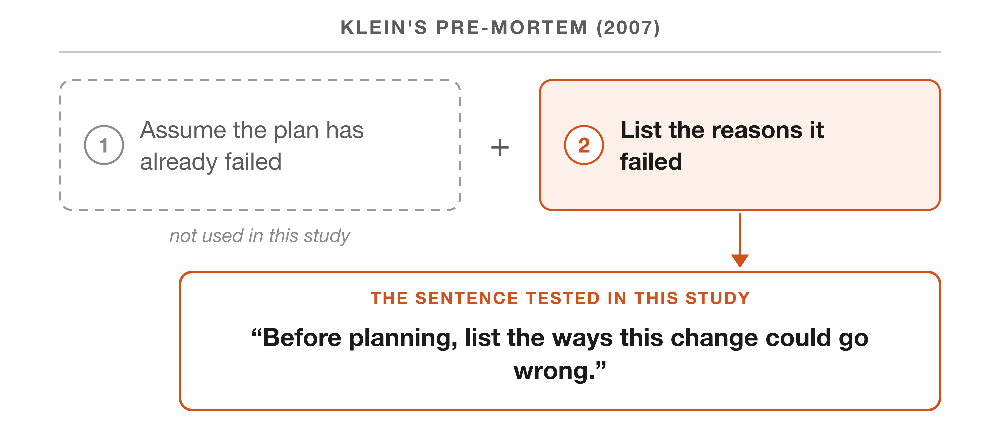

For LLMs, the closest evidence is in safety, where having a model enumerate potential harms before it answers lowers judged harmfulness more than telling it to be safe (Kim et al., 2026). In agents, anticipating failure before acting has been built into multi-step methods and evaluated as a whole (Wang et al., 2024; Wang et al., 2026). In code generation, reminders to be secure give mixed or null results (Tony et al., 2025; Kharma et al., 2026), and a longer prompt that asks a coding agent to forecast edge cases helped two models and hurt a third (Patel et al., 2026). What is missing is a controlled measurement of the smallest dose in software planning: one sentence, against the same request without it, scored against risks that somebody else listed.

The sentence emerged from an earlier evaluation of a tool that the author maintains. ASP is an open-source plugin, an installable add-on, for Claude Code, Anthropic's command-line coding agent; it walks the agent through a 13-phase pre-mortem protocol, and its first pre-registered measurement, one whose protocol and analysis were fixed in public before the data were collected (Section 4.7), found no measurable benefit: the full protocol covered fewer reference risks than a plain request with the sentence added (Flores, 2026a). The sentence, in turn, beat the plain request by 10 percentage points. That comparison was pre-registered as secondary, on one model and six tasks, so it justified a new study and no more (Nosek et al., 2018).

This paper reports that study. It was designed to give the earlier finding a fair chance to fail: twelve new tasks, a second model, the comparison as the single primary question, and a decision rule sealed before any data existed (Figure 2).

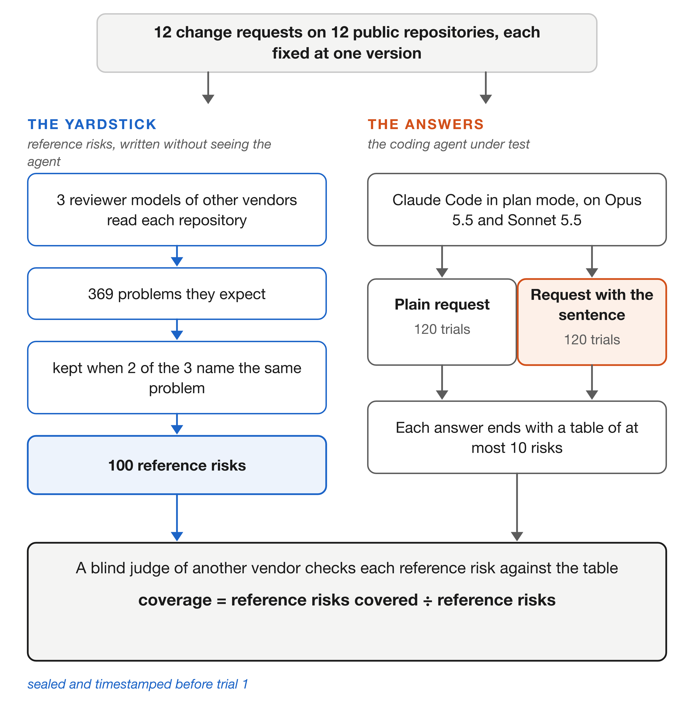

### 1.1. Contributions

1. **A confirmatory, pre-registered test of a one-sentence request in a coding agent.** Over 240 trials on twelve pinned public repositories and two models, the sentence raises the coverage of independently listed risks by 11.4 percentage points (p < .001), and by a similar amount within each model (Section 5.2).
2. **Checks on the gain.** A second judge of a different vendor reaches the same decision (Section 5.3), the listed risks are not judged less concrete (Section 5.4), and the result survives the removal of three trials that a network error zeroed in the comparison's favour (Section 5.5). Against reference lists elicited afterwards with other words, the gain stays positive and falls to 6.7 points (Section 5.8).
3. **A sealed, open record.** Every prompt defined by the study, every reference list, answer, verdict and analysis file is public and linked in a hash ledger, a chain of file fingerprints, whose pre-trial state is anchored in the Bitcoin blockchain, a public record that is impractical to rewrite (Section 4.7), and one command recomputes every result of the study (Flores, 2026b).
4. **A stated list of objections.** Section 7 takes the strongest objections to the result, including those raised by outside reviewers of this manuscript, and answers each with data or names it as open.

To our knowledge, no prior study measures the effect of a minimal pre-mortem instruction on the coverage of independently elicited risks in software-change planning by a coding agent, apart from the originating study, where it was a secondary comparison (Flores, 2026a). Section 2.5 states what bounds that sentence. The mechanism itself, enumerating failure modes before responding, has prior support (Kim et al., 2026) and is not claimed here.

---

## 2. Background and related work

### 2.1. The pre-mortem in people

Klein (2007) describes the project pre-mortem as a short meeting held before work starts: the plan is assumed to have failed, and each participant writes the reasons. The supporting experiment is that of Mitchell et al. (1989), in which certainty about an outcome, more than its position in time, increased the number of explanations people produced. In a controlled experiment with 178 students, the pre-mortem lowered confidence in a plan by 25.0 points, against 14.0 for listing pros and cons and 12.4 for listing cons alone (Veinott et al., 2010). The established human effects are therefore on quantity and on confidence, so a study of LLMs has to check that more items do not simply mean vaguer items (Section 5.4).

The human procedure has two parts, the assumption of failure and the listing of reasons (Klein, 2007). A prompt can ask for the second without the first, and the sentence studied here does exactly that. The comparison of human and AI answers in pre-mortem planning has started in human-factors research (Veinott & Lehman, 2024), but as a comparison of who answers, not of how the model is asked.

### 2.2. Enumerating failure before answering, in LLMs and agents

InvThink is the nearest prior work (Kim et al., 2026). The model lists potential harms, analyses their consequences and then answers under the constraints it derived. In its prompting-only mode, with no training, the method lowers a judged harmfulness score from 3.22 to 2.19, where a safety instruction of similar length reaches only 2.62. The authors' explanation is that explicit enumeration brings out knowledge that a direct request leaves unused. The outcome there is harmful content, and the frame has three steps.

In agents, Devil's Advocate makes a web-navigation agent reflect on likely failures and alternative remedies before each action, and reports 23.5% task success against 19.8% for a plan-and-act baseline, with 45% fewer plan revisions than the strongest competing method (Wang et al., 2024). PreFlect criticises a plan before execution using planning errors distilled from earlier trajectories, and raises success on a general-assistant benchmark, a fixed set of test tasks, from 46.1% to 58.2% (Wang et al., 2026). Both evaluate multi-step methods; neither tests a one-sentence instruction, and neither counts how many expected risks a plan names.

A third line concerns what an unprompted model leaves out. In a small, preliminary field experiment on sprint planning, where a team plans its next short work cycle, an LLM planning alone documented 36.4% of the risks that later materialised, 4 risks, against 78.6% for human planners, 11 risks (Caraeni et al., 2026). LLM agents can also produce many more candidate consequences of a product than experts working alone (Fröhling et al., 2026). The first result is the gap that a planning prompt could narrow, and its outcome is a neighbour of the one used here: there, capture of risks that materialised; here, capture of risks that reviewers expected.

### 2.3. Reminders and forecasts in code generation

Several studies add a cautionary instruction to a code-generation prompt and measure the code. On GPT-4, some prompting techniques reduced the density of security weaknesses by between 59% and 78% (Tony et al., 2025). Across five models and four prompting methods, another study found no statistically significant reduction in vulnerabilities (Kharma et al., 2026). A system prompt asking for edge-case coverage was often no better than the baseline in zero-shot code generation, where the model gets no worked example (Cheng & Mastropaolo, 2026). These results warn against assuming that a short cautionary sentence helps.

They also differ from the present setting in a way that matters. Their simplest instructions are reminders ("be secure"), although the techniques compared also include iterative ones such as recursive criticism and improvement (Tony et al., 2025), and the outcome is the code. An instruction to *enumerate* is a different act from an instruction to *be careful*, which is the distinction InvThink draws against its safety-prompt baseline (Kim et al., 2026). Asking a model to list its implicit assumptions is a neighbouring enumeration act, studied for code generation with a structured prompt (Wu, 2026).

The nearest study in software is that of Patel et al. (2026). They give coding agents, Claude Code among them, a multi-sentence prompt that asks the agent to forecast the edge cases its implementation may miss, before starting, while implementing and before submitting. The outcome is in code: a joint rate of patches (proposed code changes) that resolve the task and also avoid a defect that a later change to the project had to fix. In their comparison that rate rose from 24.5% to 32.6% for Claude Opus 5, rose for a second model and fell from 17.0% to 13.7% for Claude Sonnet 5, while the share of tasks resolved fell for all three. Their result is the reason the present claim is not extended from plans to code, and it shows that the effect of such prompts can depend on the model.

### 2.4. Short instructions and prompt sensitivity

That one sentence can move a model's output is well established. "Let's think step by step" raised zero-shot accuracy on an arithmetic benchmark from 17.7% to 78.7% (Kojima et al., 2022), and Plan-and-Solve prompting refined the same idea by asking the model to devise a plan first (Wang et al., 2023). The same literature shows why such findings need replication: accuracy varied by up to 76 points across formatting choices that carry no meaning (Sclar et al., 2024).

Nor does a pre-mortem prompt help everywhere. In a pre-registered comparison of 38 prompts for forecasting questions, which included a pre-mortem prompt, most prompts changed accuracy little (Schoenegger et al., 2025). A wording effect seen once, on one model and a handful of tasks, may be noise from that sensitivity. This is the methodological reason for a confirmatory study with a second model, new tasks and a rule fixed in advance (Nosek et al., 2018).

### 2.5. Where this study sits

The combination studied here is: a software-engineering setting with real repositories; an outcome defined as coverage of a reference list that the agent under test never saw; a dose of one sentence; and a preceding result in which a long structured protocol covered 48% of the reference risks against 66% for that sentence (Flores, 2026a). The nearest neighbours differ on at least one of these: InvThink on domain and outcome (Kim et al., 2026), and Patel et al. (2026) on dose and outcome.

The literature search behind the novelty statement of Section 1.1 covered English-language venues and preprint servers up to 14 November 2026, with additional queries in Portuguese, German, Japanese and Chinese; its record, with the status of each source, is in the repository (Flores, 2026b). It worked on titles and abstracts, so a study that tests such a condition without naming it there, or one that is not indexed, could have escaped it.

---

## 3. The originating study

The earlier study ran 90 trials on six public repositories with Claude Opus 5.5 under three conditions: the plain request, the request with the sentence, and the ASP protocol (Flores, 2026a, Section 5.5). Table 1 and Figure 3 give its result.

**Table 1.** Risk coverage and time per trial in the originating study (2026-11), by condition.

| Condition | Covered (primary judge) | Covered (second judge) | Mean time per trial |
|---|---|---|---|
| Plain request | 56% | 57% | 58 s |
| Plain request plus the sentence | 66% | 70% | 50 s |
| ASP protocol (13 phases) | 48% | 54% | 175 s |

*Note.* 30 trials per condition on six tasks. Source: Flores (2026a).

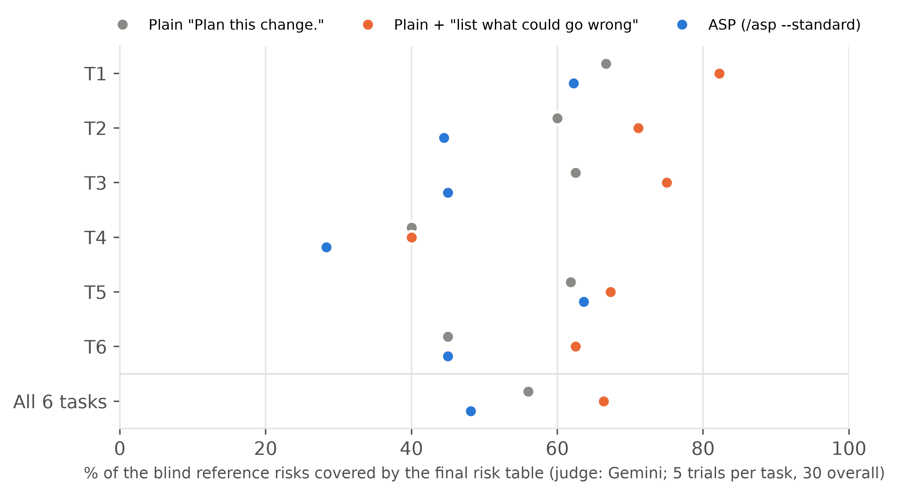

The pre-registered primary comparison of that study, ASP against the sentence, was negative on all six tasks: −18 points, p = 1.0 (Figure 3). The secondary comparison, the sentence against the plain request, was +10 points (p = .001) by the primary judge and +13 points (p < .001) by the second (Table 1). Because the protocol labelled that comparison secondary, the earlier report claimed only its direction and announced the present study (Flores, 2026a).

Two properties of that result shaped the new design. The effect was measured on a single model, and prompt effects can reverse between models (Patel et al., 2026). And it rested on six tasks, so the new study uses twelve that the earlier one never touched (Table 2).

---

## 4. Method

### 4.1. Hypothesis and design

The hypothesis is directional: the sentence raises coverage. The design crosses twelve tasks, two models and two conditions, with five replicates per cell, for 240 trials (Figure 2). A *stratum* is one task on one model; there are 24, each holding five trials per condition. The protocol fixed every item of this section before the first trial, following the practice of separating confirmatory from exploratory analysis (Nosek et al., 2018), and its file is in the repository (Flores, 2026b).

### 4.2. Tasks

Each task is a one-sentence change request on a public repository pinned to one commit, a recorded version of its code (Table 2). The requests were written to have consequences beyond the files a first reading suggests: stored data that must migrate, clients that must keep working, defaults that other projects rely on. They span seven languages, a spread that guidelines for LLM studies in software engineering recommend over a single-language sample (Baltes et al., 2026). The task file was committed before any reference list was written (Section 4.7).

### 4.3. Conditions and harness

The two conditions send the same text except for one sentence (Appendix A gives both in full):

- **Plain:** the change request, then "Plan this change."
- **Sentence:** the change request, then "Before planning, list the ways this change could go wrong." (Table A1; Figure 4)

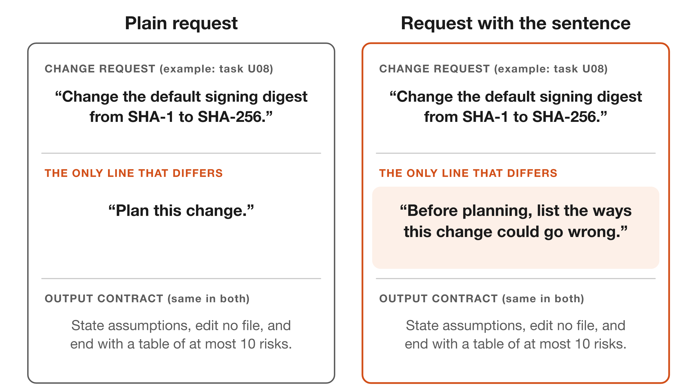

Both then carry the same *output contract*, a fixed paragraph that tells the agent to state assumptions instead of asking questions, to edit no file of the project (plan mode may still save the plan itself to a file; Section 5.6), to answer in English and to end with the main risks of the change in one table of at most ten rows (Appendix A). The contract matters for reading the result. The plain condition is not an agent that was never asked about risk: both conditions must end with a risk table. The comparison therefore measures the joint effect of opening the request with the sentence instead of the plain instruction, over and above being required to report risks at the end; it does not separate the position of the sentence from its wording (Section 7, objection 5). The prompts are byte for byte those of the originating study (Flores, 2026a). Figure 5 shows what comes back: the risk column of two real answers to the same request, one per condition.

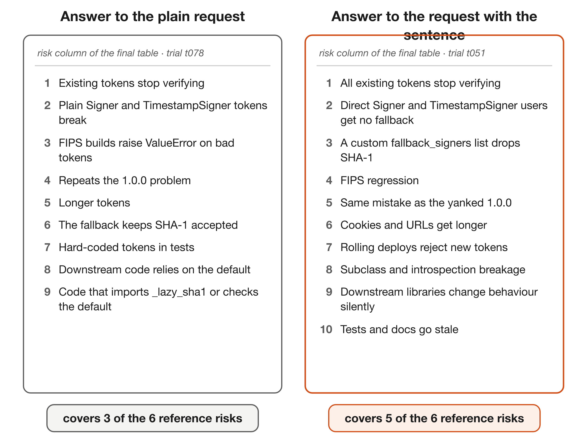

In Figure 5, FIPS stands for the Federal Information Processing Standards of the United States; a system built in FIPS mode refuses cryptographic algorithms that those standards do not approve.

**Table 2.** The twelve tasks.

| Task | Repository (language) | Change request |
|---|---|---|
| U01 | remix-run/blues-stack (TypeScript) | Require new users to verify their email address before they can log in. |
| U02 | golang-gin-realworld-example-app (Go) | Let authors change an article's title, and its URL slug with it, without breaking links that were already shared. |
| U03 | laravel-realworld-example-app (PHP) | Let moderators hide abusive comments, and let the comment's author appeal within 7 days. |
| U04 | django-axes (Python) | Lock users out by username and IP address together instead of by IP address alone, as the new default. |
| U05 | expressjs/session (JavaScript) | Make sessions roll by default, so that every request extends the session's expiry. |
| U06 | flasky (Python) | Let every user download all of their data (profile, posts and comments) as a single file. |
| U07 | fastapi-tdd-docker (Python) | Replace the integer IDs that the API exposes with UUIDs, while keeping existing API clients working. |
| U08 | pallets/itsdangerous (Python) | Change the default signing digest from SHA-1 to SHA-256. |
| U09 | aspnetcore-realworld-example-app (C#) | Store passwords with a stronger hashing scheme without forcing existing users to reset their passwords. |
| U10 | CleanArchitecture (C#) | Make every to-do list and item belong to a tenant, so that each company only sees its own data. |
| U11 | spring-petclinic (Java) | Let pet owners book visits online, without two visits being booked for the same vet at the same time. |
| U12 | starlette (Python) | Make the session middleware's cookie Secure and SameSite=Strict by default. |

*Note.* Full repository addresses and commit identifiers are in `benchmark/study-2026-11b/tasks.json` (Flores, 2026b). A slug is the readable part of a page's address, a UUID is a long, practically unique identifier, a tenant is each customer of a system that serves several at once, middleware is code that handles each request before the application does, and SHA-1 and SHA-256 are hash functions, which turn data into a fixed-length code.

The harness, the program that runs the model as an agent, is Claude Code, version 2.1.319: each trial is one non-interactive run of it in plan mode, a mode in which the agent may read the repository and may not change it (Anthropic, 2026). The run starts from a fresh clone of the pinned commit, in an isolated configuration folder, with every environment variable that could alter the model's settings removed. ASP and the five plugins synced from the operator's account were turned off; the four plugins built into Claude Code stayed on in every trial, in both conditions (Flores, 2026b). The two models are Claude Opus 5.5 and Claude Sonnet 5.5. All 240 trials were placed in one order by a seeded shuffle, so that conditions and models are interleaved in time, and ran three at a time.

### 4.4. Reference risks, written blind

The reference list of a task is the set of risks against which every answer for that task is scored, and the twelve lists together form the study's yardstick. Three models from other vendors wrote it: Grok, GPT-OSS 120B and Gemini 3.8 Flash (Table 3). Each read a fresh copy of the repository and the change request, under one prompt that asks for six to twelve concrete ways the change could go wrong in that codebase (Appendix A). None saw the conditions, the protocol or any output of the agent under test. They produced 369 items. A judge then grouped items that name the same problem, and a risk entered the reference list when at least two of the three reviewers had named it. This left 100 reference risks, between 6 and 10 per task; 31 were named by all three reviewers and 69 by two (Appendix B shows one list in full).

Models stand in here for independent engineers, a substitution that guidelines for LLM studies ask authors to declare and bound (Baltes et al., 2026). The protocol declares it as a weakening. The reviewer prompt also shares its key words with the sentence under test, and Section 7, objection 1, treats that as the main threat to the result.

**Table 3.** The roles each outside model plays in the study.

| Model | Writes a reviewer list | Groups the items | Judges coverage | Judges relevance | Reference risks in its wording |
|---|---|---|---|---|---|
| Gemini 3.8 Flash | yes | yes | primary judge | yes | 91 |
| GPT-OSS 120B | yes | no | no | no | 9 |
| Grok | yes | no | second judge | no | 0 |
| GPT-6 Astra | no | no | third judge, second yardstick only | no | 0 |

*Note.* A reference risk is worded as the first reviewer in alphabetical order of reviewer name wrote it, which is why none carries Grok's wording. No outside model shares a vendor with the models under test. The saved outputs of the Grok client carry no model identifier. GPT-6 Astra was added after review as an unplanned judge of the second yardstick, and it shares a vendor with GPT-OSS 120B (Section 5.8; Flores, 2026b).

### 4.5. Scoring

*Coverage* is the outcome: the number of reference risks that an answer's table covers, divided by the number of reference risks of the task. The primary judge, Gemini 3.8 Flash, receives the change request, the reference risks and only the rows of the answer's table (Appendix A). For each reference risk it decides whether any row addresses the same underlying problem, even if worded differently. Figure 6 shows the judge's verdicts for the two answers of Figure 5. The judge is not told the condition or the model. A fixed list of words was replaced by a marker before judging; the list was inherited from the originating study, where it hid the name of the ASP protocol, and it changed 12 words in 10 of the 240 tables here (Flores, 2026b).

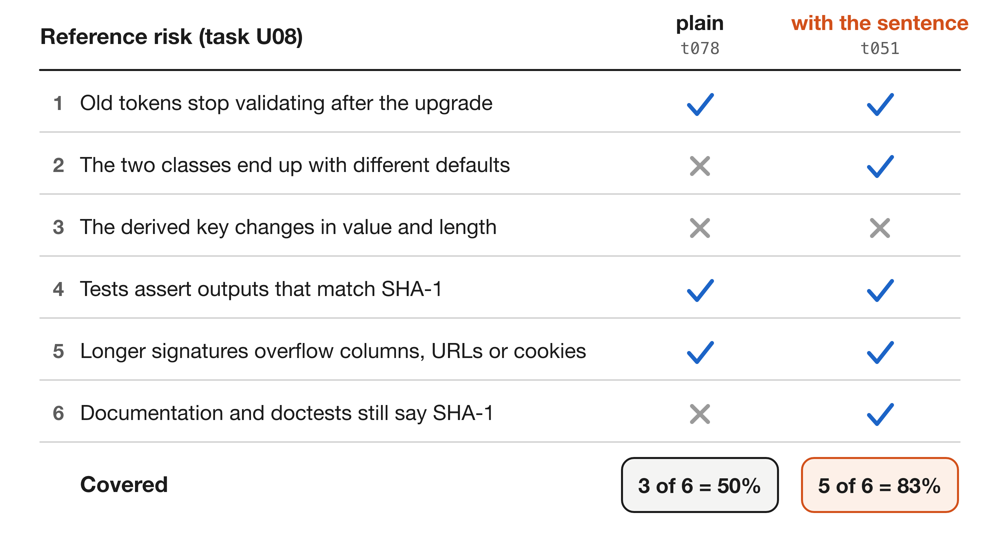

Three secondary measures were fixed with it (Flores, 2026b):

- **Second judge.** Grok scores the same material in the same way. Agreement between the two judges is reported at the level of single decisions; Cohen's κ (Cohen, 1960), which discounts the agreement expected by chance, was added to that report afterwards and is labelled unplanned (Section 7).
- **Lexical matcher.** A deterministic token-overlap matcher, which compares texts by the tokens (words or parts of words) they share, kept from the originating study, where it had already proved blind to paraphrase (Flores, 2026a).
- **Relevance.** The share of an answer's table rows that the primary judge calls a concrete, plausible risk of this specific change. Relevance guards against a hollow gain, because the human pre-mortem effect is one of quantity (Mitchell et al., 1989). It is judged from the request and the row alone, so it measures specificity and plausibility, not correctness.

LLM judges reach over 80% agreement with human preferences in some settings (Zheng et al., 2023) and carry known biases, including a preference for text that resembles their own (Panickssery et al., 2024). No judge in this study shares a vendor with the models under test, so no judge scores answers written by a model of its own vendor, the case in which self-preference is documented. The same is not true of the reference risks, most of which carry the primary judge's wording (Table 3; Section 7, objection 3).

### 4.6. Analysis and decision rule

The test statistic is the mean, over the 24 strata, of the difference between mean coverage with the sentence and mean coverage without it. Its significance comes from a permutation test (Ernst, 2004): the condition labels are shuffled within each stratum 10,000 times, and the p-value is the share of shuffles whose statistic is at least the observed one, counted as (hits + 1) / 10,001 so that it is never zero (Phipson & Smyth, 2010). The test is one-sided and makes no assumption about the distribution of coverage. Shuffling within strata keeps differences between tasks and between models out of the comparison (Ernst, 2004).

In symbols, the statistic *D* is the average in Equation 1, where *S* is the number of strata and *d*~*s*~ is the difference, in stratum *s*, between mean coverage with the sentence and mean coverage without it (Flores, 2026b).

\[ D = \frac{1}{S} \sum_{s=1}^{S} d_{s} \]

The p-value follows Equation 2, where *B* is the number of shuffles and *b* is the number of them whose statistic is at least the observed *D* (Phipson & Smyth, 2010). With *B* = 10,000, the smallest value the test can return is 1/10,001.

\[ p = \frac{b + 1}{B + 1} \]

The decision rule has one condition for "confirmed": pooled p below .05 *and* the same test within each model, over its twelve strata, below .05 for both models (Flores, 2026b). If only one model passed, the result would be stated as confirmed for that model alone. The rule also required at least 18 complete strata. No other analysis is confirmatory, in the sense of Nosek et al. (2018).

An error in a trial was fixed in advance to count as coverage zero and relevance zero and not to be rerun, except for a usage-limit error, which stops collection (Flores, 2026b). Section 5.5 examines what this rule did.

### 4.7. Pre-registration and integrity record

Pre-registration here means that the protocol, the tasks, the prompts, the reference lists and the analysis code were committed to a public repository and timestamped before the first counted trial (Nosek et al., 2018). The later additions listed in Table 4 were each fixed in an addendum, a dated text appended to the protocol and sealed in the same way before the calls it covers. A hash ledger links every file of the study: each entry holds the SHA-256 fingerprint of a file and of the entry before it, so the ledger cannot be rewritten without changing its last entry, called its head (Flores, 2026b). A file corrected after it was recorded receives a new entry, and the old one stays in the chain. A SHA-256 fingerprint is a 64-character code computed from a file; changing one byte of the file changes the code. Figure 7 shows the first three entries of the ledger with their real fingerprints, and the stages that the chain closes.

The head of the ledger before trial 1 was stamped with OpenTimestamps, a service that anchors a fingerprint in the Bitcoin blockchain, and the commit was saved to Software Heritage, a public archive of source code. Table 4 lists each sealed event with the record that proves its order, and Figure 8 shows the sequence up to the pre-registered analysis. The seal and the first trial are 21 seconds apart on the operator's clock: the sealing commit is from 16:08:23 and the first reply of the first trial from 16:08:44. That order of seconds rests on these local records; the Bitcoin anchor and the archive show that the sealed files existed when those proofs were made, not that they preceded the first trial by seconds. All 240 answers were published before any verdict existed, and all verdicts were added to the ledger before the analysis ran (Flores, 2026b).

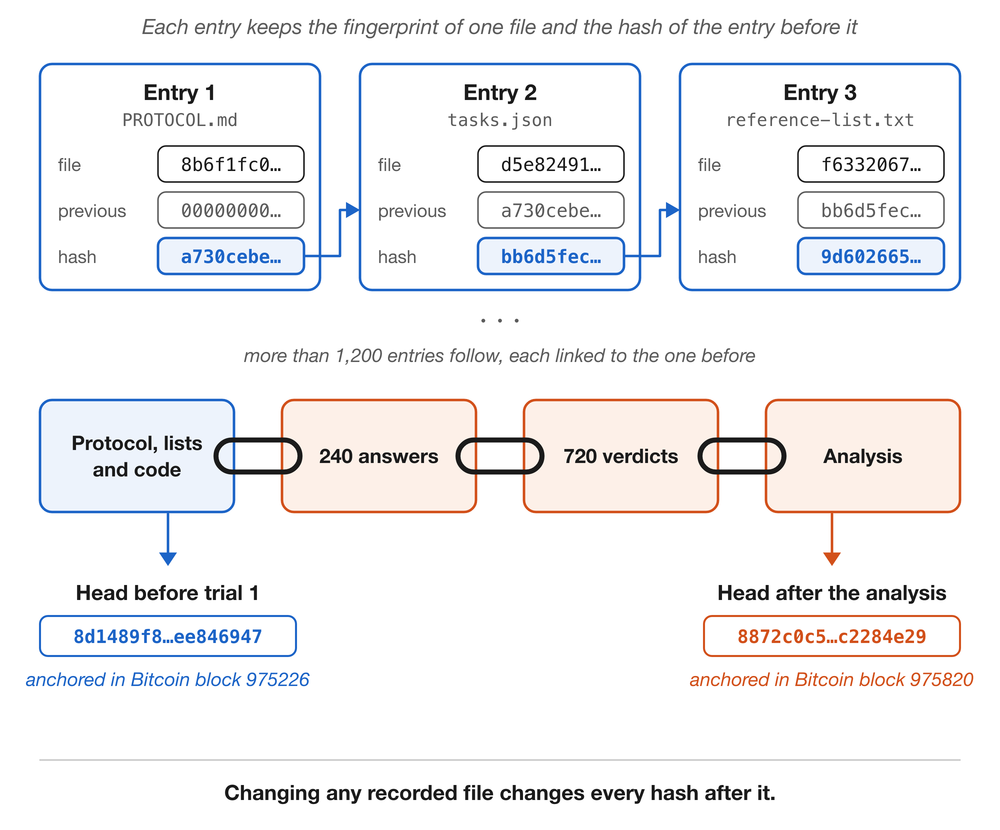

**Table 4.** The integrity record of the study.

| Event | Date, São Paulo time | Record |
|---|---|---|
| Tasks fixed, before any reference list | 9 Nov 2026, 15:25 | Commit `eb1a447` |
| Protocol, reference lists, prompts and code sealed | 9 Nov 2026, 16:08:23 | Commit `fe18438`; ledger head `8d1489f8…ee846947`; OpenTimestamps proof anchored in Bitcoin block 975226; Software Heritage revision `fe184385434ee3d433104549d054f8c98ad69b32` |
| First reply of the first counted trial, `t091` | 9 Nov 2026, 16:08:44 | First timestamp in `runs/envelopes/t091.jsonl.gz` |
| All 240 answers published, before any verdict | 14 Nov 2026, 00:30 | Commit `e046f36` |
| All 720 verdicts sealed, before the analysis | 14 Nov 2026, 12:44 | Commit `67b52d0` |
| Pre-registered analysis run and sealed | 14 Nov 2026, 12:45 | Commit `e8c73c1`; ledger head `8872c0c5…c2284e29`; OpenTimestamps proof anchored in Bitcoin block 975820 |
| Second yardstick: addendum, prompt and code sealed before its lists were written | 14 Nov 2026, 16:25 | Commits `573b8bf` and `fa3d0ba`; ledger head `cf0a7bfd…0499f47f`; OpenTimestamps proof anchored in Bitcoin block 975834 |
| Second addendum (rerun and third judge) sealed before its first call | 15 Nov 2026, 11:19 | Commits `0acd091` and `2fb3c8b`; ledger head `73e275d1…58b42f11`; OpenTimestamps proof submitted |
| Third addendum (judge through a paid API) sealed before its first scoring call | 15 Nov 2026, 14:23 | Commits `2b2af4c` and `2c5f5eb`; ledger head `2a9ac120…4f6dce4c`; OpenTimestamps proof submitted |

*Note.* Commits are in the repository of Flores (2026b). Ledger heads are shortened; the full values are in `benchmark/study-2026-11b/pretrial-head.txt` and `analysis-head.txt`, next to their `.ots` proof files. The proofs can be read with `ots info` and checked against a Bitcoin node with `ots verify`; the third head is in `yardstick2/head-before-lists.txt`. The heads of the two later addenda are in `addendum2/head-before-addendum2.txt` and `addendum3/head-before-addendum3.txt`; their proofs had been submitted and were not yet anchored when this version was written.

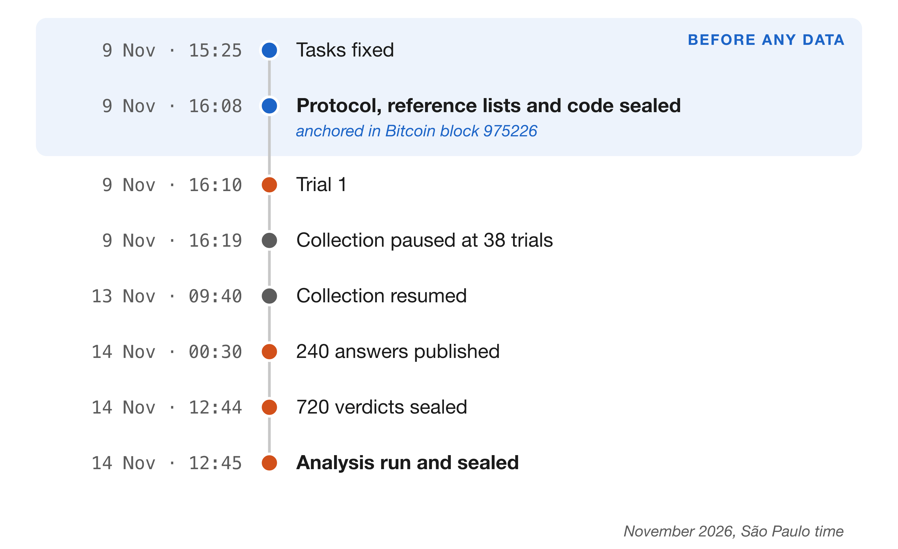

---

## 5. Results

### 5.1. Collection

All 240 trials were recorded, on one version of Claude Code, and none changed a project file (Flores, 2026b). Three trials ended in a network error and left no table (Section 5.5). All 24 strata are complete, so the decision rule of Section 4.6 applies (Table 5).

### 5.2. Primary result

The sentence raised coverage from 46.1% to 57.5% by the primary judge (Table 5). The pre-registered statistic, the mean difference over the 24 strata, is 11.4 percentage points, with p < .001: the value is 1/10,001, the smallest the test can return (Phipson & Smyth, 2010). None of the 10,000 shuffles reached the observed difference; the largest gave 5.9 points (Figure 9). Within Claude Opus 5.5 the difference is 10.4 points and within Claude Sonnet 5.5 it is 12.4 points, each with p < .001. The difference is positive in 22 of the 24 strata, zero in one and negative in one (Table 6). The decision rule returns *confirmed*.

**Table 5.** Risk coverage by model and judge.

| Model | Plain (primary judge) | Sentence (primary judge) | Plain (second judge) | Sentence (second judge) |
|---|---|---|---|---|
| Claude Opus 5.5 | 43% | 54% | 48% | 57% |
| Claude Sonnet 5.5 | 49% | 61% | 52% | 64% |
| Both | 46% | 58% | 50% | 61% |

*Note.* 60 trials per model and condition. The primary judge is Gemini 3.8 Flash and the second judge is Grok. Percentages are rounded to whole numbers; the differences in the text come from the unrounded values.

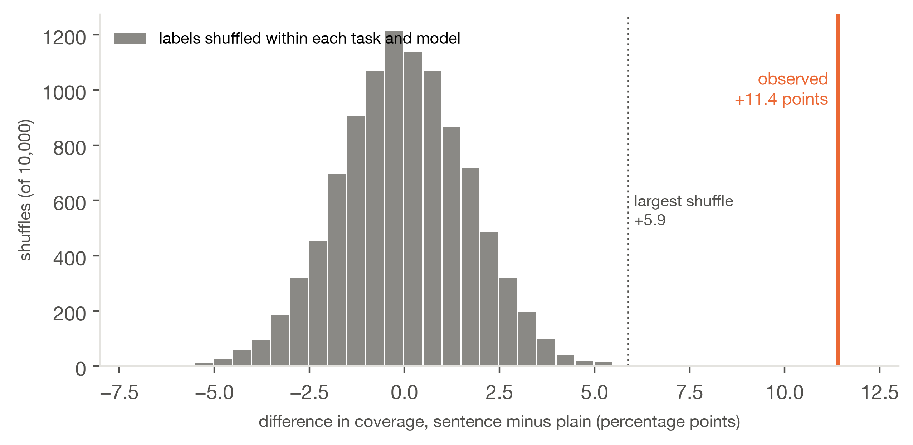

A percentile bootstrap, which recomputes the difference on many random resamples of the data, was not planned by the protocol and is reported as description only. Resampling replicates inside each cell, it gives a 95% interval of 8.9 to 14.0 points for the pooled difference, 6.8 to 14.1 for Opus 5.5 and 8.8 to 16.2 for Sonnet 5.5 (Flores, 2026b). The interval reflects variation between runs on these twelve tasks, not between tasks.

Figure 10 and Table 6 show the result task by task. The gain is not carried by a few tasks. The single negative stratum is the slug change in Go on Sonnet 5.5 (U02, −5 points), and the stratum at zero is the data export on Sonnet 5.5 (U06), where both conditions already covered 73% (Table 6).

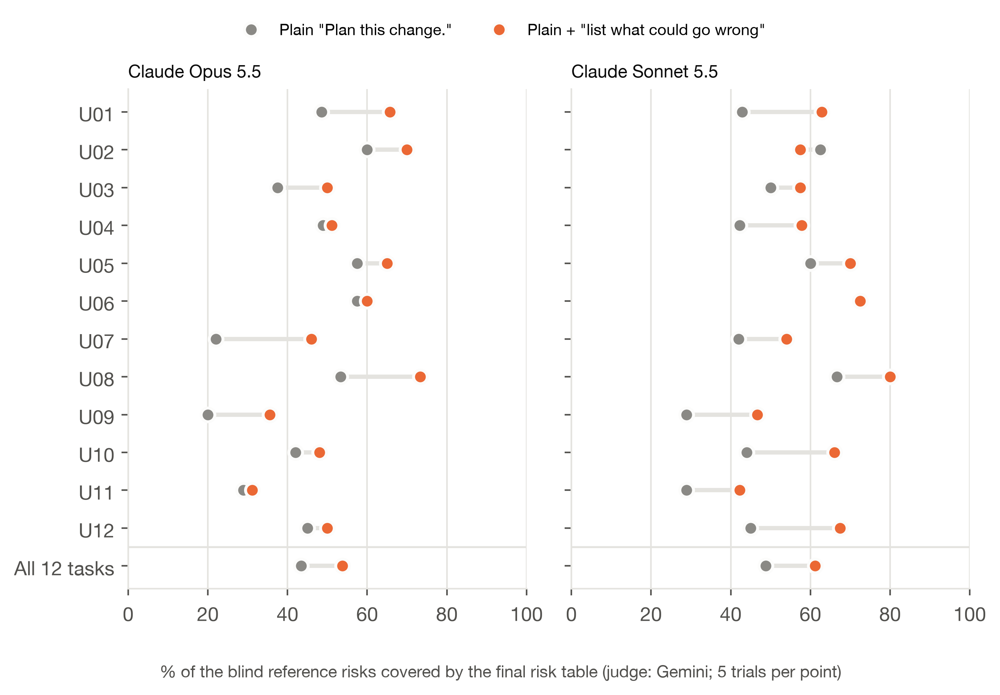

**Table 6.** Risk coverage per task and model, primary judge, in per cent.

| Task | Reference risks | Opus 5.5 plain | Opus 5.5 sentence | Sonnet 5.5 plain | Sonnet 5.5 sentence |
|---|---|---|---|---|---|
| U01 | 7 | 49 | 66 | 43 | 63 |
| U02 | 8 | 60 | 70 | 63 | 58 |
| U03 | 8 | 38 | 50 | 50 | 58 |
| U04 | 9 | 49 | 51 | 42 | 58 |
| U05 | 8 | 58 | 65 | 60 | 70 |
| U06 | 8 | 58 | 60 | 73 | 73 |
| U07 | 10 | 22 | 46 | 42 | 54 |
| U08 | 6 | 53 | 73 | 67 | 80 |
| U09 | 9 | 20 | 36 | 29 | 47 |
| U10 | 10 | 42 | 48 | 44 | 66 |
| U11 | 9 | 29 | 31 | 29 | 42 |
| U12 | 8 | 45 | 50 | 45 | 68 |

*Note.* Each cell is the mean of five trials. Three plain cells hold one trial that ended in a network error and counts as zero: U07 and U09 on Opus 5.5 and U10 on Sonnet 5.5. Over their four other trials those cells are 28, 25 and 55.

### 5.3. Second judge

The second judge gave 50.0% without the sentence and 60.8% with it: a mean difference of 10.7 points over the strata (p < .001), 9.3 points within Opus 5.5 and 12.1 within Sonnet 5.5 (each p < .001; Table 5), positive in 22 of the 24 strata by this judge as well (Flores, 2026b). It marks slightly more risks as covered than the primary judge in both conditions and reaches the same decision.

The two judges made 2,000 decisions each, one per reference risk per trial, and agreed on 93.2% of them. Cohen's κ, introduced in Section 4.5 (Cohen, 1960), is .86. Of those decisions, 29 concern the three trials without a table, where both judges could only answer "not covered"; over the other 1,971 the agreement is 93.1% and κ is .86. The lexical matcher scored 3.0% and 1.3%; as in the originating study, it misses paraphrased matches and is not used here as evidence of coverage (Flores, 2026a).

### 5.4. Relevance

Over the trials that produced a table, the share of rows that the primary judge called concrete and plausible was 71.1% without the sentence and 73.9% with it (Table 7). Under the fixed rule, which scores the three trials without a table as zero, the plain figure is 69.4%. No reduction in mean judged relevance was observed, which is the reading the protocol fixed. The study sets no non-inferiority margin, the largest drop in relevance that would still count as no loss, so this does not prove that the coverage gain came with no vaguer rows, the risk that the human literature points to (Mitchell et al., 1989). No rise in relevance is claimed: the pooled difference of 4.5 points has p = .011 under the fixed rule, but neither model reaches .05 on its own (.052 and .060), and the difference is not significant once the error trials are set aside (Table 7).

Tables held 9.2 rows without the sentence and 9.6 with it, against a cap of ten (Table 8). Coverage is a measure of recall, the share of the reference items that an answer finds, so a longer table has more chances to match a reference risk. Restricting the comparison to the trials whose table has the full ten rows, 56 plain and 82 with the sentence, leaves the difference at 11.3 points over the 17 strata where both conditions remain (Flores, 2026b). The length of a table is itself an effect of the request, so this restricted comparison describes and does not isolate a cause; it shows that the gain is present among tables of equal length.

### 5.5. Sensitivity to the three error trials

During a short loss of internet access, three trials ended with an error after ten retries and produced no table (Flores, 2026b). By the rule fixed in advance they count as zero (Section 4.6). All three belong to the plain condition, so the rule moves the primary difference toward the hypothesis. The protocol had not planned for this, and a check labelled as unplanned repeats the analysis in two ways (Table 7).

**Table 7.** The primary analysis with and without the three network-error trials.

| Analysis | Strata | Primary judge | Second judge | Relevance |
|---|---|---|---|---|
| As pre-registered (errors count zero) | 24 | +11.4 (p < .001) | +10.7 (p < .001) | +4.5 (p = .011) |
| Without the three strata that hold an error | 21 | +10.1 (p < .001) | +8.9 (p < .001) | +2.5 (p = .091) |
| Without the three trials only | 24 | +10.5 (p < .001) | +9.7 (p < .001) | +2.9 (p = .054) |

*Note.* Differences in percentage points, sentence minus plain. Only the first row is confirmatory.

The coverage result holds in every row of Table 7, and within each model: in the most conservative row the per-model differences are 8.5 points for Opus 5.5 (p < .001) and 11.6 for Sonnet 5.5 (p < .001) by the primary judge, and 6.9 (p < .001) and 10.7 (p < .001) by the second. The relevance difference does not hold at the .05 level without the error trials, which is why Section 5.4 states only that no reduction in relevance was observed.

The opposite bound gives the same reading. If each of the three error trials is scored as if its table had covered every reference risk, the difference is 8.9 points by the primary judge and 8.2 by the second (Flores, 2026b).

The three trials were also run once more, two days after collection, as an unplanned addition fixed in a dated addendum before the runs (Section 8). Each ended normally, with a table of 8, 9 and 10 rows. With their coverage in place of the three zeros, the difference on the original lists is 10.5 points (p < .001): 9.0 on Opus 5.5 and 11.9 on Sonnet 5.5 (Flores, 2026b). The rows fixed in advance are unchanged, and Section 5.8 gives the limits of this rerun.

### 5.6. Cost

Mean running time was lower with the sentence, as were turns and output tokens, on both models (Table 8). The protocol lists these measures as descriptive and attaches no test to them, so they are reported as description (Flores, 2026b). They support one statement only: no added cost was observed.

One difference in behaviour lies behind part of these figures. In plan mode the agent may save its plan to a file with a tool call before it answers (Anthropic, 2026). On Opus 5.5 it did so in 59 of the 60 plain trials and in 22 of the 60 trials with the sentence; on Sonnet 5.5 it never did, in either condition (Flores, 2026b). Section 7, objection 13, examines whether this difference could explain the gain in coverage. The two Opus 5.5 trials that ended in a network error (Section 5.5) had already saved a plan file when the connection failed, and the one on Sonnet 5.5 had not. A plain trial on Opus 5.5 ran one turn longer on average (Table 8) and was exposed to the outage for longer.

**Table 8.** Mean cost per trial, by condition and model, over the trials that did not end in an error.

| Model | Condition | Seconds | Turns | Output tokens | Table rows |
|---|---|---|---|---|---|
| Claude Opus 5.5 | Plain | 66.5 | 5.8 | 5,801 | 9.2 |
| Claude Opus 5.5 | Sentence | 53.5 | 4.8 | 4,736 | 9.4 |
| Claude Sonnet 5.5 | Plain | 32.9 | 3.5 | 3,014 | 9.3 |
| Claude Sonnet 5.5 | Sentence | 27.3 | 3.2 | 2,469 | 9.7 |
| Both | Plain | 49.6 | 4.7 | 4,395 | 9.2 |
| Both | Sentence | 40.4 | 4.0 | 3,603 | 9.6 |

*Note.* A turn is one exchange between the agent and its tools or the model. 117 plain trials and 120 trials with the sentence.

### 5.7. Which risks the sentence adds (exploratory)

This section was not planned and tests nothing. It looks at the 100 reference risks one by one, by the primary judge, to describe where the gain comes from (Figure 11). In the figure, an orange dot above the diagonal is a risk covered more often with the sentence, a grey dot on it one covered equally often and a blue dot below it one covered less often; a number inside a dot counts the risks at that point.

- **Breadth.** 52 reference risks were covered more often with the sentence, 34 equally often and 14 less often. Counting only differences of ten points or more, 45 gained and 9 lost (Figure 11).
- **Reliability.** The number of reference risks that most trials covered rose from 41 to 56. The sentence mainly turned risks that the agent named sometimes into risks it named most of the time (Figure 11).
- **Blind spots that remain.** 12 reference risks were covered by no trial in either condition, and 13 by no trial with the sentence. They are mostly narrow, file-level consequences, such as a missing composite database index or a storage format that a new hashing scheme would not fit (Flores, 2026b).


The largest gains are risks of interaction between the change and what already exists: an existing sign-up route that logs the user in at once and so bypasses the new email check (U01, from 30% to 100% of trials), existing rows left without a value after a new identifier column is added (U07, from 30% to 90%), and a synchronous password hasher that a memory-hard algorithm would stall (U09, from 20% to 90%). The largest losses are in U02 and U03, on risks that the plain plan already named in most trials (Flores, 2026b). Appendix B shows the same reading for one whole list.

### 5.8. A second yardstick, worded differently (exploratory)

This check was specified after the results above were known, and it tests nothing that was pre-registered. It answers objection 1 of Section 7: the reference lists were asked for with words close to the sentence under test. The three reviewers wrote new lists for the twelve tasks under a prompt in which one sentence changed. It asks for "the main risks of this change", which are the words of the output contract that both conditions receive, and the words "go wrong" do not appear (Flores, 2026b). The rule that merges the lists, the 240 answers, the judge's prompt and the statistic stayed as they were. The addendum, the prompt and the code were sealed in the ledger and timestamped before the first reviewer was called (Table 4).

The new lists hold 111 reference risks, between 7 and 11 per task. Against them the primary judge gives 55.8% without the sentence and 62.5% with it: a mean difference of 6.7 points (p < .001), 6.5 on Opus (p = .002) and 6.9 on Sonnet (p = .001). Of the 24 strata, 16 are positive, 2 are zero and 6 are negative (Table 9).

**Table 9.** Risk coverage against the two yardsticks, primary judge.

| Yardstick, by the words of its prompt | Reference risks | Plain | With the sentence | Difference | p | Positive strata |
|---|---|---|---|---|---|---|
| Original: "ways this change could go wrong" | 100 | 46.1% | 57.5% | +11.4 | < .001 | 22 of 24 |
| Second: "the main risks of this change" | 111 | 55.8% | 62.5% | +6.7 | < .001 | 16 of 24 |

*Note.* Differences are in percentage points, as the mean over the 24 task-by-model strata; p is from the stratified permutation test of Section 4.6. The second row is exploratory and was computed after the first was known.

The difference stays positive when the request to the reviewers no longer uses the words of the sentence, which the addendum, sealed before the lists were written, read as a gain not tied to that wording (Flores, 2026b). This does not exclude an effect of wording at the later steps that build the yardstick, described below. The difference is also smaller. 6.7 points lies below the bootstrap interval of the original estimate, 8.9 to 14.0 (Section 5.2), and the effect is less uniform across tasks (Table 9). Under the new lists the plain request gains about ten points of coverage and the request with the sentence gains five. Objection 1 is therefore upheld in part.

The data do not say how much of the gap between 11.4 and 6.7 comes from the wording. This is one new elicitation; the two sets of lists differ in size and in content, and a higher starting coverage leaves less room to gain (Table 9). Three limits apply to this check. The prompt that merges the three lists was kept as it was, and it still describes them as "ways a software change could go wrong"; the check therefore removes those words from the request to the reviewers and not from the whole construction of the yardstick (Flores, 2026b). Gemini wrote the wording of 98 of the 111 reference risks and was its only judge in the planned analysis, the concentration that objection 3 of Section 7 describes. The planned second judge reached its usage limit after 11 of 240 verdicts; the addendum forbids substituting a judge, so its verdicts are not in this version (Section 8).

Three further checks on this yardstick were requested in the blind review of this manuscript and added after its result was known; none is in the addendum (Section 8). The three network-error trials are all plain trials and count as zero here too. Without the three strata that hold them the difference is 5.3 points (p < .001), and without the three trials it is 5.6 (p < .001). At the opposite bound, with each error trial scored as full coverage, it is 4.2 points (p = .005): 5.3 on Sonnet 5.5 (p = .010) and 3.2 on Opus 5.5, where it is no longer significant (p = .099). The reading fixed in the addendum rests on the combined test and holds under every handling; the separate result on Opus 5.5 does not hold at that bound (Flores, 2026b). The bootstrap interval of the second difference is 4.1 to 9.4 points and overlaps the original interval, 8.9 to 14.0. Resampling the twelve tasks, and not the replicates, widens it to 2.2 to 11.1, against 8.2 to 14.5 for the original yardstick.

Two additions followed the second round of review, each fixed in a dated addendum that was sealed and timestamped before its first call (Section 8). First, the three error trials were run once more, one attempt each, with the same prompt, pinned commit, model identifier and Claude Code version; all three ended normally (Section 5.5). Second, GPT-6 Astra, a model of a third vendor, scored the 240 answers and the three reruns against the second yardstick with the unchanged judge prompt, as a judge that was not planned (Table 10). It does not replace the planned second judge, whose verdicts are still owed (Flores, 2026b).

**Table 10.** The difference on the second yardstick under three handlings of the error trials, by judge.

| Handling of the three error trials | Judge | Difference | Opus 5.5 | Sonnet 5.5 |
|---|---|---|---|---|
| Count zero, as fixed in advance | Gemini 3.8 Flash | +6.7 (p < .001) | +6.5 (p = .002) | +6.9 (p = .001) |
| Count zero, as fixed in advance | GPT-6 Astra | +9.0 (p < .001) | +8.1 (p < .001) | +9.8 (p < .001) |
| Scored as full coverage | Gemini 3.8 Flash | +4.2 (p = .005) | +3.2 (p = .099) | +5.3 (p = .010) |
| Scored as full coverage | GPT-6 Astra | +6.5 (p < .001) | +4.7 (p = .013) | +8.2 (p < .001) |
| Run once more | Gemini 3.8 Flash, by API | +5.6 (p < .001) | +4.9 (p = .009) | +6.4 (p = .002) |
| Run once more | GPT-6 Astra | +7.7 (p < .001) | +6.2 (p < .001) | +9.1 (p < .001) |

*Note.* Differences in percentage points, sentence minus plain, with the permutation p of Section 4.6. Every row is exploratory. In the fifth row the Gemini verdicts on the three reruns came through a paid API, not through the command-line client of the 240 sealed verdicts.

Every row of Table 10 is positive, and the pooled test stays below .05 in each. By GPT-6 Astra the difference under the fixed rule is 9.0 points, from 64.0% to 73.0%, with 20 of 24 strata positive, and it stays significant on each model at the opposite bound, where Gemini's separate result on Opus 5.5 did not hold. With the trials run once more, both judges give a significant difference on both models. The two judges agree on 89.4% of 2,192 single decisions (Cohen's κ = .77), and GPT-6 Astra marks more items as covered, 68.8% against 59.0% (Flores, 2026b).

These additions carry their own limits. The rerun was made two days after collection by an operator not blind to the result, and nothing observable proves that the model behind an identifier had not changed; the session model, the models used and the plugins that the three sessions report are those of the sealed trials. GPT-6 Astra shares a vendor with GPT-OSS 120B, which wrote one of the three reviewer lists. The primary judge reached its command-line usage limit after 4 of its 9 verdicts on the reruns; by the author's decision, recorded in a third addendum, all 9 were produced by the same model through a paid API instead of waiting for the limit to reset, a further deviation. A sample of 30 sealed trials, fixed by a seed and scored through that channel, agrees with the sealed verdicts on 98.2% of 281 decisions (κ = .96), with a mean coverage of 56.0% against 56.4%. The command-line verdicts will be reported next to these when the limit resets (Flores, 2026b).

---

## 6. Discussion

**What was confirmed.** Asking a coding agent for the ways a change could go wrong, before it plans, makes its final list of risks cover more of what three independent reviewers expected (Table 5). The effect replicated across a second study, twelve new tasks and a second model, at a size close to that of the originating study: +10 points there (Table 1), +11 here. Against a second yardstick, elicited with other words, the gain is smaller, 6.7 points, and still positive (Section 5.8). It is modest in absolute terms: the agent still misses about four reference risks in ten. Figure 12 puts the main estimates of the difference side by side; the later additions are in Table 10.

**A possible reading.** The two conditions end with the same demand for a risk table, so the agent is asked about risk in both. What differs is that the failure modes are requested first and in other words. This matches the explanation offered for InvThink, that enumeration brings out knowledge a direct request leaves unused (Kim et al., 2026), and the exploratory finding that the sentence mostly makes occasional risks regular (Figure 11). The study does not test this reading. An ablation (a rerun with one element changed) that moved the same sentence after the plan would.

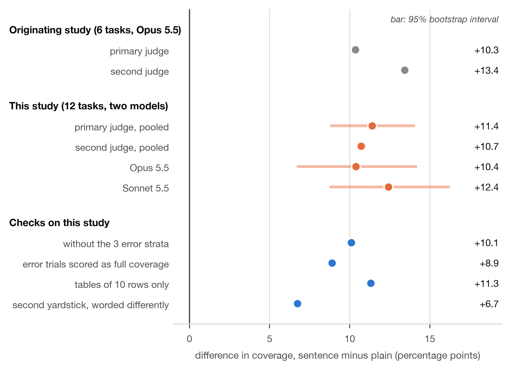

**The procedure–coverage trade-off.** In the originating study a 13-phase protocol covered fewer reference risks in its final table than this sentence, at three times the running time (Table 1). More procedure bought less coverage. The two studies do not show that structure is useless; multi-agent pipelines add failure modes of their own (Cemri et al., 2025). They show that a structured protocol has to be measured against the sentence, which is the cheap baseline, and that being better than a plain request is not enough.

**Plans are not code.** A prompt that asks a coding agent to forecast edge cases raised the joint rate of resolved tasks that avoid a later defect for one Claude model and lowered it for another (Patel et al., 2026). A plan that names a risk does not guarantee code that handles it, and nothing in Table 5 says otherwise.

**For practice.** The intervention is one sentence at the start of a planning request, and no added cost was observed in these runs (Table 8). A team using a coding agent in plan mode can adopt it without tooling. What the team should not conclude is that the resulting plan is safe: its table named 58% of the reference risks, the human work of review that remains was not measured, and the twelve risks that no trial named (Section 5.7) are a reminder that the agent's blind spots and its reviewers' attention do not fully overlap.

---

## 7. Objections and threats to validity

This section takes the objections one by one. They follow the usual classes of threats in empirical software engineering (Wohlin et al., 2012) and the cautions raised for studies that use LLMs (Sallou et al., 2024; Baltes et al., 2026). Before this version was written, the manuscript and its data were given to two models of other vendors, each asked independently to act as a hostile reviewer; both raised objection 1. One of them was then given the sentence under study itself, turned on the manuscript: before this paper is published, list the ways it could go wrong. That request produced objection 13, which neither review had raised. The repository holds the three reports (Flores, 2026b).

**1. The yardstick was elicited with the words of the sentence under test (construct).** The reviewers who wrote the reference lists were asked for "the concrete ways this change could go wrong" (Appendix A). The condition under test asks the agent to "list the ways this change could go wrong", and the plain condition never sees those words. Part of the gain could therefore be a match between the tested answers and the question that produced the yardstick, and not more of the change's real risks. Both conditions are scored against the same lists, which protects the comparison from differences between lists; it does not protect it from a treatment that steers the agent toward the reviewers' framing. Nothing in the pre-registered data separates the two readings. The relevance measure, which does not use the reference lists, shows no reduction in the mean judged relevance of the rows (Section 5.4), and that is a partial answer only. A second yardstick, elicited with the words of the output contract that both conditions receive, was specified after these results were known, in a dated addendum sealed before its collection (Flores, 2026b). Against it the difference is 6.7 points (p < .001), positive on both models and about four tenths smaller than the pre-registered estimate (Section 5.8). Under the other handlings of the error trials and by a judge of a third vendor it ranges from 4.2 to 9.0 points, and only its separate value on Opus 5.5 at the opposite bound is not significant (Table 10). The objection is upheld in part: the gain does not vanish when the request to the reviewers stops using the sentence's words, although the prompt that merges the lists keeps related words (Section 5.8), and its size does depend on the yardstick.

**2. The reference lists were written by models (construct).** Coverage measures agreement with what three LLMs of other vendors expected to go wrong, filtered to items at least two of them named (Section 4.4). It is not a measure of real risk. A risk that all three reviewers missed cannot be credited. Nor can a risk that only one of them named: the merge keeps a risk when at least two reviewers name it, which leaves out 132 of the 232 groups of the original lists and 102 of the 213 of the second (Flores, 2026b). That filter may favour the risks that models tend to repeat over those that one reviewer alone saw, and no human has audited the groups left out. In the field experiment of Caraeni et al. (2026), human planners captured context-specific risks that the model working alone did not, so a human yardstick could change the absolute figures. The first next step in Section 9 addresses this. Coverage also gives every reference risk the same weight, whatever the severity of the failure it names.

**3. One model holds four roles (construct).** Gemini 3.8 Flash wrote one reviewer list, grouped the items, is the primary judge of coverage and the only judge of relevance, and 91 of the 100 reference risks carry its wording (Table 3). A judge may match its own wording more readily (Panickssery et al., 2024). The second judge is the control for this: Grok wrote none of the reference wording, and it finds a gain of 10.7 points against 11.4 (Table 7). Relevance has no such control, which is a second reason to claim only that no reduction was observed. On the second yardstick, where 98 of the 111 risks carry Gemini's wording, a judge of a third vendor finds a larger gain than Gemini does (Table 10).

**4. The outcome is the final table (construct).** The judge sees only the rows of the table. An agent that lists failure modes first may simply copy that list into the table, and the study did not measure whether the plan itself addresses the risks, whether the risks are true of the codebase, or whether code written from the plan has fewer defects. The nearest study with an outcome in code found model-dependent results (Patel et al., 2026). The claim is about what the plan's risk table names.

**5. The design does not separate position from wording (internal).** The sentence differs from the plain request in what it asks and in when it asks (Appendix A). Section 6 offers order as a reading and does not test it. The ablation is the third next step in Section 9.

**6. The three error trials favour the hypothesis (internal).** All three fall in the plain condition and count as zero under the fixed rule. Without them the result holds (Table 7; Section 5.5).

**7. Longer tables could explain higher recall (internal).** Tables with the sentence have 0.4 more rows on average (Table 8). Among trials with the full ten rows the difference is 11.3 points (Section 5.4).

**8. The judge could sense the condition (internal).** The judge is not told the condition, and the word list replaced before judging was not designed for these two conditions (Section 4.5). A judge could infer the condition from the style of a table. The study has no measure of this. Two judges of different vendors agree on 93.2% of decisions (Section 5.3), which bounds judge noise and not a bias they might share. The judge also decides all reference risks of an answer in one call, so those decisions are not independent (Flores, 2026b).

**9. The repositories are public and may be in the models' training data (external).** Several tasks use widely copied example projects (Table 2). The agent may recall known pitfalls of those projects, and the sentence may help retrieval more than reasoning. Both conditions use the same repositories, so this affects the meaning of the effect and not its existence; cautions about data leakage in LLM studies apply (Sallou et al., 2024).

**10. Two models of one vendor are a weak test of generality (external).** Claude Opus 5.5 and Claude Sonnet 5.5 share a vendor, a harness and a mode. In the study of Patel et al. (2026), a forecasting prompt moved two models of one family in opposite directions, so agreement between the two models here is informative; it says nothing about another vendor's models, another agent, private codebases or an interactive session.

**11. The sentence is half a pre-mortem (construct).** Klein's exercise includes the assumption that the plan has failed (Klein, 2007). The sentence omits it, and the condition with Klein's full framing, which the protocol allowed as exploratory, was not run (Section 8). This paper uses "pre-mortem" for the family of the instruction and makes no claim about the assumption of failure.

**12. Time and author (internal).** Collection was paused for four days and resumed on the same version of Claude Code; because the order was a seeded shuffle, both conditions are spread across both periods (Section 8). The author chose the tasks knowing the earlier result, fixed them before the reference lists existed (Table 4), and maintains ASP, the tool whose protocol this sentence outperformed (Flores, 2026a).

**13. On one model the conditions differ in a tool call (internal).** On Opus 5.5 the plain request led the agent to save a plan file in 59 of 60 trials, against 22 of 60 with the sentence (Section 5.6). An agent that has written its plan to a file may give a shorter final answer, and the table is scored from the final answer. Sonnet 5.5 is the control: it saved no plan file in any trial, and its gain is the larger of the two, 12.4 points (Table 5). Among the Opus 5.5 trials that did save the file, the difference is 7.5 points over the 10 strata where both conditions remain (Flores, 2026b). Saving the file is itself a response to the request, so these comparisons describe and do not isolate a cause. They show that the gain appears without the tool call, on Sonnet 5.5; the tool call may explain part of the lower cost on Opus 5.5.

**14. Three limits named in review (construct).** With the sentence the agent used fewer turns (Table 8), so it may have read less of the repository before answering, and this study does not measure how far the listed risks rest on the code. The table is capped at ten rows and both conditions nearly fill it, so the measure is which risks enter the first ten, not how many risks the agent could name. The judge decides every reference risk of an answer in one call and in a fixed order, so an effect of position on its decisions is not excluded (Flores, 2026b).

**Conclusion validity.** One primary test carries the decision; secondary measures are reported as such, and every unplanned analysis is labelled as unplanned (Section 8), the separation that pre-registration exists to protect (Nosek et al., 2018). Five replicates per cell give coarse stratum means; the test pools 24 strata and does not rely on any one of them (Table 6). The tests treat the twelve tasks as fixed, and both models share them; resampling whole tasks gives 8.2 to 14.5 points for the pre-registered difference and 2.2 to 11.1 for the second yardstick (Section 5.8). Every p-value and interval here is conditional on the reference lists, their merge and the verdicts as collected; none includes the variation that a new elicitation, a new merge or a new judging would add, and the gap between the two yardsticks and between the two judges of the second shows that this variation is not small.

---

## 8. Deviations from the protocol

The protocol file records each deviation with its date (Flores, 2026b). In summary:

1. **A folder conflict fixed in the first minutes.** The trials numbered t001 to t090 failed at the cloning step, before any call to the model, because the folder for the repository copies still held copies from the earlier study. Trials t091 to t096, whose folders did not exist, ran first and are kept. The folder name was changed and collection resumed in the seeded order. Prompts, models, tasks, scoring and analysis did not change.
2. **A four-day pause.** Collection stopped after 38 trials, when the computer running it was shut down. Trials in flight at that moment left no record and ran again on resume. Their number and conditions were not recorded, so a selection by duration among the trials running at that moment can be neither measured nor ruled out. The computer updated Claude Code during the pause; the remaining trials ran on the version of the first 38, installed separately.
3. **Machine paths removed from three answers.** Answers t006, t022 and t023 named a file of the operator's computer by its full path, outside the risk table. The path was replaced by a marker, each corrected file received a new ledger entry, and from the resumed trials on the runner applies the same markers before saving.
4. **Three network-error trials,** handled as fixed in advance and examined in Section 5.5.
5. **A pause in scoring.** The primary judge reached its usage limit after 225 of 240 verdicts. The remaining 15 were produced by the same model with the same command after the limit reset. No judge was substituted.
6. **An exploratory condition that did not run.** The protocol allowed, if usage remained, a third condition with Klein's full framing: "Imagine it is a month from now and this change has failed. Before planning, list why it failed." It has no trials and no bearing on the result.
7. **Unplanned analyses,** each labelled where it appears: the sensitivity check and its opposite bound, the bootstrap interval, Cohen's κ, the full-table comparison, the plan-file comparison and the item-level description.
8. **The second yardstick,** exploratory and specified after the result (Section 5.8). The primary judge reached its usage limit after 208 of its 240 verdicts, which resumed after the reset with the same model and command. The second judge reached its limit after 11 verdicts, and the limit had not reset when this version was written. Three checks on it were added afterwards, at a reviewer's request (Section 5.8).
9. **A rerun of the three error trials and a third judge,** both unplanned and fixed in a second addendum before any call (Sections 5.5 and 5.8). The primary judge reached its command-line usage limit after 4 of its 9 verdicts on the reruns. By the author's decision, recorded in a third addendum before the calls, all 9 were produced by the same model through a paid API, with a channel check on 30 sealed trials. That addendum said the full API reply would be saved with each verdict; the code saved the reply text, the model, the provider, the token counts and the request identifier. The command-line verdicts are still owed.

---

## 9. Conclusion

One sentence that opens a planning request in place of "Plan this change.", "Before planning, list the ways this change could go wrong.", raised the share of independently listed risks that a coding agent's plan covers from 46% to 58%, in a pre-registered confirmatory study of 240 trials, on both models tested and by two judges (Table 5). The listed risks were not judged less concrete, and no added cost was observed (Section 5.4; Table 8). The finding replicates a secondary result of an earlier study on new tasks and a second model (Flores, 2026a).

The limits are those of Section 7: the yardstick and the judges were models, the yardstick was elicited with words close to the sentence, and a second yardstick elicited with other words gives a smaller gain of 6.7 points (Section 5.8), the two agents share a vendor, and the outcome is what a plan's table says, not what code does. The next steps follow from them, in the order intended: (i) a human engineer scoring a sample of the reference lists and of the judges' decisions, and reference risks taken from real defects, which no prompt elicited; (ii) the same design on a model of another vendor; (iii) an ablation that separates listing risks *first* from listing them at all, and that adds Klein's assumption of failure (Klein, 2007); and (iv) an outcome in code, by implementing the plans of both conditions and running the projects' tests, as Patel et al. (2026) do for a longer prompt.

---

## 10. Data and code availability

The material behind every number in this paper is in the public repository `anticipating-shadow-points` (Flores, 2026b), which Table 11 describes.

A single command, `python run_all.py`, recomputes every result of the study reported in this paper from the stored answers and verdicts and calls no model; it needs Python 3.11 or newer (Flores, 2026b). Running the trials again needs a Claude subscription and access to the two judge models, which may have changed since November 2026.

**Table 11.** What the repository holds for this paper.

| Material | Where in the repository | What a reader can check with it |
|---|---|---|
| Protocol, deviations and the three addenda | `PROTOCOL.md`, `yardstick2/`, `addendum2/`, `addendum3/` | What was fixed before the data and what changed afterwards |
| Tasks and prompts | `tasks.json`, `run.py`, `prompts/` | The exact text each trial and reviewer received |
| Reference lists and their merge | `lists/` | The 369 reviewer items and the 100 reference risks |
| The 240 answers and run records | `runs/` | Each reply and the record of each run |
| The 720 verdicts | `judge/` | Every decision, with the prompt that produced it |
| Analysis and checks | `analyze.py`, `sensitivity.py`, `describe.py`; `tests/test_paper3_numbers.py` | How each number is computed, and that the text matches the data |
| Ledger and timestamps | `ledger.jsonl`, `*.ots` | That each file matches its latest entry, and the order of the sealed events within the limits given in Section 4.7 |
| Outside reviews of this manuscript | `docs/paper/review/` | The reports behind Section 7 |
| The originating study | `benchmark/study-2026-11/` | The same material for the 90 trials of Section 3 |

*Note.* Paths without a folder in front are inside `benchmark/study-2026-11b/` (Flores, 2026b). Run records have machine paths removed.

## 11. Declarations

**Conflict of interest.** The author maintains ASP, the plugin whose protocol the originating study compared with the tested sentence, and directs the laboratory that publishes it. The result reported here is unfavourable to that protocol (Flores, 2026a).

**Funding.** This work received no external funding. The costs of using the models were paid by the author.

**Author contribution.** Single author: conception, design, data collection, analysis, writing and revision.

**Use of AI tools.** Language models take four roles in this study, all described in Section 4: the agents under test, the writers of the reference lists, the judges, and the blind reviewers of the manuscript (Flores, 2026b). An AI assistant was also used in programming, in the analysis, and in drafting and translating the text, under the author's direction. The author checked every number against the data and is responsible for the content.

---

## References

Anthropic. (2026). *Choose a permission mode* [Software documentation]. https://code.claude.com/docs/en/permission-modes

Baltes, S., Angermeir, F., Arora, C., Muñoz Barón, M., Chen, C., Böhme, L., Calefato, F., Ernst, N., Falessi, D., Fitzgerald, B., Fucci, D., He, J., Treude, C., Kalinowski, M., Lambiase, S., Russo, D., Lungu, M., Martinez Montes, C., Prechelt, L., Ralph, P., van Tonder, R., & Wagner, S. (2026). Guidelines for empirical studies in software engineering involving large language models. *Empirical Software Engineering, 32*(2), Article 64. https://doi.org/10.1007/s10664-026-10922-3

Caraeni, A., Shick, A., & Lan, A. (2026). *Cognitive offloading in agile teams: How artificial intelligence reshapes risk assessment and planning quality*. arXiv:2604.13814. https://arxiv.org/abs/2604.13814

Cemri, M., Pan, M. Z., Yang, S., Agrawal, L. A., Chopra, B., Tiwari, R., Keutzer, K., Parameswaran, A., Klein, D., Ramchandran, K., Zaharia, M., Gonzalez, J. E., & Stoica, I. (2025). Why do multi-agent LLM systems fail? *Advances in Neural Information Processing Systems, 38*, 135676–135729. https://doi.org/10.52202/085713-4082

Cheng, Z., & Mastropaolo, A. (2026). *An empirical study on the effects of system prompts in instruction-tuned models for code generation*. arXiv:2602.15228. https://arxiv.org/abs/2602.15228

Cohen, J. (1960). A coefficient of agreement for nominal scales. *Educational and Psychological Measurement, 20*(1), 37–46. https://doi.org/10.1177/001316446002000104

Ernst, M. D. (2004). Permutation methods: A basis for exact inference. *Statistical Science, 19*(4), 676–685. https://doi.org/10.1214/088342304000000396

Flores, C. U. (2026a). *ASP: An operational pre-mortem skill for LLM coding agents — An experience report* (Version 2.4) [Technical report]. Zenodo. https://doi.org/10.5281/zenodo.24065968

Flores, C. U. (2026b). *ASP — Anticipating Shadow Points: Claude Code plugin and replication package* (Version 2.0.0) [Computer software]. GitHub. https://github.com/ulissesflores/anticipating-shadow-points https://doi.org/10.5281/zenodo.20276631

Fröhling, L., Giaconia, A., Bogucka, E. P., & Quercia, D. (2026). Agent-supported foresight for AI systemic risks: AI agents for breadth, experts for judgment. In *Proceedings of the 2026 CHI Conference on Human Factors in Computing Systems* (pp. 1–48). ACM. https://doi.org/10.1145/3772318.3790712

International Electrotechnical Commission. (2019). *Risk management — Risk assessment techniques* (IEC 31010:2019, Edition 2.0). https://webstore.iec.ch/en/publication/59809

Jimenez, C. E., Yang, J., Wettig, A., Yao, S., Pei, K., Press, O., & Narasimhan, K. (2024). *SWE-bench: Can language models resolve real-world GitHub issues?* ICLR 2024. https://arxiv.org/abs/2310.06770

Kharma, M., Sabbah, A., Alkhanafseh, M., Hammoudeh, M., & Mohaisen, D. (2026). *An empirical evaluation of LLM-generated code security across prompting methods*. arXiv:2605.24298. https://arxiv.org/abs/2605.24298

Kim, Y., Kim, T., Park, E., Park, C., Breazeal, C., McDuff, D., & Park, H. W. (2026). *InvThink: Premortem reasoning for safer language models* (Version 3). arXiv:2510.01569. https://arxiv.org/abs/2510.01569

Klein, G. (2007). Performing a project premortem. *Harvard Business Review, 85*(9), 18–19. https://hbr.org/2007/09/performing-a-project-premortem

Kojima, T., Gu, S. S., Reid, M., Matsuo, Y., & Iwasawa, Y. (2022). Large language models are zero-shot reasoners. In *Advances in Neural Information Processing Systems, 35*. https://arxiv.org/abs/2205.11916

Mitchell, D. J., Russo, J. E., & Pennington, N. (1989). Back to the future: Temporal perspective in the explanation of events. *Journal of Behavioral Decision Making, 2*(1), 25–38. https://doi.org/10.1002/bdm.3960020103

Nosek, B. A., Ebersole, C. R., DeHaven, A. C., & Mellor, D. T. (2018). The preregistration revolution. *Proceedings of the National Academy of Sciences, 115*(11), 2600–2606. https://doi.org/10.1073/pnas.1708274114

Panickssery, A., Bowman, S. R., & Feng, S. (2024). LLM evaluators recognize and favor their own generations. In *Advances in Neural Information Processing Systems, 37*. https://doi.org/10.52202/079017-2197

Patel, S., Liao, M., Henderson, P., He, H., & Chen, V. (2026). *Do coding agents catch their own bugs? (They don't.)*. arXiv:2611.01181. https://arxiv.org/abs/2611.01181

Phipson, B., & Smyth, G. K. (2010). Permutation p-values should never be zero: Calculating exact p-values when permutations are randomly drawn. *Statistical Applications in Genetics and Molecular Biology, 9*(1). https://doi.org/10.2202/1544-6115.1585

Sallou, J., Durieux, T., & Panichella, A. (2024). Breaking the silence: The threats of using LLMs in software engineering. In *Proceedings of the 2024 ACM/IEEE 44th International Conference on Software Engineering: New Ideas and Emerging Results* (pp. 102–106). ACM. https://doi.org/10.1145/3639476.3639764

Schoenegger, P., Jones, C. R., Tetlock, P. E., & Mellers, B. (2025). *Prompt engineering large language models' forecasting capabilities*. arXiv:2506.01578. https://arxiv.org/abs/2506.01578

Sclar, M., Choi, Y., Tsvetkov, Y., & Suhr, A. (2024). *Quantifying language models' sensitivity to spurious features in prompt design or: How I learned to start worrying about prompt formatting*. ICLR 2024. https://arxiv.org/abs/2310.11324

Tony, C., Díaz Ferreyra, N. E., Mutas, M., Dhif, S., & Scandariato, R. (2025). Prompting techniques for secure code generation: A systematic investigation. *ACM Transactions on Software Engineering and Methodology, 34*(8), 1–53. https://doi.org/10.1145/3722108

Veinott, B., Klein, G. A., & Wiggins, S. (2010). Evaluating the effectiveness of the PreMortem technique on plan confidence. In *Proceedings of the 7th International ISCRAM Conference*. https://web.archive.org/web/20200928015943/http://idl.iscram.org/files/veinott/2010/1049_Veinott_etal2010.pdf

Veinott, E. S., & Lehman, B. R. (2024). Adaptive planning: Comparing human and AI responses in premortem planning. In *HCI International 2024 – Late breaking papers* (pp. 256–268). Springer Nature Switzerland. https://doi.org/10.1007/978-3-031-76827-9_15

Wang, H., Cao, Y., Lin, L., & Chen, J. (2026). *PreFlect: From retrospective to prospective reflection in large language model agents*. arXiv:2602.07187. https://arxiv.org/abs/2602.07187

Wang, H., Li, T., Deng, Z., Roth, D., & Li, Y. (2024). Devil's advocate: Anticipatory reflection for LLM agents. In *Findings of the Association for Computational Linguistics: EMNLP 2024* (pp. 966–978). Association for Computational Linguistics. https://doi.org/10.18653/v1/2024.findings-emnlp.53

Wang, L., Xu, W., Lan, Y., Hu, Z., Lan, Y., Lee, R. K.-W., & Lim, E.-P. (2023). Plan-and-solve prompting: Improving zero-shot chain-of-thought reasoning by large language models. In *Proceedings of the 61st Annual Meeting of the Association for Computational Linguistics (Volume 1: Long Papers)* (pp. 2609–2634). https://doi.org/10.18653/v1/2023.acl-long.147

Wohlin, C., Runeson, P., Höst, M., Ohlsson, M. C., Regnell, B., & Wesslén, A. (2012). *Experimentation in software engineering*. Springer. https://doi.org/10.1007/978-3-642-29044-2

Wu, J. (2026). *AssumptionMiner: Extracting, tracing, and revising implicit assumptions in LLM code generation*. arXiv:2607.22898. https://arxiv.org/abs/2607.22898

Zheng, L., Chiang, W.-L., Sheng, Y., Zhuang, S., Wu, Z., Zhuang, Y., Lin, Z., Li, Z., Li, D., Xing, E. P., Zhang, H., Gonzalez, J. E., & Stoica, I. (2023). *Judging LLM-as-a-Judge with MT-Bench and Chatbot Arena*. NeurIPS 2023 D&B. https://arxiv.org/abs/2306.05685

---

## Appendix A — The exact requests

Table A1 gives the main requests of the confirmatory study; the prompts that merge the lists and judge relevance, and the second request to the reviewers, are in the files that Table 11 lists, and each client adds instructions of its own that are not shown. Curly braces mark the only parts that change from one call to the next. The files that hold these texts are listed in Table 11 (Flores, 2026b).

**Table A1.** The requests sent to the agent, to the reviewers and to the judge.

| Who receives it | Text |
|---|---|
| The agent, plain condition | {change request} Plan this change. {output contract} |
| The agent, sentence condition | {change request} Before planning, list the ways this change could go wrong. {output contract} |
| The output contract, both conditions | Non-interactive run: state your assumptions instead of asking. Do not edit any file. Answer in English. End your answer with the main risks of this change as one markdown table with columns #, Risk, Why it bites here, Mitigation (at most 10 rows, short cells), then one line starting "Riskiest:" naming the riskiest one. |
| Each reviewer | You are a senior software engineer reviewing a change request before anyone implements it. The repository in the current directory is the codebase. Read whatever files you need. Do not modify any file. Change request: {change request} List the concrete ways this change could go wrong in this codebase if it were implemented without care: the problems a careful senior engineer would want addressed before starting. Each item must be specific to this repository and this request, one or two sentences. Answer with a numbered list of 6 to 12 items and nothing else. |
| The coverage judge | A plan for a software change ends with a table of risks. Decide, for each reference problem, whether any row of the table addresses the same underlying problem (names it as a risk or mitigates it specifically), even if worded differently. Change request: {change request} Reference problems: {numbered reference risks} Rows of the risk table: {rows} Answer directly from the text above; do not run commands or use tools. Answer with JSON only, one key per reference number. |

*Note.* Line breaks are removed. The judge's last sentence is followed, in the original, by an example of the expected JSON.

## Appendix B — One reference list in full

Table B1 shows the reference list of task U08, the shortest of the twelve, with the share of trials of each condition whose table covers each risk by the primary judge. It illustrates the pattern of Section 5.7: risks that every plan names in both conditions (rows 1 and 5), risks that the sentence makes regular (rows 4 and 6), and a risk that both conditions mostly miss (row 2). The full lists are in the repository (Flores, 2026b).

**Table B1.** The six reference risks of task U08 (change the default signing digest from SHA-1 to SHA-256) and their coverage.

| # | Reference risk, shortened | Reviewers who named it | Plain | Sentence |
|---|---|---|---|---|
| 1 | Tokens signed by earlier versions with the default settings fail validation after the upgrade, invalidating sessions in downstream projects such as Flask. | 3 | 100% | 100% |
| 2 | Changing the default in the signer and not in the HMAC algorithm class leaves the two defaults out of step. | 3 | 10% | 20% |
| 3 | Key derivation uses the digest too, so the derived key changes in value and grows from 20 to 32 bytes. | 3 | 40% | 50% |
| 4 | Tests assert outputs that match SHA-1 signatures. | 2 | 70% | 100% |
| 5 | Signatures grow from 27 to 43 characters and may overflow database columns, URL limits or cookie sizes. | 2 | 100% | 100% |
| 6 | Documentation examples and doctests hold SHA-1 outputs and state that SHA-1 is the default. | 2 | 40% | 90% |

*Note.* Ten trials per condition (five per model). All six risks carry the wording of the Gemini reviewer. Here a token is a signed value; the digest is the hash function used for signing; the signer is the class that signs; HMAC is a standard method of signing with a secret key and a hash function; doctests are documentation examples that run as tests.

---

## Technical Note

**Version** 1.0 · November 2026

**Series** Codex Hash Research Report 2026-03

**License** Text, figures and data: CC BY 4.0. Companion software: MIT.

**The ASP project.** ASP (Anticipating Shadow Points) is an open-source plugin for Claude Code that makes the agent list what could go wrong before it writes code. Its plugin and replication material sit in one public repository (Flores, 2026b). A whitepaper describes how the plugin works and reports the first measurement of whether it improves an agent's plans, which found no measurable benefit over a one-sentence request (Flores, 2026a). This paper is the confirmatory study of that sentence which the whitepaper announced.

**DOI.** A DOI (Digital Object Identifier) is a permanent link to a deposited work. Zenodo, a public research archive run by CERN, holds this paper as its own record; this version, 1.0, is https://doi.org/10.5281/zenodo.24410437. The plugin, data and code are a separate record (Flores, 2026b) whose concept DOI, https://doi.org/10.5281/zenodo.20276631, always opens the newest release.

**Replication.** Every number this paper computes from its data can be recomputed from the repository without calling a model; Section 10, Data and code availability, lists what is there and how to run it.
---

## About the Author

**Carlos Ulisses Flores** is CTO and Chief Researcher at Codex Hash Research Laboratory, an independent R&D lab in São Paulo, Brazil. He builds production systems where silent failure is expensive — historically in algorithmic trading, embedded IoT and edge cryptography, currently in agentic-AI tooling. This paper grew out of measuring his own planning plugin for coding agents and finding that one sentence did better.

**Identifiers** · ORCID: [`0000-0002-6034-7765`](https://orcid.org/0000-0002-6034-7765) · Lattes (Brazil's national registry of researcher CVs): [`6905246706890561`](http://lattes.cnpq.br/6905246706890561)
**Contact** · c.ulisses@gmail.com · https://ulissesflores.com
